# Documentação IoTDoc - Módulo 4 - Inteli

## Synthetix

### C.R.I.S.I.S - Controle e Resposta Inteligente em Situações de Incidente e Segurança

#### Integrantes:

- Davi Tricarico
- Felipe Rabinovich
- Gustavo Fantasia
- Felipe Escobar
- Lucas Oliveira
- Pedro Negri
- Vinicius Ramos
- Arthur Rodrigues


## Sumário

[1. Introdução](#c1)

[2. Metodologia](#c2)

[3. Desenvolvimento e Resultados](#c3)

[4. Conclusões e Recomendações](#c4)

[5. Referências](#c5)

<br>

# <a name="c1"></a>1. Introdução

A Unipar é uma empresa brasileira do setor químico e petroquímico, com mais de 55 anos de operação, que produz cloro, soda e PVC (Veja [...], 2024). A empresa tem mais de 1.400 colaboradores diretos (Veja [...], 2024) e fechou 2025 com receita líquida consolidada de R$ 5,1 bilhões (Unipar Carbocloro S.A., 2026b). Suas fábricas ficam em Cubatão (SP), Santo André (SP), Bahía Blanca, na Argentina (Veja [...], 2024), e Camaçari (BA), inaugurada em 2025 (Unipar [...], 2025). A Unipar é líder na produção de cloro e soda e a segunda maior produtora de PVC da América do Sul (Unipar [...], 2025).

Este projeto é feito com a fábrica de Cubatão, a unidade com a maior capacidade de produção de cloro da empresa (Unipar Carbocloro S.A., 2023), onde trabalham cerca de 355 funcionários diretos e cerca de 400 de empresas parceiras (informação verbal)[^1]. Em uma emergência, como um vazamento de cloro, essas pessoas precisam sair da área rápido e chegar aos pontos de encontro. Hoje, esse processo é quase todo manual: o alarme é acionado por um operador, a empresa só sabe quem entrou e saiu pela portaria, sem saber onde cada pessoa está dentro da planta, e a confirmação de quem chegou ao ponto de encontro é feita pelos líderes, por chamada. Além disso, durante a emergência, as catracas são liberadas para dar vazão e deixam de registrar quem passa. Com isso, a evacuação fica mais lenta e é difícil saber, rápido, quem ainda não chegou (informação verbal)[^1].

Para isso, a Synthetix propõe o C.R.I.S.I.S, uma solução de Internet das Coisas (IoT) que confirma a chegada de cada pessoa ao ponto de encontro pela leitura do crachá, registra a última zona por onde ela passou e reúne essas informações em uma aplicação web para a equipe de Segurança, Saúde e Meio Ambiente (SSMA) e para o Centro de Controle Operacional (CCO).

[^1]: Informação fornecida por representantes da Unipar na reunião de kickoff do projeto, em 16 de outubro de 2026.

## 1.1 Objetivos

Os objetivos abaixo foram definidos a partir do Termo de Abertura do Projeto (Unipar, 2026a) e da reunião de kickoff com a Unipar (informação verbal)[^1].

**Objetivo geral:** tornar a evacuação das áreas fabris da Unipar em Cubatão mais rápida, precisa e rastreável, permitindo saber quem já chegou aos pontos de encontro e quem ainda precisa ser procurado durante uma emergência (Unipar, 2026a).

**Objetivos específicos:**

1. Confirmar individualmente a chegada de cada pessoa ao ponto de encontro, substituindo a conferência manual por listas.
2. Identificar quem ainda não confirmou a chegada a tempo de a SSMA decidir a busca dentro do prazo interno de 10 minutos informado pela Unipar (informação verbal)[^1].
3. Apoiar a orientação da busca feita pelos brigadistas com a última área registrada de cada pessoa não confirmada.
4. Dar à SSMA e ao CCO uma visão consolidada da evacuação, com a estimativa de pessoas na planta e as confirmações em cada ponto de encontro.
5. Manter registros rastreáveis de cada evacuação, para auditorias, simulados e melhoria do plano de emergência.
6. Proteger os dados dos colaboradores, usando a identificação nominal somente durante a emergência e somente por quem coordena a resposta.

## 1.2 Proposta da solução

O C.R.I.S.I.S, solução proposta pela Synthetix, é um sistema de Internet das Coisas (IoT) que acompanha a evacuação em três pontos da planta e reúne as informações em uma aplicação web:

- **Nas portarias**, sensores contam as entradas e saídas e estimam quantas pessoas estão dentro da planta, sem identificar ninguém.
- **Nas portas das zonas monitoradas**, leitores registram o crachá de quem passa e guardam a última zona de cada pessoa.
- **Nos pontos de encontro**, totens confirmam a chegada de cada pessoa quando ela aproxima o crachá do leitor.

Em uma emergência, o CCO inicia o protocolo na aplicação e indica os pontos de encontro ativos, conforme a orientação da SSMA. A aplicação mostra em um só lugar a estimativa de pessoas na planta, as confirmações em cada ponto e quem ainda não confirmou. Aos 10 minutos, a SSMA recebe a lista de quem não confirmou, com a última zona registrada, e decide a busca dos brigadistas. Os nomes só aparecem enquanto a emergência está ativa e para quem coordena a resposta.

Assim, cada objetivo da seção 1.1 é atendido: a confirmação no totem substitui a lista em papel (objetivo 1); a sinalização aos 10 minutos e a última zona registrada apoiam a decisão e a orientação da busca (objetivos 2 e 3); a aplicação consolida a evacuação e guarda o histórico (objetivos 4 e 5); e a exibição restrita dos nomes protege os dados dos colaboradores (objetivo 6).

O Termo de Abertura do Projeto de Inovação (TAPI) também prevê a orientação da rota de evacuação (Unipar, 2026a). Esse item ficou fora do escopo desta solução por dois motivos. Primeiro, as áreas de processo da Unipar são classificadas, com risco de vazamento e incêndio (Unipar, 2026a), o que restringe a instalação de sinalização eletrônica ao longo das rotas. Segundo, em um vazamento de cloro, o ponto de encontro usado depende da direção do vento e é definido pela SSMA no momento do incidente (informação verbal)[^1]. A solução apoia a orientação de outra forma: o CCO seleciona na aplicação os pontos de encontro ativos indicados pela SSMA, e os brigadistas recebem a última zona registrada de quem ainda não confirmou.

O protótipo da Sprint 1 testou a contagem de entradas e saídas que deu origem ao dispositivo das portarias. A partir da Sprint 2, os protótipos passam a representar os três dispositivos da solução, detalhados nas seções 3.1.3 e 3.3.

## 1.3 Justificativa

O cloro é um gás tóxico e mais denso que o ar, que se acumula perto do solo (NIOSH, 2019). Em um vazamento, cada minuto entre o alarme e a confirmação de que todos saíram conta. Hoje, essa confirmação depende de chamadas com lista e rádio nos pontos de encontro, sob ruído de sirene e vento, e o prazo interno de 10 minutos para decidir a busca corre enquanto os números ainda estão sendo somados (informação verbal)[^1].

**Potencial e benefícios.** A solução troca a chamada manual por uma confirmação feita pela própria pessoa, ao aproximar o crachá do totem. Com isso, a SSMA passa a saber quem já chegou sem esperar a soma das listas, recebe aos 10 minutos quem ainda falta e tem a última zona registrada de cada pessoa para orientar a busca. Cada evacuação também passa a deixar um registro com horários, confirmações e alertas, o que atende ao pedido de rastreabilidade do TAPI (Unipar, 2026a) e serve para auditorias e simulados.

**Por que esta combinação de tecnologias.** Antes de chegar a essa solução, a equipe comparou três abordagens:

- **Contagem anônima nas passagens:** diz quantas pessoas estão na planta, mas não diz quem falta nem onde procurar, e erros de contagem podem se compensar.
- **Identificação individual com localização contínua:** diria onde cada pessoa está, mas exigiria equipamento em toda a área de processo e trataria dados de localização o tempo todo. Além disso, o TAPI deixa a localização precisa em ambientes internos fora do escopo do projeto (Unipar, 2026a).
- **Confirmação por crachá em pontos definidos:** diz quem chegou e qual foi a última zona registrada, mas depende de a pessoa aproximar o crachá e não dá a posição exata.

A solução combina a primeira e a terceira: a contagem anônima nas portarias dá a referência de quantas pessoas estavam na planta, e a leitura do crachá nas zonas e nos pontos de encontro diz quem chegou e onde procurar quem não chegou. Ela evita a localização contínua e reduz o uso de dados pessoais, o que facilita o atendimento à Lei Geral de Proteção de Dados Pessoais (Brasil, 2018): os nomes só aparecem durante a emergência e para quem coordena a resposta.

**Diferencial.** A solução usa o crachá, que já é de uso obrigatório na planta (informação verbal)[^1], em vez de um novo dispositivo por pessoa, e não substitui o procedimento de emergência da Unipar: a decisão da busca continua com a SSMA. Os benefícios ainda dependem de validação em simulados, principalmente quanto ao tempo que a aproximação do crachá acrescenta à chegada nos pontos de encontro.

# <a name="c2"></a>2. Metodologia (sprint 3)

_Descreva as etapas da metodologia RM-ODP que foram utilizadas para o desenvolvimento, citando o referencial teórico. Você deve apenas enunciar os métodos, sem dizer ainda como ele foi aplicado e quais resultados obtidos._

# <a name="c3"></a>3. Desenvolvimento e Resultados

## 3.1. Domínio de Fundamentos de Negócio

_Link para os templates de negócios: https://drive.google.com/drive/folders/1lTqisJ_gxxtc5J5aXM8ula2kQ4MsII_M?usp=sharing_

### 3.1.1. Contexto da Indústria

#### Concorrência

A Unipar atua na indústria química e petroquímica, com foco nos mercados de cloro, soda cáustica, policloreto de vinila (PVC) e derivados. De acordo com o Formulário de Referência 2026 da empresa, seus principais competidores no mercado interno incluem Braskem, Dow, Olin, Chemtrade, Katrium, Chlorum e CMPC. Essa relação deve ser interpretada no nível do portfólio: o documento não afirma que todas essas empresas disputam os mesmos produtos, clientes e regiões com a mesma intensidade. A soda cáustica e o PVC também estão expostos aos preços e estoques internacionais e à entrada de produtos importados. Segundo a própria companhia, os principais fatores de competitividade são a disponibilidade e o custo de matérias-primas, a escala de produção e a localização das unidades (Unipar Carbocloro S.A., 2026a).

#### Modelo de negócio

A Unipar adota um modelo predominantemente _business-to-business_ (B2B), baseado na produção e na comercialização, em grande escala, de insumos utilizados por outras organizações. A empresa atende setores como papel e celulose, alumínio, construção civil, infraestrutura, alimentos, siderurgia e metalurgia, tratamento de água, sabões, detergentes e produtos de limpeza. Essa diversidade reduz a exposição a um único mercado consumidor; em 2025, nenhum cliente respondeu por mais de 10% da receita líquida total da companhia (Unipar Carbocloro S.A., 2026a).

Trata-se de um modelo intensivo em capital, infraestrutura e energia, no qual a competitividade depende da escala, do controle dos custos e da continuidade das operações. A localização das unidades próximas a polos industriais e aos mercados consumidores reduz a distância logística e favorece a confiabilidade do abastecimento, aspecto especialmente relevante para o cloro, cujo transporte apresenta restrições técnicas e de segurança. A proximidade geográfica, associada aos contratos de fornecimento e à autoprodução de energia, contribui para proteger a posição competitiva da empresa, embora não elimine sua exposição aos custos de insumos e aos ciclos internacionais de soda cáustica e PVC (Unipar Carbocloro S.A., 2026a).

#### Tendências do setor

Entre as principais tendências da indústria química e petroquímica estão a descarbonização, a eficiência energética, o uso de fontes renováveis, a modernização tecnológica e a economia circular. Essas tendências afetam tanto os custos operacionais quanto o acesso a capital, a conformidade ambiental e a preferência dos clientes industriais. Na Unipar, esse movimento aparece na substituição das tecnologias de mercúrio e diafragma por células de membrana na fábrica de Cubatão e na ampliação do uso de energia renovável. Em 2025, a companhia informou que 79% da energia elétrica consumida em suas operações veio de fontes renováveis (Unipar, 2026b).

A digitalização e a automação dos processos industriais e administrativos também se destacam. A Indústria 4.0 integra tecnologias como Internet das Coisas, análise de grandes volumes de dados, inteligência artificial, computação em nuvem e sistemas ciberfísicos para criar fábricas mais conectadas e apoiar a melhoria dos processos produtivos (INMETRO, 2026). Nesse contexto, a integração de sistemas, o uso de sensores, a análise de dados e a automatização de tarefas podem melhorar o monitoramento das operações, reduzir atividades repetitivas e apoiar a tomada de decisão.

No mercado brasileiro, a ampliação dos investimentos em saneamento pode favorecer a demanda por cloro e PVC, utilizados, respectivamente, no tratamento de água e em componentes de infraestrutura. Ao mesmo tempo, a indústria permanece exposta às oscilações cambiais, aos preços internacionais, às importações e ao desenvolvimento de materiais e tecnologias alternativas. Esse conjunto de tendências exige investimentos contínuos em inovação, eficiência operacional e sustentabilidade (Brasil, 2020; Unipar Carbocloro S.A., 2026a).

#### Cinco Forças de Porter

O modelo das Cinco Forças de Porter analisa como a rivalidade entre concorrentes, a ameaça de novos entrantes, a ameaça de produtos substitutos e os poderes de negociação de fornecedores e compradores afetam a atratividade e a rentabilidade de um setor (Harvard Business School, [s. d.]). A aplicação a seguir considera conjuntamente os mercados de cloro, soda cáustica e PVC. Como as condições competitivas variam entre esses produtos, as classificações representam uma síntese analítica do portfólio da Unipar, e não uma avaliação oficial divulgada pela companhia.

A Figura 1 apresenta uma visão integrada da análise. A rivalidade ocupa a posição central porque resulta da interação com as outras quatro forças: barreiras de entrada, disponibilidade de substitutos e capacidade de fornecedores e compradores influenciarem custos, preços e condições comerciais. O quadro também antecipa a intensidade atribuída a cada força, permitindo comparar as pressões antes de examinar suas justificativas individualmente.

<div align="center">
  <p>Figura 1 – Cinco Forças de Porter aplicadas à Unipar</p>
  
  <p><sub>Fonte: elaboração dos autores (2026).</sub></p>
</div>

Em síntese, a figura indica que a rivalidade constitui a pressão central e mais intensa, enquanto o poder dos compradores aparece como moderado a alto. O poder dos fornecedores e a ameaça de substitutos possuem intensidade moderada, e a ameaça de novos entrantes é baixa. Essa representação funciona como síntese visual; os fatores que sustentam cada classificação são apresentados a seguir.

##### Rivalidade entre os concorrentes — alta

A rivalidade é classificada como **alta**. A soda cáustica e o PVC seguem referências internacionais de preço e concorrem com importações, o que limita a capacidade de diferenciação e aumenta a pressão sobre custos. No cloro, a competição é mais regional, pois localização e logística têm maior peso. Em todos os mercados, escala produtiva, disponibilidade de matérias-primas e confiabilidade de fornecimento são fatores relevantes. A liderança da Unipar em cloro e soda cáustica e sua posição como segunda maior produtora de PVC da América do Sul fortalecem a empresa, mas não eliminam a pressão exercida por concorrentes locais e produtos importados (Unipar Carbocloro S.A., 2026a).

##### Ameaça de novos entrantes — baixa

A ameaça de novos entrantes é classificada como **baixa** para a instalação de nova capacidade produtiva local. A entrada exige investimento elevado, escala mínima eficiente, tecnologia especializada, licenciamento ambiental, acesso contínuo a energia e matérias-primas e uma estrutura logística compatível com produtos químicos. O novo participante também precisa construir reputação de segurança e confiabilidade perante clientes que dependem de fornecimento contínuo. A entrada por importações, aquisições ou parcerias é mais viável do que a construção de uma nova planta, mas não elimina as barreiras industriais e regulatórias do setor (Unipar Carbocloro S.A., 2026a).

##### Ameaça de produtos substitutos — moderada

A ameaça de produtos substitutos é classificada como **moderada**. Outros plásticos, metais, concreto e vidro podem cumprir funções semelhantes às do PVC em determinadas aplicações, enquanto outros produtos alcalinos podem substituir a soda cáustica em processos específicos. No tratamento de água, ozônio e radiação ultravioleta podem substituir ou complementar algumas aplicações do cloro; entretanto, essas tecnologias exigem condições próprias de instalação e operação e, isoladamente, não mantêm proteção residual na rede de distribuição (EPA, 2009). As alternativas, portanto, existem, mas não reproduzem simultaneamente o custo, o desempenho e a amplitude de usos dos principais produtos da Unipar.

##### Poder de negociação dos fornecedores — moderado

O poder de negociação dos fornecedores é classificado como **moderado**. Etileno, energia elétrica, sal, água, gás natural e vapor representam, em conjunto, cerca de 90% dos custos variáveis consolidados da companhia. A criticidade desses insumos e o impacto de eventuais interrupções aumentam a dependência operacional. Em contrapartida, contratos de longo prazo, acordos de compra de energia, autoprodução renovável e a possibilidade de adquirir sal no mercado nacional ou por importação reduzem essa pressão. Portanto, embora os insumos tenham peso elevado na estrutura de custos, os mecanismos contratuais e de diversificação impedem que o poder agregado dos fornecedores seja classificado como alto (Unipar Carbocloro S.A., 2026a).

##### Poder de negociação dos compradores — moderado a alto

O poder de negociação dos compradores é classificado como **moderado a alto**. Grandes clientes industriais podem negociar preços, prazos, volumes e níveis de serviço e, nos mercados de soda cáustica e PVC, comparar a oferta doméstica com produtos importados. Entretanto, esse poder é limitado pela necessidade de fornecimento contínuo, pelos requisitos técnicos e logísticos e pela diversificação da carteira da Unipar. Em 2025, nenhum cliente representou mais de 10% da receita líquida total da companhia, o que reduz a dependência de compradores individuais. A classificação mais elevada aplica-se, portanto, principalmente aos clientes de grande volume que possuem alternativas viáveis de abastecimento (Unipar Carbocloro S.A., 2026a).

##### Conclusão

A **rivalidade entre os concorrentes** representa a maior pressão competitiva sobre a Unipar, sobretudo nos mercados expostos a preços internacionais e importações. O poder de negociação dos **compradores** constitui uma pressão moderada a alta, principalmente entre clientes de grande volume com alternativas de abastecimento. O poder dos **fornecedores** e a ameaça de **produtos substitutos** são moderados: os insumos têm peso relevante nos custos, mas existem mecanismos de mitigação, enquanto a viabilidade dos substitutos varia conforme a aplicação. A ameaça de **novos entrantes** é a força menos intensa, devido às barreiras financeiras, tecnológicas, regulatórias e logísticas. Para responder a esse cenário, a Unipar deve priorizar eficiência operacional, segurança e confiabilidade de fornecimento, disciplina de custos, proximidade dos mercados consumidores e redução da exposição a insumos críticos.

### 3.1.2. Análise SWOT (sprint 1)

A análise SWOT (ou FOFA) é uma ferramenta de planejamento estratégico que avalia quatro elementos: forças (fatores internos positivos), fraquezas (fatores internos negativos), oportunidades (fatores externos positivos) e ameaças (fatores externos negativos). Com base nisso, realizou-se a análise SWOT da Unipar, considerando suas características organizacionais, sua atuação no mercado e os fatores internos e externos que podem influenciar seu desempenho e sua competitividade, conforme apresentado na Figura 2.

<div align="center">
  <p>Figura 2 – Análise SWOT da Unipar</p>
  
  <p><sub>Fonte: elaboração dos autores (2026).</sub></p>
</div>

**Forças**

A análise das forças da Unipar evidencia sua experiência consolidada no setor químico e petroquímico, construída ao longo de décadas de atuação no mercado. Sua presença industrial no Brasil e na Argentina fortalece sua posição na América do Sul e contribui para o atendimento de diferentes setores da economia. Além disso, a empresa possui uma cultura organizacional voltada à segurança e à prevenção de acidentes, aspecto fundamental para suas atividades industriais. A existência de sistemas de alarmes e brigadas de emergência demonstra uma estrutura de resposta a situações de risco, oferecendo uma base importante para o aprimoramento dos procedimentos de segurança.

**Fraquezas**

Em relação às fraquezas, destacam-se as limitações do processo de conferência de evacuação descrito no kickoff: dependência de listas e contagens manuais nos pontos de encontro e perda de registros de passagem quando as catracas são liberadas. Na figura, “ausência de monitoramento digital em tempo real” e “falta de infraestrutura dedicada ao rastreamento” se referem a esse recorte de acompanhamento da evacuação, não à ausência de automação ou sistemas de identificação em toda a Unipar. Essas limitações motivam o protótipo de contagem local da Sprint 1 e a avaliação de consolidação remota nas sprints seguintes; não tornam necessário adotar rastreamento individual contínuo.

**Oportunidades**

A crescente demanda do mercado por práticas industriais sustentáveis pode incentivar a adoção de processos mais eficientes e ambientalmente responsáveis, enquanto os avanços tecnológicos em digitalização e automação industrial oferecem oportunidades para melhorar o controle e a produtividade das atividades. Além disso, o crescimento da demanda por saneamento básico representa uma oportunidade comercial, considerando a importância de produtos como o cloro no tratamento de água. No cenário internacional, a possibilidade de ampliar as exportações pode permitir que a Unipar alcance novos mercados consumidores, diversifique sua base de clientes e reduza a dependência dos mercados em que já atua, fortalecendo sua competitividade e presença no setor químico global.

**Ameaças**

Por fim, as ameaças estão relacionadas às condições externas do mercado e às exigências regulatórias que afetam a indústria química. A concorrência no mercado químico internacional pode pressionar os preços e a competitividade da Unipar, enquanto as oscilações nos custos de energia e matérias-primas podem elevar suas despesas de produção. Além disso, as exigências regulatórias e ambientais rigorosas demandam investimentos contínuos em segurança, conformidade e modernização das instalações industriais. A esses fatores somam-se a instabilidade econômica e as variações cambiais nos países em que a empresa atua, que podem impactar seus custos operacionais, seus resultados financeiros e sua competitividade no mercado.

### 3.1.3. Descrição da Solução a ser Desenvolvida (sprint 1)

#### 3.1.3.1 Qual é o problema a ser resolvido

A Unipar opera uma planta química em Cubatão (SP), onde emergências operacionais como vazamentos de cloro gasoso ou incêndios exigem abandono imediato de área e conferência rápida nos Pontos de Encontro (PEs). Segundo o contexto operacional fornecido ao projeto, a população de referência para dimensionamento preliminar é de aproximadamente 755 pessoas, compreendendo cerca de 355 colaboradores próprios e 400 terceirizados (além de eventuais visitantes). Na prática operacional, a população presente em cada ocorrência depende do fluxo efetivo de entradas e saídas nas portarias da unidade.

Em situação de alarme de emergência, a liberação das catracas permite a vazão física rápida para evasão, conforme o princípio geral da Norma Regulamentadora NR-23 de manter saídas desobstruídas para abandono seguro (Brasil, 2022), mas interrompe o registro eletrônico individual das passagens. Ao mesmo tempo, a ausência de visibilidade sobre a última zona acessada pelos trabalhadores e a dependência de chamadas manuais com listas em papel nos Pontos de Encontro dificultam e retardam a consolidação das informações pelo Centro de Controle Operacional (CCO) e pela equipe de Saúde, Segurança e Meio Ambiente (SSMA). Pela diretriz interna informada pela Unipar no Termo de Abertura do Projeto de Inovação (TAPI) e no kickoff, qualquer pessoa não confirmada em até 10 minutos após o acionamento do alarme é classificada como caso crítico, exigindo o acionamento imediato da Brigada de Emergência para busca e resgate. Esse limite de 10 minutos constitui uma regra operacional interna da parceira, e não um prazo fixado pela NR-23.

O cloro é tóxico, mais denso que o ar e não inflamável, embora seja um forte oxidante (NIOSH, 2019). Seu risco tóxico não caracteriza, por si só, uma área com atmosfera explosiva. A NR-20 trata de inflamáveis e combustíveis; sua aplicação depende das substâncias e atividades presentes. A classificação de áreas e a adequação dos equipamentos dependem de avaliação técnica específica. A NR-23 exige condições de abandono rápido e seguro, sem obstrução das passagens (Brasil, 2022, 2025).

**Rastreabilidade das informações internas:** dados de população aproximada, procedimento de liberação de catracas, conferência manual, prazo interno de 10 minutos, atuação do CCO a partir de sala segura e restrição de não realizar localização contínua de alta precisão em ambientes internos foram fornecidos no contexto do projeto (TAPI e reunião de kickoff realizada em **16/10/2026**, conforme confirmação registrada em 23/10/2026). A ata formal e a versão/data publicada do TAPI permanecem pendentes de disponibilização no repositório, não sendo tais parâmetros operacionais atribuídos ao relatório público de sustentabilidade.

#### 3.1.3.2 Qual a solução proposta (visão de negócios)

A solução proposta pela equipe Synthetix (Grupo G05) integra **três tipos de dispositivos baseados em ESP32** a uma **aplicação web centralizada** para apoiar o monitoramento e a confirmação da evacuação em emergências industriais na planta de Cubatão, respeitando a restrição do TAPI de não realizar localização contínua precisa em ambientes internos e sem substituir os procedimentos institucionais de emergência da Unipar. A implantação real poderá demandar múltiplas unidades físicas de cada tipo de dispositivo, conforme a quantidade de portarias, portas de zonas e pontos de encontro monitorados.

Na Sprint 1, o protótipo Wokwi utiliza Arduino Uno e **dois sensores HC-SR04**, um para entrada e outro para saída, LCD, buzzer e LEDs. O botão apenas alterna os LEDs e **não pausa a contagem**. A detecção usa sensores dedicados a cada sentido; não há algoritmo implementado de direção pela ordem de acionamento de dois feixes. Dashboard, comunicação em rede, integração às portarias, registros de horário, histórico e alerta automático ao CCO/brigada ainda são funcionalidades futuras. A seção 3.3.8 detalha os limites e o modelo técnico; a seção 3.4.1 registra CT01–CT10.

Os três módulos de hardware e a camada de software que compõem a arquitetura proposta são:

1. **Dispositivo de controle de entradas e saídas da planta (Portarias / Catracas):**
   - Utiliza **dois sensores ultrassônicos HC-SR04** (um dedicado ao registro de passagens de entrada e outro ao de saída) acoplados a um microcontrolador (evoluindo do protótipo inicial em Arduino Uno da Sprint 1 para **ESP32** na versão final conectada via Wi-Fi e MQTT) para calcular continuamente uma estimativa da quantidade de pessoas na planta, $P(t)$.
   - Como os sensores ultrassônicos não leem crachás, a contagem das portarias é **estritamente anônima e quantitativa**, servindo como referência numérica, mas sujeita a erros de medição (especialmente quando as catracas estão liberadas e múltiplas pessoas passam simultaneamente ou quando ocorre falha de leitura), não informando nominalmente quem está na planta.
   - A relação nominal de pessoas esperadas, $G(t)$, depende de uma integração futura, separada e autorizada, com os registros identificados do controle de acesso da planta. As leituras anônimas dos HC-SR04 não produzem nomes; divergências entre as duas fontes exigem reconciliação humana.

2. **Dispositivo de monitoramento por zonas (Acessos às Zonas Monitoradas):**
   - Utiliza **ESP32** e **leitores RFID RC522** compatíveis com **tags MIFARE de 13,56 MHz**, instalando-se um nó junto ao leitor de cada porta monitorada (no protótipo acadêmico pode-se simular mais de uma porta, o que não comprova por si só a viabilidade física em locais distantes na fábrica).
   - A leitura válida de uma tag atualiza o estado da pessoa na zona correspondente por lógica de alternância: a primeira leitura no acesso registra a entrada na zona e a leitura seguinte registra a saída. Quando uma tag é lida em uma nova zona, a aplicação web encerra automaticamente a associação ativa à zona anterior e registra a nova zona. De modo análogo, a confirmação posterior em um Ponto de Encontro encerra a associação ativa à zona, preservando o histórico permitido para o evento.
   - Esse modelo atende à restrição do TAPI: o sistema registra apenas a **última passagem detectada em porta de zona**, sem acompanhar a trajetória da pessoa entre leitores nem determinar sua posição exata no interior do ambiente.

3. **Dispositivo de confirmação nos Pontos de Encontro (Totens nos PEs):**
   - Os Pontos de Encontro são áreas abertas situadas entre as portarias de entrada da planta e as zonas monitoradas; como não possuem leitores de zona em seus acessos, as pessoas nesses espaços abertos compõem o contingente não associado a nenhuma zona monitorada.
   - Cada Ponto de Encontro contará com um **totem baseado em ESP32 e leitor RFID** compatível com as tags adotadas, além de sinalização local por LED e buzzer (que confirmam unicamente o registro da leitura do crachá, e não a segurança física da pessoa).
   - Durante a evacuação, cada pessoa aproxima seu crachá RFID do totem para confirmar sua chegada, permitindo à aplicação associar o identificador ao cadastro correspondente. Caso ocorra falha de conexão de rede, o totem pode ser ativado por botão local e armazena as leituras em memória local para sincronização automática assim que a conectividade for restabelecida.

4. **Aplicação Web e Modelo de Indicadores do Balanço ($P(t)$, $B_0$, $Z(t)$, $M(t)$, $G(t)$ e $H(t)$):**
   - A aplicação web reúne os dados dos três tipos de dispositivos e apresenta à SSMA, ao CCO e aos brigadistas a estimativa de pessoas na planta, as pessoas com última zona registrada, as confirmações nos Pontos de Encontro e o horário da última atualização.
   - Para fundamentar a interpretação operacional e explicitar seus limites, o modelo considera seis variáveis:
     - $P(t)$: estimativa anônima da quantidade de pessoas dentro da planta no instante $t$, calculada pelos sensores ultrassônicos das portarias;
     - $B_0$: estimativa anônima de pessoas na planta no início da emergência, congelada no instante do alarme ($t_0$);
     - $Z(t)$: conjunto de identificadores RFID distintos associados ativamente a uma zona monitorada no instante $t$;
     - $M(t)$: conjunto de pessoas identificadas pelo RFID inserido no crachá que registraram chegada a um Ponto de Encontro ativo até o instante $t$, com indicação do ponto e do horário da leitura;
     - $G(t)$: relação nominal esperada, obtida de registros identificados do controle de acesso da planta em fluxo separado dos sensores ultrassônicos;
     - $H(t)$: diferença numérica entre a contagem anônima na planta e os identificadores associados a zonas monitoradas, sujeita a divergências de medição:

$$H(t) = P(t) - |Z(t)|$$

- Como os Pontos de Encontro ficam fora das zonas monitoradas, quem está nesses locais pode integrar $H(t)$. A confirmação no totem é um registro histórico de chegada e não mede ocupação atual; por isso, não se subtrai $|M(t)|$ de $H(t)$ para inferir presença atual em áreas abertas.
- Complementarmente, $B_0 - |M(t)|$ é uma diferença numérica entre a população de referência inicial e os crachás com chegada confirmada. O RFID identifica nominalmente cada confirmação, mas essa diferença isolada não identifica quem falta; para isso, é necessária a relação $G(t)$. Saídas diretas da planta, entradas posteriores e divergências entre fontes exigem reconciliação. A leitura do crachá confirma a chegada ao ponto registrado, sem demonstrar permanência física posterior.

**Separação entre o escopo implementado na Sprint 1 e a solução final proposta:**

- **Planejado para a solução final (próximas sprints):** migração do contador das portarias para **ESP32** com nova lógica de botão/LEDs de emergência, inclusão dos nós **ESP32 + RFID RC522** nas portas de zonas e nos totens dos Pontos de Encontro, conectividade **Wi-Fi/MQTT**, armazenamento offline temporário nos totens e construção da **aplicação web** com controle de acesso e regras de privacidade atualizadas para tratamento de identificadores RFID. A solução **não calcula rotas de evacuação** (pilar de Orientação fora do escopo completo do grupo G05, tratado apenas parcialmente pelo apoio informativo à coordenação da SSMA, do CCO e dos brigadistas).

#### 3.1.3.3 Como a solução proposta deverá ser utilizada

A operação da solução proposta envolve a atuação coordenada do **Operador do CCO**, dos **Porteiros**, dos **Colaboradores, Terceiros e Visitantes**, dos **Brigadistas** e da **Equipe de SSMA**, distribuindo-se em cinco etapas operacionais:

1. **Operação de Rotina (Controle de Portarias e Monitoramento por Zonas):**
   - Nas portarias da planta, os dispositivos com dois sensores ultrassônicos contabilizam continuamente as entradas e saídas para atualizar a estimativa $P(t)$, mantendo o **LED verde aceso** e o **LED vermelho apagado** em estado normal.
   - Nas portas das zonas monitoradas, os colaboradores, terceiros e visitantes (previamente cadastrados e portando tags RFID MIFARE de 13,56 MHz) registram suas passagens nos leitores RC522. O sistema alterna o estado da tag entre entrada e saída naquela zona (ou transfere a associação ativa quando a tag é lida em nova zona), partindo de um estado inicial reconciliado e zerado nas trocas de turno ou quando a planta fica vazia. Fora de situações de emergência ativa, a identificação nominal permanece oculta na aplicação web.

2. **Deflagração da Emergência e Ativação Coordenada (CCO e Porteiros):**
   - Diante de uma emergência (como vazamento de cloro), o **CCO** acompanha o acionamento do alarme da Unipar e a abertura do evento integrado na aplicação web, confere a referência inicial $B_0$ no instante $t_0$ e seleciona os Pontos de Encontro designados pela SSMA conforme a área afetada e a direção do vento. A aplicação inicia o prazo interno de dez minutos e ativa os totens selecionados. O CCO comunica as informações relevantes à SSMA pelo rádio.
   - Simultaneamente, o CCO comunica-se por **radiocomunicador com os porteiros** para que pressionem o botão físico nos dispositivos instalados nos acessos de entrada e saída da planta. Na versão ESP32 final, esse acionamento apaga o LED verde e mantém o **LED vermelho aceso**, sinalizando localmente o protocolo de emergência ativo nas portarias.
   - Caso ocorra falha de comunicação de rede antes que algum totem de Ponto de Encontro receba o comando remoto do CCO, um integrante da SSMA ou brigadista ativa o modo de leitura pressionando o **botão físico local do totem**.

3. **Deslocamento e Confirmação Nominal por RFID nos Pontos de Encontro:**
   - Durante a evacuação, os trabalhadores dirigem-se aos Pontos de Encontro ativos. Ao chegar ao totem do Ponto de Encontro, cada pessoa **aproxima seu crachá/tag RFID do leitor**.
   - A leitura válida aciona a sinalização visual e sonora local do totem (LED e buzzer, que indicam apenas que o crachá foi lido), encerra a associação ativa daquela pessoa à última zona monitorada e registra sua confirmação no conjunto $M(t)$ da aplicação web (ou armazena o evento localmente no ESP32 caso a rede esteja indisponível, sincronizando-o quando a conexão retornar).

4. **Monitoramento na Aplicação Web e Coordenação de Resgate aos 10 Minutos:**
   - Durante a emergência ativa, a aplicação web habilita a visualização nominal restrita aos usuários autorizados da SSMA e do CCO. O painel apresenta $P(t)$, $B_0$, $Z(t)$, $M(t)$, a diferença numérica $H(t) = P(t) - |Z(t)|$, a comparação $B_0 - |M(t)|$, a relação nominal esperada $G(t)$ obtida de registros identificados separados e o horário da última atualização. O conjunto $G(t)\setminus M(t)$ indica pessoas identificadas ainda sem confirmação, sujeito à completude dos registros de acesso.
   - Quando o limite interno de **10 minutos** definido no TAPI é atingido, a aplicação sinaliza à SSMA as pessoas ainda sem confirmação em Ponto de Encontro. A equipe de SSMA analisa os dados, coordena a resposta e orienta os brigadistas pelos canais operacionais da Unipar, utilizando o registro da última zona conhecida ($Z(t)$) como subsídio investigativo de busca (ciente de que esse dado informa apenas a última porta lida, e não a localização exata do indivíduo).

5. **Tratamento de Limitações Operacionais e Encerramento do Protocolo:**
   - **Limitações e contingências na interpretação:** (i) leituras perdidas ou duplicadas nos leitores RFID de zona podem inverter o estado de entrada/saída e exigem conferência operacional; (ii) a contagem ultrassônica nas portarias ($P(t)$ e $B_0$) é anônima e tem maior risco de erro com catracas liberadas e pessoas passando juntas; (iii) para obter uma lista nominal completa de esperados no início da emergência, é indispensável uma fonte cadastral confiável de quem entrou na planta (incluindo terceiros e visitantes com tags distribuídas), pois o sensor ultrassônico não gera lista nominal e as zonas monitoradas não cobrem áreas abertas; e (iv) se uma pessoa sair diretamente da planta sem passar por um Ponto de Encontro, ela poderá continuar constando como não confirmada em $B_0 - |M(t)|$ até a reconciliação.
   - **Encerramento formal:** a SSMA avalia a conferência e decide quando a operação de evacuação está encerrada. Após receber essa decisão, o CCO desliga oficialmente o alarme de emergência, registra o encerramento e a justificativa na aplicação e comunica aos porteiros a normalização da sinalização local. Saldo zero, isoladamente, não autoriza o encerramento.

#### 3.1.3.4 Quais os benefícios trazidos pela solução proposta

Os benefícios descritos a seguir representam **resultados esperados e potenciais** da arquitetura completa proposta (versão 7), cuja comprovação dependerá das próximas etapas de desenvolvimento, integração e testes em simulados:

1. **Apoio à Proteção da Vida e Resposta dentro do Prazo de 10 Minutos:**
   - Potencial para substituir a chamada manual em papel nos Pontos de Encontro pela confirmação rápida via aproximação de crachá RFID nos totens, agilizando a identificação de quem já atingiu local seguro ($M(t)$);
   - Apoio informativo à atuação da Brigada de Emergência e da SSMA ao atingir o limite de 10 minutos, fornecendo a última zona registrada ($Z(t)$) das pessoas ainda não confirmadas para orientar a priorização de buscas sem depender exclusivamente de relatos verbais.

2. **Visibilidade Situacional Integrada e Resiliência Operacional:**
   - Consolidação, em uma única aplicação web para a SSMA e o CCO, das três camadas do fluxo de evacuação: portarias ($P(t)$ e $B_0$), zonas internas monitoradas ($Z(t)$) e Pontos de Encontro ($M(t)$), permitindo estimar inclusive o contingente em áreas abertas intermediárias ($G(t)$);
   - Redundância operacional nos acionamentos críticos e na coleta: combinação de ativação remota pelo CCO com acionamento físico local nas portarias (via porteiros avisados por rádio) e nos totens dos PEs (via botão local e armazenamento offline temporário em caso de queda de Wi-Fi/MQTT).

3. **Governança, Privacidade por Contexto e Escalabilidade Modular:**
   - Cumprimento da diretriz do TAPI de não realizar rastreamento contínuo de alta precisão em ambiente interno, trabalhando apenas com eventos discretos de passagem em portas de zona e confirmação em totens;
   - Proteção de dados pessoais alinhada à finalidade de salvamento de vidas: embora a solução final trate dados vinculados a indivíduos via RFID, a exibição nominal na aplicação web fica bloqueada na rotina e restrita a usuários autorizados exclusivamente durante emergências ativas;
   - Arquitetura modular em ESP32 que, após validação técnica de segurança e capacidade em Cubatão, poderá servir de base para estudos de expansão em outras unidades da Unipar.

#### 3.1.3.5 Qual será o critério de sucesso e qual medida será utilizada para o avaliar

**Aceitação da Sprint 1:** o protótipo deve reproduzir CT01–CT10 com as entradas e saídas da seção 3.4.1, ter código e circuito versionados, funções `setup()` e `loop()`, ao menos duas funções auxiliares utilizadas e uma classe instanciada em uso. A medida é a quantidade de casos aprovados sobre dez, acompanhada das evidências e da versão ensaiada. A revisão do diagrama exige nova execução antes de confirmar a aprovação da versão corrigida.

A avaliação da arquitetura integrada, ainda sujeita à validação com a parceira, combina critérios quantitativos de desempenho operacional, fidelidade de leitura/contagem e resiliência técnica, distinguindo o que foi verificado no protótipo da Sprint 1 do que será validado na arquitetura integrada com três dispositivos ESP32 e aplicação web:

1. **Tempo de Confirmação e Atendimento ao Prazo Interno de 10 Minutos:**
   - **Meta proposta:** redução mínima de 60% no tempo de apuração nos Pontos de Encontro em comparação ao procedimento manual em papel, assegurando que o dimensionamento de totens RFID nos PEs e de acessos comporte o fluxo da população dentro da janela crítica de 10 minutos (600 s) definida no TAPI.
   - **Condição de avaliação:** como a confirmação nos Pontos de Encontro na solução final exige a interação física de aproximar o crachá do leitor RFID no totem (e, nas portarias, respeitar o tempo de rearmamento dos sensores ultrassônicos), a vazão efetiva por dispositivo deverá ser medida empiricamente em ensaios controlados e simulados de evacuação, dimensionando-se a quantidade necessária de totens e nós para evitar filas que atrasem a confirmação (conforme modelagem das seções 3.3.8 e 3.4.1.1).

2. **Acurácia de Contagem nas Portarias e Confiabilidade de Leitura RFID (Zonas e PEs):**
   - **Meta proposta:** atingir taxa de acurácia por evento igual ou superior a 99% em condições controladas tanto na detecção bidirecional de passagem pelos sensores ultrassônicos das portarias quanto no registro e associação de tags RFID MIFARE (13,56 MHz) nos leitores RC522 de zonas e totens de Ponto de Encontro.
   - **Medidas decompostas:** nos sensores ultrassônicos das portarias, avaliar separadamente omissões, duplicidades, erros de sentido e falhas por passagem simultânea com catracas liberadas; nos nós RFID de zonas e PEs, medir a taxa de leituras válidas na primeira aproximação, a ausência de leituras fantasma/duplicadas que desalinhem o estado de entrada/saída da zona ($Z(t)$) e a exatidão da baixa automática da zona quando a tag é confirmada no totem do Ponto de Encontro ($M(t)$). Resultados inferiores (como 90% em ensaios de estresse) são tratados como diagnóstico de falha que exige correção, e não como aprovação operacional.

3. **Latência de Sincronização na Aplicação Web e Persistência Offline nos Totens:**
   - **Meta proposta:** resposta local imediata nos dispositivos de borda (até 0,5 s para sinalização de LED/buzzer/LCD) e atualização remota na aplicação web via Wi-Fi/MQTT em até 3,0 segundos após o evento em condições normais de rede, além de 0% de perda de confirmações registradas nos totens durante interrupções temporárias de conectividade (com sincronização integral do buffer local após o restabelecimento da conexão).

4. **Verificação Funcional por Etapa do Projeto:**
   - **Evidência atual da Sprint 1 (Protótipo Wokwi):** execução documentada dos dez casos de teste funcionais `CT01` a `CT10` (seção 3.4.1) no protótipo inicial com Arduino Uno e dois sensores HC-SR04 (cobrindo inicialização, entrada, liberação, saída, botão/LEDs, proteção contra saldo negativo, objeto fora de alcance, bloqueio de leitura conflitante e falha do pino `ECHO`), os quais constituem validação funcional preliminar em simulador e não comprovam ainda as metas de tempo, acurácia estatística ou operação industrial.
   - **Validação das próximas sprints:** execução de baterias de teste integrando os três dispositivos ESP32 (portaria ultrassônica com botão de protocolo de emergência, porta de zona RFID RC522 e totem RFID de Ponto de Encontro com armazenamento offline) à aplicação web, verificando a consistência dos indicadores $P(t)$, $B_0$, $Z(t)$, $M(t)$ e $G(t)$ e o disparo do alerta de não confirmados aos 10 minutos.

### 3.1.4. Value Proposition Canvas

O Value Proposition Canvas relaciona o perfil do cliente (tarefas, dores e ganhos) com o mapa de valor (produtos e serviços, aliviadores de dor e criadores de ganho) da solução (Osterwalder et al., 2014). O cliente considerado é a gestão de SSMA, representada pela persona Tuco Salamanca (seção 3.2.1.3), que coordena a resposta à emergência e os brigadistas e líderes de ponto responsáveis pela conferência nos pontos de encontro.

<div align="center">
  <p>Figura 3 – Value Proposition Canvas do C.R.I.S.I.S</p>
  
  <p><sub>Fonte: elaboração dos autores (2026), com auxílio de inteligência artificial, com base em Osterwalder et al. (2014).</sub></p>
</div>

**Proposta de valor:** saber quem chegou aos pontos de encontro e onde procurar quem falta.

**Perfil do cliente**

- **Tarefas:** coordenar a evacuação e a resposta à emergência; saber quem chegou aos pontos de encontro; decidir quando e onde fazer buscas; registrar a ocorrência para auditorias; revisar o Plano de Ação de Emergência e conduzir simulados.
- **Dores:** contagem manual por listas e rádio, lenta e sujeita a erro; não saber quem falta nem onde procurar; números que chegam fragmentados e fora de ordem; o prazo de 10 minutos correndo durante a conferência; falta de registro confiável para análise posterior.
- **Ganhos:** saber em minutos quem já chegou e quem falta; decidir a busca com uma pista de onde procurar; números confiáveis, com origem e horário; registro de cada evacuação para auditorias e simulados.

**Mapa de valor**

- **Produtos e serviços:** dispositivo de contagem nas portarias, leitores de crachá nas zonas monitoradas, totens de confirmação nos pontos de encontro e aplicação web para a SSMA e o CCO.
- **Aliviadores de dor:** confirmação pelo crachá no totem no lugar da chamada manual; lista de quem não confirmou aos 10 minutos, com a última zona registrada; portarias, zonas e pontos de encontro consolidados em uma só tela, com o horário de cada dado; registro automático de horários e confirmações.
- **Criadores de ganho:** sinalização à SSMA no prazo de 10 minutos para decidir a busca; aviso quando os dados não são confiáveis, como dispositivo sem conexão ou leituras pendentes; relatório do evento após o encerramento; nomes exibidos só durante a emergência, protegendo os dados dos colaboradores.

**Encaixe entre perfil e mapa de valor**

Cada dor principal tem um aliviador correspondente: a contagem manual é substituída pela confirmação no totem; o "não saber quem falta nem onde procurar" é respondido pela lista dos 10 minutos com a última zona registrada; os números fragmentados passam a aparecer consolidados e com horário; e a falta de registro é suprida pelo histórico de cada evento e pelo relatório após o encerramento.

O canvas também deixa claro o que a solução não promete. Ela não informa a posição exata das pessoas, não aciona a brigada sozinha e não considera a evacuação concluída só porque os números se igualaram: essas decisões continuam com a SSMA. Os ganhos são esperados e dependem de validação em simulados.

### 3.1.5. Matriz de Riscos

A matriz considera o protótipo de contagem local da Sprint 1 e as dependências de sua eventual evolução. Chaveiros, acelerômetros, triangulação por antenas e rede mesh não fazem parte da solução confirmada. Os riscos abaixo foram revistos a partir do firmware, do circuito e dos testes registrados, sem atribuir ocorrências em campo que não foram observadas.

#### Critérios de classificação

Probabilidade e impacto usam escala ordinal de 1 a 5. A probabilidade é uma estimativa qualitativa da equipe, não frequência medida: muito baixa (1), baixa (2), média (3), alta (4) e muito alta (5). O impacto sobre a validade da contagem e da entrega é muito baixo (1, ajuste editorial), baixo (2, ajuste local), moderado (3, retrabalho), alto (4, resultado ou entrega comprometidos) e muito alto (5, informação capaz de induzir decisão insegura se usada fora do ensaio). A prioridade `P × I` é baixa de 1 a 4, média de 5 a 9, alta de 10 a 15 e crítica de 16 a 25. Não representa uma análise formal de segurança industrial.

<p align="center">Quadro 1 – Ameaças ao projeto e respostas planejadas</p>

| ID  | Evento e escopo                                                                            |   P |   I | Prioridade  | Justificativa e resposta planejada                                                                                                                                                                | Responsável proposto / verificação                   |
| --- | ------------------------------------------------------------------------------------------ | --: | --: | ----------- | ------------------------------------------------------------------------------------------------------------------------------------------------------------------------------------------------- | ---------------------------------------------------- |
| R01 | Perda de passagens próximas ou em sentidos opostos — atual                                 |   4 |   5 | 20, crítica | O bloqueio é compartilhado e exige 1 s livre; CT09 mostra saída ignorada. Medir vazão e ensaiar duplas, respeitando a evasão; rever lógica antes de uso físico.                                   | Firmware e testes / campanha da seção 3.4.1.1        |
| R02 | Saldo divergente por saída sem entrada inicial, reinício ou passagem não detectada — atual |   4 |   4 | 16, crítica | O total começa em zero e não persiste; CT07 mascara saldo negativo. Reconciliar a ocupação e registrar reinícios/erros.                                                                           | Testes / CT07 e ensaio de reinicialização planejado  |
| R03 | Eco ausente ou sensor desconectado parecer ausência de pessoas — atual                     |   3 |   5 | 15, alta    | CT10 descarta a leitura, mas não identifica falha nem alerta o operador. Planejar diagnóstico e conferência manual.                                                                               | Firmware / CT10; RF009 futuro                        |
| R04 | Igualdade de totais ser tomada como confirmação nominal — atual e futuro                   |   3 |   5 | 15, alta    | Contagem anônima não identifica ausentes nem detecta erros compensados. Explicitar limites na interface e manter conferência da SSMA.                                                             | Negócios e UX / RN07, RN09                           |
| R05 | Montagem física incompatível com diagrama/BOM — transição à bancada                        |   4 |   4 | 16, crítica | Foram identificados alimentação invertida do sensor de entrada, protoboard cotada menor que a simulada e buzzer a conferir. Corrigir circuito, recotar itens e conferir pinos antes de energizar. | Hardware / checklist elétrico e nova simulação       |
| R06 | Botão e LEDs serem interpretados como alarme, pausa ou indicação de segurança — atual      |   3 |   4 | 12, alta    | O botão só alterna LEDs. Rotular a demonstração e verificar entendimento com os usuários.                                                                                                         | UX / RF014, CT06                                     |
| R07 | Ruído acústico, geometria ou múltiplas pessoas invalidarem a detecção — bancada futura     |   3 |   5 | 15, alta    | O Wokwi não comprova cobertura física nem discriminação humana. Ensaiar posição, reflexões e fluxo; revisar sensores se necessário.                                                               | Hardware e testes / seção 3.3.8                      |
| R08 | População B incorreta ou ausência de integração com portarias — futuro                     |   3 |   5 | 15, alta    | Sem referência válida, D não permite estimar pendências. Validar origem, congelamento e reconciliação de B.                                                                                       | Integração e SSMA / RF003, RF004                     |
| R09 | Rede indisponível ou retransmissão distorcer consolidação — futuro                         |   3 |   4 | 12, alta    | Comunicação não existe na Sprint 1. Planejar conectividade explícita, mensagens identificadas e estado de desatualização.                                                                         | Integração / RF010, RF016                            |
| R10 | Expansão introduzir dados pessoais sem política adequada — futuro                          |   3 |   4 | 12, alta    | Conta de usuário e eventual crachá mudam o tratamento. Revisar agentes, finalidade, base legal, retenção e acesso antes da coleta.                                                                | Gestão e privacidade / RF011, RF013                  |
| R11 | Extrapolação de bancada para instalação industrial inadequada — futuro                     |   3 |   5 | 15, alta    | Não há validação de alimentação, proteção ambiental, vazão ou classificação de área. Submeter a localização e os equipamentos à avaliação técnica do parceiro.                                    | Hardware e SSMA / seção 3.3.8                        |
| R12 | Documentação, evidências e firmware divergirem — atual                                     |   4 |   4 | 16, crítica | A revisão encontrou RTM de outra lógica, links inexistentes e riscos de outra arquitetura. Manter baseline, revisar RF/RN/CT e repetir testes após alterações.                                    | Documentação e testes / RTM e conferência documental |


<p><sub>Fonte: elaboração dos autores (2026).</sub></p>

#### Distribuição na matriz

<div align="center">
  <p>Figura 4 – Matriz de riscos do C.R.I.S.I.S</p>
  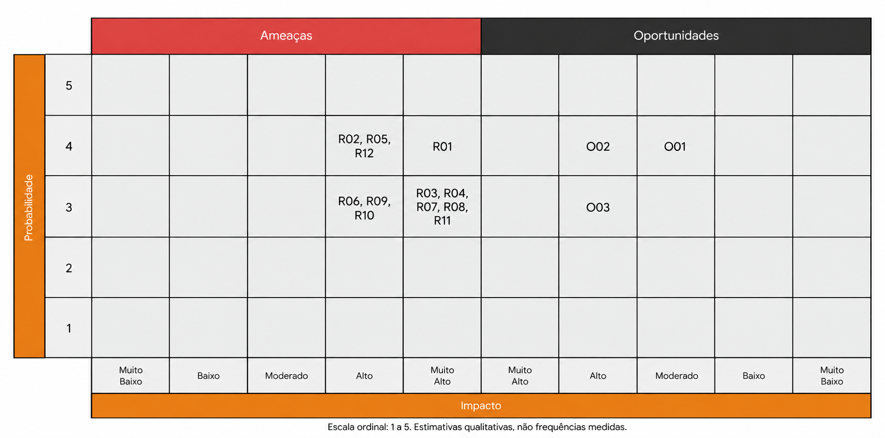
  <p><sub>Fonte: elaboração dos autores (2026), com auxílio de inteligência artificial, adaptada do modelo disponibilizado à turma.</sub></p>
</div>

A figura usa posições, sem codificação de prioridade por cor. Na metade das ameaças, o impacto cresce da esquerda para a direita; na metade das oportunidades, a ordem é espelhada. A escala ordinal evita apresentar estimativas qualitativas como probabilidades percentuais medidas. As prioridades e justificativas estão no quadro anterior.

#### Oportunidades

<p align="center">Quadro 2 – Oportunidades do projeto e ações propostas</p>

| ID  | Evento positivo                                                         |   P |   I | Justificativa / ação proposta                                                                               |
| --- | ----------------------------------------------------------------------- | --: | --: | ----------------------------------------------------------------------------------------------------------- |
| O01 | Reuso dos casos simulados reduzir retrabalho em bancada                 |   4 |   3 | CT01–CT10 fornecem entradas e saídas; reproduzi-los no hardware físico e comparar os resultados.            |
| O02 | Contagem agregada reduzir necessidade de dados pessoais                 |   4 |   4 | Não há identidade no fluxo atual; preservar essa minimização ao avaliar a consolidação remota.              |
| O03 | Retorno de SSMA/CCO melhorar a legibilidade e o processo de conferência |   3 |   4 | As proto-personas ainda precisam de validação; apresentar LCD e limites antes de especificar telas futuras. |

<p><sub>Fonte: elaboração dos autores (2026).</sub></p>

As oportunidades usam a mesma escala com impacto entendido como benefício: O01 em (P4,I3), O02 em (P4,I4) e O03 em (P3,I4). Sua distribuição é separada das ameaças para não confundir benefício com severidade. Os responsáveis são papéis propostos, sujeitos à divisão de tarefas do grupo. As prioridades imediatas são R01, R02, R05 e R12; as demais serão reavaliadas a cada sprint. Nenhuma resposta planejada deve ser interpretada como mitigação já testada.

### 3.1.6. Política de privacidade do projeto

Esta política preliminar contempla a solução integrada da Synthetix: três tipos de dispositivos baseados em ESP32, responsáveis pela contagem nas portarias, pelo monitoramento por zonas e pela confirmação nos pontos de encontro, conectados a uma aplicação web. As disposições a seguir orientam o desenvolvimento e distinguem o tratamento previsto das funcionalidades já demonstradas; não constituem evidência de controles implementados ou de homologação para uso industrial.

A análise do primeiro protótipo permanece válida para as condições da Sprint 1, documentadas na Seção 3.4.1: Arduino Uno, contagem ultrassônica agregada, sinalização local e ausência de RFID, rede e histórico persistente. Sob esses pressupostos, sem associação das passagens a indivíduos ou combinação com fontes identificáveis, o fluxo de contagem não caracteriza tratamento de dados pessoais. Essa conclusão não se estende à solução integrada, cujos identificadores RFID podem ser associados a pessoas, zonas e horários, mesmo quando os nomes não são exibidos (Brasil, 2018).

#### 3.1.6.1 Informações gerais sobre a empresa / organização

O projeto é desenvolvido pela equipe Synthetix, no Inteli, em parceria com a Unipar. O Aviso de Privacidade da empresa abrange a Unipar Carbocloro S.A. e suas sociedades controladas diretas e indiretas (Unipar, [s. d.]a). A solução tem finalidade acadêmica de desenvolvimento e validação de recursos de apoio à evacuação, considerando o contexto operacional da unidade de Cubatão.

Antes do tratamento de dados reais, devem ser formalizadas as entidades responsáveis e suas atribuições: quem decide as finalidades e os meios do tratamento, quem o executa em nome de outra organização e quem atende aos titulares. A parceria não determina automaticamente os papéis de controlador e operador, nem atribui à Unipar responsabilidade por todos os tratamentos acadêmicos do Inteli. Essa definição depende das atividades efetivamente desempenhadas (ANPD, 2022; Brasil, 2018).

#### 3.1.6.2 Informações sobre o tratamento de dados

Os sensores ultrassônicos das portarias produzem uma estimativa anônima da quantidade de pessoas na planta. Os leitores RFID das zonas registram passagens por aproximação, enquanto os totens dos pontos de encontro registram confirmações durante a emergência. Os dispositivos enviam identificadores e eventos; cabe à aplicação associá-los ao cadastro correspondente. O registro de zona representa a última passagem detectada, sem fornecer localização precisa ou acompanhamento contínuo entre leitores.

A identificação nominal deve ser apresentada na aplicação somente durante uma emergência ativa e a usuários autorizados para a resposta ao incidente. Fora desse período, nomes e associações que permitam consultar nominalmente as leituras devem permanecer indisponíveis na interface e nos serviços que a atendem. A restrição de exibição não torna os registros anônimos: a coleta rotineira de identificadores vinculáveis a pessoas continua sendo tratamento de dados pessoais.

As bases legais devem ser definidas e documentadas por finalidade antes do uso de dados reais, distinguindo o registro rotineiro por zonas do uso de informações durante emergências. A finalidade de segurança não autoriza automaticamente qualquer forma de monitoramento, e a condição acadêmica do projeto não dispensa a análise das hipóteses legais aplicáveis. Esta política não presume consentimento, legítimo interesse ou outra base ainda não definida com os responsáveis (Brasil, 2018).

#### 3.1.6.3 Quais são os dados coletados

O quadro apresenta as categorias necessárias à solução planejada e seus limites de utilização.

| Origem ou processo                 | Dados previstos                                                                                                            | Condição de tratamento                                                                                                   |
| ---------------------------------- | -------------------------------------------------------------------------------------------------------------------------- | ------------------------------------------------------------------------------------------------------------------------ |
| Controle das portarias             | Leituras de distância, eventos de entrada/saída, contagem agregada, identificador do dispositivo e horário de atualização. | A leitura ultrassônica não fornece identidade. A associação com outras fontes identificáveis exige avaliação específica. |
| Monitoramento por zonas            | Identificador da tag, leitor/zona, horário e estado de passagem inferido pela regra de atualização.                        | São dados pessoais quando vinculáveis a alguém; indicam a última zona registrada, não a posição exata.                   |
| Confirmação nos pontos de encontro | Identificador da tag, ponto de encontro, horário de leitura e vínculo com o evento de emergência.                          | Confirmam uma leitura de chegada; não comprovam, por si, condição clínica ou ausência de risco.                          |
| Cadastro de pessoas e tags         | Identificador interno, nome e vínculo com a tag, limitados ao necessário à identificação na emergência.                    | A origem e a manutenção do cadastro, inclusive de terceiros e visitantes, ainda precisam ser definidas.                  |
| Acesso à aplicação                 | Identificador da conta, perfil de permissão e registros necessários à autenticação e à auditoria de acesso.                | O mecanismo e os campos técnicos devem ser especificados conforme a implementação, com minimização.                      |

Não se prevê coleta de CPF, RG, imagem, voz, biometria ou dados de saúde. Nos testes acadêmicos, devem ser usados cadastros e situações fictícios. Uma tag associada a um participante real, mesmo sob um código, deixa de representar um dado exclusivamente fictício e exige avaliação do tratamento. Capturas de tela e evidências públicas não devem expor registros identificáveis.

#### 3.1.6.4 Onde os dados são coletados

Na solução proposta, as leituras são obtidas nas portarias, nas portas de zonas monitoradas e nos totens dos pontos de encontro, situados em áreas abertas dentro da planta. A aplicação recebe os eventos dos dispositivos e os dados necessários ao cadastro e ao acesso dos usuários autorizados. A fonte de uma relação nominal confiável de pessoas presentes no início da emergência permanece pendente; ela não pode ser deduzida do contador ultrassônico nem de leituras parciais das zonas.

Os protótipos acadêmicos representam esses locais em ambiente controlado. Uma implantação real depende da definição dos locais, dos fluxos de cadastro e da informação aos colaboradores, terceiros e visitantes sobre quais dados são tratados, para quais finalidades e por quais responsáveis.

#### 3.1.6.5 Para quais finalidades os dados serão utilizados

O tratamento previsto destina-se a:

- estimar a quantidade de pessoas na planta e apresentar indicadores agregados;
- manter a última zona registrada para apoiar a busca durante uma emergência;
- registrar confirmações nos pontos de encontro e apoiar a análise de pendências;
- disponibilizar informações necessárias à coordenação do CCO, da SSMA e dos brigadistas;
- controlar acessos à aplicação e avaliar o funcionamento da solução com dados de teste adequados.

O escopo não contempla controle de jornada, avaliação de produtividade, vigilância disciplinar, publicidade ou cálculo de rotas individuais. Os indicadores não autorizam conclusões automáticas sobre quem está em perigo ou onde uma pessoa se encontra. As decisões de resposta permanecem sob responsabilidade das equipes de emergência. Uma nova finalidade exige avaliação própria e atualização desta política.

#### 3.1.6.6 Onde os dados ficam armazenados

A solução prevê processamento nos ESP32 e armazenamento dos registros necessários à integração na infraestrutura da aplicação web. A tecnologia de persistência, a hospedagem, a localização dos servidores, os fornecedores e eventuais cópias mantidas pelo serviço MQTT ainda devem ser especificados; esta política não pressupõe banco de dados ou serviço de nuvem já implementado.

Durante falhas de conexão, os totens devem preservar localmente as leituras para posterior sincronização. Essa cópia também integra o tratamento de dados pessoais e precisa de proteção, controle de acesso e regra de descarte após confirmação de recebimento pela aplicação, conforme a política de retenção. A ativação local por SSMA ou brigadista não elimina essas obrigações.

Repositórios, capturas e relatórios acadêmicos devem conter código, circuitos e resultados simulados, sem listas nominais, identificadores vinculados a participantes reais ou credenciais. Créditos dos autores no README são um tratamento separado do fluxo de evacuação e devem ser avaliados conforme sua finalidade de publicação.

#### 3.1.6.7 Qual o período de armazenamento dos dados (retenção)

Os prazos ainda não foram definidos com a Unipar. Antes do uso de dados reais, deve existir uma tabela de retenção por categoria, abrangendo cadastros, passagens por zonas, confirmações, registros de acesso, cópias locais e eventuais cópias de segurança. Ela deve indicar finalidade, prazo ou critério de término, responsável e procedimento de exclusão ou anonimização, observadas as hipóteses legais de conservação (Brasil, 2018).

O encerramento da emergência interrompe a exibição nominal operacional, mas não equivale à exclusão de todos os registros. Da mesma forma, atualizar ou zerar um estado de zona não significa apagar seu histórico. Nenhum desses eventos justifica retenção indefinida. Os registros locais sincronizados devem ser descartados segundo a regra definida, sem eliminar a única cópia antes da confirmação de recebimento. Resultados acadêmicos agregados e não identificáveis podem ser preservados para avaliação do projeto.

#### 3.1.6.8 Uso de cookies e/ou tecnologias semelhantes

Os circuitos não utilizam cookies de navegador. A aplicação web poderá necessitar de cookies ou mecanismos equivalentes para autenticação e sessão; sua utilização efetiva, finalidade e duração devem ser informadas quando a implementação for definida. Não se prevê uso de rastreadores publicitários. A presença de uma interface web, por si só, não permite afirmar quais cookies existem.

Wokwi e GitLab são serviços externos usados no desenvolvimento. O tratamento de contas, cookies e registros de uso dessas plataformas segue suas próprias políticas e não deve ser confundido com o fluxo de dados dos dispositivos.

#### 3.1.6.9 Com quem esses dados são compartilhados (parceiros, fornecedores, subcontratados)

Durante uma emergência ativa, usuários autorizados da SSMA e do CCO devem acessar somente as informações necessárias às suas atribuições. Os brigadistas recebem os dados necessários à busca pelo canal operacional definido com a Unipar; isso não implica acesso irrestrito ao cadastro ou ao histórico. A matriz de permissões ainda precisa detalhar os acessos de cada perfil.

A equipe acadêmica e os avaliadores devem utilizar dados fictícios ou resultados efetivamente anonimizados. Eventual acesso a dados reais, uso de fornecedores de infraestrutura ou integração com sistemas corporativos exige identificação dos envolvidos e definição de responsabilidades, finalidade, segurança, retenção e condições de compartilhamento. O Aviso de Privacidade institucional da Unipar não substitui essas definições específicas do projeto.

#### 3.1.6.10 Informações sobre medidas de segurança adotadas pela empresa

Para a solução integrada, as medidas abaixo constituem requisitos de proteção a implementar e verificar, sem afirmar que já estejam disponíveis:

- autenticar usuários e aplicar permissões por perfil, inclusive nos serviços da aplicação;
- restringir a consulta nominal operacional ao período de emergência ativa e aos usuários autorizados;
- proteger a transmissão e o armazenamento, incluindo os registros mantidos localmente durante falhas de rede;
- limitar o acesso físico aos dispositivos e o acesso lógico aos cadastros e registros;
- manter credenciais fora do código público e impedir a divulgação de dados reais nas evidências;
- preservar a integridade das associações entre tags e pessoas e tratar duplicidades na sincronização;
- registrar acessos relevantes e prever procedimentos de correção, descarte e resposta a incidentes.

As medidas devem ser proporcionais ao tratamento e verificadas na implementação, conforme a LGPD e as orientações da ANPD (ANPD, 2021; Brasil, 2018). A apresentação de controles no aviso institucional da Unipar não comprova sua adoção no protótipo acadêmico.

#### 3.1.6.11 Orientações sobre como a empresa/organização atende aos direitos dos usuários

Para os tratamentos identificáveis, a organização responsável deve disponibilizar meios para confirmação da existência de tratamento, acesso, correção e informação sobre compartilhamento, além dos demais direitos aplicáveis, como anonimização, bloqueio, eliminação, portabilidade e revogação de consentimento quando essa for a base utilizada. O atendimento deve observar as condições legais de cada direito (Brasil, 2018).

Uma leitura incorreta ou uma associação equivocada entre tag e pessoa deve poder ser analisada e corrigida pelo responsável autorizado. O atendimento aos direitos dos titulares constitui um procedimento próprio, separado do painel operacional: a restrição de nomes fora da emergência não impede o atendimento legítimo de uma solicitação. No fluxo exclusivamente agregado do contador, pode não existir registro individual recuperável, limitação que deve ser explicada ao solicitante.

#### 3.1.6.12 Informações sobre como o titular de dados pode solicitar e exercer os seus direitos

Para tratamentos sob responsabilidade da Unipar, o titular pode utilizar o canal institucional **lgpd-encarregado@unipar.com**, divulgado em seu Aviso de Privacidade (Unipar, [s. d.]a). O pedido deve indicar o contexto e o direito ou esclarecimento pretendido; a verificação da identidade deve solicitar apenas as informações necessárias ao atendimento seguro.

O canal e o responsável pelo atendimento de participantes de testes acadêmicos ainda precisam ser definidos pelo Inteli e pelos envolvidos no tratamento. O contato da Unipar não deve ser apresentado automaticamente como responsável por esses testes. Antes da coleta de dados reais, os participantes devem receber informações claras sobre o tratamento e o canal aplicável.

#### 3.1.6.13 Informações de contato do Data Protection Officer (DPO) ou encarregado de proteção de dados da organização

O canal oficial publicado pela Unipar para contato com seu Encarregado de Proteção de Dados Pessoais é:

- **E-mail:** lgpd-encarregado@unipar.com
- **Aviso de Privacidade:** <https://unipar.com/aviso-de-privacidade>

O aviso público consultado não informa o nome da pessoa que exerce a função. O canal institucional foi mantido como referência, sem presumir a designação desse encarregado para os tratamentos acadêmicos do projeto (Unipar, [s. d.]a).

Permanecem pendentes de formalização os agentes responsáveis, as bases legais por finalidade, a origem e a manutenção dos cadastros, a matriz de permissões, os prazos de retenção, a infraestrutura de armazenamento e o canal de atendimento acadêmico. Essas definições devem anteceder o uso de dados reais. A política deve acompanhar a implementação e qualquer mudança de finalidade, dados, integrações ou fornecedores.

### 3.1.7. Bill of Material (BOM) (sprint 1)

A Bill of Materials (BOM) apresenta o levantamento de materiais para uma montagem de bancada baseada no protótipo simulado da Sprint 1. Não é uma lista de equipamentos industriais homologados. A revisão documental não altera o circuito nem o firmware; as decisões de montagem serão verificadas pela equipe antes da etapa física.

Esta BOM considera **uma unidade** do protótipo ilustrado, com Arduino Uno, dois sensores ultrassônicos, sinalização visual e sonora, display LCD, botão para alternância dos LEDs e materiais de montagem. Os preços abaixo são do levantamento original da equipe, sujeitos a atualização; não incluem frete, impostos adicionais ou reposição. O quadro preserva esse levantamento, enquanto a reconciliação logo abaixo identifica os itens que precisam ser especificados e recotados. Seu total não deve ser usado como orçamento fechado de aquisição.

<p align="center">Tabela 1 – Levantamento inicial de materiais e preços do protótipo da Sprint 1</p>

| Categoria                 | Quantidade | Referência do componente no protótipo/PCI                      | Código do componente (fabricante)                                                                                                        |                                                                                                                                                                                                                                                                                                                                                                                                                                                                                                                                                                                                                                                                                                                                                                                                                               Valor do componente (R$) |
| ------------------------- | ---------: | -------------------------------------------------------------- | ---------------------------------------------------------------------------------------------------------------------------------------- | -----------------------------------------------------------------------------------------------------------------------------------------------------------------------------------------------------------------------------------------------------------------------------------------------------------------------------------------------------------------------------------------------------------------------------------------------------------------------------------------------------------------------------------------------------------------------------------------------------------------------------------------------------------------------------------------------------------------------------------------------------------------------------------------------------------------------------------------------------: |
| Processamento             |          1 | Arduino Uno                                                    | Arduino Uno R3                                                                                                                           |          R$39,54 ([Mercado Livre](https://www.mercadolivre.com.br/cabo-usb-compativel-com-placa-de-desenvolvimento-arduino-uno-r3-atmega328p-ch340/p/MLB44072268?pdp_filters=item_id%3AMLB5229650730&from=gshop&matt_tool=56164162&matt_word=&matt_source=google&matt_campaign_id=22090193744&matt_ad_group_id=194474654154&matt_match_type=&matt_network=g&matt_device=c&matt_creative=792355615410&matt_keyword=&matt_ad_position=&matt_ad_type=pla&matt_merchant_id=735125422&matt_product_id=MLB44072268-product&matt_product_partition_id=2495059736147&matt_target_id=pla-2495059736147&cq_src=google_ads&cq_cmp=22090193744&cq_net=g&cq_plt=gp&cq_med=pla&gad_source=4&gad_campaignid=22090193744&gbraid=0AAAAAD93qcDWMW_AFPrQLlrvCxOyNb_89&gclid=CjwKCAjwotzWBhBFEiwA1JhPoJRuM1jdBvwQsy-JbDuO2GqZUVevX9I5SgDqMi81aZh_Pusf2a-KQhoC7PwQAvD_BwE)) |
| Sensoriamento             |          2 | Sensores ultrassônicos de entrada e saída                      | HC-SR04                                                                                                                                  | R$15,00 (unidade); R$30,00 (2 unidades) ([Mercado Livre](https://www.mercadolivre.com.br/modulo-sensor-ultrassonico-distancia-hc-sr04-para-arduino/p/MLB64164978?pdp_filters=item_id%3AMLB5130062737&from=gshop&matt_tool=56164162&matt_word=&matt_source=google&matt_campaign_id=22090193744&matt_ad_group_id=194474654154&matt_match_type=&matt_network=g&matt_device=c&matt_creative=792355615410&matt_keyword=&matt_ad_position=&matt_ad_type=pla&matt_merchant_id=735128761&matt_product_id=MLB64164978-product&matt_product_partition_id=2495059736347&matt_target_id=pla-2495059736347&cq_src=google_ads&cq_cmp=22090193744&cq_net=g&cq_plt=gp&cq_med=pla&gad_source=4&gad_campaignid=22090193744&gbraid=0AAAAAD93qcDWMW_AFPrQLlrvCxOyNb_89&gclid=CjwKCAjwotzWBhBFEiwA1JhPoIQ9ytYCHxi7QMFA-RU1aROmSXUtXE3xD1biz_vwK9s3dwk-8Ro6oxoCIOoQAvD_BwE)) |
| Interação                 |          1 | Botão de pressão                                               | Board Push Button Switch (tactile)                                                                                                       |                                                                                                                                                                                                                                                                                                                                                                                                                                                                                                                                                                                            R$1,21 (unidade) ([Mercado Livre](https://www.mercadolivre.com.br/conjunto-de-50-botoes-de-pressao-para-placa-de-circuito/p/MLB2052130334?matt_tool=18956390&utm_source=google_shopping&utm_medium=organic&pdp_filters=item_id%3AMLB7635767930&from=gshop)) |
| Sinalização visual        |          1 | LED verde                                                      | LED difuso 5 mm                                                                                                                          |                                                                                                                                                                                                                                                                                                                                                                                                                                                                                                                       R$0,15 ([Eletrogate](https://www.eletrogate.com/led-difuso-5mm-verde?utm_source=Site&utm_medium=GoogleMerchant&utm_campaign=GoogleMerchant&gad_source=1&gad_campaignid=22470016551&gbraid=0AAAAADqxjs-J182in_CBPr1nyA54F-LL9&gclid=CjwKCAjwotzWBhBFEiwA1JhPoCaLKeb9vaLT7u49dThE1TEGwTfv0C6_EYGFI6dS3biP6Xoqy1ZgVxoCiEIQAvD_BwE)) |
| Sinalização visual        |          1 | LED vermelho                                                   | LED difuso 5 mm                                                                                                                          |                                                                                                                                                                                                                                                                                                                                                                                                                                                                                                                    R$0,15 ([Eletrogate](https://www.eletrogate.com/led-difuso-5mm-vermelho?utm_source=Site&utm_medium=GoogleMerchant&utm_campaign=GoogleMerchant&gad_source=1&gad_campaignid=20223015315&gbraid=0AAAAADqxjs_RKxEA4lB8OTz9kzOy_b2y9&gclid=CjwKCAjwotzWBhBFEiwA1JhPoN-apmwJkkXYYznxTECGwrAfUUdQMOGaQL_4-m8zeFGfzU6AOYhiNxoCqJgQAvD_BwE)) |
| Sinalização sonora        |          1 | Buzzer                                                         | Buzzer ativo 5V                                                                                                                          |                                                                                                                                                                                                                                                                                                                                                                                                                                                                                                                            R$2,90 ([Eletrogate](https://www.eletrogate.com/buzzer-ativo-5v?utm_source=Site&utm_medium=GoogleMerchant&utm_campaign=GoogleMerchant&gad_source=1&gad_campaignid=20223015315&gbraid=0AAAAADqxjs_RKxEA4lB8OTz9kzOy_b2y9&gclid=CjwKCAjwotzWBhBFEiwA1JhPoLPBf6mtcZizCQRpZRRLmGNgwewSSuaihP1VIORbIt2h8imNmBty9RoCrG8QAvD_BwE)) |
| Visualização              |          1 | Display LCD                                                    | LCD 16 × 2 com interface I²C                                                                                                             |                                    R$25,55 ([Mercado Livre](https://www.mercadolivre.com.br/display-lcd-16x2-1602-fundo-azul-com-modulo-i2c-soldado/up/MLBU4549779439?pdp_filters=item_id%3AMLB7321088826&from=gshop&matt_tool=56885173&matt_word=&matt_source=google&matt_campaign_id=22090354256&matt_ad_group_id=192555051054&matt_match_type=&matt_network=g&matt_device=c&matt_creative=799032781561&matt_keyword=&matt_ad_position=&matt_ad_type=pla&matt_merchant_id=119897001&matt_product_id=MLBU4549779439&matt_product_partition_id=2498613880064&matt_target_id=pla-2498613880064&cq_src=google_ads&cq_cmp=22090354256&cq_net=g&cq_plt=gp&cq_med=pla&gad_source=1&gad_campaignid=22090354256&gbraid=0AAAAAD93qcAf98DVye3WhOkZqJU1o3eSE&gclid=CjwKCAjwotzWBhBFEiwA1JhPoMgiK21_IFmDbVmbNMgDC3o03ZARpy4oBINxyPna8AsDNp4ISmYalRoCR_MQAvD_BwE)) |
| Condicionamento elétrico  |          2 | Resistores                                                     | 5V ou 3.3V, 1k Ohm, (1/4W)                                                                                                               |                                                                                                                                                                                                                                                                                                                                                                                                                                                                                                                                                                                 R$0,12 (unidade) ([Saravati](https://www.saravati.com.br/resistor-1k-5-1-4w.html?gad_source=1&gad_campaignid=23551463662&gbraid=0AAAAAC2QUl9NJxOJbt89j1o1regZh5Nz1&gclid=CjwKCAjwotzWBhBFEiwA1JhPoG38v08Hq-K_8VKXdxS8REO0qaNgkFziIwVTl9Rc2LXpGSD3o1KboRoCCEkQAvD_BwE)) |
| Montagem                  |          1 | Protoboard                                                     | Protoboard para montagem sem solda                                                                                                       |                                                                                                                                                                                                                                                                                                                                                                                                                                                                                                                      R$8,90 ([Eletrogate](https://www.eletrogate.com/protoboard-400-pontos?utm_source=Site&utm_medium=GoogleMerchant&utm_campaign=GoogleMerchant&gad_source=4&gad_campaignid=20223015315&gbraid=0AAAAADqxjs--_IDti_OP_PomQr4wJeFmq&gclid=CjwKCAjwotzWBhBFEiwA1JhPoPlT3_2SAg4EbLjDVCFA_2Gb0qBCgwXD5npVhSjZdn-yagDte4bg4BoCZoMQAvD_BwE)) |
| Alimentação planejada     |          1 | Pilha de lítio tipo moeda, ainda não implementada no protótipo | CR2023, 3 V, não recarregável                                                                                                            |                                                                                                                                                                                                                                                                                                                                                                                                                                                                                                                                                                                                                                                                                                                                                                     R$13,90 ([Mercado Livre](https://lista.mercadolivre.com.br/bateria-maxell-cr2032)) |
| Interconexão              |          4 | Jumpers macho-fêmea                                            | Alternativa A: conexão do display LCD I²C; utilizar com 16 jumpers macho-macho                                                           |                R$1,05 (unidade); R$4,20 (4 unidades) ([Mercado Livre](https://www.mercadolivre.com.br/20pcs-jumper-mxf-20cm--20pcs-jumper-fxf-20cm/up/MLBU2370810037?pdp_filters=item_id%3AMLB4078036044&from=gshop&matt_tool=19390443&matt_word=&matt_source=google&matt_campaign_id=22090354205&matt_ad_group_id=191786774561&matt_match_type=&matt_network=g&matt_device=c&matt_creative=782869962440&matt_keyword=&matt_ad_position=&matt_ad_type=pla&matt_merchant_id=5458938305&matt_product_id=MLBU2370810037&matt_product_partition_id=2495493043879&matt_target_id=pla-2495493043879&cq_src=google_ads&cq_cmp=22090354205&cq_net=g&cq_plt=gp&cq_med=pla&gad_source=4&gad_campaignid=22090354205&gbraid=0AAAAAD93qcBWh7S0-tQRtyURYUhdok1-w&gclid=CjwKCAjwotzWBhBFEiwA1JhPoO4nhPq-F2KwwBsDI-Hn3A0iwomUAHbI1TRcldDnimZUYjGi7kAF6xoCG5oQAvD_BwE)) |
| Interconexão              |   16 ou 20 | Jumpers macho-macho                                            | Alternativa A: 16 unidades com 4 jumpers macho-fêmea; alternativa B: 20 unidades, caso todos os módulos sejam conectados pela protoboard |                                                                                                                                                                                                                                                                                                                                                                                                                                                                                                                                                                                                                                                      R$0,42 (unidade); Alternativa A: R$6,72; Alternativa B: R$8,40; ambos em [Mercado Livre](https://www.mercadolivre.com.br/cabo-jumper-mxm-20cm-40-pinos-para-arduino-protoboard/up/MLBU2098535281) |
| **Total estimado do MVP** |            |                                                                |                                                                                                                                          |                                                                                                                                                                                                                                                                                                                                                                                                                                                                                                                                                                                                                                                                                                                                                                                                   **Alternativa A: R$133,46; Alternativa B: R$130,94** |

<p><sub>Fonte: elaboração dos autores (2026), com base nas cotações de Eletrogate ([s. d.]a, [s. d.]b, [s. d.]c, [s. d.]d), Mercado Livre ([s. d.]a, [s. d.]b, [s. d.]c, [s. d.]d, [s. d.]e, [s. d.]f, [s. d.]g) e Saravati ([s. d.]).</sub></p>

> **Origem dos valores:** datas de consulta e preços foram informados no levantamento original, com referências de 20 a 22/10/2026. Não representam nova cotação nesta revisão. Os valores unitários rateados de kits não equivalem necessariamente ao desembolso para comprar os kits completos.

A coluna <i>Categoria</i> identifica a função do item no protótipo, enquanto <i>Quantidade</i> registra o número de unidades necessárias. A <i>Referência</i> descreve o componente empregado no circuito, e o <i>Código do componente</i> apresenta o modelo ou a especificação adotada. A coluna <i>Valor do componente</i> registra o valor estimado e disponibiliza o respectivo link de consulta. Nos itens vendidos por unidade, o custo total foi calculado pela multiplicação do valor unitário pela quantidade indicada.

**Reconciliação com o protótipo e correções para a próxima cotação**

<p align="center">Quadro 3 – Reconciliação dos materiais e pontos de revisão para as próximas sprints</p>

| Item / referência no diagrama             | Quantidade | Especificação a considerar                                                                                                            | Situação do orçamento                                                                                                      |
| ----------------------------------------- | ---------: | ------------------------------------------------------------------------------------------------------------------------------------- | -------------------------------------------------------------------------------------------------------------------------- |
| Processamento — uno                       |          1 | Placa compatível com Arduino Uno R3; confirmar se a oferta inclui a placa e o cabo, pois o título do link original menciona cabo USB. | R$ 39,54 é referência histórica; confirmar conteúdo do anúncio.                                                            |
| Sensoriamento — ultrasonic1 e ultrasonic2 |          2 | HC-SR04, um dedicado à saída e outro à entrada.                                                                                       | R$ 15,00 por unidade; subtotal histórico R$ 30,00.                                                                         |
| Interação — btn1                          |          1 | Botão momentâneo; muda a sinalização, sem pausar a contagem.                                                                          | R$ 1,21 por unidade rateada; conferir lote mínimo.                                                                         |
| Sinalização — led1 e led2                 |          2 | Um LED vermelho e um verde.                                                                                                           | R$ 0,15 por unidade; subtotal histórico R$ 0,30.                                                                           |
| Sinalização sonora — bz1                  |          1 | Transdutor compatível com frequência controlada pelo firmware; avaliar buzzer passivo e corrente necessária antes da montagem.        | O preço de R$ 2,90 refere-se ao buzzer ativo do levantamento; não comprova equivalência ao simulado. Recotar após revisão. |
| Visualização — lcd1                       |          1 | LCD 16 × 2 com interface I²C e endereço compatível com o firmware.                                                                    | R$ 25,55 no levantamento original.                                                                                         |
| Resistores — r1 e r2                      |          2 | 1 kΩ, 1/4 W, tolerância de 5%; a tensão de alimentação não é o valor do resistor.                                                     | R$ 0,12 por unidade; subtotal R$ 0,24.                                                                                     |
| Montagem — bb1                            |          1 | Protoboard que comporte o layout ilustrado, a conferir como modelo de 830 pontos.                                                     | O link de 400 pontos não reproduz a disposição atual. Recotar.                                                             |
| Interconexão                              |         20 | Alternativa A: 16 macho-macho e 4 macho-fêmea; alternativa B: 20 macho-macho, dependendo dos terminais e da montagem final.           | A: R$ 10,92; B: R$ 8,40, por rateio histórico.                                                                             |
| Alimentação/programação                   | 1 conjunto | Cabo USB compatível e alimentação de bancada adequada ao Uno e periféricos; confirmar cabo incluído na placa e fonte disponível.      | Custo não confirmado separadamente; não assumir item gratuito.                                                             |

<p><sub>Fonte: elaboração dos autores (2026).</sub></p>

Os totais originais de R$ 133,46 (A) e R$ 130,94 (B) incluem R$ 13,90 de pilha que não integra o circuito. Sua exclusão resulta em **subtotais históricos de R$ 119,56 (A) e R$ 117,04 (B)**. Esses valores ainda precisam incorporar as correções da placa/cabo, protoboard, buzzer e alimentação, além do custo efetivo dos kits. A diferença histórica entre as alternativas de jumpers é R$ 2,52. Portanto, o **custo total de uma montagem física validada permanece a confirmar**, sem substituir preços ausentes por zero.

No protótipo, o Arduino Uno realiza o processamento das entradas e controla as saídas. Dois sensores ultrassônicos HC-SR04 identificam separadamente a entrada e a saída de pessoas, e o total é apresentado no display LCD 16 × 2 conectado por I²C. O botão alterna a sinalização entre os LEDs verde e vermelho, enquanto o buzzer fornece o aviso sonoro das contagens. Os dois resistores de 1 kΩ limitam a corrente dos LEDs. A protoboard e os jumpers viabilizam a montagem e as conexões do circuito sem a necessidade de solda.

A referência correta do anúncio da pilha é **CR2032**, e não CR2023. Ela foi uma hipótese do levantamento inicial, não foi implementada e não constitui alimentação validada para o conjunto Uno e periféricos. Fica excluída da montagem de referência e dos subtotais reconciliados. Qualquer solução de autonomia será dimensionada em etapa futura.

A lista apresentada é adequada ao protótipo de bancada, mas não caracteriza, por si só, uma solução pronta para uso no ambiente industrial. Para uma futura implantação, será necessário especificar itens adicionais, como gabinete de proteção, alimentação apropriada, conectores, cabeamento, fixação mecânica e componentes com grau de proteção compatível com as condições de operação da Unipar.

Assim, a BOM preserva o levantamento inicial, explicita suas correções e identifica os componentes do diagrama. Antes da aquisição, a equipe deverá consolidar a revisão elétrica, a opção de interconexão e as cotações no template de materiais da turma. Esta documentação não declara essa montagem física executada ou aprovada.

## 3.2. Domínio de Fundamentos de Experiência de Usuário

### 3.2.1. Personas

Esta seção apresenta as proto-personas que orientam a compreensão das necessidades dos públicos envolvidos na evacuação do complexo industrial da Unipar em Cubatão. Os perfis organizam contextos de trabalho, comportamentos, dores, necessidades e desejos, e servem de base para os requisitos (seção 3.3), as jornadas e os storyboards (seção 3.2.2).

O mapeamento considera cinco grupos de partes interessadas: colaboradores, operadores do Centro de Controle Operacional (CCO), gestores de Segurança, Saúde e Meio Ambiente (SSMA), brigadistas e líderes de ponto de encontro, e profissionais de Infraestrutura e TI. Três personas são detalhadas: Gustavo Fring, técnico de operação, representa quem precisa evacuar e ter a chegada confirmada; Maria Schrader, operadora de CCO, representa quem inicia o protocolo de emergência e acompanha a ocorrência; e Tuco Salamanca, gestor de SSMA, representa quem coordena a resposta e decide a busca. Os brigadistas e líderes de ponto, que fazem a conferência nos pontos de encontro, são representados dentro da persona de Tuco, porque atuam sob a coordenação da SSMA. Infraestrutura e TI é um público secundário, ligado ao suporte dos dispositivos e da rede.

Os três perfis são proto-personas: foram construídos a partir do kickoff e das reviews com a Unipar, do Termo de Abertura do Projeto de Inovação (TAPI) e dos demais materiais do projeto, sem entrevistas com usuários. Nomes, idades, famílias, hábitos e falas são fictícios. As descrições a seguir são hipóteses da equipe e devem ser validadas em pesquisa com os públicos representados.

**Processo de construção:** a equipe reuniu os relatos e materiais sobre evacuação, conferência e comunicação, organizou as necessidades por papel e sintetizou três perfis em um template com dados demográficos, perfil socioeconômico, biografia, dores, necessidades, desejos, tarefas, comportamento em emergência e letramento digital. Na Sprint 2, os perfis foram atualizados com o retorno da avaliação da Sprint 1 e com a solução definida na seção 3.1.3.

**Uso de inteligência artificial:** as imagens das personas foram geradas com o ChatGPT e o Gemini. Os textos foram escritos pela equipe, com apoio de IA na revisão. Na atualização da Sprint 2, a IA (Claude) apoiou a revisão e a reorganização do texto a partir do feedback e da nova solução; as decisões de conteúdo foram da equipe. Nenhuma fala, entrevista ou validação foi produzida por IA.

#### 3.2.1.1. Persona – Técnico de Operação

A Figura 5 apresenta Gustavo Fring, que representa os trabalhadores das áreas operacionais do complexo de Cubatão.

<div align="center">
  <p>Figura 5 – Proto-persona Gustavo Fring, técnico de operação</p>
  
  <p><sub>Fonte: elaboração dos autores (2026), com auxílio de inteligência artificial no ChatGPT.</sub></p>
</div>

**Dados demográficos**

- **Nome:** Gustavo Fring
- **Idade:** 32 anos
- **Formação:** técnico em Química
- **Ocupação:** técnico de operação industrial
- **Local:** Cubatão, São Paulo
- **Perfil socioeconômico:** classe média; renda de técnico industrial com adicional de turno; mora em casa financiada em Cubatão

**Biografia**

Gustavo trabalha há oito anos em ambiente industrial. Conhece bem os procedimentos da área dele, mas circula por outras zonas durante o turno. Vive com a esposa e um filho pequeno. Nas folgas, joga futebol e visita a família. Usa todos os EPIs exigidos. Numa emergência, a prioridade dele é sair com segurança e saber que alguém sabe que ele saiu.

<p align="center">Quadro 4 – Dores, necessidades e desejos da proto-persona Gustavo Fring</p>

| Prioridade     | Dor ou necessidade                                                   | O que deseja da solução                                                                                |
| :------------- | :------------------------------------------------------------------- | :----------------------------------------------------------------------------------------------------- |
| **1. Crítica** | Perceber o alarme e entender o que fazer na área onde está.          | Que nenhum dispositivo novo deixe a saída mais lenta ou mais confusa.                                  |
| **2. Crítica** | Encontrar uma saída segura quando a rota habitual está bloqueada.    | Que, se ele não chegar ao ponto de encontro, a brigada saiba a última zona onde ele passou.            |
| **3. Alta**    | Conseguir ajuda se estiver ferido, isolado ou desorientado.          | Que a falta de confirmação dele vire um alerta para a SSMA, sem depender de ele conseguir pedir ajuda. |
| **4. Alta**    | Ter a chegada reconhecida no ponto de encontro.                      | Confirmar a chegada aproximando o crachá do totem, com sinal sonoro e luminoso, sem esperar a chamada. |
| **5. Média**   | Lembrar o procedimento em áreas menos familiares e em outros turnos. | Treinamentos e simulados que incluam o uso do crachá nos leitores das portas e no totem.               |

<p><sub>Fonte: elaboração dos autores (2026).</sub></p>

**Tarefas**

Gustavo opera equipamentos, acompanha as condições das máquinas e da área e faz as inspeções e manutenções previstas para a função. Participa de treinamentos e simulados de emergência. Numa emergência, interrompe a atividade, segue a orientação da brigada até o ponto de encontro e informa sua chegada.

**Comportamento em uma emergência**

Quando o alarme toca numa área que ele não conhece, Gustavo para o que está fazendo, procura a placa de rota mais próxima e segue o brigadista ou o colega que trabalha ali. Se não encontra ninguém, volta pelo caminho por onde entrou. No ponto de encontro, procura o líder de ponto para dizer que chegou e fica perto dele até ouvir o próprio nome na chamada. Se a chamada demora, pergunta aos colegas se alguém da equipe dele ainda não apareceu.

**Interesses e hábitos**

Gustavo valoriza procedimentos claros, sinalização fácil de entender e treinamentos parecidos com a rotina real. No dia a dia, está concentrado nas tarefas operacionais; a evacuação aparece nos treinamentos, nos simulados e nos alarmes reais.

**Letramento digital**

Intermediário. Usa aplicativos comuns e as ferramentas do trabalho, mas não usa celular na área operacional. Na evacuação, depende de sinais físicos, das orientações da equipe e, na solução, do crachá.

**Falas ilustrativas, não coletadas em entrevista**

> "Quando o alarme toca, procuro a orientação da brigada e sigo para o ponto de encontro."

> "Depois que chego, preciso esperar a chamada para saberem que estou aqui."

> "Se eu estiver em outra área, sigo quem trabalha ali, porque eles conhecem a saída."

**Interação com a solução**

Gustavo não usa a aplicação. Na solução descrita na seção 3.1.3, ele interage com três pontos: passa pela catraca, onde a contagem é anônima; aproxima o crachá dos leitores nas portas das zonas monitoradas; e, numa evacuação, aproxima o crachá do totem no ponto de encontro e recebe um sinal sonoro e luminoso de que a leitura foi registrada. Os protótipos da Sprint 2 simulam essas leituras em bancada (seção 3.4.2).

**Abrangência e limites**

Gustavo representa o trabalhador habitual de área operacional. Terceirizados, equipes de manutenção, novos colaboradores e pessoas com deficiência podem conhecer menos as rotas, ter outro tipo de crachá ou precisar de apoio diferente. Visitantes ficam fora do público representado por ele.

#### 3.2.1.2. Persona – Operadora de Centro de Controle Operacional (CCO)

A Figura 6 apresenta Maria Schrader, que representa os profissionais de operação do Centro de Controle Operacional.

<div align="center">
  <p>Figura 6 – Proto-persona Maria Schrader, operadora de CCO</p>
  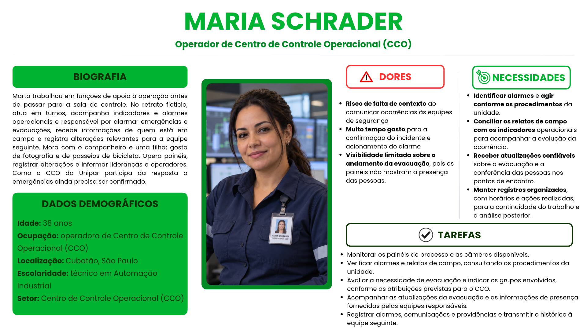
  <p><sub>Fonte: elaboração dos autores (2026), com auxílio de inteligência artificial no ChatGPT.</sub></p>
</div>

**Dados demográficos**

- **Nome:** Maria Schrader
- **Idade:** 38 anos
- **Formação:** técnica em Automação Industrial
- **Ocupação:** operadora do Centro de Controle Operacional (CCO)
- **Local:** Cubatão, São Paulo
- **Perfil socioeconômico:** classe média; trabalha em regime de turnos; mora em Cubatão com o companheiro e a filha

**Biografia**

Maria trabalhou em funções de apoio à operação antes de ir para a sala de controle. Trabalha em turnos. Acompanha indicadores e alarmes, recebe informações do campo e registra tudo para a equipe seguinte. É ela quem inicia o protocolo de emergência no CCO. Nas folgas, gosta de fotografia e de andar de bicicleta.

<p align="center">Quadro 5 – Dores, necessidades e desejos da proto-persona Maria Schrader</p>

| Prioridade     | Dor ou necessidade                                                                      | O que deseja da solução                                                                                                                |
| :------------- | :-------------------------------------------------------------------------------------- | :------------------------------------------------------------------------------------------------------------------------------------- |
| **1. Crítica** | Distinguir rapidamente um alarme relevante de outros avisos simultâneos.                | Que a solução não acrescente alarmes às telas que ela já acompanha, e que o alerta dos 10 minutos vá para a SSMA.                      |
| **2. Crítica** | Comunicar a ocorrência às equipes certas, sem perder informação.                        | Iniciar o modo de emergência na aplicação, o que ativa os totens dos pontos de encontro selecionados, e avisar os porteiros por rádio. |
| **3. Alta**    | Acompanhar o processo enquanto chegam relatos do campo em momentos diferentes.          | Ver em um só lugar a ocupação estimada, as últimas zonas registradas e as confirmações, com o horário de atualização de cada dado.     |
| **4. Alta**    | Entender o andamento da evacuação sem confundir status de área com presença de pessoas. | Que a aplicação separe a contagem das portarias, as zonas e as confirmações nos pontos de encontro.                                    |
| **5. Média**   | Deixar um histórico claro para a troca de turno.                                        | Ter os horários de acionamento, confirmações e alertas registrados na aplicação para consulta posterior.                               |

<p><sub>Fonte: elaboração dos autores (2026).</sub></p>

**Tarefas**

Na passagem de turno, Maria recebe as ocorrências em aberto. Durante o trabalho, acompanha os painéis de processo e as câmeras, verifica alarmes e relatos do campo e consulta os procedimentos antes de caracterizar uma ocorrência. Numa emergência, inicia o protocolo, comunica a SSMA, a brigada e a portaria e acompanha as atualizações. No fim, registra alarmes, comunicações e providências para a equipe seguinte.

**Comportamento em uma emergência**

Quando dois alarmes tocam ao mesmo tempo, Maria olha primeiro para o que pode virar vazamento e deixa os outros para depois. Antes de iniciar a emergência, liga para o operador de campo da área para confirmar o que está vendo nas telas. Durante a evacuação, anota à mão os números que chegam pelo rádio, porque eles chegam fora de ordem e às vezes se repetem. Trabalha na sala de controle, que a Unipar descreve como sala segura.

**Interesses e hábitos**

Maria valoriza estabilidade operacional, comunicação sem ambiguidade com o campo e registros confiáveis para a troca de turno. Passa longos períodos diante de painéis e câmeras.

**Letramento digital**

Alto nas ferramentas operacionais que usa todos os dias: interpreta indicadores e navega entre telas de processo e câmeras com facilidade. Para um sistema novo, precisa de interface clara, que mostre a origem e o horário de cada informação, e de treinamento antes de usá-lo sob pressão.

**Falas ilustrativas, não coletadas em entrevista**

> "Preciso confirmar o que o alarme indica antes de repassar a ocorrência."

> "Enquanto converso com o campo, continuo acompanhando as condições do processo."

> "O painel mostra a condição da área, mas quem confere as pessoas é a equipe no ponto de encontro."

**Interação com a solução**

Na solução descrita na seção 3.1.3, Maria inicia o modo de emergência na aplicação web, seleciona os pontos de encontro ativos indicados pela SSMA (conforme a direção do vento e a área afetada) e avisa os porteiros por rádio para acionarem o botão dos dispositivos das portarias. Durante a evacuação, acompanha na aplicação a ocupação estimada, as últimas zonas registradas e as confirmações; os nomes só aparecem enquanto a emergência está ativa. A aplicação está prevista para as Sprints 4 e 5.

**Abrangência e limites**

Maria representa as necessidades comuns aos profissionais de operação do CCO: interpretar alarmes, iniciar o protocolo de emergência, acompanhar o processo, comunicar ocorrências e manter registros entre turnos. Tempo de experiência, turno, área monitorada e permissões de acesso variam e devem ser observados em pesquisa. Maria não representa as atribuições da SSMA, da brigada ou dos trabalhadores em evacuação.

#### 3.2.1.3. Persona – Gestor de SSMA (Segurança, Saúde e Meio Ambiente)

A Figura 7 apresenta Tuco Salamanca, que representa a gestão de Segurança, Saúde e Meio Ambiente e, dentro dela, a equipe de campo que faz a conferência nos pontos de encontro.

<div align="center">
  <p>Figura 7 – Proto-persona Tuco Salamanca, gestor de SSMA</p>
  
  <p><sub>Fonte: elaboração dos autores (2026), com auxílio de inteligência artificial no ChatGPT.</sub></p>
</div>

**Dados demográficos**

- **Nome:** Tuco Salamanca
- **Idade:** 43 anos
- **Formação:** graduação em Engenharia Química e pós-graduação em Engenharia de Segurança do Trabalho
- **Ocupação:** gestor de Segurança, Saúde e Meio Ambiente (SSMA)
- **Local:** mora em Santos e trabalha em Cubatão, São Paulo
- **Perfil socioeconômico:** classe média alta; cargo de gestão; mora em Santos com a esposa e dois filhos adolescentes

**Biografia**

Tuco tem 18 anos de experiência no setor químico e petroquímico, seis deles na Unipar. Lidera as diretrizes de prevenção de acidentes e o Plano de Ação de Emergência (PAE) da unidade. Tem como meta o "Zero Acidentes". Nas folgas, gosta de velejar e de acompanhar novidades sobre tecnologia industrial. Numa emergência, quer saber quem falta e onde procurar, sem mandar a brigada para o lugar errado.

<p align="center">Quadro 6 – Dores, necessidades e desejos da proto-persona Tuco Salamanca</p>

| Prioridade     | Dor ou necessidade                                                     | O que deseja da solução                                                                                                           |
| :------------- | :--------------------------------------------------------------------- | :-------------------------------------------------------------------------------------------------------------------------------- |
| **1. Crítica** | Acompanhar as confirmações nos pontos de encontro durante a evacuação. | Ver na aplicação as confirmações por crachá em cada ponto de encontro e quantas pessoas ainda não confirmaram.                    |
| **2. Crítica** | Saber se ainda há pessoas em áreas de risco e onde procurar.           | Aos 10 minutos, receber a lista de quem tem registro de zona e não confirmou, com a última zona registrada, para decidir a busca. |
| **3. Alta**    | Decidir sem depender de informações fragmentadas.                      | Uma interface simples, que mostre a origem e o horário de cada dado e avise quando os números não são confiáveis.                 |
| **4. Alta**    | Acabar com a lentidão e os erros da contagem por listas em papel.      | Confirmação digital nos pontos de encontro, conduzida pelos brigadistas e líderes de ponto.                                       |
| **5. Média**   | Ter dados do tempo de evacuação para auditorias e simulados.           | Um relatório do evento após o encerramento, com tempos, alertas e confirmações.                                                   |

<p><sub>Fonte: elaboração dos autores (2026).</sub></p>

**Tarefas**

Tuco elabora e revisa o PAE e as rotas de evacuação, acompanha os indicadores de SSMA e coordena simulados com as equipes operacionais e a brigada. Numa emergência, coordena a resposta, orienta os brigadistas e decide quando e onde fazer buscas. Depois, encaminha os relatórios de simulados e ocorrências à diretoria e aos órgãos fiscalizadores.

**Equipe de campo: brigadistas e líderes de ponto**

Tuco coordena os brigadistas e os líderes de ponto, que fazem a conferência nos pontos de encontro. Hoje, eles chamam nome por nome com lista e prancheta e repassam os números pelo rádio, com sirene e vento ao fundo. Na solução, são eles que orientam as pessoas a aproximar o crachá do totem, ativam o totem pelo botão local se a conexão cair e fazem a busca orientada pela última zona registrada. As necessidades desse público estão incluídas nesta persona até que ele ganhe uma persona própria.

**Comportamento em uma emergência**

Quando o alarme toca, Tuco vai para a coordenação da emergência e a primeira coisa que pede pelo rádio é o número de cada ponto de encontro. Se a soma não bate com quem estava na planta, ele pede aos líderes de ponto uma segunda chamada antes de mandar a brigada, porque não quer arriscar uma equipe por um erro de contagem. Só encerra a emergência quando cada líder de ponto confirma que fechou a lista.

**Interesses e hábitos**

Tuco valoriza dados confiáveis, processos auditáveis, equipamentos adequados para áreas classificadas e ferramentas que reduzam o erro humano sob estresse. No dia a dia, acompanha relatórios e faz inspeções.

**Letramento digital**

Entre intermediário e avançado. Usa sistemas corporativos de gestão, ferramentas de análise de dados e programas de gestão de riscos, e entende os conceitos gerais de Internet das Coisas e automação industrial. Mesmo assim, espera que o sistema da evacuação seja simples de usar numa emergência.

**Falas ilustrativas, não coletadas em entrevista**

> "Preciso olhar a tela e saber em segundos quantos já chegaram e quem ainda falta."

> "A contagem em papel funcionou por décadas, mas é lenta demais quando cada minuto conta."

> "Não mando a brigada atrás de um número; mando atrás de uma pessoa e de um lugar."

**Interação com a solução**

Na solução descrita na seção 3.1.3, Tuco coordena as equipes de segurança em campo, recebe pelo rádio as informações do CCO e pode consultar a aplicação quando necessário. Aos 10 minutos, usa as pendências e últimas zonas registradas para orientar a verificação com líderes e brigadistas. A SSMA decide quando a operação de evacuação terminou; o CCO desliga oficialmente o alarme e registra o encerramento após essa decisão. As leituras indicam passagens e confirmações, não a posição exata nem a segurança individual.

**Abrangência e limites**

Tuco representa a gestão da emergência na unidade de Cubatão e, dentro dela, a equipe de campo que faz a conferência. A visão dele difere da do brigadista, que precisa de mobilidade e orientação no local, e da do operador, focado em sair com segurança. Plantas da Unipar em outras localidades podem demandar adaptações. A estrutura de coordenação da emergência na unidade deve ser confirmada com a Unipar.

Em conjunto, Gustavo, Maria e Tuco conectam três perspectivas da evacuação: quem se desloca até um local seguro, quem inicia e acompanha a ocorrência e quem coordena a resposta. A necessidade de Gustavo de ter a chegada confirmada se liga à necessidade de Maria de acompanhar a evacuação com dados confiáveis e à de Tuco de saber quem falta e onde procurar. Essa relação orienta a solução: confirmação por crachá nos pontos de encontro, última zona registrada como apoio à busca e informações organizadas para a SSMA e o CCO, sem que a falta de confirmação seja lida automaticamente como pessoa em área de risco.

#### 3.2.1.4. Processo de Elaboração das Personas

As personas foram construídas como proto-personas (Gothelf; Seiden, 2016), método que organiza hipóteses sobre os usuários antes de haver pesquisa de campo. O processo teve três etapas.

##### 1. Pesquisa documental

- **Termo de Abertura do Projeto de Inovação (TAPI) (Unipar, 2026a):** forneceu o escopo do desafio, os usuários previstos (gestores de SSMA, equipes de resposta, liderança local, colaboradores e terceiros) e a restrição de que o projeto não trata de localização precisa em ambientes internos.
- **Normas Regulamentadoras (Brasil, 2022; Brasil, 2025):** a NR-23 (proteção contra incêndios) orientou a atenção a saídas de emergência desobstruídas e comunicação clara; a NR-20 foi consultada, mas sua aplicação depende das substâncias de cada área.
- **Riscos do cloro (NIOSH, 2019):** o comportamento do cloro (gás tóxico, mais denso que o ar, que se acumula perto do solo) mostrou a importância do tempo de evacuação e da escolha do ponto de encontro conforme a direção do vento.

##### 2. Imersão no contexto da Unipar (kickoff)

Na reunião de kickoff com a Unipar, em 16 de outubro de 2026 (informação verbal)[^kickoff-personas], foram levantados os pontos que mais pesaram nos perfis:

1. **População de referência:** cerca de 755 pessoas na unidade de Cubatão, sendo 355 colaboradores diretos e cerca de 400 terceirizados.
2. **Catracas liberadas no alarme:** no acionamento da emergência, as catracas e portas são liberadas para agilizar a saída, o que interrompe o registro habitual de passagem.
3. **Conferência manual:** a checagem nos pontos de encontro é feita por líderes e brigadistas, com listas e rádio, sob ruído de sirene e vento.
4. **Prazo de 10 minutos:** a pessoa sem confirmação no ponto de encontro em até 10 minutos após o alarme passa a ser caso crítico para a SSMA decidir a busca.

##### 3. Seleção dos perfis

Foram identificados cinco grupos: colaboradores, operadores de CCO, gestores de SSMA, brigadistas e líderes de ponto, e profissionais de Infraestrutura e TI. Três foram detalhados como personas:

- **Técnico de operação (Gustavo Fring):** quem precisa evacuar com segurança e ter a chegada confirmada no ponto de encontro com o crachá, sem procedimentos complexos.
- **Operadora de CCO (Maria Schrader):** quem trabalha na sala segura da unidade, distingue alarmes de processo de emergências reais, inicia o modo de emergência e seleciona os pontos de encontro ativos.
- **Gestor de SSMA (Tuco Salamanca):** quem coordena a resposta, acompanha os indicadores da evacuação (como `B₀ − |M(t)|`, as pessoas ainda não confirmadas) e decide quando e onde fazer buscas. Os brigadistas e líderes de ponto estão representados nesta persona, porque atuam sob a coordenação da SSMA.

Infraestrutura e TI ficou como público secundário, ligado ao suporte dos dispositivos e da rede.

##### 4. Articulação com a proposta de valor e os requisitos

As dores e necessidades das personas foram conectadas ao Value Proposition Canvas (seção 3.1.4), à Matriz de Riscos (seção 3.1.5), às regras de negócio e aos requisitos funcionais. A necessidade de Gustavo de ter a chegada confirmada se reflete na confirmação por crachá no totem (RF009) e na regra de contagem por identificadores distintos (RN06). A necessidade de Maria de iniciar e acompanhar a ocorrência se reflete no início manual do modo de emergência pelo CCO (RN01 e RF016) e no painel da evacuação (RF018). A necessidade de Tuco de saber quem falta e onde procurar se reflete na última zona registrada (RF007), na sinalização aos 10 minutos (RN07.1 e RF019) e na decisão da busca pela SSMA (RN07.2). A exibição de nomes só durante a emergência (RN12 e RF024) responde à preocupação com a privacidade dos três públicos.

[^kickoff-personas]: Informações fornecidas pela Unipar na reunião de kickoff do projeto, em 16 de outubro de 2026.

### 3.2.2. Jornada do Usuário e Storyboard

**Processo de construção e revisão.** A equipe partiu das personas Maria (operação do CCO) e Tuco (gestão de SSMA), do fluxo de evacuação descrito na seção 3.1.3 e dos RFs/RNs da seção 3.3. Primeiro definiu início, fim e quatro fases de cada jornada; depois registrou, por fase, ações, pensamentos e emoções, pontos de contato, dores, insights e oportunidades. Os storyboards transformam as decisões e respostas do sistema em sete cenas sequenciais. Na revisão desta entrega, o texto e as figuras foram confrontados com RN01, RN07, RN08, RN18 e RN19: a última zona foi tratada como pista histórica, uma chegada no totem não virou prova de segurança e o encerramento ficou separado entre decisão da SSMA e ação oficial do CCO.

**Uso de IA e edição dos visuais.** As ilustrações rasterizadas originais dos storyboards tiveram auxílio do ChatGPT, conforme as legendas históricas. Para corrigir texto, números e atribuições nas figuras, as jornadas futuras e os dois storyboards foram redesenhados como SVGs vetoriais editáveis por um [gerador versionado](../assets/design/gerar_visuais_art7.py). O conteúdo das novas figuras foi redigido e conferido contra a documentação do projeto; elas representam um cenário futuro, não uma validação da solução implantada. Os PNGs anteriores foram preservados no repositório como histórico, mas as figuras revisadas abaixo são as referências desta entrega.

#### 3.2.2.1. Jornada do Usuário

##### 3.2.2.1.1. Operadora de Centro de Controle Operacional (CCO)

###### Situação-Problema Presente

<div align="center">
  <p>Figura 8 – Jornada do Usuário do Presente de Maria Schrader, Operadora de Centro de Controle Operacional (CCO)</p>
  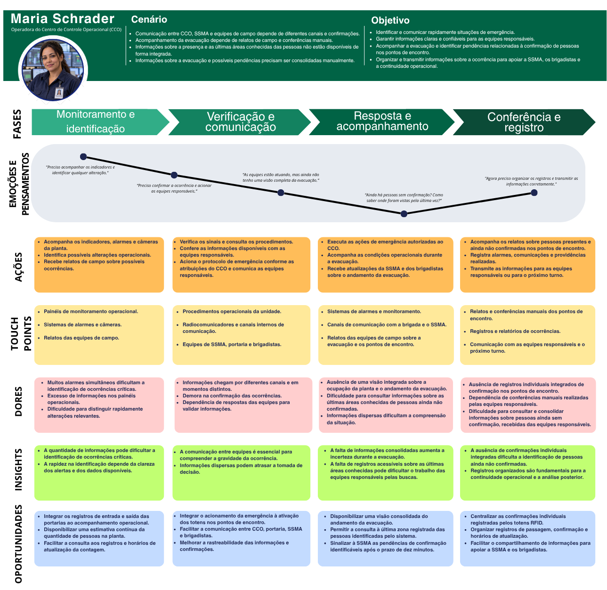
  <p><sub>Fonte: elaboração dos autores (2026).</sub></p>
</div>

**Cenário**

O cenário atual é caracterizado pela utilização de diferentes canais de comunicação entre o Centro de Controle Operacional (CCO), a equipe de Segurança, Saúde e Meio Ambiente (SSMA) e as equipes de campo, exigindo confirmações para garantir a transmissão adequada das informações. Durante a evacuação, o acompanhamento depende de relatos das equipes responsáveis e de conferências manuais realizadas nos pontos de encontro. Além disso, as informações sobre a presença das pessoas e suas últimas áreas conhecidas não estão disponíveis de forma integrada, dificultando a compreensão geral da situação. As informações sobre o andamento da evacuação e possíveis pendências também precisam ser consolidadas manualmente, aumentando a necessidade de organização e conferência dos dados recebidos.

**Objetivo**

O principal objetivo de Maria é identificar e comunicar rapidamente situações de emergência, garantindo que as equipes responsáveis recebam informações claras e confiáveis. Durante a ocorrência, busca acompanhar o andamento da evacuação e identificar pendências relacionadas à confirmação de pessoas nos pontos de encontro, sem assumir responsabilidades que pertencem às equipes de segurança. Além disso, procura organizar e transmitir as informações sobre a ocorrência para apoiar a atuação da SSMA e dos brigadistas, contribuindo para a continuidade operacional e para a comunicação entre as equipes e os turnos.

**Fases da jornada**

A jornada foi dividida em quatro fases principais, que representam a sequência de atividades desempenhadas pela operadora durante uma ocorrência. A primeira fase, Monitoramento e identificação, envolve o acompanhamento das condições operacionais e a identificação de possíveis alterações. Na segunda, Verificação e comunicação, Maria analisa os sinais disponíveis, consulta os procedimentos, confirma as informações com as equipes responsáveis e aciona o protocolo de emergência conforme as orientações estabelecidas. A terceira fase, Resposta e acompanhamento, corresponde à execução das ações autorizadas ao CCO e ao recebimento de atualizações da SSMA e dos brigadistas sobre o andamento da evacuação. Por fim, a fase de Conferência e registro envolve o acompanhamento dos relatos sobre pessoas presentes e ainda não confirmadas nos pontos de encontro, o registro das ocorrências e a transmissão das informações às equipes responsáveis ou ao próximo turno.

**Emoções e pensamentos**

As emoções e os pensamentos de Maria variam conforme a evolução da emergência. Inicialmente, ela demonstra atenção e familiaridade ao acompanhar os indicadores operacionais, atividade que faz parte de sua rotina. Quando identifica uma possível ocorrência, surge a preocupação de confirmar a situação e acionar as equipes responsáveis. Durante a resposta à emergência, a tensão aumenta devido à necessidade de acompanhar simultaneamente as condições operacionais e as atualizações recebidas, sem dispor de uma visão completa da evacuação. O maior vale de frustração ocorre quando Maria percebe que ainda podem existir pessoas sem confirmação nos pontos de encontro e não consegue identificar facilmente suas últimas áreas conhecidas. Na etapa final, ocorre uma recuperação emocional parcial, associada à organização dos registros e à transmissão das informações necessárias à continuidade do acompanhamento. Apesar disso, permanece a responsabilidade de garantir a clareza e a confiabilidade dos dados compartilhados.

**Ações**

As ações realizadas por Maria acompanham as quatro fases da jornada. Inicialmente, ela monitora indicadores, alarmes e câmeras da planta, identificando possíveis alterações operacionais e recebendo relatos das equipes de campo. Ao perceber uma ocorrência, verifica os sinais, consulta os procedimentos aplicáveis, confere as informações disponíveis e aciona o protocolo de emergência conforme as atribuições do CCO, comunicando as equipes responsáveis. Durante a resposta, executa as ações autorizadas ao CCO, acompanha as condições operacionais e recebe atualizações da SSMA e dos brigadistas sobre o andamento da evacuação. Na etapa final, acompanha os relatos sobre pessoas presentes e ainda não confirmadas nos pontos de encontro, registra alarmes, comunicações e providências realizadas e transmite as informações relevantes às equipes responsáveis ou ao próximo turno.

**Touchpoints (Pontos de contato)**

Os pontos de contato representam os recursos, canais e equipes com os quais Maria interage ao longo da jornada. Durante o monitoramento, utiliza painéis operacionais, sistemas de alarmes, câmeras e informações fornecidas pelas equipes de campo. Na verificação da ocorrência, consulta os procedimentos da unidade e utiliza radiocomunicadores e outros canais internos para interagir com a SSMA, a portaria e os brigadistas. Durante a resposta à emergência, mantém contato com a brigada, a SSMA e as equipes de campo, além de acompanhar os sistemas de monitoramento disponíveis e receber relatos sobre a evacuação. Na etapa final, utiliza informações provenientes das conferências manuais realizadas nos pontos de encontro, registros e relatórios de ocorrências e canais de comunicação com as equipes responsáveis e o próximo turno. Esses pontos de contato evidenciam a dependência de diferentes fontes para compreender o andamento da situação.

**Dores**

As principais dores identificadas estão relacionadas à dificuldade de interpretar, reunir e acompanhar informações durante uma emergência. Na primeira fase, a presença de alarmes simultâneos e o excesso de dados operacionais podem dificultar a identificação rápida de ocorrências críticas. Na segunda, a utilização de diferentes canais de comunicação e a necessidade de confirmação das informações podem aumentar o tempo necessário para compreender e comunicar a situação. Durante a resposta e o acompanhamento, a ausência de uma visão integrada sobre a ocupação da planta e o andamento da evacuação dificulta a compreensão geral da ocorrência. Além disso, a dificuldade para consultar informações sobre as últimas áreas conhecidas de pessoas ainda não confirmadas pode prejudicar o trabalho das equipes responsáveis pelas buscas. Na etapa final, a ausência de registros individuais integrados de confirmação nos pontos de encontro, a dependência de conferências manuais e a dificuldade para consolidar a quantidade de pessoas ainda sem confirmação representam desafios para o acompanhamento e a continuidade operacional.

**Insights**

A análise da jornada permite identificar que os desafios enfrentados por Maria não estão relacionados apenas à identificação de uma emergência, mas principalmente à disponibilidade e à confiabilidade das informações ao longo da ocorrência. A quantidade de alertas e dados operacionais pode dificultar a identificação de situações críticas, enquanto a comunicação entre equipes depende da clareza e da confirmação das informações compartilhadas. Durante a evacuação, a ausência de dados consolidados aumenta a incerteza sobre o andamento da resposta, especialmente pela dificuldade de consultar informações integradas sobre a ocupação da planta e as últimas áreas conhecidas das pessoas. Essa limitação também pode dificultar o direcionamento das buscas realizadas pelos brigadistas. Na etapa final, a ausência de confirmações individuais integradas dificulta a identificação de pessoas ainda não confirmadas nos pontos de encontro. Dessa forma, o principal aprendizado é a importância de disponibilizar informações organizadas, atualizadas e confiáveis para apoiar a comunicação, o acompanhamento da evacuação e a continuidade operacional.

**Oportunidades de melhoria**

As oportunidades de melhoria foram identificadas a partir das dificuldades observadas em cada fase da jornada e estão relacionadas às funcionalidades previstas na solução proposta. No monitoramento, destaca-se a possibilidade de integrar os registros de entrada e saída das portarias ao acompanhamento operacional, disponibilizando uma estimativa contínua da quantidade de pessoas na planta e facilitando a consulta aos registros e horários de atualização da contagem. Na fase de verificação e comunicação, surge a oportunidade de integrar o acionamento da emergência à ativação dos totens nos pontos de encontro, facilitar a comunicação entre CCO, portaria, SSMA e brigadistas e melhorar a rastreabilidade das informações e confirmações. Durante a resposta à emergência, a integração entre os registros das portarias, das zonas monitoradas e dos pontos de encontro pode proporcionar uma visão consolidada do andamento da evacuação. A consulta à última zona registrada das pessoas identificadas pelo sistema e a sinalização à SSMA das pendências de confirmação identificáveis após o prazo de dez minutos também podem apoiar a coordenação da resposta, sem representar uma localização precisa dos indivíduos. Na etapa final, as oportunidades envolvem centralizar as confirmações individuais registradas pelos totens RFID, organizar os registros de passagem e os horários de atualização e facilitar o compartilhamento das informações com as equipes responsáveis. Essas possibilidades representam funcionalidades planejadas para a solução final, cujos resultados ainda dependem de implementação e validação.

**Considerações finais**

A jornada atual evidencia que o acompanhamento de uma emergência industrial envolve diferentes atividades de monitoramento, verificação, comunicação e registro, que dependem da interação entre o CCO, a SSMA, os brigadistas e as equipes de campo. Entre os principais desafios identificados, destacam-se a ausência de informações integradas sobre a ocupação da planta, a dificuldade de consultar as últimas áreas conhecidas das pessoas e a dependência de conferências manuais para acompanhar as confirmações nos pontos de encontro. Essas limitações podem aumentar a incerteza durante a evacuação e dificultar a identificação de pendências e a organização das informações necessárias à continuidade operacional. Nesse contexto, a jornada atual permite compreender as necessidades que fundamentam a solução proposta, especialmente a integração de registros de passagem, monitoramento por zonas e confirmação nos pontos de encontro, preservando as responsabilidades das equipes de segurança e os procedimentos de emergência existentes.

###### Situação-Problema Futura

<div align="center">
  <p>Figura 9 – Jornada do Usuário do Futuro de Maria Schrader, Operadora de Centro de Controle Operacional (CCO)</p>
  
  <p><sub>Fonte: elaboração dos autores (2026).</sub></p>
</div>

**Cenário**

O cenário futuro considera a utilização da solução tecnológica desenvolvida pela Synthetix para apoiar o acompanhamento da evacuação em situações de emergência industrial. A proposta integra três tipos de dispositivos baseados em ESP32 a uma aplicação web: sensores ultrassônicos nas portarias para estimar a quantidade de pessoas na planta, leitores RFID nas zonas monitoradas para registrar as últimas passagens identificadas e totens RFID nos pontos de encontro para confirmar a chegada das pessoas. Nesse contexto, Maria passa a contar com informações integradas sobre a ocupação estimada da planta, as últimas zonas registradas, as confirmações nos pontos de encontro, possíveis pendências e horários de atualização. A aplicação web organiza esses dados para apoiar o acompanhamento da evacuação e a comunicação entre as equipes responsáveis, sem substituir os procedimentos operacionais e de segurança da Unipar.

**Objetivo**

O principal objetivo de Maria na jornada futura é acompanhar o andamento da evacuação com maior clareza e agilidade, utilizando informações organizadas sobre a ocupação estimada da planta, as últimas zonas registradas e as confirmações de chegada aos pontos de encontro. Com o apoio da aplicação web, ela busca consultar os registros disponíveis, identificar possíveis pendências e compartilhar informações relevantes com a equipe de Segurança, Saúde e Meio Ambiente (SSMA) e os brigadistas. Além disso, pretende utilizar os dados organizados para apoiar o registro das ocorrências e a transmissão das informações entre equipes e turnos, contribuindo para a continuidade operacional. A avaliação das pessoas ainda sem confirmação e a coordenação das buscas permanecem sob responsabilidade da SSMA, conforme os procedimentos estabelecidos.

**Fases da jornada**

A jornada futura permanece organizada em quatro fases principais: Monitoramento e identificação, Verificação e comunicação, Resposta e acompanhamento e Conferência e registro. Na primeira fase, Maria continua acompanhando os indicadores, alarmes e câmeras da planta para identificar possíveis alterações operacionais. Na segunda, verifica as informações disponíveis, consulta os procedimentos e aciona o protocolo de emergência conforme as atribuições do CCO, comunicando a SSMA, os brigadistas e a portaria. Esse acionamento permite iniciar o processo integrado de confirmação nos pontos de encontro designados pela SSMA, enquanto os porteiros são orientados a acionar os dispositivos locais das portarias. Na terceira fase, Maria utiliza a aplicação web para acompanhar os registros provenientes das portarias, das zonas monitoradas e dos pontos de encontro. Por fim, na etapa de conferência e registro, consulta as confirmações e possíveis pendências, verifica os horários de atualização e utiliza as informações disponíveis para apoiar a documentação e a comunicação com as equipes responsáveis.

**Emoções e pensamentos**

Na jornada futura, as emoções e os pensamentos de Maria apresentam uma evolução gradualmente mais positiva durante o acompanhamento da emergência. Inicialmente, ela mantém a atenção necessária ao monitoramento dos indicadores operacionais, atividade que faz parte de sua rotina. Ao identificar uma possível ocorrência, surge a preocupação de confirmar a situação e acionar o protocolo de emergência, representando o principal vale emocional da jornada, associado ao momento de maior tensão. Durante a resposta, a possibilidade de consultar os registros das zonas monitoradas e as confirmações nos pontos de encontro contribui para uma percepção de maior clareza sobre o andamento da evacuação. Essa percepção melhora quando Maria consegue identificar possíveis pendências e verificar os horários de atualização das informações, embora permaneça a necessidade de avaliar sua confiabilidade. Na etapa final, ocorre o principal pico de satisfação relativa, associado à organização dos registros e à transmissão das informações com maior clareza, sem eliminar completamente as incertezas relacionadas à ocorrência.

**Ações**

As ações realizadas por Maria na jornada futura continuam relacionadas ao monitoramento operacional, à verificação de ocorrências, à comunicação com as equipes e ao registro das informações. Inicialmente, ela acompanha os indicadores, alarmes e câmeras da planta, identifica possíveis alterações operacionais e recebe relatos das equipes de campo. Ao perceber uma ocorrência, verifica os sinais, consulta os procedimentos aplicáveis, confirma as informações disponíveis e aciona o protocolo de emergência, conforme as atribuições do CCO, comunicando a SSMA, os brigadistas e a portaria. Durante a resposta, executa as ações autorizadas ao CCO e consulta a aplicação web para acompanhar a estimativa de ocupação da planta, as últimas zonas registradas e as confirmações disponíveis de chegada aos pontos de encontro. Na etapa final, consulta os registros de confirmação e as possíveis pendências, verifica os horários de atualização e eventuais inconsistências e utiliza os dados disponíveis para apoiar os registros e a comunicação com as equipes responsáveis.

**Touchpoints (Pontos de contato)**

Os pontos de contato da jornada futura incluem os recursos operacionais já utilizados por Maria e as interfaces previstas na solução Synthetix. Durante o monitoramento, permanecem os painéis operacionais, sistemas de alarmes, câmeras e informações fornecidas pelas equipes de campo. Na verificação da ocorrência, Maria consulta os procedimentos da unidade e utiliza radiocomunicadores e outros canais internos para interagir com a SSMA, a portaria e os brigadistas. Durante a resposta à emergência, a aplicação web passa a representar um novo ponto de contato, reunindo informações provenientes dos sensores ultrassônicos das portarias, dos leitores RFID instalados nas zonas monitoradas e dos totens de confirmação nos pontos de encontro. Na etapa de conferência e registro, Maria utiliza a aplicação para consultar confirmações, possíveis pendências e horários de atualização, além de recorrer aos registros de ocorrências e aos canais de comunicação com as equipes responsáveis e o próximo turno. Esses recursos complementam os procedimentos de segurança existentes, sem substituir a atuação das equipes em campo.

**Dores**

Embora a solução proposta busque reduzir as dificuldades identificadas na jornada atual, alguns desafios ainda podem permanecer na experiência futura de Maria. Durante o monitoramento, a presença de alarmes simultâneos e o excesso de informações operacionais continuam exigindo atenção constante e interpretação cuidadosa. Na etapa de verificação e comunicação, a confirmação das ocorrências ainda depende das equipes responsáveis, enquanto possíveis falhas de conexão podem exigir o acionamento local dos totens por membros autorizados da SSMA ou brigadistas. Durante a resposta à emergência, interrupções de rede podem atrasar a atualização dos registros na aplicação web, e leituras RFID ausentes ou duplicadas podem provocar inconsistências nos estados das zonas monitoradas. Além disso, a última zona registrada representa apenas a última passagem detectada, não a localização exata da pessoa. Na etapa final, divergências entre a contagem estimada das portarias e as confirmações RFID podem dificultar a interpretação das pendências, tornando necessária a avaliação das informações pela SSMA antes de orientar as ações das equipes responsáveis.

**Insights**

Os insights da jornada futura evidenciam que a integração tecnológica pode melhorar o acompanhamento da evacuação, mas sua efetividade continua dependendo da qualidade dos registros e da comunicação entre as equipes. O monitoramento operacional e a interpretação adequada dos alertas permanecem fundamentais para identificar possíveis emergências. Na etapa de verificação, a integração entre o acionamento do protocolo e a ativação dos totens pode agilizar o início das confirmações, sem eliminar a necessidade de comunicação e validação entre os envolvidos. Durante a resposta, a integração dos dados das portarias, zonas monitoradas e pontos de encontro pode proporcionar uma visão mais abrangente da evacuação. Entretanto, a última zona registrada não representa a localização atual da pessoa, embora possa fornecer uma referência para apoiar buscas coordenadas pela SSMA. Na etapa final, as confirmações RFID facilitam a consulta às chegadas registradas nos pontos de encontro, enquanto as estimativas de ocupação e os indicadores de pendência precisam ser interpretados considerando possíveis erros de leitura, registros incompletos e diferenças entre as fontes de dados.

**Oportunidades de melhoria**

As oportunidades identificadas na jornada futura estão relacionadas ao aperfeiçoamento da solução e à ampliação de sua capacidade de apoiar o acompanhamento das emergências. Na fase de monitoramento, destacam-se possibilidades de melhorar a integração entre os sistemas operacionais e os dados da evacuação, identificar possíveis divergências na estimativa de ocupação da planta e aprimorar a clareza das informações apresentadas. Durante a verificação e comunicação, surgem oportunidades para facilitar o compartilhamento de informações entre equipes, melhorar o registro do acionamento do protocolo e da ativação dos pontos de encontro e aperfeiçoar os procedimentos de contingência em caso de falhas de conexão. Na resposta à emergência, destacam-se melhorias relacionadas à atualização dos dados, à identificação de registros incompletos ou inconsistentes e à comparação entre os registros das zonas monitoradas e as confirmações nos pontos de encontro. Por fim, na etapa de conferência e registro, as oportunidades envolvem facilitar a identificação e a análise de pendências de confirmação após o prazo de dez minutos, aprimorar a rastreabilidade e o histórico dos registros eletrônicos e melhorar a validação e a transmissão das informações entre equipes e turnos.

**Considerações finais**

A jornada futura de Maria demonstra como a solução Synthetix pode transformar o acompanhamento de uma evacuação industrial por meio da integração de informações provenientes das portarias, zonas monitoradas e pontos de encontro. Enquanto a jornada atual apresenta dificuldades relacionadas à dispersão das informações, à ausência de registros individuais integrados e à dependência de conferências manuais, o cenário futuro prevê a utilização de sensores ultrassônicos, leitores RFID, totens de confirmação e uma aplicação web para organizar os dados da evacuação. Essa integração tem potencial para reduzir incertezas, facilitar a identificação de possíveis pendências e apoiar a comunicação entre o CCO, a SSMA e os brigadistas. Entretanto, a solução não oferece localização precisa, não comprova automaticamente a segurança das pessoas e não substitui os procedimentos de emergência da Unipar. Seus benefícios dependem da confiabilidade dos sensores e leitores, da atualização dos registros, da integração entre os dispositivos e da validação das informações pelas equipes responsáveis.

##### 3.2.2.1.2. Gestor de SSMA (Segurança, Saúde e Meio Ambiente)

###### Situação-Problema Presente

<div align="center">
  <p>Figura 10 – Jornada do Usuário do Presente de Tuco Salamanca, Gestor de SSMA</p>
  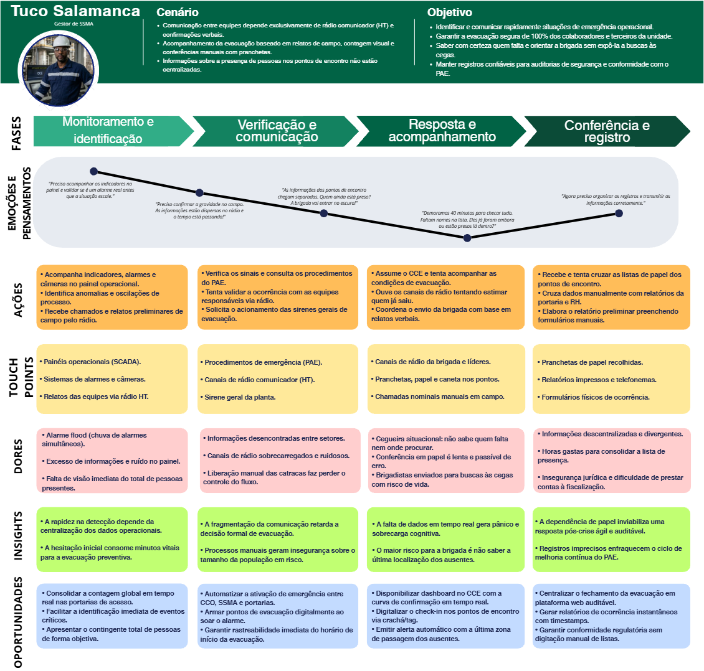
  <p><sub>Fonte: elaboração dos autores (2026).</sub></p>
</div>

**Cenário**

O cenário atual da gestão de Segurança, Saúde e Meio Ambiente (SSMA) na fábrica de Cubatão durante situações de emergência é pautado pela fragmentação dos fluxos de comunicação e pela dependência de ferramentas manuais e analógicas. A troca de mensagens entre os setores operacionais, o Centro de Controle Operacional (CCO), o Centro de Controle de Emergência (CCE) e as frentes de campo ocorre quase que exclusivamente por meio de radiocomunicadores portáteis (HT) e confirmações verbais, frequentemente prejudicadas por ruídos industriais e sobrecarga de canal. O acompanhamento do abandono da planta baseia-se em relatos verbais descentralizados, estimativas visuais e conferências manuais com listas em papel afixadas em pranchetas nos Pontos de Encontro (PEs). Além disso, a ausência de uma base centralizada de dados em tempo real e a abertura compulsória das catracas no momento do alarme — necessária para viabilizar a fuga célere dos colaboradores — eliminam os registros convencionais de saída, criando um ponto cego crítico quanto ao contingente real de pessoas retidas no interior da fábrica.

**Objetivo**

O objetivo principal de Tuco Salamanca como Gestor de SSMA é exercer a liderança estratégica da emergência, garantindo a evacuação segura e ágil de 100% dos colaboradores diretos e prestadores de serviços terceirizados da unidade. Ele precisa identificar e validar rapidamente a gravidade das ocorrências operacionais (tais como vazamentos tóxicos de cloro ou incêndios industriais), determinar com exatidão quem são os indivíduos ausentes nos pontos de encontro e orientar a brigada de emergência com dados consistentes, evitando que equipes de resgate realizem buscas às cegas em áreas de risco iminente. Adicionalmente, busca assegurar o cumprimento rigoroso dos prazos do Plano de Ação de Emergência (PAE) e consolidar registros confiáveis para fins periciais, auditorias de segurança e conformidade perante órgãos fiscalizadores (como Cetesb e Ministério do Trabalho e Emprego).

**Fases da jornada**

A jornada do presente estrutura-se em quatro fases sequenciais que definem a dinâmica de resposta sob a liderança de SSMA. A primeira fase, Monitoramento e identificação, consiste no acompanhamento de indicadores no painel operacional, na detecção de oscilações anômalas no processo químico e na recepção de relatos preliminares de campo via rádio. A segunda fase, Verificação e comunicação, envolve a consulta aos protocolos técnicos do PAE, o diálogo por rádio com a operação para averiguar a gravidade do evento e a solicitação formal de acionamento das sirenes gerais de evacuação. A terceira fase, Resposta e acompanhamento, corresponde à instalação do CCE, à tentativa de quantificação dos evacuados a partir de escuta atenta dos canais de rádio e à coordenação do envio da brigada a partir de relatos verbais. Por fim, a fase de Conferência e registro engloba o recolhimento físico das listas de presença nos pontos de encontro, a conciliação manual desses papéis com listagens do RH e da portaria e o preenchimento manual dos relatórios preliminares de ocorrência.

**Emoções e pensamentos**

A curva emocional de Tuco no cenário presente reflete uma crescente tensão psicológica, atingindo um vale profundo de angústia e sobrecarga cognitiva no instante mais decisivo da crise. Inicialmente, durante o monitoramento de rotina, apresenta postura vigilante e controlada, expressando: _"Preciso acompanhar os indicadores no painel e validar se é um alarme real antes que a situação escale"_. Ao adentrar a fase de verificação e comunicação, o estresse se acentua pela hesitação inerente à falta de clareza situacional: _"Preciso confirmar a gravidade no campo. As informações estão dispersas no rádio e o tempo está passando!"_. O momento de maior desespero e frustração (vale mais agudo da jornada) manifesta-se na fase de resposta e acompanhamento, quando as incertezas colocam vidas humanas em risco: _"As informações dos pontos de encontro chegam separadas. Quem ainda está preso? A brigada vai entrar no escuro!"_. Na fase final, após a normalização das áreas, Tuco sente alívio parcial mesclado a exaustão e insegurança jurídica diante da lentidão dos métodos manuais: _"Demoramos 40 minutos para checar tudo. Faltam nomes na lista. Eles já foram embora ou estão presos lá dentro?"_.

**Ações**

As ações desempenhadas por Tuco traduzem a árdua rotina de preenchimento de lacunas informacionais por métodos manuais. No monitoramento e identificação, ele acompanha indicadores de processo, alarmes e imagens de câmeras no painel SCADA, identifica flutuações atípicas e recebe alertas e chamados preliminares de técnicos de operação pelo rádio HT. Na etapa de verificação e comunicação, confere os sinais de instrumentação, consulta as diretrizes operacionais do PAE, estabelece contato com as equipes de campo para validar o sinistro e autoriza o acionamento dos sinais sonoros de evacuação geral. Durante a resposta e acompanhamento, assume o comando da emergência no CCE, monitora os canais de rádio em busca de informes sobre a movimentação das equipes e autoriza o despacho dos brigadistas com base em estimativas orais. Por fim, na conferência e registro, recebe fisicamente as pranchas e folhas recolhidas pelos líderes de ponto de encontro, tenta cruzar manualmente os nomes assinalados com as listas de acesso da portaria e formulários de terceiros e redige o relatório inicial de sinistro em formulários físicos.

**Touchpoints (Pontos de contato)**

Os pontos de contato evidenciam a predominância de interfaces dispersas, equipamentos analógicos e comunicações verbais. No monitoramento, Tuco interage com as telas do sistema supervisório (SCADA), detectores fixos de gás, painéis de alarme e imagens de câmeras de segurança, além do canal de rádio HT. Na fase de verificação, os pontos de contato são as pastas físicas e procedimentos documentados do PAE, os canais de rádio compartilhados com líderes industriais e a botoeira de sirene geral da planta. Na resposta à emergência, as interações ocorrem pelos canais de rádio da brigada e dos líderes de área, pranchetas com papel e caneta nos pontos de encontro e a realização de chamadas orais nominais em campo aberto. No encerramento e registro, os pontos de contato são as próprias listas de papel recolhidas dos PEs, relatórios impressos de controle de acesso, telefonemas para conferência com gestores de contratadas e formulários físicos padronizados de ocorrência.

**Dores**

As dores identificadas retratam severas fragilidades operacionais decorrentes da dependência de registros manuais e processos analógicos. Na primeira fase, manifesta-se o problema do _alarm flood_ (avalanche de alarmes simultâneos), gerando excesso de ruído visual no painel e privando a liderança de uma visão imediata da quantidade exata de pessoas presentes na fábrica. Na segunda fase, destacam-se as informações desencontradas entre setores fabris, a saturação ruidosa dos canais de rádio e a perda irreversível do controle de fluxo causada pela liberação compulsória das catracas de portaria. Durante a resposta e acompanhamento, a dor culminante é a "cegueira situacional": a liderança não consegue determinar com exatidão quem está ausente nem em qual setor da planta realizar as buscas; paralelamente, a contagem física em papel mostra-se lenta e suscetível a erros humanos, forçando os brigadistas a realizarem buscas exploratórias às cegas, com grave exposição a atmosferas perigosas. Na fase final, a dispersão e as inconsistências entre listas descentralizadas demandam horas de conciliação pós-crise, gerando insegurança jurídica e vulnerabilidade em auditorias e fiscalizações externas.

**Insights**

A análise da jornada atual proporciona aprendizados decisivos para a concepção de uma solução tecnológica eficaz. Inicialmente, constata-se que a agilidade na detecção de sinistros químicos depende diretamente da centralização de dados operacionais e da minimização de ruídos cognitivos. Em segundo lugar, a hesitação humana decorrente de informações fragmentadas consome minutos vitais, retardando a tomada de decisão formal de evacuação preventiva e expondo os trabalhadores à inalação de substâncias tóxicas. Em terceiro lugar, a ausência de telemetria em tempo real no CCE provoca sobrecarga cognitiva e desgaste emocional extremo no gestor de crise. Por fim, evidencia-se que o maior perigo para a brigada de resgate reside no desconhecimento da última localização conhecida dos indivíduos ausentes, demonstrando que métodos estritamente baseados em papel inviabilizam o cumprimento do SLA crítico de resgate e comprometem a rastreabilidade necessária à melhoria contínua do PAE.

**Oportunidades de melhoria**

As dores mapeadas no presente fundamentam diretamente as especificações funcionais da solução proposta pela Synthetix. Na fase de monitoramento, destaca-se a oportunidade de integrar sensores nas portarias para calcular e exibir um contingente global objetivo em tempo real, permitindo identificar precocemente variações críticas. Na verificação e comunicação, surge a necessidade de automatizar a ativação de emergência entre CCO, SSMA e portarias, armando digitalmente os pontos de encontro ao toque da sirene e registrando com precisão o marco temporal de início da evasão. Na resposta e acompanhamento, desponta a exigência de prover um dashboard no CCE com a curva de confirmação em tempo real, digitalizar a validação nos PEs por aproximação de crachás RFID e disparar alertas automáticos com a última zona de passagem registrada dos colaboradores ausentes. Na conferência e registro, a oportunidade reside em centralizar o fechamento da emergência em uma plataforma web auditável, gerando automaticamente relatórios consolidados com carimbos de tempo (_timestamps_), dispensando digitações manuais e assegurando conformidade regulatória.

**Considerações finais**

A jornada do presente vivenciada por Tuco Salamanca sintetiza o esgotamento dos modelos convencionais de evacuação baseados em contagem por papel e comunicação verbal descentralizada. Em um ambiente industrial de alto risco com agentes químicos voláteis como o cloro, no qual cada fração de minuto é determinante para a preservação de vidas, a dependência de processos manuais que levam até 40 minutos para conciliar dados torna a operação vulnerável e eleva drasticamente o risco para as equipes de busca. Esse cenário evidencia a imperativa urgência de dotar o Gestor de SSMA de ferramentas digitais capazes de automatizar o balanço populacional da fábrica, fornecer telemetria em tempo real e transformar o resgate em uma intervenção tática orientada por dados precisos.

###### Situação-Problema Futura

<div align="center">
  <p>Figura 11 – Jornada do Usuário do Futuro de Tuco Salamanca, Gestor de SSMA</p>
  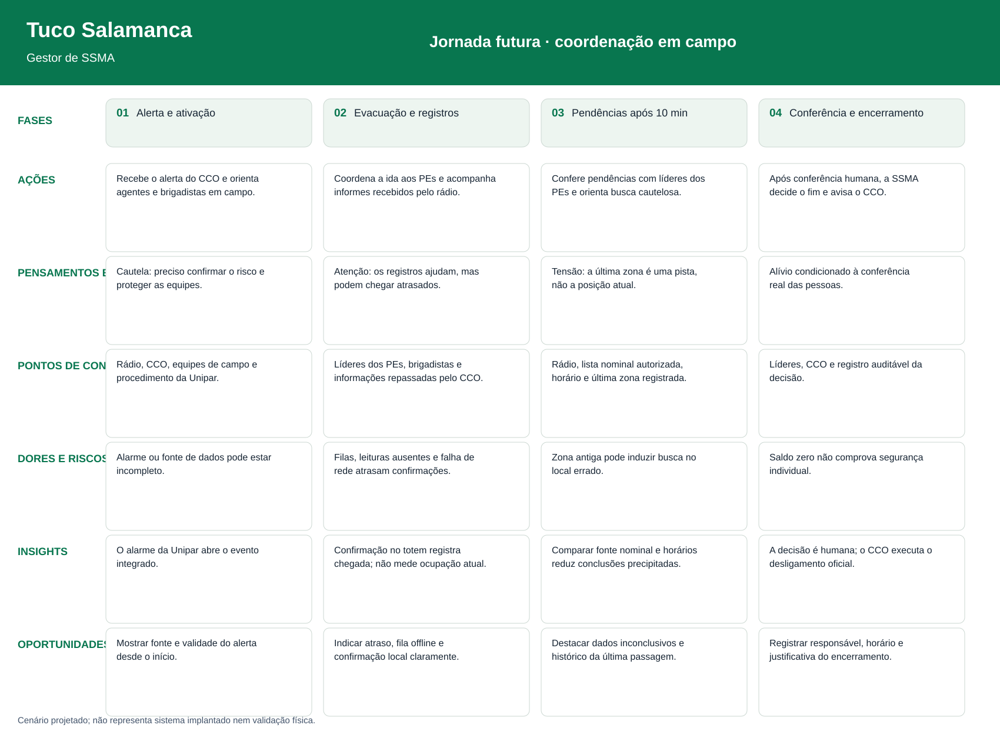
  <p><sub>Fonte: elaboração dos autores (2026).</sub></p>
</div>

**Cenário**

O cenário futuro pressupõe a integração ainda planejada entre contagem anônima nas portarias, leitores RFID nas passagens de zonas, totens nos pontos de encontro e aplicação web no CCO. Os registros de zona mostram a última passagem detectada e as leituras nos totens registram chegadas, com possibilidade de sincronização posterior após falha de rede. O CCO acompanha a tela de monitoramento e repassa dados pelo rádio. Tuco atua principalmente em campo, podendo consultar a aplicação quando necessário; as estimativas e confirmações apoiam sua decisão, sem comprovar a posição atual ou a segurança individual de cada pessoa.

**Objetivo**

O objetivo de Tuco é coordenar agentes de segurança e brigadistas para apoiar uma evacuação segura e conferir as pessoas sem confirmação. Ele usa as informações transmitidas pelo CCO, especialmente a última zona registrada e os horários de leitura, para orientar verificações sem tratar esses dados como coordenadas atuais. Busca preservar o acesso restrito aos dados nominais e decidir, após conferência com os líderes em campo, quando a operação pode ser encerrada. O CCO realiza o desligamento oficial do alarme e registra o fechamento.

**Fases da jornada**

A jornada futura organiza-se em quatro fases. Na ativação, o CCO acompanha o alarme e o evento na aplicação e transmite as informações pelo rádio; Tuco orienta as equipes em campo. Na evacuação, os totens registram chegadas e o CCO comunica à SSMA os números e horários disponíveis. Aos dez minutos, o CCO sinaliza pendências e últimas zonas registradas; Tuco confirma as listas com os líderes dos pontos de encontro e coordena uma busca cautelosa quando necessária. No encerramento, a SSMA decide se a operação terminou; o CCO desliga oficialmente o alarme, registra a decisão e prepara o relatório.

**Emoções e pensamentos**

Na jornada futura, Tuco mantém contato pelo rádio com o CCO e com as equipes de campo. O painel pode reduzir a incerteza ao mostrar confirmações e pendências, mas dados atrasados ou divergentes ainda exigem cautela. Ao receber a indicação de duas pendências após dez minutos, pede conferência aos líderes dos pontos de encontro e prepara a brigada para verificar a última zona registrada. O alívio no fim da operação depende da confirmação humana de segurança, além do saldo apresentado.

**Ações**

Tuco coordena a resposta em campo, recebe do CCO os alertas e dados da aplicação e transmite instruções aos agentes de segurança e brigadistas. Ele pode consultar o painel quando a situação permitir. Para pendências, confronta as listas dos pontos de encontro com as últimas passagens RFID antes de orientar uma busca cuidadosa. Após a conferência dos líderes, a SSMA decide pelo encerramento e comunica o CCO, que desliga oficialmente o alarme, registra a justificativa e prepara o relatório.

**Touchpoints (Pontos de contato)**

Os principais pontos de contato de Tuco são o rádio, os líderes dos pontos de encontro, os agentes de segurança e a brigada. A aplicação web é acompanhada continuamente pelo CCO e pode ser consultada por Tuco quando necessário. Os sensores das portarias, leitores de zona e totens alimentam o painel com registros cuja atualização e integridade precisam ser verificadas. No encerramento, a comunicação SSMA–CCO e o registro de auditoria documentam a decisão e o desligamento oficial do alarme.

**Dores**

A solução proposta pode reduzir o tempo de consolidação das informações e apoiar a busca dirigida, desde que as fontes sejam confiáveis e a integração seja validada. Permanecem riscos de contagem incorreta nas portarias, crachás não lidos, falhas de rede, atraso na sincronização e listas nominais incompletas. A última zona registrada indica uma passagem detectada e deve ser usada como pista para a verificação cautelosa, nunca como localização em tempo real.

**Insights**

A jornada futura ilustra ganhos esperados, ainda sujeitos a ensaio: congelar a referência numérica no início da emergência, reunir confirmações por RFID e disponibilizar ao CCO a última zona registrada podem acelerar a conferência. O retorno sonoro e visual do totem confirma a leitura, não a segurança física. O marco de dez minutos apoia a decisão de resposta; o histórico digital ajuda a auditoria, mas depende de dados completos e da aplicação do procedimento da Unipar.

**Oportunidades de melhoria**

As oportunidades de melhoria seguem as limitações observadas na própria jornada. Na ativação, o CCO deve ver a origem e o horário do alerta e distinguir um evento confirmado de um sinal ainda em verificação. Durante a evacuação, a interface deve mostrar atrasos, filas offline e a diferença entre leitura local e confirmação conciliada na plataforma. Aos dez minutos, o painel deve destacar pendências nominais apenas quando a fonte identificada for válida e apresentar a última zona como passagem histórica, com seu horário. No encerramento, a aplicação deve exigir o registro da decisão da SSMA e permitir ao CCO documentar o desligamento oficial do alarme com responsável, instante e justificativa. Essas melhorias dependem de implementação e validação futuras.

**Considerações finais**

A jornada futura de Tuco Salamanca descreve uma coordenação de campo apoiada por registros digitais e pela comunicação constante com o CCO. A contagem das portarias é estimada, a última zona RFID é um registro de passagem e o saldo de confirmações não comprova segurança individual. Com essas limitações visíveis, Tuco pode orientar a conferência e os brigadistas, decidir quando a evacuação terminou e comunicar a decisão ao CCO para o desligamento oficial do alarme e o registro da ocorrência.

#### 3.2.2.2. Storyboard

##### 3.2.2.2.1. Operadora de Centro de Controle Operacional (CCO)

O storyboard apresenta a jornada de Maria Schrader, operadora do Centro de Controle Operacional (CCO), durante uma situação de emergência industrial, ilustrando como a solução Synthetix apoia o acompanhamento da evacuação. Organizado em sete quadros sequenciais, o storyboard retrata desde o monitoramento inicial da planta e a verificação da ocorrência até o acionamento do protocolo de emergência, o acompanhamento da evacuação e o registro das informações. Cada quadro evidencia o ambiente, as ações e decisões de Maria e as respostas dos sistemas envolvidos, demonstrando como a integração de sensores, leitores RFID e uma aplicação web pode facilitar o acesso às informações, a identificação de possíveis pendências e a comunicação entre as equipes responsáveis, sem substituir os procedimentos de segurança existentes.

<div align="center">
  <p>Figura 12 – Storyboard de Maria Schrader, Operadora de Centro de Controle Operacional (CCO)</p>
  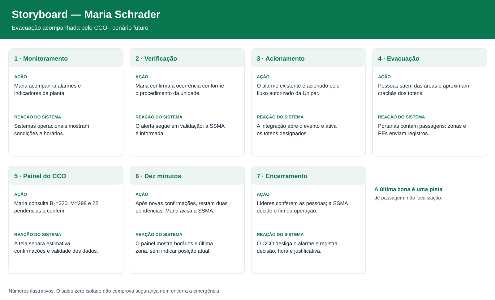
  <p><sub>Fonte: elaboração dos autores (2026), revisão vetorial do storyboard anterior.</sub></p>
</div>

**Cena 1 – Monitoramento da operação**

Maria está no Centro de Controle Operacional (CCO), acompanhando os indicadores, alarmes e câmeras da planta durante sua rotina. Os sistemas operacionais exibem as condições monitoradas em tempo real, permitindo que ela identifique possíveis alterações e mantenha a atenção sobre o funcionamento da unidade.

**Cena 2 – Verificação da ocorrência**

Ao receber um alerta, Maria analisa os indicadores, consulta as câmeras e verifica os procedimentos da unidade para determinar se a situação representa uma emergência. Enquanto realiza essa avaliação, os sistemas operacionais continuam exibindo os dados da área afetada. Com base nas informações disponíveis, Maria decide se deve prosseguir com o protocolo de emergência.

**Cena 3 – Identificação e acionamento**

Após confirmar a ocorrência, Maria segue os procedimentos da unidade e comunica a situação à SSMA, aos brigadistas e à portaria, respeitando suas atribuições no CCO. Com o acionamento do protocolo de emergência, a solução Synthetix inicia o acompanhamento da evacuação, preparando a integração dos registros provenientes dos dispositivos instalados na planta.

**Cena 4 – Registro da evacuação**

Com a evacuação em andamento, os trabalhadores se deslocam até os pontos de encontro definidos pelas equipes responsáveis. Durante esse processo, os sensores ultrassônicos das portarias fornecem dados para estimar a ocupação da planta, os leitores RFID registram as passagens pelas zonas monitoradas e os totens RFID confirmam as chegadas aos pontos de encontro. A solução integra essas informações e as disponibiliza na aplicação web.

**Cena 5 – Acompanhamento em tempo real**

Maria acessa a aplicação web da Synthetix para acompanhar o andamento da evacuação. O sistema apresenta a ocupação estimada da planta, as últimas zonas registradas pelos leitores RFID e as confirmações nos pontos de encontro, destacando possíveis pendências. Com essas informações organizadas e atualizadas conforme os registros recebidos, Maria consegue acompanhar a situação com maior clareza.

**Cena 6 – Análise e alinhamento**

Ao identificar possíveis pendências na aplicação, Maria consulta os últimos registros RFID e verifica os horários de atualização das informações. O sistema apresenta os dados disponíveis sobre as pessoas ainda sem confirmação, permitindo que ela compartilhe essas informações com a SSMA. A equipe responsável utiliza os registros como apoio à verificação em campo, considerando que a última zona registrada não representa necessariamente a localização atual da pessoa.

**Cena 7 – Conferência e registro**

Após a conferência em campo pelos líderes dos pontos de encontro, a SSMA decide se a operação terminou e comunica a decisão ao CCO. Maria registra o responsável, a hora e a justificativa, desliga oficialmente o alarme conforme o procedimento da Unipar e prepara o relatório para as equipes e o próximo turno. Os valores ilustrativos de 320 pessoas de referência, 298 confirmações e 22 pendências na cena 5 evoluem para duas pendências na cena 6 após novas confirmações; a cena 7 não presume que saldo zero isolado comprove segurança.

##### 3.2.2.2.2. Gestor de SSMA (Segurança, Saúde e Meio Ambiente)

O storyboard apresenta Tuco Salamanca, gestor de SSMA, coordenando a evacuação em campo. Em sete cenas, ele recebe pelo rádio as informações do CCO, orienta agentes de segurança e brigadistas, verifica pendências com líderes dos pontos de encontro e decide quando a operação pode terminar. O CCO acompanha a aplicação e comunica as últimas zonas registradas, que servem como pistas para a busca, sem informar a posição atual exata. Após a decisão da SSMA, o CCO registra o encerramento e desliga oficialmente o alarme.

<div align="center">
  <p>Figura 13 – Storyboard de Tuco Salamanca, Gestor de SSMA</p>
  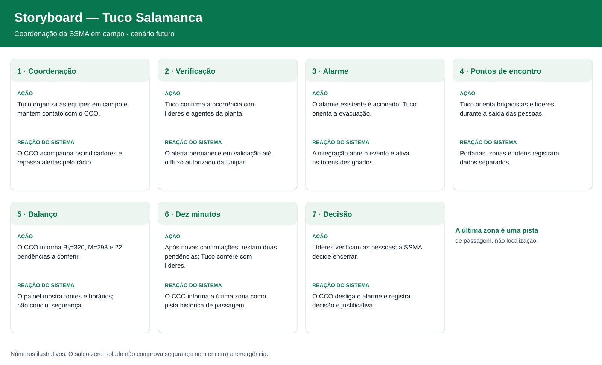
  <p><sub>Fonte: elaboração dos autores (2026), revisão vetorial do storyboard anterior.</sub></p>
</div>

**Cena 1 – Monitoramento da operação**

Tuco acompanha as equipes em campo com o rádio. No CCO, Maria monitora as telas e mantém contato com ele para transmitir alertas e informações sobre a evacuação.

**Cena 2 – Verificação da ocorrência**

O CCO identifica um alerta na tela de monitoramento e informa Tuco pelo rádio. Ele consulta a equipe em campo para confirmar a ocorrência e definir a resposta conforme o procedimento da planta.

**Cena 3 – Identificação e acionamento**

Depois da confirmação da ocorrência, o alarme existente da Unipar é acionado pelo fluxo autorizado da unidade. A integração abre o evento na aplicação e ativa os totens designados. Tuco transmite as orientações pelo rádio, coordena agentes e brigadistas e acompanha o início da evacuação.

**Cena 4 – Registro da evacuação**

Tuco orienta agentes e brigadistas no deslocamento das pessoas para os pontos de encontro designados. As passagens por zonas e as confirmações nos totens são registradas; o CCO acompanha os dados na aplicação e repassa informações relevantes pelo rádio.

**Cena 5 – Acompanhamento em tempo real**

No CCO, Maria acompanha o painel com a referência inicial de 320 pessoas, 298 confirmações e 22 pendências, conforme o exemplo ilustrado no storyboard. Ela comunica o balanço a Tuco pelo rádio. Esses números apoiam a coordenação, mas não comprovam segurança individual.

**Cena 6 – Gestão de pendências (10 min)**

Depois de novas confirmações, aos dez minutos restam duas pessoas sem confirmação no exemplo. O CCO informa a Tuco pelo rádio as pendências e a última passagem RFID registrada na Zona B. Tuco pede aos líderes dos pontos de encontro que confiram suas listas e orienta a brigada a preparar uma busca cuidadosa, conforme o procedimento. A última zona registrada é uma pista de passagem, não a posição atual dessas pessoas.

**Cena 7 – Conferência e encerramento**

Após a conferência em campo, os líderes informam que as pessoas estão seguras. Tuco, pela SSMA, decide que a operação de evacuação pode ser encerrada e comunica a decisão ao CCO. O CCO registra o encerramento com a justificativa e desliga oficialmente o alarme de emergência. O relatório preserva o histórico da ocorrência; o saldo zero isolado não determina esse fechamento.

## 3.3. Solução Técnica

_Nesta seção, detalhe a especificação da solução, de acordo com o disposto nas subseções._

### 3.3.1. Requisitos Funcionais

Os requisitos funcionais descrevem o comportamento esperado da solução final e seguem o padrão "QUANDO/ENQUANTO/SE, o <sujeito> DEVE <resposta>". Cada linha descreve um único comportamento verificável; comportamentos da mesma funcionalidade compartilham o número e recebem um sufixo (por exemplo, RF001.1 e RF001.2). Os requisitos estão agrupados por parte da solução: nó da portaria (RF001 a RF005), nó de zona (RF006 e RF007), totem dos pontos de encontro (RF008 a RF011), comunicação e cadastro dos dispositivos (RF012 a RF015) e aplicação web (RF016 a RF025). A coluna "Critério de teste" indica como cada requisito é verificado e, quando já existe, o caso de teste correspondente (seções 3.4.1 e 3.4.2).

**Sujeitos:** o **nó da portaria** é o dispositivo com ESP32 e dois sensores ultrassônicos instalado nas portarias (Arduino Uno no protótipo da Sprint 1); o **nó de zona** é o dispositivo com ESP32 e leitor RC522 instalado em cada porta monitorada; o **totem** é o dispositivo com ESP32 e leitor RFID instalado em cada ponto de encontro; a **plataforma** reúne o broker MQTT, o backend e a lógica de consolidação dos dados; o **painel** é a interface usada pela SSMA e pelo CCO. Quando o requisito diz apenas "o nó", ele vale para os três tipos de dispositivo.

**Tipos de requisito:** Ubíquo (sempre ativo); Evento (QUANDO: resposta a um gatilho); Estado (ENQUANTO: vale durante uma condição); Indesejado (SE... ENTÃO: resposta a uma falha ou situação anormal).

**Atores:** pessoas que interagem com a solução ou recebem suas informações. Os códigos são usados na coluna "Atores" do quadro e nas regras de negócio (3.3.2): A01: Tuco, gestor de SSMA; A02: brigadistas e responsáveis pela conferência no ponto de encontro; A03: Gustavo, técnico de operação; A04: Infraestrutura/TI; A05: Maria, operadora de CCO; A06: porteiros das entradas e saídas da planta.

**Indicadores:** `P(t)` é a estimativa anônima de pessoas na planta; `B₀` é essa estimativa congelada em `t0`; `Z(t)` reúne identificadores associados a zonas; `M(t)` reúne identificadores com chegada registrada em PE; `H(t) = P(t) − \|Z(t)\|` é uma diferença numérica sujeita a erro e não uma lista nominal. `B₀ − \|M(t)\|` compara a referência congelada com as confirmações, mas não identifica individualmente quem falta. `G(t)` é a relação nominal esperada obtida de registros identificados de acesso, em fluxo separado da contagem ultrassônica; `G(t) \ M(t)` é a lista de pessoas identificadas ainda sem confirmação, sujeita à completude dessa fonte. A última leitura em zona orienta a conferência, sem indicar posição em tempo real.

<p align="center">Quadro 7 – Requisitos funcionais e critérios de verificação</p>

| ID      | Tipo       | Requisito                                                                                                                                                                                                                                           | Atores        | Origem / RN                                                                                                                                                                                                                                                                                                                                | Critério de teste                                                                                                                                                | Situação                                                                                                             |
| --- | --- | --- | --- | --- | --- | --- |
| RF001.1 | Evento     | QUANDO o sensor de entrada medir distância maior que 0 e menor que 200 cm e o nó da portaria estiver desbloqueado, o nó da portaria DEVE incrementar o total local em 1.                                                                            | A03, A06      | 3.1.3; 3.4.1 / RN12, RN13 | Objeto a menos de 200 cm no sensor de entrada aumenta o total em 1 (CT01 a CT05).                                                                                | Implementado no protótipo Uno da Sprint 1; versão ESP32 a desenvolver                                                |
| RF001.2 | Evento     | QUANDO o sensor de saída medir distância maior que 0 e menor que 200 cm, o nó da portaria estiver desbloqueado e o total local for maior que 0, o nó da portaria DEVE decrementar o total local em 1.                                               | A03, A06      | 3.1.3; 3.4.1 / RN12, RN13 | Objeto no sensor de saída com total maior que 0 reduz o total em 1 (CT01 a CT05).                                                                                | Implementado no protótipo Uno da Sprint 1; versão ESP32 a desenvolver                                                |
| RF001.3 | Indesejado | SE o sensor de saída detectar uma passagem válida com o total local igual a 0, ENTÃO o nó da portaria DEVE manter o total em 0 e registrar "saída com saldo zero" no monitor serial.                                                                | A06           | 3.4.1 / RN12, RN13 | Saída com total 0 mantém o total em 0 e registra a mensagem no serial (CT07).                                                                                    | Parcial: o protótipo Uno mantém o total em 0, mas imprime "Pessoa saiu: -1" (CT07); ajuste no código a fazer         |
| RF002.1 | Evento     | QUANDO o total local mudar, o nó da portaria DEVE exibir o novo valor no LCD em até 0,5 s.                                                                                                                                                          | A06           | 3.1.3; 3.4.1 / RN12 | Medir o tempo entre a detecção e a atualização do LCD, que deve ser de até 0,5 s (CT a definir).                                                                 | Implementado no protótipo Uno da Sprint 1; tempo a medir                                                             |
| RF002.2 | Evento     | QUANDO uma passagem válida for detectada, o nó da portaria DEVE acionar o buzzer em 1.000 Hz por 100 ms.                                                                                                                                            | A06           | 3.4.1 / RN12 | Cada passagem válida gera o tom de 1.000 Hz por 100 ms (CT01 a CT05).                                                                                            | Implementado no protótipo Uno da Sprint 1                                                                            |
| RF003.1 | Evento     | QUANDO uma passagem for contabilizada, o nó da portaria DEVE ignorar os dois sensores até o sensor acionado permanecer ao menos 1.000 ms sem detecção.                                                                                              | A04           | 3.3.8; 3.4.1 / RN13 | Nova presença antes de 1.000 ms com o sensor livre não altera o total (CT03, CT05, CT08 a CT10).                                                                 | Implementado no protótipo Uno da Sprint 1                                                                            |
| RF003.2 | Evento     | QUANDO os dois sensores detectarem presença no mesmo ciclo com o nó da portaria desbloqueado, o nó da portaria DEVE contabilizar apenas a saída.                                                                                                    | A04           | 3.4.1 / RN13 | Presença simultânea nos dois sensores reduz o total em 1 e não o aumenta (CT a definir).                                                                         | Implementado no protótipo Uno da Sprint 1; simultaneidade a ensaiar                                                  |
| RF003.3 | Indesejado | SE o pulso de eco não retornar em até 30 ms, ENTÃO o nó da portaria DEVE descartar a leitura sem alterar o total nem acionar o buzzer.                                                                                                              | A04           | 3.4.1 / RN13 | Sem eco em até 30 ms, o total e o buzzer não mudam (CT08 a CT10).                                                                                                | Implementado no protótipo Uno da Sprint 1                                                                            |
| RF004.1 | Ubíquo     | O nó da portaria DEVE iniciar com o LED verde aceso e o LED vermelho apagado.                                                                                                                                                                       | A06           | 3.1.3; 3.4.1 / RN14 | Ao ligar, o verde está aceso e o vermelho apagado (CT01).                                                                                                        | Implementado no protótipo Uno da Sprint 1                                                                            |
| RF004.2 | Evento     | QUANDO o botão permanecer pressionado por mais de 10 ms com o LED verde aceso, o nó da portaria DEVE apagar o LED verde e acender o LED vermelho, indicando no local o protocolo de emergência ativo.                                               | A06           | 3.1.3 / RN14 | Botão com o verde aceso apaga o verde e acende o vermelho (CT06).                                                                                                | Parcial: o protótipo Uno alterna os LEDs; a indicação do protocolo é da versão ESP32                                 |
| RF004.3 | Evento     | QUANDO o botão permanecer pressionado por mais de 10 ms com o LED vermelho aceso, o nó da portaria DEVE apagar o LED vermelho e acender o LED verde.                                                                                                | A06           | 3.1.3 / RN14 | Botão com o vermelho aceso volta ao verde (CT a definir).                                                                                                        | Parcial: o retorno ao verde ainda não foi ensaiado no protótipo Uno                                                  |
| RF004.4 | Estado     | ENQUANTO qualquer um dos LEDs estiver aceso, o nó da portaria DEVE continuar detectando e contando passagens.                                                                                                                                       | A06           | 3.4.1 / RN14 | Passagens com qualquer LED aceso continuam alterando o total (CT06).                                                                                             | Implementado no protótipo Uno da Sprint 1                                                                            |
| RF005.1 | Evento     | QUANDO a plataforma receber uma passagem de qualquer nó da portaria, a plataforma DEVE atualizar `P(t)` somando as entradas e subtraindo as saídas de todas as portarias.                                                                           | A01, A05      | 3.1.3 / RN02, RN12 | Enviar passagens de duas portarias e conferir o valor de `P(t)` na plataforma.                                                                                   | Preliminar; aplicação prevista para as Sprints 4 e 5                                                                 |
| RF006.1 | Evento     | QUANDO o leitor RC522 ler uma tag MIFARE de 13,56 MHz, o nó de zona DEVE publicar um evento com `tag_id`, zona, `device_id` e horário.                                                                                                              | A03, A04      | 3.1.3 / RN19 | Aproximar uma tag e conferir o evento publicado. A leitura do identificador já é verificada (CT20 a CT22); a publicação, não.                                    | Parcial: leitura do identificador verificada no Wokwi; publicação MQTT prevista para a Sprint 3                      |
| RF007.1 | Evento     | QUANDO a plataforma receber uma leitura de zona, a plataforma DEVE associar o `tag_id` ao cadastro (RF023) e registrar a zona e o horário como a última zona da pessoa.                                                                             | A01, A02, A05 | 3.1.3 / RN19 | Leitura de tag cadastrada atualiza a última zona e o horário da pessoa.                                                                                          | Preliminar; aplicação prevista para as Sprints 4 e 5                                                                 |
| RF007.2 | Evento     | QUANDO a plataforma receber uma leitura de uma tag em uma zona, a plataforma DEVE alternar o estado da tag naquela zona entre "dentro" e "fora".                                                                                                    | A01, A05      | 3.1.3 / RN19 | Duas leituras seguidas da mesma tag na mesma zona alternam o estado entre "dentro" e "fora".                                                                     | Preliminar; aplicação prevista para as Sprints 4 e 5                                                                 |
| RF007.3 | Evento     | QUANDO a plataforma registrar a entrada de uma tag em uma nova zona, a plataforma DEVE encerrar a associação ativa da tag à zona anterior.                                                                                                          | A01, A05      | 3.1.3 / RN19 | Entrada em uma zona nova deixa a tag com uma única zona ativa.                                                                                                   | Preliminar; aplicação prevista para as Sprints 4 e 5                                                                 |
| RF007.4 | Evento     | QUANDO a plataforma registrar a confirmação de uma tag em um ponto de encontro, a plataforma DEVE encerrar a associação ativa da tag a qualquer zona.                                                                                               | A01, A05      | 3.1.3 / RN19 | Confirmação no ponto de encontro remove a tag de `Z(t)`.                                                                                                         | Preliminar; aplicação prevista para as Sprints 4 e 5                                                                 |
| RF008.1 | Evento     | QUANDO o totem receber o comando `ativar` da plataforma, o totem DEVE entrar em modo de leitura.                                                                                                                                                    | A05           | 3.1.3 / RN01 | Enviar o comando e verificar que o totem passa a aceitar leituras.                                                                                               | Preliminar; integração prevista para a Sprint 3                                                                      |
| RF008.2 | Evento     | QUANDO o botão local do totem permanecer pressionado por pelo menos 40 ms, o totem DEVE entrar em modo de leitura.                                                                                                                                  | A01, A02      | 3.1.3 / RN01 | Pressionar o botão local e verificar que o totem passa a aceitar leituras (CT29 planejado).                                                  | Implementado no protótipo offline do totem (seção 3.4.2); CT29 não executado                                          |
| RF009.1 | Estado     | ENQUANTO estiver em modo de leitura, o totem DEVE publicar uma confirmação com `tag_id`, ponto de encontro e horário para cada tag lida.                                                                                                            | A02, A03      | 3.1.3 / RN04, RN08 | Aproximar uma tag com o totem ativo e conferir a confirmação (CT30 cobre apenas o registro local; publicação depende de teste integrado).                                                               | Parcial: o protótipo offline do totem registra a leitura localmente; publicação prevista para a Sprint 3; CT30 não executado             |
| RF009.2 | Evento     | QUANDO a plataforma receber a confirmação de um `tag_id` que ainda não está em `M(t)`, a plataforma DEVE incluí-lo em `M(t)` com o ponto de encontro e o horário.                                                                                   | A01, A05      | 3.1.3 / RN04, RN08 | Segunda confirmação da mesma tag não aumenta `                                                                                                                   \| M(t)                                                                                                                 \| `.                                                                                                                                                                    | Preliminar; aplicação prevista para as Sprints 4 e 5 |
| RF010.1 | Evento     | QUANDO o totem registrar uma confirmação, o totem DEVE acionar o buzzer em 2.000 Hz por 120 ms e acender o LED verde por 300 ms.                                                                                                                    | A03           | 3.1.3; 3.4.2 / RN04 | Cada confirmação gera o tom e acende o LED verde pelos tempos definidos (CT30 planejado).                                                    | Implementado no protótipo offline do totem (seção 3.4.2); CT30 não executado                                          |
| RF011.1 | Estado     | ENQUANTO estiver em modo de leitura sem conexão, o totem DEVE guardar cada confirmação em memória local, com referência temporal da leitura e o campo `sincronizada` igual a `false`.                                                               | A04           | 3.1.3 / RN15 | Registrar confirmações sem rede, reiniciar o totem e verificar que continuam guardadas como não sincronizadas (CT31 cobre apenas a persistência local).              | Parcial: o protótipo offline guarda as leituras, mas com tempo relativo, sem horário de calendário nem sincronização; CT31 não executado |
| RF011.2 | Evento     | QUANDO receber a confirmação de que a plataforma recebeu e conciliou uma leitura guardada, o totem DEVE marcar o registro local correspondente com `sincronizada` igual a `true`.                                                                   | A04           | 3.1.3 / RN15 | Reconectar o totem e conferir que o registro permanece não sincronizado até a confirmação de conciliação e muda para sincronizado somente depois (CT a definir). | Preliminar; protocolo de confirmação e integração previstos para a Sprint 3                                          |
| RF012.1 | Evento     | QUANDO for ligado, o nó DEVE conectar-se à rede Wi-Fi configurada.                                                                                                                                                                                  | A04           | 3.1.3 / RN15 | Ligar o nó e verificar o estado "conectado".                                                                                                                     | Preliminar; prevista para a Sprint 3                                                                                 |
| RF012.2 | Indesejado | SE o nó perder a conexão Wi-Fi, ENTÃO o nó DEVE tentar reconectar a cada 5 s, preservar o total local e guardar em fila os eventos não enviados.                                                                                                    | A04           | 3.1.3; 3.1.5 / RN15 | Desligar o roteador e verificar novas tentativas a cada 5 s, sem perda do total.                                                                                 | Preliminar; prevista para a Sprint 3                                                                                 |
| RF012.3 | Evento     | QUANDO a conexão Wi-Fi for restabelecida, o nó DEVE reenviar os eventos da fila em ordem de `seq`.                                                                                                                                                  | A04           | 3.1.3 / RN15 | Religar o roteador e conferir que os eventos chegam em ordem de `seq`.                                                                                           | Preliminar; prevista para a Sprint 3                                                                                 |
| RF013.1 | Evento     | QUANDO registrar uma passagem, leitura ou confirmação, o nó DEVE publicar uma mensagem JSON com QoS 1 no tópico `evacuacao/{tipo}/{device_id}/{mensagem}`, no formato dos exemplos abaixo do quadro.                                                | A04           | 3.1.3 / RN03, RN11 | Assinar o tópico e conferir o JSON recebido.                                                                                                                     | Preliminar; padrão de tópicos a validar com a arquitetura da solução                                                 |
| RF013.2 | Estado     | ENQUANTO estiver conectado ao broker, o nó DEVE publicar um heartbeat a cada 10 s no tópico `evacuacao/{tipo}/{device_id}/status`.                                                                                                                  | A04           | 3.1.3 / RN03, RN11 | Conferir o intervalo entre heartbeats no broker.                                                                                                                 | Preliminar; prevista para a Sprint 3                                                                                 |
| RF013.3 | Indesejado | SE a plataforma receber uma mensagem com a mesma combinação de `device_id` e `seq` de uma mensagem já processada, ENTÃO a plataforma DEVE descartá-la sem alterar os indicadores.                                                                   | A04           | 3.1.3 / RN03, RN11 | Reenviar a mesma mensagem e verificar que os indicadores não mudam.                                                                                              | Preliminar; aplicação prevista para as Sprints 4 e 5                                                                 |
| RF013.4 | Indesejado | SE a plataforma receber uma mensagem sem campo obrigatório, ENTÃO a plataforma DEVE descartá-la e registrar o erro.                                                                                                                                 | A04           | 3.1.3 / RN03, RN11 | Enviar mensagem sem `device_id` e conferir o descarte e o registro do erro.                                                                                      | Preliminar; aplicação prevista para as Sprints 4 e 5                                                                 |
| RF014.1 | Evento     | QUANDO se conectar à rede, o nó DEVE sincronizar o relógio por NTP antes de publicar eventos.                                                                                                                                                       | A04           | 3.1.3 / RN11 | Conferir que o horário do primeiro evento corresponde ao horário real.                                                                                           | Preliminar; prevista para a Sprint 3                                                                                 |
| RF015.1 | Ubíquo     | A plataforma DEVE permitir que um usuário com perfil Infraestrutura/TI cadastre um dispositivo com `device_id` único, tipo (portaria, zona ou totem) e local.                                                                                       | A04           | 3.1.3 / RN03 | Cadastrar um dispositivo e conferir os dados salvos.                                                                                                             | Preliminar; aplicação prevista para as Sprints 4 e 5                                                                 |
| RF015.2 | Indesejado | SE um usuário tentar cadastrar um `device_id` já existente, ENTÃO a plataforma DEVE recusar o cadastro e exibir a mensagem "ID já cadastrado".                                                                                                      | A04           | 3.1.3 / RN03 | Cadastrar o mesmo `device_id` duas vezes e conferir a recusa.                                                                                                    | Preliminar; aplicação prevista para as Sprints 4 e 5                                                                 |
| RF015.3 | Indesejado | SE a plataforma receber uma mensagem de `device_id` não cadastrado, desativado ou de local incompatível, ENTÃO a plataforma DEVE descartar a mensagem e registrar o motivo.                                                                         | A04           | 3.1.3 / RN03 | Enviar mensagem de um `device_id` desconhecido e conferir o descarte.                                                                                            | Preliminar; aplicação prevista para as Sprints 4 e 5                                                                 |
| RF016.1 | Evento     | QUANDO receber da integração com o sistema de alarme da Unipar o sinal de acionamento de emergência, a plataforma DEVE criar um evento com `event_id`, `t0`, `B₀ = P(t0)` e origem do acionamento.                                                  | A05           | 3.1.3 / RN01, RN02 | Simular o recebimento do sinal da integração e conferir evento, `t0`, `B₀` e origem; a integração real depende da Unipar.                                        | Preliminar; integração a cargo da Unipar e aplicação prevista para as Sprints 4 e 5                                  |
| RF016.2 | Evento     | QUANDO um evento for criado, a plataforma DEVE enviar o comando `ativar` aos totens dos pontos de encontro ativos.                                                                                                                                  | A05           | 3.1.3 / RN01, RN02 | Conferir que só os totens dos pontos ativos recebem o comando.                                                                                                   | Preliminar; aplicação prevista para as Sprints 4 e 5                                                                 |
| RF016.3 | Estado     | ENQUANTO o evento estiver aberto, a plataforma DEVE manter `B₀` inalterado, mesmo que cheguem novas passagens das portarias.                                                                                                                        | A01, A05      | 3.1.3 / RN01, RN02 | Registrar passagens depois de `t0` e conferir que `B₀` não muda.                                                                                                 | Preliminar; aplicação prevista para as Sprints 4 e 5                                                                 |
| RF016.4 | Evento     | QUANDO um usuário autorizado do CCO acionar o alarme simulado no modo de testes do painel, a plataforma DEVE criar um evento de teste com `event_id`, `t0`, `B₀ = P(t0)` e origem identificada como simulação, sem acionar o alarme real da Unipar. | A05           | 3.1.3 / RN01, RN02 | Ativar o modo de testes, acionar o alarme simulado e conferir o evento e sua origem; fora do modo de testes, recusar esse comando.                               | Preliminar; previsto para os testes da aplicação nas Sprints 4 e 5                                                   |
| RF017.1 | Evento     | QUANDO um usuário com perfil CCO selecionar no painel os pontos de encontro ativos, a plataforma DEVE registrar a seleção.                                                                                                                          | A05, A01      | 3.1.3 / RN01 | Selecionar dois pontos e conferir o registro da seleção.                                                                                                         | Preliminar; aplicação prevista para as Sprints 4 e 5                                                                 |
| RF017.2 | Estado     | ENQUANTO o evento estiver aberto, o painel DEVE exibir os pontos de encontro ativos.                                                                                                                                                                | A05, A01      | 3.1.3 / RN01 | Conferir no painel os pontos selecionados durante o evento.                                                                                                      | Preliminar; aplicação prevista para as Sprints 4 e 5                                                                 |
| RF018.1 | Estado | ENQUANTO o evento estiver aberto, o painel DEVE exibir `P(t)`, `B₀`, `\|Z(t)\|`, `\|M(t)\|`, `H(t) = P(t) − \|Z(t)\|`, `B₀ − \|M(t)\|`, a lista nominal `G(t) \ M(t)` quando a fonte identificada estiver disponível e o tempo desde `t0`, sem reiniciar o relógio a cada mensagem. O painel DEVE distinguir estimativa numérica de confirmação por crachá e sinalizar fonte incompleta. | A01, A05 | 3.1.3 / RN05, RN08, RN18 | Simular entradas e saídas após `t0` e verificar valores, rótulos, lista nominal e relógio. | Preliminar; aplicação prevista para as Sprints 4 e 5 |
| RF018.2 | Estado | ENQUANTO o evento estiver aberto, o painel DEVE exibir um gráfico de `P(t)` e da quantidade `\|M(t)\|` de pessoas identificadas que confirmaram chegada por crachá ao longo do tempo, atualizado com cada mensagem válida. | A01, A05 | 3.1.3 / RN05, RN08, RN18 | Enviar novas mensagens e verificar a atualização das duas séries e os horários de origem. | Preliminar; aplicação prevista para as Sprints 4 e 5 |
| RF018.3 | Estado     | ENQUANTO o evento estiver aberto, o painel DEVE exibir as pessoas com última zona registrada e as confirmadas em cada ponto de encontro, com nomes conforme o RF024.                                                                                | A01, A05      | 3.1.3 / RN05, RN08, RN18 | Conferir as listas por zona e por ponto de encontro durante o evento.                                                                                            | Preliminar; aplicação prevista para as Sprints 4 e 5                                                                 |
| RF018.4 | Ubíquo     | O painel DEVE exibir, para cada `device_id`, o estado (online ou offline) e o horário da última mensagem recebida.                                                                                                                                  | A04, A05      | 3.1.3 / RN05, RN08, RN18 | Desligar um nó e conferir a mudança para offline.                                                                                                                | Preliminar; aplicação prevista para as Sprints 4 e 5                                                                 |
| RF019.1 | Evento | QUANDO transcorrerem 600 s desde `t0`, se os dados forem válidos e `B₀ − \|M(t)\| > 0` ou houver pessoas de `G(t) \ M(t)`, o painel DEVE alertar SSMA e CCO com a diferença quantitativa e a lista nominal disponível, distinguindo registros incompletos. | A01, A02, A05 | Kickoff / RN06 | Simular pendências aos 600 s e verificar alerta e rótulos; com dados inválidos, verificar estado inconclusivo. | Preliminar; aplicação prevista para as Sprints 4 e 5 |
| RF020.1 | Indesejado | SE `\|M(t)\| > B₀`, algum dispositivo do evento ficar mais de 30 s sem mensagem ou houver confirmações pendentes de sincronização, ENTÃO a plataforma DEVE classificar os indicadores como "Inconclusivo" e exibir a causa, sem converter valores ausentes em zero. | A01, A04, A05 | 3.1.3; 3.1.5 / RN18 | Desligar um nó por mais de 30 s e conferir o estado "Inconclusivo". | Preliminar; aplicação prevista para as Sprints 4 e 5 |
| RF021.1 | Evento | QUANDO a SSMA comunicar a decisão de encerrar a evacuação, um usuário autorizado do CCO DEVE registrar a confirmação da SSMA e a justificativa, desligar oficialmente o alarme e registrar `user_id`, instante e resultado. | A01, A05 | 3.1.3 / RN07, RN10 | Tentar encerrar sem decisão da SSMA ou sem justificativa (recusado); com ambas, verificar ação do CCO e registro de auditoria. | Preliminar; aplicação prevista para as Sprints 4 e 5 |
| RF021.2 | Estado | ENQUANTO não houver encerramento conforme RF021.1, a plataforma DEVE manter o evento aberto, inclusive quando `B₀ − \|M(t)\| = 0`. | A01, A05 | 3.1.3 / RN07, RN10 | Zerar as pendências e conferir que o evento continua aberto até a decisão da SSMA e a ação do CCO. | Preliminar; aplicação prevista para as Sprints 4 e 5 |
| RF022.1 | Evento     | QUANDO um usuário enviar `user_id` e senha válidos, o painel DEVE conceder acesso com as permissões do perfil associado (SSMA, CCO ou Infraestrutura/TI).                                                                                           | A01, A04, A05 | 3.1.6 / RN09, RN10 | Entrar com cada perfil e conferir as permissões.                                                                                                                 | Preliminar; aplicação prevista para as Sprints 4 e 5                                                                 |
| RF022.2 | Indesejado | SE as credenciais forem inválidas, ENTÃO o painel DEVE negar o acesso e registrar a tentativa com o horário.                                                                                                                                        | A01, A04, A05 | 3.1.6 / RN09, RN10 | Entrar com senha errada e conferir a recusa e o registro.                                                                                                        | Preliminar; aplicação prevista para as Sprints 4 e 5                                                                 |
| RF022.3 | Indesejado | SE um usuário tentar uma ação não permitida ao seu perfil, ENTÃO a plataforma DEVE recusar e registrar a tentativa. | A01, A04, A05 | 3.1.6 / RN09, RN10 | Tentar desligar o alarme com perfil sem autorização CCO e conferir a recusa. | Preliminar; aplicação prevista para as Sprints 4 e 5 |
| RF023.1 | Ubíquo     | A plataforma DEVE manter um cadastro que associa cada `tag_id` a uma pessoa.                                                                                                                                                                        | A04, A01      | 3.1.3; 3.1.6 / RN09, RN17 | Cadastrar uma tag e conferir a associação.                                                                                                                       | Preliminar; aplicação prevista para as Sprints 4 e 5                                                                 |
| RF023.2 | Indesejado | SE a plataforma receber uma leitura de `tag_id` não cadastrado, ENTÃO a plataforma DEVE registrar a leitura como "tag não cadastrada" e exibi-la no painel.                                                                                         | A04, A01      | 3.1.3 / RN09, RN17 | Ler uma tag sem cadastro e conferir o aviso no painel.                                                                                                           | Preliminar; aplicação prevista para as Sprints 4 e 5                                                                 |
| RF024.1 | Estado     | ENQUANTO houver um evento aberto, o painel DEVE exibir nomes de pessoas somente a usuários com perfil SSMA ou CCO.                                                                                                                                  | A01, A05      | 3.1.3; 3.1.6 / RN09 | Durante o evento, conferir os nomes com perfil SSMA e a ausência deles com perfil Infraestrutura/TI.                                                             | Preliminar; aplicação prevista para as Sprints 4 e 5                                                                 |
| RF024.2 | Estado     | ENQUANTO não houver evento aberto, o painel DEVE exibir somente contagens e indicadores, sem nomes.                                                                                                                                                 | A01, A05      | 3.1.3; 3.1.6 / RN09 | Fora de evento, conferir que nenhum nome aparece.                                                                                                                | Preliminar; aplicação prevista para as Sprints 4 e 5                                                                 |
| RF025.1 | Evento | QUANDO o evento for encerrado pelo CCO após a decisão da SSMA, a plataforma DEVE disponibilizar à SSMA relatório com `t0`, `B₀`, séries de `P(t)` e `\|M(t)\|`, alertas, confirmação da decisão da SSMA e registro do desligamento do alarme, sem nomes no relatório agregado. | A01, A05 | 3.1.4; 3.2.1 / RN07, RN18 | Encerrar evento simulado e verificar conteúdo, autorização e registro de auditoria. | Preliminar; aplicação prevista para as Sprints 4 e 5 |
| RF026.1 | Evento | QUANDO o botão local do nó de zona permanecer pressionado por mais de 25 ms, o nó DEVE alternar uma vez entre os modos NORMAL e EMERGÊNCIA, atualizando os LEDs e a mensagem serial. | A03 | 3.4.2 / RN21 | Pressionar, manter e soltar o botão; verificar uma transição por acionamento e os LEDs correspondentes. CT17–CT19 registram apenas a versão simulada anterior. | Implementado; sem ensaio físico ou temporal da versão atual |
| RF026.2 | Evento | QUANDO o RC522 ler um UID válido no nó de zona e o armazenamento estiver disponível, o nó DEVE alternar o estado local daquele UID entre DENTRO e FORA e persistir o novo estado. | A03, A04 | 3.4.2 / RN21 | Ler o mesmo UID duas vezes com afastamento, reiniciar e comparar os estados locais recuperados. O estado não representa sentido físico nem confirmação na plataforma. | Implementado no firmware atual; sem CT executado dessa versão |
| RF026.3 | Indesejado | SE a gravação local do UID falhar ou a memória estiver indisponível, ENTÃO o nó de zona DEVE omitir o bipe e o pulso verde de sucesso e informar a falha no serial. | A03, A04 | 3.4.2 / RN22 | Injetar falha controlada na memória e verificar ausência de sinal de sucesso e mensagem de erro. | Corrigido no código; sem ensaio executado |
| RF026.4 | Indesejado | SE o leitor RC522 estiver sem comunicação na inicialização, ENTÃO o nó de zona DEVE sinalizar indisponibilidade e impedir que o estado NORMAL seja interpretado como leitor pronto. | A03, A04 | 3.4.2 / RN22 | Reiniciar com MISO desconectado, observar diagnóstico e depois restaurar a ligação com o circuito desenergizado. | Implementado por leitura do registrador de versão; sem ensaio da versão atual |

<p><sub>Fonte: elaboração dos autores (2026).</sub></p>

Exemplos de mensagens MQTT previstas no RF013.1 (valores ilustrativos):

```json
// evacuacao/portaria/portaria-01/passagem
{ "device_id": "portaria-01", "sentido": "entrada", "delta": 1, "total_local": 153, "ts": "2026-11-03T08:15:02-03:00", "seq": 1042 }

// evacuacao/zona/zona-03/leitura
{ "device_id": "zona-03", "zona": "Z03", "tag_id": "04A1B2C3", "ts": "2026-11-03T08:20:47-03:00", "seq": 877 }

// evacuacao/totem/totem-pe2/confirmacao
{ "device_id": "totem-pe2", "ponto": "PE2", "tag_id": "04A1B2C3", "ts": "2026-11-03T09:02:11-03:00", "seq": 15, "sincronizada": false }

// evacuacao/totem/totem-pe2/comando (enviado pela plataforma)
{ "comando": "ativar", "event_id": "EV-2026-11-03-01", "ts": "2026-11-03T09:00:05-03:00" }

// evacuacao/{tipo}/{device_id}/status (heartbeat de qualquer nó)
{ "device_id": "zona-03", "conectado": true, "ts": "2026-11-03T09:00:30-03:00" }
```

O campo `sincronizada` permanece `false` enquanto a confirmação não tiver sido recebida e conciliada pela plataforma; somente depois passa a `true` (RF011.1 e RF011.2).

Os valores de 0,5 s, 5 s, 10 s e 30 s são preliminares, adotados para tornar os requisitos testáveis, e serão validados com a Unipar e nos testes. Os valores do totem (botão de 40 ms, buzzer de 2.000 Hz por 120 ms e LED verde por 300 ms) seguem o firmware do protótipo descrito na seção 3.4.2. As restrições que não são comportamento do sistema, como o anonimato da contagem nas portarias e o fato de os indicadores não comprovarem a segurança das pessoas, estão nas regras de negócio (RN08 e RN13, seção 3.3.2) e na descrição da solução (3.1.3).

Os casos de teste CT01 a CT10 foram registrados na Sprint 1 em um circuito com a alimentação do sensor de entrada invertida e precisam ser repetidos no circuito corrigido (seção 3.4.1). Os casos CT16 a CT19 e CT23 (seção 3.4.2) registram o botão e os LEDs da versão simulada anterior do protótipo de zonas e apoiam parcialmente RF026.1. O comportamento local atual está formalizado em RF026.1–RF026.4, mas requer uma nova bateria de testes; as capturas anteriores não aprovam o firmware atualizado.

RF001.1, RF001.2, RF002, RF003, RF004.1 e RF004.4 foram implementados no protótipo da Sprint 1, com Arduino Uno; RF001.3, RF004.2 e RF004.3 foram implementados em parte. RF008.2 e RF010.1 estão implementados no protótipo offline do totem, e RF006.1, RF009.1 e RF011.1, em parte. RF026.1–RF026.4 descrevem o firmware local atual do nó de zona, ainda sem execução documentada dessa versão. Os demais requisitos descrevem a solução final e ainda não foram implementados.

### 3.3.2. Regras de Negócio

RN12–RN14 descrevem o protótipo atual; as demais regras tratam da integração futura. **PE** significa ponto de encontro; **SSMA**, Segurança, Saúde e Meio Ambiente; **CCO**, Centro de Controle Operacional; e **RF**, requisito funcional. **Evento** é o registro da emergência na plataforma, com `event_id`. **`t0`** é o instante em que o acionamento do alarme da Unipar abre o evento integrado; `t` é um instante posterior. `P(t0)` é a estimativa anônima reconciliada de entradas e saídas nas portarias P1/P2, e `B` ou `B₀` é a população numérica de referência congelada: `B = B₀ = P(t0)`. `A(t)` é a ocupação atual estimada dos PEs; `D(t) = B₀ − A(t)` é a diferença quantitativa. `M(t)` é o histórico de pessoas distintas que confirmaram chegada por crachá nos PEs desde `t0`; uma saída posterior do PE não apaga esse histórico. `G(t)` é a relação nominal esperada, formada por um fluxo separado de registros identificados de acesso; saídas diretas ficam sinalizadas à parte. `Z(t)` é o conjunto de pessoas cuja última leitura de crachá indica associação a uma zona, sem demonstrar posição atual exata. Nenhum desses dados integrados está no firmware da Sprint 1.

<p align="center">Quadro 8 – Regras de negócio e requisitos associados</p>

| ID   | Regra e condição                                                                                                                                                                                                                                                                                                                                                                                                                 | Consequência se descumprida                                                                             | RFs associados / estágio                              |
| ---- | -------------------------------------------------------------------------------------------------------------------------------------------------------------------------------------------------------------------------------------------------------------------------------------------------------------------------------------------------------------------------------------------------------------------------------- | ------------------------------------------------------------------------------------------------------- | ----------------------------------------------------- |
| RN01 | Um **evento** é o registro da emergência na plataforma, com `event_id`, `t0` e PEs designados. A abertura decorre do acionamento por botão no sistema de alarme existente da Unipar; a integração desse sinal ao nosso sistema é responsabilidade da empresa parceira. A contagem de rotina não abre evento.                                                                                                                     | Misturar rotina com evacuação ou abrir evento sem acionamento do alarme.                                | RF016.1, RF016.4, RF017.1 / futuro |
| RN02 | Antes da abertura, a contagem anônima das portarias P1/P2 é reconciliada com uma fonte separada de registros identificados de acesso. Em `t0`, a plataforma congela a referência numérica `B = P(t0)`; entradas e saídas posteriores permanecem nos respectivos fluxos e não alteram `B` daquele evento. | Comparar o PE com base variável ou confundir a contagem anônima com a lista nominal. | RF005.1, RF016.1, RF016.3 / futuro |
| RN03 | A plataforma aceita somente mensagens MQTT de dispositivos cadastrados e ativos, autenticados no broker e autorizados a publicar em seus tópicos. A comunicação deve usar TLS; a aplicação valida `device_id`, local, função, sentido, evento, formato e referência à pessoa nos eventos identificados antes de somar a passagem ou registrar confirmação. Credenciais não ficam no repositório.                                 | Aceitar origem desconhecida, mensagem adulterada ou passagem atribuída à pessoa ou ao local errado.     | RF013.1, RF015.1–RF015.3 / futuro |
| RN04 | `A(t)` é a ocupação atual dos PEs, dependente da ocupação inicial reconciliada e de registros válidos de entrada e saída. Os totens RFID atuais registram chegadas identificadas em `M(t)`, mas não registram saídas; por isso, não calculam `A(t)` sozinhos. Transferência entre PEs requer saída na origem e entrada no destino em fluxo futuro. | Tratar o histórico de chegadas como ocupação atual ou contar transferências duas vezes. | RF009.1–RF009.2 / futuro; registro de saída a especificar |
| RN05 | `D(t) > 0` representa diferença entre a população de referência e a ocupação atual dos PEs; sozinho, esse valor não indica quem falta nem onde está. A relação nominal pendente é apurada separadamente com `G(t)` e `M(t)`.                                                                                                                                                                                                     | Tratar um número como identificação ou localização individual.                                          | RF018.1, RF019.1 / futuro |
| RN06 | Aos dez minutos desde `t0`, prazo interno informado no kickoff, diferença quantitativa positiva ou pessoas nominalmente não confirmadas, com dados válidos, exigem alerta à SSMA e ao CCO para apoiar a resposta conforme procedimento da Unipar. Leituras não reiniciam o prazo; o painel não aciona a brigada sozinho.                                                                                                         | Retardar a resposta ou ocultar pendências compensadas na contagem.                                      | RF019.1 / futuro |
| RN07 | `D = 0` exige conferência humana e não comprova segurança individual. A SSMA decide quando a operação de evacuação terminou; depois dessa decisão, o CCO desliga oficialmente o alarme e registra o encerramento com responsável, instante e justificativa. | Encerrar a emergência sem decisão da SSMA ou sem a ação oficial do CCO. | RF021.1–RF021.2 / futuro |
| RN08 | `D(t) = B₀ − A(t)` descreve a diferença de ocupação atual. A lista nominal de pessoas de `G(t)` que não constam em `M(t)` mostra quem ainda não confirmou chegada ao PE; `M(t)` é histórico de chegadas, não ocupação atual. O painel apresenta os dois resultados e sinaliza divergências. Igualdade numérica ou lista vazia não encerram a emergência automaticamente.                                                         | Confundir chegada passada com presença atual ou concluir segurança por um único indicador.              | RF018.1, RF018.3, RF020.1 / futuro |
| RN09 | Durante a emergência, os registros identificados das catracas mostram quem entrou ou saiu da planta, e a leitura de crachá no PE mostra quem confirmou chegada. O acesso a nomes e movimentos fica restrito aos perfis autorizados e à finalidade de resposta à emergência.                                                                                                                                                      | Perder a conferência nominal ou expor dados pessoais sem necessidade.                                   | RF022.1–RF022.3, RF024.1–RF024.2 / futuro |
| RN10 | O painel restringe consultas e alterações por perfil vinculado a `user_id`, registra ações e aplica a divisão de responsabilidades da RN07. Na integração futura, os protótipos compartilham o estado de emergência: os sensores das portarias continuam a contagem anônima; os registros identificados vêm de fluxo autorizado e separado; os PEs registram confirmações por crachá. | Estados divergentes, acesso indevido ou associação incorreta entre pessoa e passagem. | RF021.1, RF022.1–RF022.3 / futuro |
| RN11 | A combinação dispositivo, sessão e sequência processa uma mensagem uma única vez, inclusive após retransmissão. No PE, a combinação pessoa e evento impede que leituras repetidas do mesmo crachá gerem duas confirmações; uma nova passagem física continua sujeita às regras de entrada e saída.                                                                                                                               | Duplicar mensagens de rede ou confirmações da mesma pessoa.                                             | RF013.3, RF009.2 / futuro |
| RN12 | O total local do protótipo começa em zero; entrada válida soma 1 e saída válida subtrai 1 sem produzir total negativo. LCD e buzzer indicam a detecção. Esse total não representa sozinho a população da planta.                                                                                                                                                                                                                 | Saldo local inválido ou interpretação indevida como balanço geral.                                      | RF001.1–RF001.3, RF002.1–RF002.2 / atual |
| RN13 | O protótipo conta somente distância válida em sensor livre, respeita bloqueio e rearme após 1 s livre e prioriza a saída no ciclo livre. Eco ausente ou inválido não é passagem; leituras perdidas exigem investigação.                                                                                                                                                                                                          | Duplicar passagens ou tratar ausência de eco como pessoa.                                               | RF003.1–RF003.3 / atual |
| RN14 | O botão D11 do protótipo alterna verde/vermelho para **simular o estado de emergência** sem pausar ou alterar a contagem. Ele não aciona o alarme real nem abre evento na plataforma. Na implementação real, o estado será recebido por integração com o sistema de alarme da empresa.                                                                                                                                           | Confundir a simulação local com o acionamento real da emergência.                                       | RF004.1–RF004.4 / atual |
| RN15 | Na versão conectada, a perda de Wi-Fi preserva o total local; leituras ainda não enviadas devem ser armazenadas temporariamente e retransmitidas após reconexão com identificação para deduplicação. A capacidade, a persistência após falta de energia e o limite de atraso precisam ser dimensionados e testados. Até a sincronização, o painel marca o dado como desatualizado.                                               | Perder passagens ou apresentar saldo antigo como atual.                                                 | RF011.1–RF011.2, RF012.2–RF012.3 / futuro |
| RN16 | Se uma pessoa sair pela portaria após `t0` sem confirmação no PE, a plataforma sinaliza sua identidade e o status de saída direta para verificação da Unipar. A saída não altera `B` do evento nem é registrada como confirmação no PE.                                                                                                                                                                                          | Iniciar busca por pessoa que saiu ou tratar saída direta como presença confirmada no PE.                | RF a detalhar para saída identificada / futuro |
| RN17 | Pessoas cadastradas recebem crachá, conforme o fluxo informado pelo revisor; exceções sem identificação continuam visíveis para conferência. O sensor da Sprint 1 apenas conta passagens; na integração futura, catracas registram entradas e saídas identificadas e a leitura de crachá no PE identifica quem chegou.                                                                                                           | Ocultar exceções ou confundir contagem do protótipo com conferência nominal futura.                     | RF023.1–RF023.2; RF001.1–RF001.2 (contagem anônima) / futuro |
| RN18 | O dashboard mostra graficamente as confirmações nominais por PE, a diferença `B₀ − \|M(t)\|`, as saídas diretas da planta, a validade dos dados e a última atualização. `A(t)` e `D(t)` só são exibidos como ocupação atual e saldo correspondente se houver fonte validada de entradas e saídas dos PEs; caso contrário, ficam inconclusivos. Dados ausentes ou atrasados não aparecem como zero nem como evacuação concluída. | Ocultar divergências ou apresentar histórico de chegada como presença atual. | RF018.1–RF018.4, RF020.1, RF025.1 / futuro |
| RN19 | **Zona** é uma área monitorada da planta cuja última leitura de crachá pode indicar passagem ou associação histórica, sem provar localização em tempo real. Se essa integração futura for aprovada, a confirmação da pessoa no PE encerra sua associação ativa à zona, preservando o histórico permitido no evento.                                                                                                              | Mostrar a pessoa simultaneamente em zona ativa e no PE ou tratar última leitura como localização atual. | RF006.1, RF007.1–RF007.4 / futuro |
| RN20 | Durante a emergência, `G(t)` parte da relação identificada em `t0` e incorpora entradas posteriores que exigem conferência; saídas posteriores são sinalizadas em estado próprio, sem alterar `B` nem virar confirmação no PE. `M(t)` guarda as chegadas confirmadas. Fonte nominal incompleta ou divergente torna a lista inconclusiva e exige conferência humana. Fora da emergência, não se produz lista de ausentes dos PEs. | Apresentar lista incompleta como definitiva ou confundir saída da planta com chegada ao PE.             | RF a detalhar para relação identificada / futuro |
| RN21 | No protótipo offline de zona, o botão alterna apenas a sinalização local NORMAL/EMERGÊNCIA. Cada leitura persistida com sucesso alterna um estado local DENTRO/FORA por UID, sem medir direção de passagem, validar cadastro ou atualizar `Z(t)` na plataforma. | Interpretar uma alternância experimental como passagem física comprovada ou localização atual. | RF026.1–RF026.2 / atual, com validação pendente |
| RN22 | O nó de zona só deve emitir sinal de registro bem-sucedido após a gravação local. Ausência de comunicação com o RC522 deve ser diagnosticada antes de indicar prontidão operacional; o modo NORMAL isolado não certifica o leitor. | Sinalizar aceite sem registro ou apresentar um leitor indisponível como apto. | RF026.3–RF026.4 implementados sem ensaio |

<p><sub>Fonte: elaboração dos autores (2026), com base no escopo documentado e nos esclarecimentos da revisão; regras futuras sujeitas à validação com a Unipar.</sub></p>

Essas regras não substituem o procedimento de emergência da Unipar. A validação futura deve ligar cada regra ao teste específico e à versão da implementação.

### 3.3.3. Requisitos Não Funcionais — 8 eixos do IoTDoc relacionados à ISO/IEC 25010

A tabela segue os oito eixos adotados pelo IoTDoc para esta entrega. A [ISO/IEC 25010:2023](https://www.iso.org/standard/78176.html) fornece um modelo de referência com **nove características de qualidade de produto**; a rubrica solicita oito requisitos não funcionais diferentes, não uma linha para cada característica da norma. Os RNF01–RNF08 são oito metas distintas da arquitetura integrada da seção 3.1.3, todas ainda **sem aprovação experimental**. A verificação está planejada na seção 3.3.4. CAP, REST e ORG são recortes do projeto, não nomes de características da ISO/IEC 25010.

| Eixo do IoTDoc | Característica pertinente da ISO/IEC 25010 | Relação com a meta deste projeto |
| --- | --- | --- |
| USAB — Usabilidade | Capacidade de interação | Compreensão das mensagens e sinais pelos operadores. |
| CONF — Confiabilidade | Confiabilidade | Continuidade e recuperação das confirmações após falhas. |
| DES — Desempenho | Eficiência de desempenho | Tempo de resposta local e no painel. |
| SUP — Suportabilidade | Manutenibilidade | Diagnóstico das falhas por dispositivo, facilitando análise e correção. |
| SEG — Segurança | Segurança | Controle de acesso, proteção do tráfego e privacidade. |
| CAP — Capacidade | Eficiência de desempenho, subcaracterística capacidade | Volume de identificadores e eventos suportado no ensaio. |
| REST — Restrições de design | Segurança, subcaracterística confidencialidade | Separação da telemetria anônima e dos registros identificados. |
| ORG — Organizacionais | Adequação funcional | Apoio às tarefas e decisões autorizadas no procedimento de evacuação. |

<p align="center">Quadro 9 – Requisitos não funcionais da arquitetura integrada</p>

| ID    | Eixo                        | Requisito                                                                                                                                                                                                                                                                                                                             | Métrica e critério de aceitação                                                                                                                                                                                                                                                                                                                                                                                                                                                                                                                                                               | Justificativa                                                                                                                     |
| ----- | --------------------------- | ------------------------------------------------------------------------------------------------------------------------------------------------------------------------------------------------------------------------------------------------------------------------------------------------------------------------------------- | --------------------------------------------------------------------------------------------------------------------------------------------------------------------------------------------------------------------------------------------------------------------------------------------------------------------------------------------------------------------------------------------------------------------------------------------------------------------------------------------------------------------------------------------------------------------------------------------- | --------------------------------------------------------------------------------------------------------------------------------- |
| RNF01 | USAB — Usabilidade          | Distinguir leitura aceita, leitura não confirmada e dados desatualizados por sinalização local e mensagens do painel conforme a interface.                                                                                                                                                                                            | Em ensaio com cinco participantes representando os perfis operacionais, 5/5 devem interpretar corretamente os três cenários sem ajuda. O painel deve exibir texto além de cor.                                                                                                                                                                                                                                                                                                                                                                                                                | Evitar que Maria ou Tuco interpretem uma indicação de leitura como confirmação de segurança.                                      |
| RNF02 | CONF — Confiabilidade       | Persistir confirmações no totem durante a perda de comunicação, inclusive após reinício dos sistemas e reconciliá-las após reconexão, com integridade e sem duplicar o balanço.                                                                                                                                                       | Interromper o broker por 15 min com até 900 eventos aceitos por totem a 1 evento/s e reiniciar o nó durante o ensaio. Após reconexão e drenagem, exigir 0 perdas, 0 duplicações e correspondência de IDs e conteúdos com o registro de referência.                                                                                                                                                                                                                                                                                                                                            | Preservar a conferência de Tuco durante falha de rede ou reinicialização.                                                         |
| RNF03 | DES — Desempenho            | Sinalizar o resultado no dispositivo e atualizar o painel dentro dos limites de resposta, inclusive durante a carga simultânea dos pontos de encontro.                                                                                                                                                                                | Durante o ensaio integrado com o cenário preliminar de até 755 identificadores distintos da RNF06, medir pelo menos 100 eventos válidos distribuídos entre os pontos de encontro e ao longo do ensaio. Com rede operacional, cada evento medido deve ter resposta local em até 0,5 s e atualização no painel em até 3,0 s, contadas desde a captura. Eventos ocorridos sem rede seguem a contingência da RNF02.                                                                                                                                                                               | Dar a Maria visibilidade dentro da janela de apuração.                                                                            |
| RNF04 | SUP — Suportabilidade       | Permitir diagnosticar falhas de comunicação e leitura por dispositivo.                                                                                                                                                                                                                                                                | Em 100% das falhas injetadas de perda de heartbeat, fila cheia e leitura inválida, registrar nó, instante e código da causa observada, sem registrar UID bruto em logs de diagnóstico.                                                                                                                                                                                                                                                                                                                                                                                                        | Permitir que Maria localize a falha e acione a equipe responsável.                                                                |
| RNF05 | SEG — Segurança             | Proteger telemetria e painel com TLS e controle de acesso, limitando o tratamento de identificadores RFID ao fluxo aprovado pela Unipar.                                                                                                                                                                                              | Rejeitar 100% das conexões com certificado inválido e das consultas de teste sem permissão. Em captura de tráfego, encontrar 0 identificadores em claro. Antes de usar dados reais, registrar aprovação da finalidade, perfis e prazo de retenção e verificar a remoção ao expirar o prazo em massa sintética.                                                                                                                                                                                                                                                                                | Proteger o cadastro usado por Tuco e permitir a verificação dos controles de privacidade antes da coleta.                         |
| RNF06 | CAP — Capacidade            | Suportar o cenário preliminar de dimensionamento de até 755 pessoas com identificadores cadastrados, distribuídas entre os pontos de encontro, mantendo a conferência e a indicação das pendências durante o evento. O prazo de dez minutos é o marco de sinalização de pendências, não um prazo para concluir todas as confirmações. | Em ensaio com 755 identificadores válidos e distintos, distribuição por ponto de encontro, deslocamentos, filas e tentativas repetidas registrados no roteiro, aceitar e reconciliar as 755 confirmações apresentadas, com 0 perdas e 0 duplicações. Em t0 + 600 s, registrar corretamente quantos identificadores ainda não confirmaram chegada e emitir o alerta previsto, se houver pendências. Medir e apresentar o tempo total e a vazão obtida por ponto de encontro; validar a distribuição e os limites operacionais com a Unipar antes de usar o resultado como capacidade aprovada. | Verificar a capacidade da solução e apoiar a resposta às pendências sem confundir o prazo de alerta com a conclusão da evacuação. |
| RNF07 | REST — Restrições de design | Restringir a telemetria dos sensores de contagem das portarias a passagens anônimas. Tratar os registros identificados das catracas em fluxo separado e autorizado; limitar as leituras RFID aos pontos previstos pela solução. Não produzir rastreamento contínuo por coordenadas.                                                   | Inspecionar 100% dos esquemas e mensagens da massa de teste. Exigir 0 coordenadas contínuas e 0 identificadores pessoais na telemetria dos sensores de contagem das portarias. Verificar separadamente que os registros identificados das catracas circulam apenas pelo fluxo autorizado e com acesso restrito aos perfis previstos.                                                                                                                                                                                                                                                          | Preservar a distinção entre contagem anônima e registros identificados necessários à conferência durante a emergência.            |
| RNF08 | ORG — Organizacionais | Apoiar a decisão de encerramento pela SSMA e o desligamento oficial do alarme e registro pelo CCO, conforme RF021.1–RF021.2 e RN07. | Em quatro simulações — saldo reconciliado, saldo positivo aos 600 s, dados inconclusivos e tentativa de encerramento sem decisão da SSMA ou por perfil indevido — verificar o procedimento em 4/4 e registrar responsáveis, instante e justificativa. | Preservar a decisão humana e a divisão de atribuições no procedimento de evacuação. |
<p><sub>Fonte: elaboração dos autores (2026).</sub></p>

<a id="rtm"></a>

### 3.3.4. Matriz de Rastreabilidade (RTM)

A RTM liga necessidade, requisito, regra e evidência. **Registrado** significa resultado informado no ensaio original da seção 3.4.1, com imagem existente; não significa nova execução nesta revisão. A correção do circuito requer repetir a bateria. **Planejado** significa critério de aceitação futuro, sem resultado executado. A relação com uma persona indica a necessidade atendida, não participação dessa pessoa fictícia no teste.

<p align="center">Quadro 10 – Rastreabilidade dos testes registrados na Sprint 1</p>

| Caso | Necessidade / persona                      | RF           | RN         | Evidência e alcance                                                                                                                                                                                                   | Status                                  |
| ---- | ------------------------------------------ | ------------ | ---------- | --------------------------------------------------------------------------------------------------------------------------------------------------------------------------------------------------------------------- | --------------------------------------- |
| CT01 | Leitura inicial compreensível / Tuco       | RF004.1 | RN14 | [T01](../assets/casos_teste_prototipos/inicial/T01.png): total 0, verde aceso.                                                                                                                                        | Registrado; repetir                     |
| CT02 | Passagem contabilizada / Gustavo           | RF001.1 | RN12, RN13 | [T02](../assets/casos_teste_prototipos/inicial/T02.png): entrada a 2 cm, total 1.                                                                                                                                     | Registrado; repetir                     |
| CT03 | Não duplicar ao afastar / Tuco             | RF003.1 | RN13 | [T03](../assets/casos_teste_prototipos/inicial/T03.png): entrada afastada a 400 cm, total 1; imagem não mede sozinha 1 s.                                                                                             | Registrado; repetir                     |
| CT04 | Descontar saída / Tuco                     | RF001.2 | RN12, RN13 | [T04](../assets/casos_teste_prototipos/inicial/T04.png): saída a 43 cm, de 1 para 0.                                                                                                                                  | Registrado; repetir                     |
| CT05 | Rearmar sem novo decremento / Tuco         | RF003.1 | RN13 | [T05](../assets/casos_teste_prototipos/inicial/T05.png): saída a 400 cm, total 0.                                                                                                                                     | Registrado; repetir                     |
| CT06 | Compreender o estado visual / Maria        | RF004.2, RF004.4 | RN14 | [T06](../assets/casos_teste_prototipos/inicial/T06.png): vermelho aceso, total preservado; não prova pausa.                                                                                                           | Registrado; repetir                     |
| CT07 | Evitar saldo negativo / Tuco               | RF001.3 | RN12 | [T07](../assets/casos_teste_prototipos/inicial/T07.png): saída a 6 cm com zero preservado.                                                                                                                            | Registrado; repetir                     |
| CT08 | Descartar alvo fora do limiar / Gustavo    | RF001.1, RF003.3 | RN13 | [T08](../assets/casos_teste_prototipos/inicial/T08.png): 400 cm não altera total.                                                                                                                                     | Registrado; repetir                     |
| CT09 | Entender conflito entre acessos / Tuco     | RF003.1 | RN13 | [T09.1](../assets/casos_teste_prototipos/inicial/T09.1.png), [T09.2](../assets/casos_teste_prototipos/inicial/T09.2.png): entrada primeiro, saída ignorada durante bloqueio. Não prova simultaneidade no mesmo ciclo. | Registrado para essa sequência; repetir |
| CT10 | Leitura inválida não gerar contagem / Tuco | RF003.3 | RN13 | [T10](../assets/casos_teste_prototipos/inicial/T10.png): ECHO desconectado; não comprova diagnóstico remoto do RF009.                                                                                                 | Registrado; repetir                     |

<p><sub>Fonte: elaboração dos autores (2026).</sub></p>

#### Casos planejados para o protótipo físico offline

CT11–CT15 registram o planejamento anterior de leitura autorizada com ESP32 e RC522, nunca executado. A tabela abaixo preserva a relação histórica com os requisitos atuais e aponta os roteiros substitutos. Os resultados de execução física permanecem pendentes.

<p align="center">Quadro 11 – Rastreabilidade do planejamento histórico superado</p>

| Caso | Necessidade / persona                                     | RF                      | RN                             | Relação com a versão atual                                                                                                                        | Status                   |
| ---- | --------------------------------------------------------- | ----------------------- | ------------------------------ | ----------------------------------------------------------------------------------------------------------------------------------------- | ------------------------ |
| CT11 | Reconhecer prontidão / apoio de TI | RF026.4 | RN22 | Planejamento histórico; diagnóstico atual coberto por CT24 e CT27. | Superado; não executado |
| CT12 | Receber retorno da leitura local / Gustavo | RF026.2–RF026.3 | RN21–RN22 | Planejamento histórico de aceite visual; registro local atual coberto por CT25. | Superado; não executado |
| CT13 | Evitar repetição involuntária / Gustavo, Tuco | RF026.2 | RN21 | Política de bloqueio ainda não implementada; CT25 caracteriza a alternância local após duas leituras. | Superado; não executado |
| CT14 | Rejeitar tag não cadastrada / Gustavo | RF023.1–RF023.2, futuros | RN17 | Não há autorização local no firmware atual; requer escopo integrado e teste posterior. | Superado; não executado |
| CT15 | Sinalizar falha do RC522 / apoio de TI, Tuco | RF026.4 | RN22 | Expectativa histórica de LED vermelho substituída pelo estado indisponível com ambos LEDs apagados em CT27. | Superado; não executado |

<p><sub>Fonte: elaboração dos autores (2026).</sub></p>

#### Rastreabilidade dos roteiros atuais ainda não executados

Os CT24–CT32 são especificações de teste, não resultados. O estado de todos é **planejado**; nenhum aprova RF, RN ou RNF. A execução deverá registrar separadamente o ambiente de simulação e a montagem física.

| Casos | Necessidade / persona | RF | RN | RNF relacionado | Evidência necessária / status |
| --- | --- | --- | --- | --- | --- |
| CT24, CT27 | Gustavo e TI — reconhecer prontidão e falha do leitor | RF026.2, RF026.4 | RN21, RN22 | RNF04 | Vídeo/foto dos LEDs e serial, incluindo comunicação válida e MISO ausente. **Planejado.** |
| CT25 | Gustavo, Tuco — conhecer persistência e limite da alternância local | RF026.2 | RN21 | RNF02 | Log antes/depois do reinício e vídeo das três apresentações. **Planejado.** |
| CT26 | Maria — entender o estado local sem transições duplicadas | RF026.1 | RN21 | RNF01, RNF03 | Vídeo contínuo com marcas de tempo e estados dos LEDs. **Planejado.** |
| CT28 | Gustavo e TI — não sinalizar gravação malsucedida | RF026.3 | RN22 | RNF04 | Log da falha injetada e registro das saídas visuais e sonoras. **Planejado.** |
| CT29–CT30 | Brigadista — ativar e confirmar UIDs distintos sem duplicar | RF008.2, RF010.1 | RN04, RN11 | RNF01, RNF02 | Vídeo, serial e total por apresentação. **Planejado.** |
| CT31–CT32 | TI, Tuco — recuperar registros e conhecer limite/falhas | RF011.1, RF010.1 | RN15 | RNF02, RNF04, RNF06 | Log antes/depois, massa fictícia e evidência da recusa. **Planejado.** |

#### Rastreabilidade da simulação de monitoramento

Os casos abaixo verificam o comportamento local da **versão simulada anterior** do firmware ESP32. RF026 e RN21–RN22 agora especificam o comportamento da versão atual; os vínculos históricos abaixo não aprovam o novo código, que requer ensaios próprios.

| Caso | Necessidade / persona                                | Vínculo com os requisitos atuais                                                                                             | Evidência                                                                                                                                                                       | Resultado e alcance                                                                            |
| ---- | ---------------------------------------------------- | ---------------------------------------------------------------------------------------------------------------------------- | ------------------------------------------------------------------------------------------------------------------------------------------------------------------------------- | ---------------------------------------------------------------------------------------------- |
| CT16 | Reconhecer o estado inicial / Maria | RF026.4/RN22 foram definidos depois deste ensaio; a mensagem inicial antiga não validou a comunicação com o RC522. | [Inicialização](../assets/casos_teste_prototipos/wokwi-monitoramento/ct16-inicializacao.png) | Aprovado apenas para LEDs e serial da versão ensaiada; RF026.4 sem ensaio. |
| CT17 | Acionar a sinalização de emergência / Maria | RF026.1/RN21; RF004.2–RF004.3 e RN14 pertencem ao Arduino Uno. | [Emergência](../assets/casos_teste_prototipos/wokwi-monitoramento/ct17-emergencia.png) | Aprovado no escopo visual/serial da versão anterior; repetir no código atual. |
| CT18 | Restaurar a sinalização normal / Maria | RF026.1/RN21. | [Normal](../assets/casos_teste_prototipos/wokwi-monitoramento/ct18-normal.png) | Aprovado no escopo visual/serial da versão anterior; repetir no código atual. |
| CT19 | Evitar alternâncias durante pressão contínua / Maria | RF026.1/RN21; limiar temporal a medir. | [Pressão contínua](../assets/casos_teste_prototipos/wokwi-monitoramento/ct19-pressao-continua.png) | Parcial; duração e sequência sem comprovação temporal. |
| CT20 | Obter retorno da leitura local / Gustavo | Apoia apenas a aquisição de UID de RF026.2; não cobre persistência nem publicação de RF006.1. | [Cartão em modo normal](../assets/casos_teste_prototipos/wokwi-monitoramento/ct20-rfid-normal.png) | Parcial; UID e LEDs antigos observados, áudio e gravação atual pendentes. |
| CT21 | Ler cartão durante emergência / Gustavo, Tuco | Apoia a leitura em emergência de RF026.2/RN21 na versão antiga. | [Cartão em emergência](../assets/casos_teste_prototipos/wokwi-monitoramento/ct21-rfid-emergencia.png) | Parcial; UID e LEDs observados, áudio e gravação atual pendentes. |
| CT22 | Distinguir leitura de autorização / Gustavo, Tuco | RF026.2 não verifica cadastro; autorização e confirmação na plataforma são futuras. | [Segundo cartão](../assets/casos_teste_prototipos/wokwi-monitoramento/ct22-segundo-cartao.png) | Parcial; dois UIDs fictícios lidos na versão antiga. |
| CT23 | Conhecer o estado após reinício / Maria, Tuco | RN21 delimita o modo local; a política segura de recuperação ainda deve ser definida. | [Antes](../assets/casos_teste_prototipos/wokwi-monitoramento/ct23-antes-reinicio.png) e [depois](../assets/casos_teste_prototipos/wokwi-monitoramento/ct23-reinicio-normal.png) | Retorno a NORMAL observado na versão anterior; repetir no código atual. |

#### Rastreabilidade preliminar da evolução

Os identificadores PV representam validações planejadas para os RFs, RNs e RNFs desta versão da develop. A coluna RNF vincula os critérios da seção 3.3.3 às necessidades das personas e às evidências previstas. A coluna de cenário descreve a verificação a executar. Os códigos CT só são atribuídos quando o caso oficial for detalhado na seção de testes.

<p align="center">Quadro 12 – Rastreabilidade das validações previstas para as próximas sprints</p>

| Validação proposta           | RNF                 | RF                  | RN                           | Persona beneficiada | Entrada / resultado esperado                                                                                                                                                                                                          | Etapa e evidência prevista                                                                 |
| ---------------------------- | ------------------- | ------------------- | ---------------------------- | ------------------- | ------------------------------------------------------------------------------------------------------------------------------------------------------------------------------------------------------------------------------------- | ------------------------------------------------------------------------------------------ |
| PV01 — Dispositivos          | RNF04               | RF015.1–RF015.3, RF013.4 | RN03 | Tuco / apoio de TI  | Cadastrar um nó. rejeitar ID duplicado e evento de nó desconhecido.                                                                                                                                                                   | Sprints 3–4 . Cadastro e log de rejeições.                                                 |
| PV02 — Referência e evento   | RNF08               | RF016.1–RF016.4 | RN01, RN02 | Maria, Tuco         | Simular sinal do alarme da Unipar com base 10 e nova entrada identificada na portaria. B continua 10 e t0 não muda.                                                                                                                   | Sprint 3 . Trilha do alarme e registros P1/P2.                                             |
| PV03 — Ocupação e balanço    | RNF02, RNF08        | RF009.2, RF018.1; ocupação de PE a especificar | RN04, RN05, RN08 | Tuco                | B=10, A inicial=2, +3 entradas e −1 saída: A=4, D=6. uma pessoa que sai do PE permanece no histórico M, mas não em A.                                                                                                                 | Sprint 3 . Sequência de eventos e capturas do painel.                                      |
| PV04 — Representação gráfica | RNF01, RNF03        | RF018.1–RF018.4, RF020.1 | RN18 | Maria, Tuco         | Eventos em dois PEs geram série temporal por local, total e horário. nó parado aparece desatualizado.                                                                                                                                 | Sprints 3–4 . Capturas, observação dos participantes e medidas de latência.                |
| PV05 — Prazo                 | RNF08               | RF019.1 | RN06 | Maria, Tuco         | D positivo ou pendência nominal válida aos 600 s gera alerta. nova passagem não reinicia relógio.                                                                                                                                     | Sprint 3 . Log temporal e captura do alerta.                                               |
| PV06 — Falhas                | RNF04               | RF018.4, RF020.1 | RN15, RN18 | Maria, Tuco         | Invalidar B ou a relação nominal, interromper heartbeat ou simular sensor indisponível: balanço inconclusivo sem conclusão automática.                                                                                                | Sprints 3–4 . Log de falha e estado do painel.                                             |
| PV07 — MQTT                  | RNF02, RNF03, RNF05 | RF013.1–RF013.4, RF009.2 | RN03, RN11 | Tuco / apoio de TI  | Repetir mensagem e leitura de crachá. testar referência nominal obrigatória, mensagem inválida e tópico não autorizado. Só eventos válidos alteram o estado.                                                                          | Sprint 3 . Captura de mensagens, teste TLS e log de processamento.                         |
| PV08 — Crachás, se aprovado  | RNF05, RNF07        | RF009.2, RF023.1–RF023.2, RF024.1; acesso identificado a especificar | RN09, RN16, RN17, RN20 | Maria, Tuco         | Consulta autorizada a base fictícia. identificar entradas e saídas, confirmar crachá no PE, sinalizar saída direta e exceção sem identificação.                                                                                       | A decidir com parceiro . Massa fictícia, registro de permissões e verificação de retenção. |
| PV09 — Conclusão | RNF08 | RF021.1–RF021.2, RF022.3 | RN07, RN10 | Maria, Tuco | Saldo zero não encerra. A SSMA decide o fim da evacuação; o CCO desliga o alarme e registra decisão, usuário, instante e justificativa. Recusar perfil indevido. | Sprint 4. Registro de auditoria do encerramento. |
| PV10 — Acesso ao painel      | RNF05               | RF022.1–RF022.3 | RN10 | Maria, Tuco         | Chaves de usuários distintas, login válido/inválido e perfis diferentes. negar alteração não autorizada e registrar ação.                                                                                                             | Sprint 4 . Log de autenticação e ações permitidas/negadas.                                 |
| PV11 — Wi-Fi                 | RNF02, RNF04        | RF012.1–RF012.3 | RN15 | Maria / apoio de TI | Conectar, derrubar rede e restabelecer: preservar total local, sinalizar desatualização e recuperar conexão.                                                                                                                          | Sprints 3–4 . Logs do buffer e comparação com a referência após reconexão.                 |
| PV12 — Zonas, se aprovadas   | RNF07               | RF007.4, RF009.2 | RN19 | Maria, Tuco         | Confirmar no PE uma pessoa com última zona registrada. encerrar associação ativa sem apagar o histórico nem apresentar a zona como localização atual.                                                                                 | Etapa futura a definir . Sequência de leituras e histórico da associação.                  |
| PV13 — Capacidade RFID       | RNF03, RNF06        | RF009.2, RF010.1, RF018.1, RF019.1 | RN04, RN05, RN08, RN11, RN17 | Gustavo, Tuco       | Ensaiar 755 confirmações distintas com verificação de pendências em t0 + 600 s e medição do tempo total, incluindo deslocamento, filas e repetições. Separar ocupação A de confirmações M e medir latência. Registrar distribuição por PE, horários, tentativas e resultado de cada evento. | Etapa integrada. Logs temporais, total por PE e relatório de carga.                        |

<p><sub>Fonte: elaboração dos autores (2026).</sub></p>

#### Casos revisados do modelo 2

Os CT16–CT23 estão documentados na [seção consolidada de testes do modelo 2](#testes-prototipos), com versão e limitações das evidências identificadas nessa seção.

| Casos oficiais | Persona e necessidade                              | RF/RN e alcance                                                                                                               | RNF relacionado                                                     | Evidência e status                                                                                                 |
| -------------- | -------------------------------------------------- | ----------------------------------------------------------------------------------------------------------------------------- | ------------------------------------------------------------------- | ------------------------------------------------------------------------------------------------------------------ |
| CT16–CT18 | Maria — reconhecer e alternar o modo local | RF026.1/RN21 formalizados após a simulação; RF026.4/RN22 exigem novo ensaio de inicialização. | RNF01 como meta de compreensão, ainda sem participantes. | Capturas visual/serial da versão anterior; não aprovam o firmware atual. |
| CT19 | Maria — evitar múltiplas transições em uma pressão | RF026.1/RN21, limiar de debounce ainda sem medição. | RNF03 como meta de resposta. | Captura estática; resultado temporal parcial. |
| CT20–CT22 | Gustavo, Tuco — observar a aquisição de UID | RF026.2/RN21 apenas na aquisição antiga; RF026.3/RN22 e a persistência atual não foram ensaiados. | RNF03 e RNF05 como metas futuras. | Dois UIDs fictícios na versão anterior; áudio e gravação não medidos. |
| CT23 | Maria, Tuco — conhecer a recuperação após reinício | RN21: modo local retorna a NORMAL; a política segura de recuperação ainda requer definição. | RNF02 como meta futura de reconciliação. | Capturas da versão anterior, sem validação atual. |

A execução visual/serial desses CTs não aprova os RNFs relacionados. As [ressalvas técnicas](#ressalvas-modelo-2) delimitam o alcance das evidências. CT11–CT15 permanecem como histórico do planejamento anterior; CT24–CT32 são o roteiro atual, sem execução.

#### Cobertura e atualização

A especificação atual reúne 62 requisitos funcionais, organizados em 26 grupos, 22 regras de negócio e 8 requisitos não funcionais. CT01–CT10 registram ensaios históricos da Sprint 1 e precisam ser repetidos no circuito corrigido. CT11–CT15 são planejamento anterior incompatível em parte com o firmware atual. CT16–CT23 possuem evidências de simulação da versão antiga do monitoramento, com resultados parciais e ressalvas na seção 3.4.2.4. CT24–CT32 são roteiro atual **não executado**. RF026.1–RF026.4 e RN21–RN22 formalizam o nó de zona atual, mas não contam com CT aprovado dessa versão. O totem também permanece sem CT próprio executado. A integração entre dispositivos e aplicação requer implementação e validação próprias. Os oito RNFs não foram aprovados experimentalmente.

Os dez CTs da Sprint 1 possuem arquivos de evidência e vínculo específico, mas sua cobertura não é integral: faltam, entre outros, limites exatos da distância, permanência prolongada, ambos os sensores ativos no mesmo ciclo, retorno do botão ao verde e reinicialização.

A revisão do circuito e a execução em bancada permanecem pendentes. Quando os ensaios forem possíveis, registrar commit do firmware, responsável, data, entradas, saídas, resultado real e arquivo de evidência, sem reutilizar capturas da versão antiga como prova do código atual. A cada sprint, atualizar RFs, RNs, riscos e testes juntos. Um caso só muda para aprovado após execução e evidência; planejamento não é cobertura experimental.

### 3.3.5. Arquitetura da Solução (sprint 3)

A arquitetura integrada, suas conexões, o broker MQTT, o painel e a justificativa de atendimento aos requisitos serão documentados após a implementação e a validação da Sprint 3. As descrições dos protótipos offline e seus limites constam da seção 3.4.2.

### 3.3.6. Arquitetura do Protótipo (sprint 4)

O diagrama de blocos e a relação dos componentes efetivamente utilizados serão registrados após a montagem e a validação do protótipo online. As tecnologias e a comunicação previstas ainda dependem de ensaio integrado.

### 3.3.7. Arquitetura Refinada da Solução (sprint 5)

A revisão da arquitetura e a avaliação do atendimento aos requisitos funcionais e não funcionais serão documentadas na Sprint 5, com base nos resultados de integração e teste.

### 3.3.8. Modelo de contagem, capacidade e limites operacionais (Sprint 2)

#### Referência e saldo de evacuação

Nas portarias P1/P2, os acumulados reconciliados de entrada e saída usam a mesma origem de contagem. Se houver pessoas presentes na abertura da contagem, elas entram no saldo inicial reconciliado de entradas. No instante do alarme t0, congelar a referência B = E_total(t0) − S_total(t0), equivalente a B₀ na seção 3.1.3. Passagens posteriores podem apoiar a reconciliação, mas não alteram silenciosamente B. O cenário de 755 pessoas serve para dimensionamento.

Em cada ponto de encontro j, C_PE,j(t) é a quantidade de pessoas distintas com confirmação válida atribuída ao ponto no evento aberto. A aplicação deduplica por identificador e evento. Repetições mantêm a mesma confirmação, e uma transferência entre PEs não aumenta o total de pessoas confirmadas. Assim, Σ C_PE,j(t) = |M(t)| representa o histórico de chegadas confirmadas, sujeito à correta atribuição de cada pessoa a um PE. A ocupação atual A(t) requer, além das chegadas, o registro de saídas e de quem já estava no PE no início do evento; os totens atuais não fornecem esses dados. Sem essa fonte adicional, D(t) = B − A(t) permanece inconclusivo e a comparação B − |M(t)| deve ser apresentada apenas como diferença entre a referência inicial e as confirmações históricas. Nenhum desses saldos comprova segurança individual. Saídas diretas da planta exigem reconciliação com a SSMA.

| Estado       | Condição                                                                                            | Ação                                                                                                                                                           |
| ------------ | --------------------------------------------------------------------------------------------------- | -------------------------------------------------------------------------------------------------------------------------------------------------------------- |
| Nominal | Referência válida, fontes atualizadas e D = 0. | Exibir saldo conciliado para conferência. A SSMA decide o fim da operação; após a decisão, o CCO desliga oficialmente o alarme e registra o encerramento. |
| Divergente   | Referência válida, fontes atualizadas e D > 0.                                                      | Exibir a pendência quantitativa. Aos 600 s desde t0, alertar CCO e SSMA para acionamento da brigada conforme o procedimento da planta.                         |
| Inconclusivo | D < 0, base inválida, nó crítico indisponível, dados atrasados ou sequência ainda não reconciliada. | Exibir causa e horário do último dado válido, acionar a contingência manual e manter o relógio original. Aos 600 s, destacar que a conferência segue pendente. |

A ocupação por entradas menos saídas na RN04 e em PV03 depende de um fluxo adicional de registros de entrada e saída dos PEs, ainda não implementado nos totens. Na Sprint 2, o indicador disponível é o conjunto de confirmações válidas. A RTM explicita essa dependência e a revisão pendente dos RFs e RNs correlatos.

#### Vazão dos leitores RFID e distribuição por PE

Com 755 pessoas em 600 s, a vazão agregada mínima é de 75,5 pessoas/min. Reservando 180 s para deslocamento no cenário exploratório, restam 420 s, o que exige cerca de 107,9 pessoas/min durante o atendimento. O tempo efetivo s por pessoa inclui aproximação, leitura, retorno local, liberação do campo e novas tentativas. Para cada PE com demanda B_j, janela útil T_j e margem de capacidade m, usar k_j = ceil(B_j × s_j / ((1 − m) × T_j)). A vazão nominal por totem é 60/s_j pessoas/min. O total de totens é a soma dos k_j e depende da distribuição das chegadas.

<p align="center">Tabela 2 – Cenários exploratórios para 755 confirmações por crachá</p>

| Tempo efetivo por pessoa | Vazão por totem | Totens com 600 s | Totens com 420 s | Totens com 420 s e reserva de 20% |
| ------------------------ | --------------- | ---------------- | ---------------- | --------------------------------- |
| 1,5 s                    | 40 pessoas/min  | 2                | 3                | 4                                 |
| 2,0 s                    | 30 pessoas/min  | 3                | 4                | 5                                 |
| 3,0 s                    | 20 pessoas/min  | 4                | 6                | 7                                 |

<p><sub>Fonte: elaboração dos autores (2026). Cenários exploratórios sujeitos a ensaio de capacidade.</sub></p>

Com s = 2 s e reserva de 20%, um PE que receba 500 pessoas precisa de três totens em 420 s e outro que receba 255 precisa de dois. Se o primeiro receber 600, precisa de quatro, mesmo que sobre capacidade no segundo. A SSMA deve validar a distribuição, as chegadas tardias, a indisponibilidade de um totem e o posicionamento das filas. Os números são estimativas de projeto. O ensaio de carga deve medir a vazão efetiva, incluindo releituras e interrupções, antes de confirmar o dimensionamento.

#### Leitura, latência e contingência

- **RFID e botão local.** Adotar como ponto de partida uma janela de 1.000 ms para suprimir repetições do mesmo crachá no mesmo leitor, sem bloquear crachás distintos. Leituras contínuas do mesmo crachá geram um único evento até a retirada do campo. A deduplicação de confirmação por pessoa e evacuação continua válida após a janela e entre totens. Para o botão local, aceitar uma transição após 50 ms de estado estável e rearmar após soltura estável. Medir esses tempos com crachás sucessivos, leitura mantida e acionamentos repetidos.
- **Processamento.** Medir desde a captura até a sinalização local, com limite proposto de 0,5 s, e até a atualização remota, com limite de 3,0 s sob rede operacional. Registrar separadamente a duração de leitura, gravação local e entrega ao painel. Usar heartbeat proposto de 5 s e sinalizar desatualização após 15 s sem heartbeat ou quando houver lacuna conhecida.
- **MQTT ou Wi-Fi indisponível.** Persistir localmente cada evento antes de sinalizar aceitação. Dimensionar o buffer para pelo menos 900 eventos por totem, equivalentes a 15 min a 1 evento/s. Ao reconectar, retransmitir com identidade estável de dispositivo, sessão e sequência, preservar o horário original e remover o evento do buffer após confirmação de processamento persistente pela aplicação. O painel deduplica reenvios e mantém o estado inconclusivo até a reconciliação. Fila de armazenamento cheia, leitura falha ou atraso persistente exigem sinalização local e conferência manual.
- **Filas físicas e falhas de leitura.** Encaminhar para totens disponíveis conforme o procedimento da SSMA, preservando as rotas de saída. Encaminhar crachá ilegível, pessoa sem crachá ou saída direta da planta para conferência manual com registro separado e reconciliação autorizada. Evitar confirmação dupla na consolidação.
- **Limites do protótipo da Sprint 1.** O Arduino Uno usa HC-SR04 dedicados por sentido e contagem local. O limite de detecção é maior que zero e menor que 200 cm na direção do sensor, com rearme após 1.000 ms livres, timeout de eco de 30 ms por medição e botão que alterna LEDs sem pausar a contagem. O limite de distância não define largura útil. Os dois sensores compartilham o bloqueio e não equivalem a duas filas independentes. Os CT01–CT10 registram o comportamento local, enquanto RFID, persistência, MQTT e vazão aguardam os ensaios integrados.

## 3.4. Resultados

_Nesta seção, detalhe os resultados obtidos com a implementação, de acordo com o disposto nas subseções._

### 3.4.1. Protótipo Inicial do Projeto usando o Simulador Wokwi (sprint 1)

O protótipo inicial está disponível no [projeto publicado no Wokwi](https://wokwi.com/projects/478404642645348353). O código-fonte e o diagrama do circuito estão armazenados no diretório [`src/firmware/prototipo`](../src/firmware/prototipo-contagem/).

As versões seguintes adotam ESP32, com conectividade Wi-Fi para a integração MQTT planejada. CT01–CT10 registram os resultados da Sprint 1 com Arduino Uno. A simulação com ESP32 e RFID está documentada em CT16–CT23, na seção 3.4.2.

O protótipo consiste em um contador de pessoas desenvolvido com Arduino Uno e dois sensores ultrassônicos HC-SR04. Um dos sensores registra a entrada de pessoas e incrementa o contador, enquanto o segundo registra a saída e decrementa o total. O valor atualizado é apresentado em um display LCD 16 × 2 conectado por I²C. Cada entrada ou saída válida também aciona um buzzer na frequência de 1.000 Hz durante 100 ms.

Uma pessoa é detectada quando a distância medida pelo sensor é maior que zero e menor que 200 cm. Depois de uma detecção, o sensor permanece bloqueado até deixar de detectar a pessoa e permanecer livre durante pelo menos um segundo. Esse mecanismo evita contagens repetidas causadas pela permanência de uma pessoa em frente ao sensor. Durante o bloqueio, leituras conflitantes do outro sensor são ignoradas. O contador também possui uma proteção que impede a apresentação de valores negativos.

O botão alterna a sinalização visual entre os LEDs verde e vermelho sem interromper o funcionamento dos sensores. Dessa forma, o usuário recebe uma indicação visual do estado selecionado sem perder o monitoramento de entradas e saídas. Caso um sensor não retorne o pulso de eco dentro de 30 ms, a medição é considerada inválida e descartada sem alterar o contador ou acionar o buzzer.

O software contém as funções obrigatórias `setup()` e `loop()`, além de funções auxiliares como `iniciarLCD()`, `atualizarContador()`, `medirDistancia()` e `detectarPessoa()`. Também foi definida a classe `ContadorPessoas`. A instância `contador` dessa classe é utilizada no `loop()` para registrar entradas, registrar saídas e consultar o total atual. A documentação original informa execução no Wokwi sem erros de sintaxe ou compilação. Nesta revisão, foi feita inspeção do código; a versão do circuito corrigida ainda deve ser reexecutada no simulador.

#### Preparação e reprodução

Na próxima execução, usar juntos os arquivos locais `sketch.ino` e `diagram.json` em um projeto Arduino Uno no Wokwi. Para reproduzir CT01, preparar ambos os sensores em 400 cm e manter o botão solto. O diagrama recebeu ajustes locais na etapa anterior desta revisão, mas sua conferência elétrica e a execução ficaram pendentes para a equipe. Nenhuma alteração no circuito ou no firmware foi feita nesta etapa documental. As capturas abaixo pertencem ao ensaio registrado anteriormente e não comprovam nova execução da versão local.

Antes de cada caso isolado, restaurar o ECHO e as conexões normais, afastar ambos os sensores e aguardar pelo menos 1 s livre; quando houver reinício, o saldo esperado é zero. CT01–CT05 são sequenciais. CT06–CT10 requerem preparação própria indicada na tabela; CT09 começa com zero e detecta a entrada antes da saída. Para CT10, manter o sensor não testado em 400 cm e desconectar apenas o ECHO do sensor testado. Não restaurar conexões de alimentação invertidas para imitar a captura antiga.

<a id="testes-modelo-1"></a>

#### Casos de teste

Os testes CT01 a CT05 representam uma sequência completa de entrada e saída. Os testes seguintes verificam o botão e os LEDs, condições de limite, leituras simultâneas e falha de leitura. A simulação foi reiniciada quando necessário para isolar a situação avaliada.

<p align="center">Quadro 13 – Casos de teste e resultados registrados na Sprint 1</p>

| **CT#** | **Bloco**                         | **Componente de entrada**             | **Leitura da entrada**                                                              | **Componente de saída**             | **Leitura da saída**                                                                          | **Descrição e resultado observado**                                                                                                                                                                                                                                                                                                      |
| ------- | --------------------------------- | ------------------------------------- | ----------------------------------------------------------------------------------- | ----------------------------------- | --------------------------------------------------------------------------------------------- | ---------------------------------------------------------------------------------------------------------------------------------------------------------------------------------------------------------------------------------------------------------------------------------------------------------------------------------------- |
| CT01    | Inicialização                     | Arduino Uno                           | Simulação iniciada sem pessoas próximas aos sensores                                | LED verde e LCD 16 × 2              | LED verde aceso, LED vermelho apagado e `Total: 0`                                            | O sistema inicializa com o contador zerado e fica pronto para receber leituras. **Aprovado.**                                                                                                                                                                                                                                            |
| CT02    | Entrada de pessoa                 | HC-SR04 de entrada                    | 2 cm, abaixo do limite de 200 cm                                                    | LCD 16 × 2, buzzer e monitor serial | `Total: 1`, aviso sonoro de 1.000 Hz por 100 ms e mensagem `Pessoa entrou: +1`                | A pessoa é detectada pelo sensor de entrada e o contador é incrementado uma única vez. **Aprovado.**                                                                                                                                                                                                                                     |
| CT03    | Liberação do sensor de entrada    | HC-SR04 de entrada                    | Distância alterada para 400 cm depois da entrada                                    | LCD 16 × 2                          | Total permanece em `1`                                                                        | O afastamento não gera uma nova contagem. Após um segundo sem presença, os sensores são liberados para o próximo evento. **Aprovado.**                                                                                                                                                                                                   |
| CT04    | Saída de pessoa                   | HC-SR04 de saída                      | 43 cm, com o total anterior igual a `1`                                             | LCD 16 × 2, buzzer e monitor serial | `Total: 0`, aviso sonoro de 1.000 Hz por 100 ms e mensagem `Pessoa saiu: -1`                  | A pessoa é detectada pelo sensor de saída e o contador é reduzido em uma unidade. **Aprovado.**                                                                                                                                                                                                                                          |
| CT05    | Liberação do sensor de saída      | HC-SR04 de saída                      | Distância alterada para 400 cm depois da saída                                      | LCD 16 × 2                          | Total permanece em `0`                                                                        | O afastamento não gera outro decremento. Após um segundo sem presença, os sensores são liberados para a próxima leitura. **Aprovado.**                                                                                                                                                                                                   |
| CT06    | Sinalização vermelha              | Botão                                 | Um pressionamento válido                                                            | LEDs e LCD 16 × 2                   | LED vermelho aceso, LED verde apagado e total preservado em `0`                               | O botão alterna a sinalização para o LED vermelho sem reiniciar ou modificar o contador. **Aprovado.**                                                                                                                                                                                                                                   |
| CT07    | Proteção contra valor negativo    | HC-SR04 de saída                      | 6 cm com o contador já em `0`                                                       | LCD 16 × 2, buzzer e monitor serial | LCD permanece em `Total: 0`, aviso sonoro de 1.000 Hz por 100 ms e mensagem `Pessoa saiu: -1` | A saída é detectada, mas o método `saida()` impede que o total seja reduzido abaixo de zero. **Aprovado.**                                                                                                                                                                                                                               |
| CT08    | Objeto fora do alcance            | HC-SR04                               | 400 cm, acima do limite de detecção de 200 cm                                       | LCD 16 × 2 e buzzer                 | Total permanece em `0` e buzzer não é acionado                                                | O objeto fora do alcance definido não é interpretado como uma pessoa e não altera o contador. **Aprovado.**                                                                                                                                                                                                                              |
| CT09    | Bloqueio de leituras conflitantes | HC-SR04 de entrada e HC-SR04 de saída | Entrada detectada a 2 cm e, antes da liberação, leitura de 86 cm no sensor de saída | LCD 16 × 2, buzzer e monitor serial | Apenas uma entrada é registrada e o total permanece em `1`                                    | Neste ensaio, a entrada foi acionada antes da saída e permanece ativa. A leitura do sensor de saída é ignorada até a liberação do sensor inicial. Se ambos já estiverem detectando no início do mesmo ciclo, o firmware dá prioridade à saída; esse cenário não é comprovado por esta evidência. **Aprovado para a sequência ensaiada.** |
| CT10    | Falha de leitura do sensor        | HC-SR04 com o fio `ECHO` desconectado | Sensor configurado em 63 cm, mas sem pulso de retorno durante 30 ms                 | LCD 16 × 2 e buzzer                 | Total permanece em `0` e buzzer não é acionado                                                | A função `medirDistancia()` devolve `-1` após o tempo limite. A leitura inválida é descartada e o sistema continua funcionando sem contabilizar uma pessoa incorretamente. **Aprovado.**                                                                                                                                                 |

<p><sub>Fonte: elaboração dos autores (2026).</sub></p>

#### Evidências dos testes

As Figuras 14 a 23 apresentam as capturas dos ensaios CT01 a CT10. Os títulos identificam o estado observado em cada captura; os resultados e as limitações de cada ensaio estão descritos no quadro de casos de teste. A Figura 16 reúne duas capturas da sequência do CT09.

<div align="center">
  <p>Figura 14 – CT01: inicialização com LED verde aceso e contador em zero</p>
  
  <p><sub>Fonte: captura dos autores no Wokwi (2026).</sub></p>
</div>

<div align="center">
  <p>Figura 15 – CT02: entrada detectada a 2 cm e contador em um</p>
  
  <p><sub>Fonte: captura dos autores no Wokwi (2026).</sub></p>
</div>

<div align="center">
  <p>Figura 16 – CT03: sensor de entrada a 400 cm e contador preservado em um</p>
  
  <p><sub>Fonte: captura dos autores no Wokwi (2026).</sub></p>
</div>

<div align="center">
  <p>Figura 17 – CT04: saída detectada a 43 cm e contador reduzido a zero</p>
  
  <p><sub>Fonte: captura dos autores no Wokwi (2026).</sub></p>
</div>

<div align="center">
  <p>Figura 18 – CT05: sensor de saída a 400 cm e contador preservado em zero</p>
  
  <p><sub>Fonte: captura dos autores no Wokwi (2026).</sub></p>
</div>

<div align="center">
  <p>Figura 19 – CT06: sinalização vermelha sem alteração do contador</p>
  
  <p><sub>Fonte: captura dos autores no Wokwi (2026).</sub></p>
</div>

<div align="center">
  <p>Figura 20 – CT07: saída detectada a 6 cm com contador preservado em zero</p>
  
  <p><sub>Fonte: captura dos autores no Wokwi (2026).</sub></p>
</div>

<div align="center">
  <p>Figura 21 – CT08: objeto a 400 cm sem alteração do contador</p>
  
  <p><sub>Fonte: captura dos autores no Wokwi (2026).</sub></p>
</div>

<div align="center">
  <p>Figura 22 – CT09: registro da entrada e bloqueio da leitura conflitante de saída</p>
  
  
  <p><sub>Fonte: capturas dos autores no Wokwi (2026). Nota: à esquerda, a captura A registra a entrada; à direita, a captura B mostra a leitura de saída durante o bloqueio.</sub></p>
</div>

<div align="center">
  <p>Figura 23 – CT10: ECHO desconectado e contador preservado em zero</p>
  
  <p><sub>Fonte: captura dos autores no Wokwi (2026).</sub></p>
</div>

#### 3.4.1.1. Alcance dos resultados e protocolo de validação futura

**Evidência disponível:** CT01–CT10 são dez cenários funcionais com resultados e imagens registrados acima. A numeração e as descrições de referência são: CT01 — Inicialização; CT02 — Entrada de pessoa; CT03 — Liberação do sensor de entrada; CT04 — Saída de pessoa; CT05 — Liberação do sensor de saída; CT06 — Sinalização vermelha; CT07 — Proteção contra valor negativo; CT08 — Objeto fora do alcance; CT09 — Bloqueio de leituras conflitantes; CT10 — Falha de leitura do sensor. A conformidade **reportada no ensaio original** é `10/10` nos cenários documentados, com a ressalva de sequência do CT09. A aprovação da versão corrigida permanece pendente de nova execução. Isso não significa acurácia de 100% por passagem nem validação física/industrial. Não foram fornecidas séries de medições de tempo ou amostras auditadas de passagens que comprovem 60% de redução ou 99% de acurácia.

**Redução do tempo de apuração quantitativa — meta ainda não validada:** utilizar o mesmo grupo e condições equivalentes nos dois métodos. O início da medição será o sinal de liberação da primeira pessoa de um grupo posicionado na mesma linha de chegada ao acesso do PE. O fim será a disponibilização, ao mesmo responsável pela conferência, do total quantitativo de todas as pessoas do grupo: no manual, após chamada, anotação e soma final; no protótipo, após atualização do LCD e comunicação do total ao responsável. Se houver erro, o relógio continua até a correção e disponibilização do total correto. Registrar separadamente o instante da última passagem e o tempo de reconciliação. A confirmação nominal continua sendo uma atividade complementar; contagem anônima e chamada nominal não entregam a mesma informação.

Planejar inicialmente três rodadas pareadas com 20 voluntários, alternando a ordem dos métodos para reduzir efeito de aprendizagem, com as mesmas pessoas, organização inicial, percurso, responsáveis e condições. Registrar `T_manual,r` e `T_sensor,r` de cada rodada, tamanho do grupo, erros e correções; nenhum desses ensaios é declarado executado. Calcular a redução sobre as médias dos tempos pareados:

$$R = 100\left(1 - \frac{\overline{T}_{sensor}}{\overline{T}_{manual}}\right)$$

A meta exploratória é `R >= 60%`, sem equivaler a redução já comprovada para a planta. Esse intervalo começa na linha de chegada ao PE e exclui o deslocamento desde a área de trabalho. Para avaliar o **SLA de emergência**, medir separadamente desde o disparo do alarme geral (`t0`) até a disponibilização do balanço consolidado de todos os PEs ao CCO/SSMA, com pendências e inconsistências explicitadas. Na etapa conectada, a medição incluirá transmissão e consolidação. Aos 600 s deve haver avaliação e acionamento conforme o SLA, mesmo que o balanço ainda esteja incompleto; não se espera a última chegada para tratar casos críticos. O ensaio local de 20 pessoas não demonstra cumprimento do SLA de 755 pessoas.

**Acurácia por evento — meta ainda não validada:** comparar cada passagem real, inclusive direção, com a alteração do contador, usando observador independente e gravação autorizada para auditoria. Um evento correto exige exatamente uma alteração de sinal correto; omissão, duplicidade, sinal incorreto e contagem sem passagem são falhas, registradas individualmente sem compensar sobrecontagem com subcontagem. Relatar separadamente, para entradas e saídas, `eventos corretos / passagens reais`, omissões, erros de direção, registros extras e divergência do saldo. Medir falsos positivos em períodos sem passagem por unidade de tempo; uma taxa alta de acertos entre passagens não neutraliza registros extras durante ociosidade.

Como campanha exploratória futura, planejar cinco baterias de 20 passagens por sentido, reiniciando/reconciliando o saldo entre baterias e garantindo ocupação inicial nas saídas. Em uma amostra de 100 passagens de um sentido, 99 acertos representam **99% observado em amostra pequena**, sem demonstrar que a acurácia populacional seja de pelo menos 99%. A amostra reduzida e a dependência entre repetições limitam a generalização. Para sustentar a meta de engenharia, será necessário ampliar a campanha em condições físicas representativas, definir previamente o plano amostral e analisar a incerteza estatística por direção e condição, com avaliação da SSMA. Não há certificação de segurança decorrente dessa meta, mesmo que seja alcançada.

**Estresse e condições de falha — diagnóstico, sem aprovação para uso real:** planejar testes com permanência de cinco segundos, passagens próximas sem um segundo livre, duplas, sentidos opostos, acionamento simultâneo, ausência de eco, reinicialização e períodos sem passagem. Registrar todas as perdas, duplicidades e saídas ignoradas durante o bloqueio. Um resultado de **90% de acurácia é insuficiente para aprovação operacional**: expõe falha que exige correção, restrição de uso ou revisão da solução antes de nova validação. A contagem em bancada ou Wokwi não autoriza instalação em área industrial; a aceitação depende de ensaios de campo e avaliação formal de segurança, capacidade e adequação dos equipamentos.

**Resposta local e futura latência remota:** medir o intervalo entre a passagem pela referência física de detecção e a atualização legível no LCD, sincronizando a observação por vídeo ou instrumentação. A meta exploratória local é até 0,5 s; não foi comprovada por cronometrias nos CT01–CT10. Para o sistema conectado futuro, medir separadamente do registro do evento no nó até a exibição no dashboard, com relógios sincronizados, meta proposta de até 3 s e pelo menos 50 eventos, relatando máximo, distribuição e perdas. Histórico e registros de horário necessários a essa análise ainda precisam ser implementados.

### 3.4.2. Protótipo Físico do Projeto (offline)

Esta seção contextualiza o protótipo físico offline da Sprint 2 e sua relação com a solução proposta para a evacuação industrial. O conteúdo apresenta o cenário de uso e o papel esperado dos dispositivos; as subseções seguintes organizam a descrição funcional, os protótipos e os registros de validação, distinguindo o que foi implementado nesta etapa das capacidades previstas para a solução integrada.

> **Maturidade das entregas:** o dispositivo 2, de monitoramento por zonas, constitui a entrega principal da Sprint 2. O dispositivo 1 preserva o protótipo de contagem da Sprint 1, com formalização da arquitetura e do desenho esquemático prevista para a Sprint 3. O dispositivo 3 é apresentado preliminarmente por suas montagens física e digital, funcionalidades, componentes e código; CT29–CT32 já têm roteiro, mas não foram executados. Sua arquitetura, desenho esquemático formal e validação continuam pendentes. Os três dispositivos são apresentados em escopo offline, ainda sem o sistema web de integração.

#### 3.4.2.1. Contexto da Solução

Em uma emergência industrial na unidade da Unipar em Cubatão, como um vazamento de cloro, os colaboradores e terceiros devem deixar as áreas de trabalho e dirigir-se ao ponto de encontro indicado. A conferência manual de quem chegou pode atrasar a consolidação das informações. A Unipar estabelece o prazo de 10 minutos para que pessoas ainda sem confirmação sejam consideradas para o acionamento dos Brigadistas. Nesse processo, o CCO inicia o protocolo de emergência, a SSMA acompanha a evacuação e coordena a resposta, e os Brigadistas podem realizar buscas quando necessário, mesmo se houver contato com áreas contaminadas pelo cloro.

A solução proposta integra três tipos de dispositivos baseados em ESP32 a uma aplicação web. O dispositivo nas portarias utiliza sensores ultrassônicos para estimar entradas, saídas e a quantidade de pessoas dentro da planta; essa contagem é agregada e não identifica indivíduos. Os dispositivos instalados junto a portas de zonas monitoradas utilizam leitores RFID para registrar a última zona associada ao crachá. Nos pontos de encontro, que são áreas abertas situadas entre as portarias e as zonas monitoradas, totens RFID registram a confirmação de chegada. Em cada unidade, o ESP32 processa as leituras dos sensores, leitores e botões e controla as saídas locais, como LCD, LEDs e buzzer, conforme a função do dispositivo. O CCO ativa os totens por integração com o alarme; se não houver conexão, um membro da SSMA ou um Brigadista pode ativá-los localmente, com armazenamento das leituras para sincronização posterior.

A diferença numérica entre a estimativa corrente de pessoas na planta e a quantidade de identificadores associados a zonas é `H(t) = P(t) − \|Z(t)\|`. Os pontos de encontro ficam fora das zonas monitoradas, mas as confirmações no totem registram chegadas históricas, não a ocupação atual. Por isso, subtrair `\|M(t)\|` de `H(t)` não fornece o número de pessoas atualmente em áreas abertas. A relação nominal esperada `G(t)` depende de registros identificados de acesso separados dos sensores; `G(t) \ M(t)` apoia a conferência individual quando essa fonte está completa.

No escopo físico offline desta seção, os dispositivos são contextualizados como componentes da solução completa, mas sua existência não significa que a aplicação web, a comunicação MQTT ou a integração entre todos eles já estejam implementadas. O LCD, os LEDs, o buzzer e os botões fornecem informações ou interação local conforme a função de cada dispositivo. A leitura de crachá exige aproximação ao leitor e pode influenciar o fluxo de evacuação; as leituras por zona representam somente a última passagem registrada. A solução não realiza localização precisa em ambientes internos nem calcula rotas. A apresentação nominal na aplicação ocorre somente enquanto uma emergência está ativa e para usuários autorizados; a contagem ultrassônica, por si só, não produz uma lista nominal de pessoas presentes.

> **\*totens**: estruturas cilíndricas, similares a um poste, com aproximadamente 1,20 metros de altura e feitos de um material rígido. (madeira, plástico ou PVC, por exemplo).

#### 3.4.2.2. Funcionalidades dos Dispositivos Físicos

As funcionalidades são organizadas pelos três tipos de dispositivo da solução, seguindo seu propósito, entradas, processamento, saídas, interação e limitações. A descrição considera a descrição da solução (Seção 3.1.3) e as especificações de Requisitos Funcionais (Seção 3.3.1), Regras de Negócio (Seção 3.3.2) e Requisitos Não Funcionais (Seção 3.3.3). Os identificadores RF, RN e RNF relacionam as funcionalidades às respectivas especificações. A situação de implementação é delimitada pelo código disponível.

O quadro-resumo apresenta os componentes e as funções locais codificadas em cada protótipo. As referências à aplicação explicam o destino dos dados e as dependências de integração dos dispositivos.

<p align="center">Quadro 14 – Síntese dos dispositivos físicos</p>

| Dispositivo e controlador do protótipo                                           | Sensores e entradas                                  | Atuadores e saídas                                | Comunicação                                                              | Funcionalidades implementadas no firmware                                                                                         |
| -------------------------------------------------------------------------------- | ---------------------------------------------------- | ------------------------------------------------- | ------------------------------------------------------------------------ | --------------------------------------------------------------------------------------------------------------------------------- |
| Controle de entradas e saídas — Arduino Uno; ESP32 definido para a solução final | Dois sensores ultrassônicos HC-SR04 e botão          | LCD, LEDs verde/vermelho, buzzer e monitor serial | Local, sem rede; Wi-Fi/MQTT previstos na versão ESP32                    | Contagem de entradas e saídas, bloqueio entre detecções, total mínimo zero e sinalização local.                                   |
| Monitoramento por zonas — ESP32                                                  | Leitor RFID RC522 e botão                            | LEDs verde/vermelho, buzzer e monitor serial      | Local, sem rede; envio de leituras previsto na integração                | Leitura de UID, persistência de estado DENTRO/FORA por UID, sinal sonoro após gravação e alternância local normal/emergência pelo botão. |
| Confirmação nos pontos de encontro — ESP32                                       | Leitor RFID RC522, botão e comandos seriais de teste | LEDs azul/verde, buzzer e monitor serial          | Local, sem rede; ativação remota e sincronização previstas na integração | Ativação local, registro de até 50 UIDs distintos, persistência, recuperação após reinicialização e tratamento de algumas falhas. |

<p><sub>Fonte: elaboração dos autores, com base nos firmwares dos protótipos.</sub></p>

##### Dispositivo 1 — Controle de entradas e saídas da planta

O controle das portarias ainda não possui protótipo com ESP32 nesta sprint. Todas as funcionalidades locais descritas como implementadas provêm do firmware do Arduino Uno da Sprint 1, registrado em [`prototipo-contagem/sketch.ino`](../src/firmware/prototipo-contagem/sketch.ino) e preservado como histórico do projeto. O dispositivo final deve utilizar ESP32 para fornecer a referência quantitativa de ocupação da planta e comunicar-se com a solução integrada; os comportamentos dessa versão são indicados como previstos.

- **Propósito:** estimar continuamente o total local de pessoas a partir das passagens de entrada e saída, fornecendo uma referência para a conferência da evacuação. A detecção produz uma contagem anônima (RN13 e RN14).
- **Entradas e sensores:** dois sensores ultrassônicos HC-SR04, dedicados separadamente à entrada e à saída, e um botão para alternar a sinalização local. No firmware do primeiro protótipo, uma detecção é aceita quando a distância é maior que zero e menor que 200 cm; a ausência de eco em até 30 ms não produz passagem (RF001.1–RF001.3, RF003.3 e RN15).
- **Processamento e comportamento:** o contador inicia em zero, acrescenta uma unidade por entrada aceita e reduz uma unidade por saída quando há saldo, sem assumir valores negativos. Após uma detecção, ambos os sensores ficam bloqueados até que o sensor acionado permaneça sem detecção por pelo menos 1.000 ms; quando livre, o programa verifica primeiro a saída. O botão alterna os LEDs sem interromper a contagem. No dispositivo final com ESP32, o porteiro aciona o botão após aviso do CCO por rádio e volta ao estado normal após o CCO comunicar o encerramento decidido pela SSMA. Essa interação representa o protocolo local (RF003, RF004, RN13 e RN14).
- **Saídas informacionais:** o LCD apresenta o total local; o buzzer emite um sinal de 1.000 Hz por 100 ms quando uma detecção é aceita; os LEDs verde e vermelho representam o estado selecionado. O monitor serial informa entradas, saídas, alternância e liberação dos sensores. Mesmo com saldo zero, uma detecção de saída aciona o buzzer e imprime `Pessoa saiu: -1`, embora o total permaneça zero; essa mensagem ainda não atende à redação de RF001.3.
- **Interação com os demais dispositivos:** o primeiro protótipo funciona isoladamente. O dispositivo final com ESP32 deve enviar os eventos por Wi-Fi e MQTT para permitir a consolidação das portarias e a comparação com os registros de zonas e pontos de encontro. A integração utiliza os eventos anônimos do contador (RF005, RF012 e RF013, previstos).
- **Limitações conhecidas:** passagens simultâneas, grupos e catracas liberadas podem produzir erros; durante o bloqueio, passagens no outro sensor podem não ser contabilizadas. A reinicialização perde o saldo mantido em memória volátil. O firmware do primeiro protótipo não possui persistência ou rede. A contagem permanece anônima também na versão final com ESP32.

##### Dispositivo 2 — Monitoramento por zonas

O dispositivo representa o ponto de leitura de crachá que fornecerá indícios da última zona registrada. O firmware disponível em [`prototipo-monitoramento/sketch.ino`](../src/firmware/prototipo-monitoramento/sketch.ino) implementa leitura RFID, sinalização e persistência local de um estado DENTRO/FORA por UID em ESP32. Esse estado experimental não identifica o sentido físico de passagem nem substitui a associação de zonas na plataforma prevista para a solução final.

- **Propósito:** capturar o identificador de um crachá em um acesso monitorado, criando a base física para apoiar a busca coordenada pela SSMA e pelos brigadistas. O registro representa a última passagem detectada pelo leitor.
- **Entradas e sensores:** um leitor RFID RC522 para aproximação de tags compatíveis com a solução, que adota MIFARE de 13,56 MHz, e um botão de simulação do estado local. O firmware e o diagrama disponíveis representam um único leitor. Na implantação prevista, cada porta monitorada terá seu próprio nó.
- **Processamento e comportamento:** o ESP32 inicia no estado normal e alterna entre normal e emergência quando reconhece um pressionamento estabilizado por mais de 25 ms. A leitura de UID permanece disponível nos dois estados. O firmware atual conserva em memória não volátil até 20 UIDs e alterna o estado local DENTRO/FORA a cada leitura persistida. Não há consulta a cadastro nem verificação de direção real da passagem; duas leituras involuntárias podem inverter o estado. Para a solução final, uma leitura por passagem e no máximo uma zona ativa por pessoa dependem da integração posterior entre nós e plataforma (RF006, RF007, RF026 e RN19–RN22).
- **Saídas informacionais:** o LED verde indica o estado local normal e o vermelho indica emergência. Após uma leitura gravada com sucesso, o firmware emite um bipe de 2.000 Hz por 50 ms e imprime o UID e o estado DENTRO/FORA no serial; em emergência, o verde também pulsa por 150 ms. Falha de gravação ou memória indisponível não produz esse bipe nem o pulso de sucesso. Os sinais indicam somente registro local, não autorização do crachá nem confirmação de segurança.
- **Interação com os demais dispositivos:** não há comunicação entre nós no firmware atual. Na solução integrada, as leituras deverão ser associadas ao dispositivo, à zona e ao horário para envio à aplicação; a associação com o cadastro e a conciliação com confirmações dos totens ocorrerão nessa integração. A consulta nominal operacional ficará restrita à emergência ativa e aos usuários autorizados, conforme a descrição da solução (Seção 3.1.3) e as RN09–RN10.
- **Limitações conhecidas:** o código não identifica sentido físico de passagem. Embora alterne um estado local por tag, não elimina leituras repetidas, não guarda evento, zona ou horário de calendário e não mantém fila para sincronização. Falhas de leitura e aproximações repetidas podem comprometer a futura inferência de zona. A revisão atual acrescentou um diagnóstico inicial pelo registrador de versão do RC522: valores `0x00` ou `0xFF` deixam ambos os LEDs apagados e exibem `STATUS: INDISPONIVEL`. Essa revisão ainda não foi ensaiada e uma resposta válida do registrador não prova que todos os cartões serão lidos. A versão simulada anterior permaneceu em NORMAL quando MISO foi desconectado. O modo de emergência volta a NORMAL após reinício. A impressão de UID bruto no serial precisa ser revista antes do uso com dados vinculáveis a pessoas reais. O estado local deve ser reconciliado antes de qualquer zeramento, para não apagar informação sobre pessoas que permaneceram na área.

##### Dispositivo 3 — Confirmação nos pontos de encontro

O totem registra crachás apresentados no ponto de encontro. O firmware [`prototipo-totem/sketch.ino`](../src/firmware/prototipo-totem/sketch.ino) implementa ativação local, leitura RFID, controle de duplicidades e armazenamento persistente em ESP32. Essas funcionalidades compõem o protótipo offline; a integração com o alarme e a sincronização continuam pendentes.

- **Propósito:** registrar a chegada de crachás distintos em um ponto de encontro e preservar os registros localmente, oferecendo suporte à conferência pela SSMA e pelos brigadistas. Os pontos são áreas abertas dentro da planta e fora das zonas monitoradas. O total do protótipo corresponde aos UIDs distintos armazenados naquele equipamento; a associação ao cadastro e a consolidação entre pontos dependem da integração.
- **Entradas e sensores:** ESP32 com leitor RC522, tags compatíveis e botão de ativação local. Para os testes do protótipo, o monitor serial recebe os comandos `L`, que lista os registros, e `R`, que reinicia o dispositivo sem apagar a lista. Esses comandos são ferramentas de teste, não funcionalidades operacionais da solução final. O botão exige estabilização por pelo menos 40 ms. A leitura aceita UIDs de 4, 7 ou 10 bytes; a validação de cadastro e autorização depende da integração.
- **Processamento e comportamento:** no primeiro uso, o totem inicia inativo e não registra chegadas até o acionamento do botão. Depois de ativado, rejeita UIDs já presentes e armazena até 50 identificadores distintos na memória persistente do ESP32, usando `Preferences`. Esse limite é uma configuração específica do protótipo, definida pela constante `CAPACIDADE = 50`, e deve ser ampliado para a implantação. Cada registro contém UID, número da inicialização e tempo decorrido desde essa inicialização. O programa atualiza a contagem e emite a indicação de registro somente após a rotina de gravação retornar sucesso. Reinicializações recuperam a lista e o estado de ativação; pressionar novamente o botão mantém os registros, sem encerrar o atendimento. Falhas detectadas na memória ou na disponibilidade inicial do leitor bloqueiam o atendimento, e uma lista cheia impede novas inclusões (implementação parcial de RF008.2, RF009, RF011, RN04 e RN06).
- **Saídas informacionais:** após a inicialização, o LED azul indica atendimento ativo com memória e leitor considerados disponíveis. Um novo registro gravado acende o LED verde por aproximadamente 300 ms e aciona o buzzer em 2.000 Hz por 120 ms. O monitor serial apresenta UIDs, total, repetições e erros. Durante a inicialização, o programa executa uma sequência de acionamento dos LEDs e do buzzer para verificação das saídas. Durante o atendimento, a sinalização de um novo registro indica a gravação local concluída.
- **Interação com os demais dispositivos:** o código atual não possui Wi-Fi, MQTT, recepção de comando do CCO ou sincronização. Conforme a descrição da solução (Seção 3.1.3), a integração com o alarme deverá ativar os totens dos pontos designados pela SSMA; em falha de conexão, um membro da SSMA ou um brigadista poderá ativá-los localmente. Os registros preservados deverão ser enviados após o restabelecimento da comunicação e conciliados com os demais pontos e zonas. A associação ao cadastro será realizada pela aplicação (RF008.1, RF012, RF013, RN03, RN04 e RN19).
- **Limitações conhecidas:** a deduplicação vale apenas para a lista local, sem distinguir eventos de emergência ou registros em outros totens. Não existem encerramento, descarte controlado ou abertura de uma nova lista por evento; por isso, a retomada automática após reinicialização pode manter o atendimento ativo depois do término da emergência. O botão não identifica o operador que o acionou. Os tempos armazenados são relativos à inicialização e excluem períodos desligados; a sincronização exige uma referência adicional ao horário original de calendário. A capacidade de 50 registros é uma limitação específica deste protótipo. Para a implantação na planta, frequentada diariamente por mais de 700 pessoas, conforme informado pela Unipar no kickoff (informação verbal)[^1], o limite deve ser ampliado e dimensionado conforme a população de referência da emergência e a demanda dos pontos ativos, incluindo concentração de pessoas e indisponibilidade de outros pontos. Essa ampliação exige revisar também os tipos dos contadores e as estruturas de armazenamento, além de validar memória, persistência e tempo de atendimento. O dimensionamento deve contemplar a meta de 900 eventos por totem do RNF02 e o cenário de evacuação do RNF06. Os UIDs são exibidos no serial e não há proteção de transporte ou controle de acesso implementados para atender aos RNF04 e RNF05. Falhas de leitura sem UID obtido também não recebem diagnóstico específico.

A descrição registra comportamentos identificados nos firmwares. A execução física, os tempos de resposta, a capacidade e a recuperação após falhas precisam ser verificados nos testes, conforme os RNFs. Os sinais locais indicam estados, leituras ou gravações e não atestam a segurança das pessoas; os registros de zona representam passagens discretas, sem localização precisa. A adequação ao ambiente industrial exige avaliação específica. A montagem, as versões e as evidências de execução são documentadas nas subseções seguintes.

<a id="prototipos-codigos"></a>

#### 3.4.2.3. Protótipos Físicos e Códigos

Esta subseção reúne os componentes representados nas montagens digitais, suas conexões e os códigos dos três protótipos. O levantamento foi realizado a partir dos arquivos `diagram.json` e confrontado com os pinos definidos nos respectivos firmwares. As listas complementam a BOM (Seção 3.1.7), cuja pesquisa para os dispositivos da solução integrada está prevista para a Sprint 3; não incluem preços, fornecedores ou quantidades de aquisição.

As figuras distinguem o esquema digital no Wokwi do registro fotográfico da montagem física. A numeração será ajustada na revisão geral da documentação. Os componentes e valores listados correspondem aos esquemas; eventuais diferenças da montagem física devem ser registradas junto às fotografias. Os resultados dos testes pertencem à Seção 3.4.2.4.

<a id="codigo-modelo-1"></a>

##### Protótipo do Dispositivo 1 — Controle de entradas e saídas da planta

**Código-fonte e esquema:** [sketch.ino do contador](../src/firmware/prototipo-contagem/sketch.ino) e [diagram.json da montagem](../src/firmware/prototipo-contagem/diagram.json). A simulação está disponível no [projeto do contador no Wokwi](https://wokwi.com/projects/478404642645348353).

O primeiro protótipo utiliza Arduino Uno e preserva a implementação da Sprint 1 que fundamenta o controle das portarias. A versão final do dispositivo deve utilizar ESP32; o circuito abaixo documenta a montagem inicial.

**Componentes utilizados no esquema**

| Componente                           | Quantidade | Identificação e função                                     |
| ------------------------------------ | ---------: | ---------------------------------------------------------- |
| Arduino Uno                          |          1 | Controlador da contagem e da sinalização local.            |
| Sensor ultrassônico HC-SR04          |          2 | Um sensor de entrada e um de saída.                        |
| Display LCD 16 × 2 com interface I²C |          1 | Apresentação do total local.                               |
| LED verde e LED vermelho             |  1 de cada | Indicação do estado local.                                 |
| Resistor de 1 kΩ                     |          2 | Um em série com cada LED.                                  |
| Buzzer                               |          1 | Sinalização sonora de detecção.                            |
| Botão momentâneo de 6 mm             |          1 | Alternância da sinalização.                                |
| Protoboard                           |          1 | Organização dos componentes e distribuição de alimentação. |

Os fios de interligação são representados no diagrama; a quantidade de jumpers e o cabo de alimentação da montagem física ainda precisam ser registrados na BOM.

**Montagem, conexões e alimentação:** o esquema distribui 5 V e GND do Uno pelos barramentos da protoboard para os sensores e o LCD. O sensor de saída utiliza TRIG no pino 3 e ECHO no pino 2; o de entrada utiliza TRIG no pino 5 e ECHO no pino 4. O LCD utiliza SDA em A4 e SCL em A5, com endereço `0x27` definido no firmware. O LED verde está associado ao pino 13, o vermelho ao 12, o buzzer ao 6 e o botão ao 11, com `INPUT_PULLUP` e acionamento para GND. LEDs, resistores, botão, buzzer e sensores estão organizados na protoboard; Uno e LCD aparecem ao lado dela. O esquema representa as tensões do circuito, enquanto a fonte e o cabo usados em bancada devem ser identificados no registro físico.

**Figuras da montagem**

<div align="center">
  <p>Figura 24 – Montagem digital do primeiro protótipo de controle das portarias, com Arduino Uno</p>
  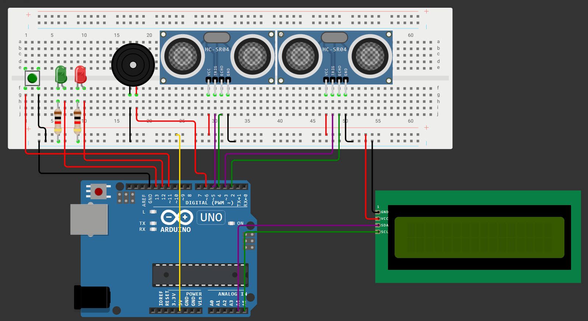
  <p><sub>Fonte: elaboração dos autores no Wokwi; captura do protótipo inicial já registrada na Sprint 1.</sub></p>
</div>

<div align="center">
  <p>Figura 25 – Montagem física do protótipo de controle de entradas e saídas – vista 1</p>
  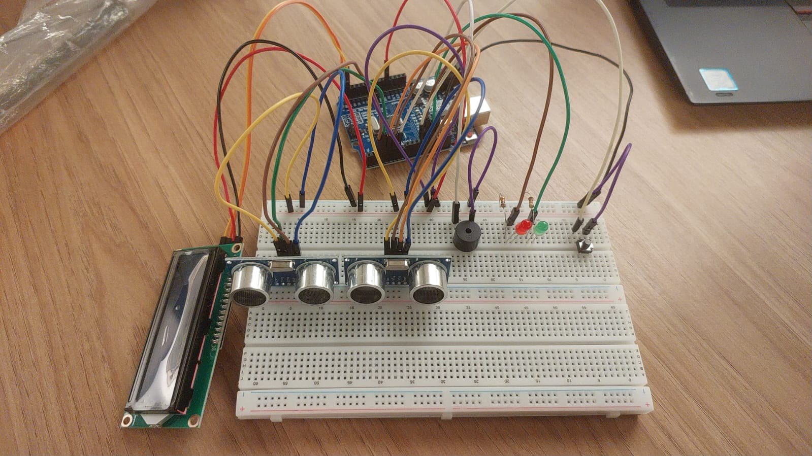
  <p><sub>Fonte: acervo da equipe Synthetix.</sub></p>
</div>

<div align="center">
  <p>Figura 26 – Montagem física do protótipo de controle de entradas e saídas – vista 2</p>
  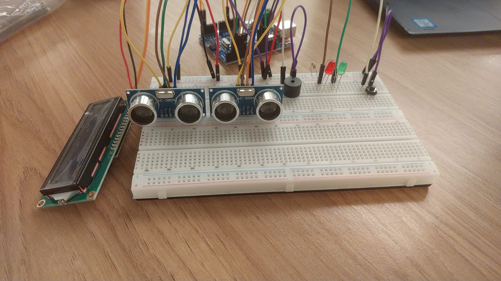
  <p><sub>Fonte: acervo da equipe Synthetix.</sub></p>
</div>

**Versão do código e ambiente:** código e esquema registrados no commit `91d5329`. O firmware utiliza a API Arduino e a biblioteca `Wire`, com comunicação serial a 9.600 baud e controle do LCD implementado no próprio sketch. O alvo da montagem digital é Arduino Uno. A versão do compilador e do núcleo Arduino não está registrada nos arquivos consultados.

<a id="codigo-modelo-2"></a>

##### Protótipo do Dispositivo 2 — Monitoramento por zonas

**Código-fonte e esquema:** [sketch.ino do monitoramento](../src/firmware/prototipo-monitoramento/sketch.ino), [diagram.json da montagem](../src/firmware/prototipo-monitoramento/diagram.json). A simulação está disponível no [projeto do monitoramento por zonas no Wokwi](https://wokwi.com/projects/479939986090755073).

O protótipo utiliza ESP32 e um leitor RFID para representar um acesso monitorado. O botão e os LEDs permitem alternar e visualizar o estado local durante a demonstração, enquanto o buzzer sinaliza a leitura do crachá.

**Componentes utilizados no esquema**

| Componente               | Quantidade | Identificação e função                                              |
| ------------------------ | ---------: | ------------------------------------------------------------------- |
| ESP32 DevKitC V4         |          1 | Controlador representado no Wokwi como `board-esp32-devkit-c-v4`.   |
| Leitor RFID RC522        |          1 | Leitura de tags por aproximação, representado como `board-mfrc522`. |
| LED verde e LED vermelho |  1 de cada | Indicação do estado local normal/emergência.                        |
| Resistor de 1 kΩ         |          2 | Um em série com cada LED.                |
| Buzzer                   |          1 | Sinalização sonora de leitura.                                      |
| Botão momentâneo         |          1 | Alternância do estado local.                                        |
| Protoboard               |          1 | Organização das entradas e saídas e do retorno comum.               |

As tags compatíveis com a solução, de 13,56 MHz, são necessárias à interação com o leitor. A quantidade de crachás físicos de teste, dos jumpers e dos cabos não é especificada pelo `diagram.json` e deve constar do levantamento da montagem física.

**Montagem, conexões e alimentação:** o RC522 recebe 3,3 V do ESP32 e compartilha GND com a protoboard. A comunicação SPI utiliza SCK no GPIO 18, MISO no 19 e MOSI no 23; o terminal SDA do módulo atua como seleção SPI (SS), ligado ao GPIO 5, e RST utiliza o GPIO 17. O LED verde utiliza GPIO 26, o vermelho GPIO 33 e o buzzer GPIO 25. O botão utiliza GPIO 27, configurado com `INPUT_PULLUP` e fechamento para GND. Os barramentos negativos superior e inferior da protoboard estão interligados; os dois resistores ficam em série com os LEDs; o buzzer liga-se diretamente ao GPIO 25, conforme o `diagram.json` atualizado. A adequação da ligação direta depende da especificação do buzzer usado. ESP32 e leitor aparecem ao lado da protoboard no esquema. O cabo e a fonte efetivamente utilizados na bancada devem ser identificados no registro fotográfico.

**Desenho Esquemático**

Um desenho esquemático representa os componentes de um circuito e suas ligações elétricas por meio de símbolos e linhas, sem reproduzir a posição física das peças. Aqui, seu objetivo é mostrar como o ponto de leitura RFID é alimentado e conectado ao controlador e como o protótipo recebe comandos e sinaliza seu estado.

<div align="center">
  <p>Figura 27 – Desenho esquemático do protótipo de monitoramento por zonas</p>
  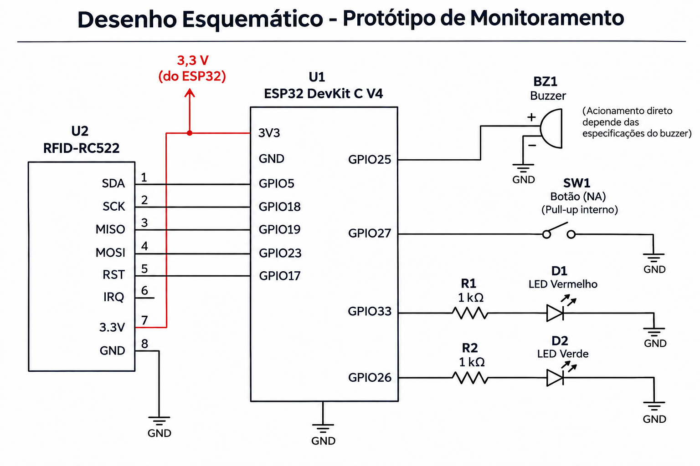
  <p><sub>Fonte: elaboração dos autores com uso de Inteligência Artificial no apoio à geração da imagem.</sub></p>
</div>

No centro, o **ESP32 (U1)** controla a leitura e as saídas. À esquerda, o **RC522 (U2)** recebe 3,3 V e GND do circuito e troca dados com o ESP32 pela interface SPI; o pino SDA do leitor funciona como seleção do dispositivo, e RST permite reiniciá-lo. À direita, o **botão (SW1)** fecha o GPIO 27 para GND quando pressionado e alterna o estado local; a indicação de _pull-up interno_ mostra que o pino permanece em nível alto enquanto o botão está solto. O **LED vermelho (D1)** indica emergência e o **verde (D2)** indica operação normal. Os **resistores de 1 kΩ (R1 e R2)** limitam a corrente dos LEDs. O **buzzer (BZ1)** emite um sinal sonoro a cada UID lido. As linhas representam as conexões elétricas; os símbolos de **GND** indicam o retorno comum.

Para reproduzir a montagem, devem prevalecer as conexões descritas acima e no `diagram.json`: a figura identifica MISO no GPIO 19 e MOSI no GPIO 23. O `diagram.json` atualizado usa ligação direta do buzzer, como no esquemático; a captura da montagem digital abaixo mostra a versão anterior, com o terceiro resistor.

**Diagrama de Classes UML Conceitual — Protótipo de monitoramento em tempo real**

O diagrama abaixo representa **somente o firmware offline atualmente implementado** em [`prototipo-monitoramento/sketch.ino`](../src/firmware/prototipo-monitoramento/sketch.ino). `SistemaMonitoramento` coordena os componentes físicos, mantém `EstadoEmergencia` e usa `ControlePresenca` para persistir até 20 UIDs e seus estados locais. Não representa a aplicação web nem uma confirmação de chegada ao ponto de encontro. O botão alterna o modo após debounce; uma leitura RFID gravada produz bipe e mensagem serial. O estado local DENTRO/FORA resulta da ordem das leituras, sem prova de sentido físico.

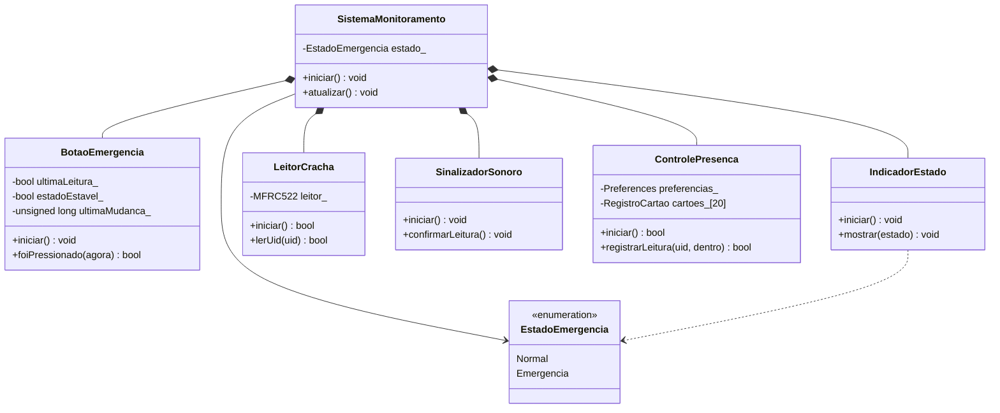

Esta arquitetura não inclui classes para pessoa, zona, ponto de encontro, MQTT ou dashboard: nenhuma dessas responsabilidades existe neste sketch. `ControlePresenca` armazena UIDs e estados locais no ESP32, mas não cria histórico de eventos nem fila de sincronização. A leitura continua disponível nos modos normal e emergência; o protótipo não valida autorização, não deduplica leituras e não envia dados à rede. Essas capacidades exigem implementação e testes próprios antes de constarem no diagrama do firmware.

**Figuras da montagem**

<div align="center">
  <p>Figura 28 – Montagem digital do protótipo de monitoramento por zonas no Wokwi</p>
  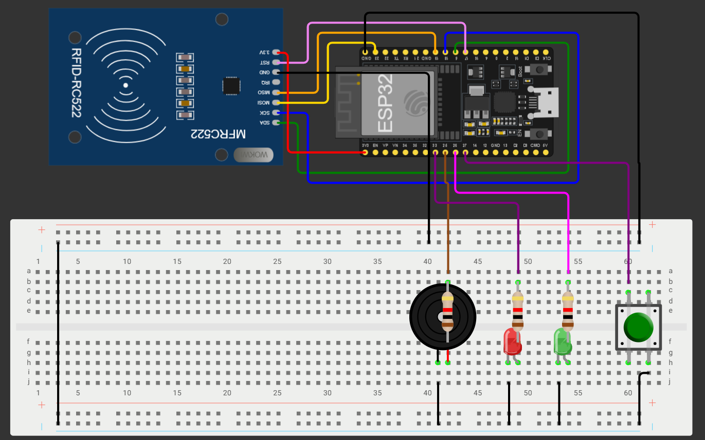
  <p><sub>Fonte: elaboração dos autores no Wokwi.</sub></p>
</div>

<div align="center">
  <p>Figura 29 – Montagem física do protótipo de monitoramento por zonas – vista 1</p>
  
  <p><sub>Fonte: acervo da equipe Synthetix.</sub></p>
</div>

<div align="center">
  <p>Figura 30 – Montagem física do protótipo de monitoramento por zonas – vista 2</p>
  
  <p><sub>Fonte: acervo da equipe Synthetix.</sub></p>
</div>

<div align="center">
  <p>Figura 31 – Montagem física do protótipo de monitoramento por zonas – vista 3</p>
  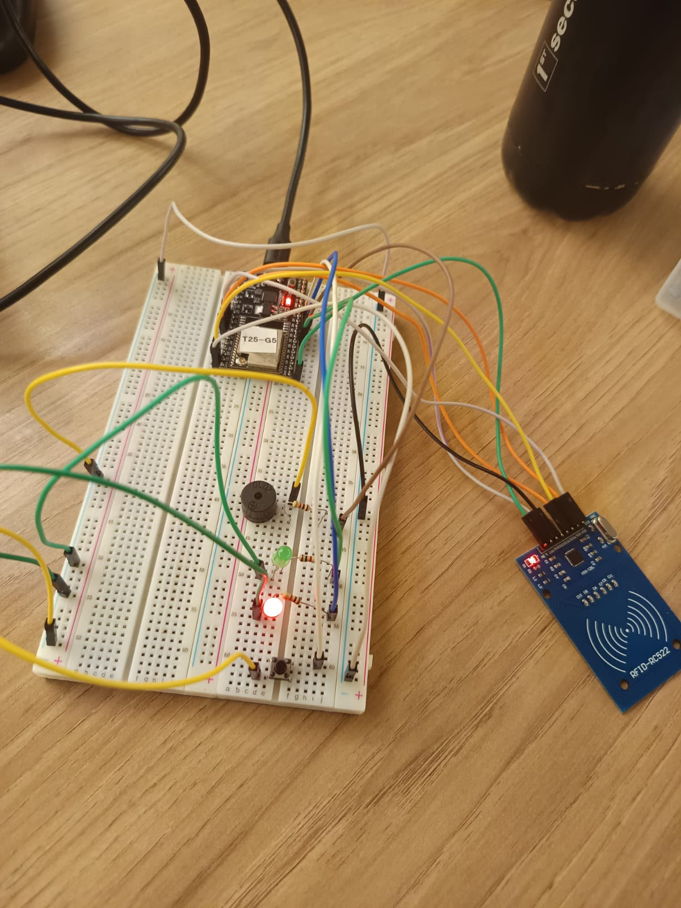
  <p><sub>Fonte: acervo da equipe Synthetix.</sub></p>
</div>

<div align="center">
  <p>Figura 32 – Montagem física do protótipo de monitoramento por zonas – vista 4</p>
  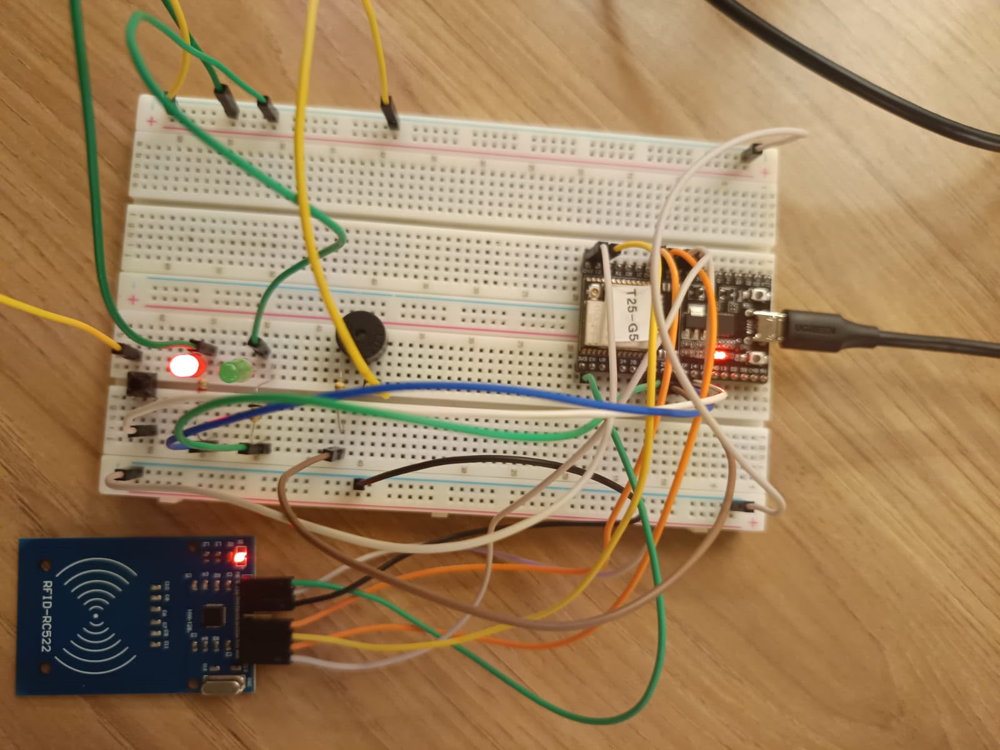
  <p><sub>Fonte: acervo da equipe Synthetix.</sub></p>
</div>

**Versão do código e ambiente:** as revisões `c096117` e `91d5329` são referências históricas do firmware e do esquema. A descrição acima acompanha o arquivo atual desta entrega, que deve receber um commit e identificador próprios antes de qualquer novo ensaio. O código utiliza a API Arduino para ESP32 e as bibliotecas `SPI`, `MFRC522` e `Preferences`, com serial a 115.200 baud. O arquivo `libraries.txt` declara `MFRC522`, sem fixar sua versão. As versões do núcleo Arduino-ESP32 e do compilador ainda precisam ser registradas para reprodução do ambiente.

<a id="codigo-modelo-3"></a>

##### Protótipo do Dispositivo 3 — Confirmação nos pontos de encontro

O protótipo do totem utiliza ESP32 e RFID para registrar localmente crachás distintos, com persistência e sinalização de atendimento. O circuito de bancada representa a eletrônica do dispositivo; o invólucro do totem não aparece no esquema digital.

**Componentes utilizados no esquema**

| Componente        | Quantidade | Identificação e função                                        |
| ----------------- | ---------: | ------------------------------------------------------------- |
| ESP32 DevKitC V4  |          1 | Controlador e armazenamento dos registros na memória interna. |
| Leitor RFID RC522 |          1 | Captura dos identificadores das tags.                         |
| LED azul          |          1 | Indicação de atendimento ativo.                               |
| LED verde         |          1 | Sinalização de um novo registro gravado.                      |
| Resistor de 330 Ω |          2 | Um em série com cada LED.                                     |
| Buzzer            |          1 | Sinalização sonora local.                                     |
| Botão momentâneo  |          1 | Ativação local do atendimento.                                |
| Protoboard        |          1 | Organização do circuito e das interligações.                  |

Também são necessárias tags compatíveis de 13,56 MHz para os ensaios. A quantidade de tags, jumpers e cabos físicos deve ser registrada na BOM. A persistência utiliza a memória interna do ESP32; o esquema não inclui cartão de memória ou módulo de armazenamento externo.

**Montagem, conexões e alimentação:** o RC522 recebe 3,3 V do ESP32 e utiliza GND comum. As conexões SPI são SCK no GPIO 18, MISO no 19 e MOSI no 23; SDA/SS utiliza GPIO 21 e RST utiliza GPIO 22. O LED azul está associado ao GPIO 25, o verde ao GPIO 26, o buzzer ao GPIO 27 e o botão ao GPIO 32. O botão utiliza `INPUT_PULLUP` e acionamento para GND. No esquema, parte dos terminais do ESP32 está inserida na protoboard, cujos barramentos negativos são interligados. Os resistores de 330 Ω ficam em série com os LEDs e o leitor aparece separado, conectado por fios. A fonte e o cabo utilizados na montagem física devem ser identificados junto à fotografia.

**Figuras da montagem**

<div align="center">
  <p>Figura 33 – Montagem digital do protótipo de confirmação nos pontos de encontro no Wokwi</p>
  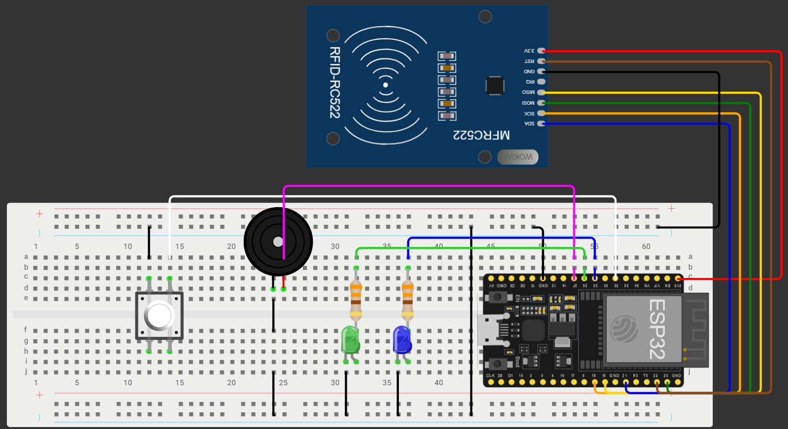
  <p><sub>Fonte: elaboração dos autores no Wokwi.</sub></p>
</div>

<div align="center">
  <p>Figura 34 – Montagem física do protótipo de confirmação nos pontos de encontro – vista 1</p>
  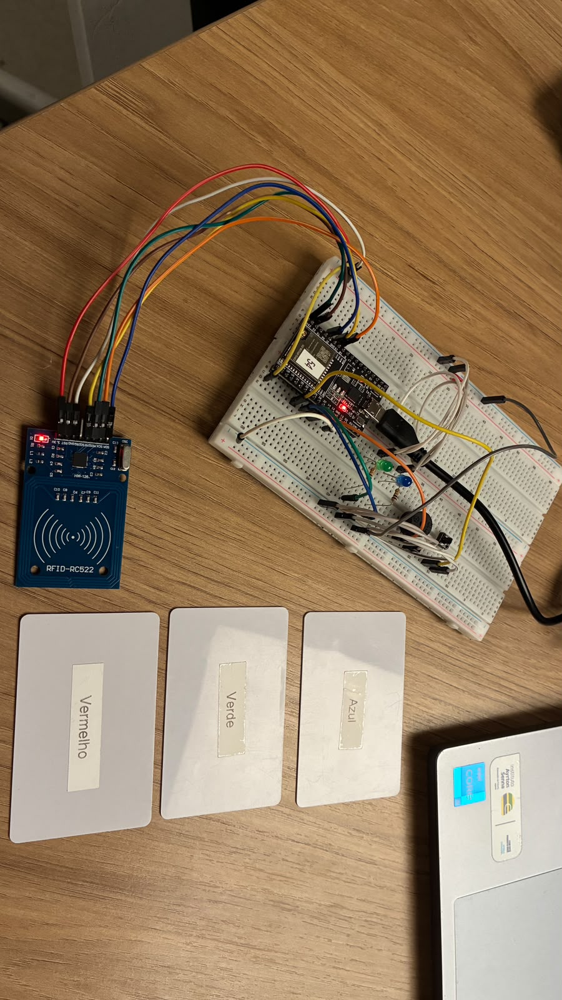
  <p><sub>Fonte: acervo da equipe Synthetix.</sub></p>
</div>

<div align="center">
  <p>Figura 35 – Montagem física do protótipo de confirmação nos pontos de encontro – vista 2</p>
  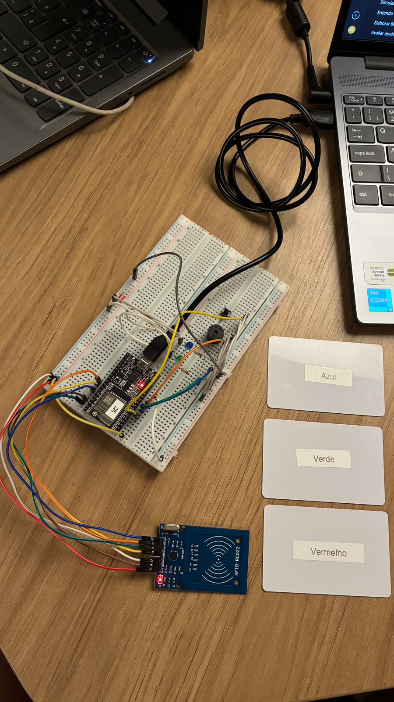
  <p><sub>Fonte: acervo da equipe Synthetix.</sub></p>
</div>

<div align="center">
  <p>Figura 36 – Montagem física do protótipo de confirmação nos pontos de encontro – vista 3</p>
  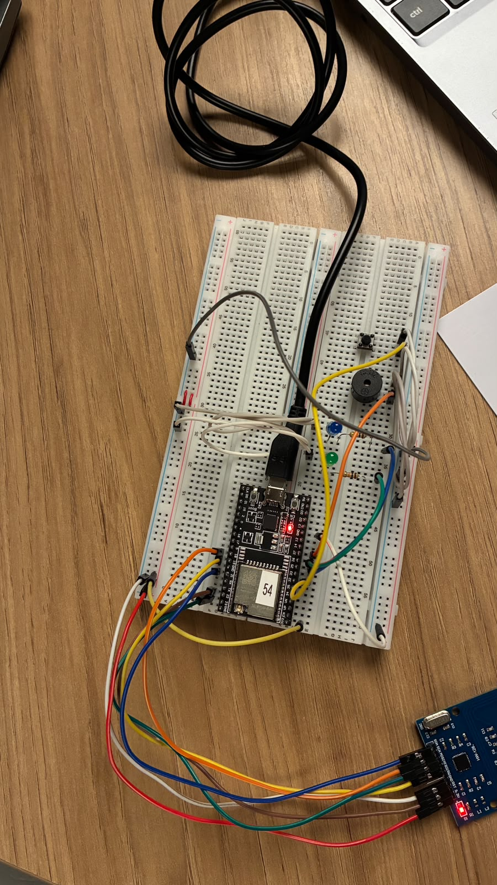
  <p><sub>Fonte: acervo da equipe Synthetix.</sub></p>
</div>

**Código-fonte e esquema:** [sketch.ino do totem](../src/firmware/prototipo-totem/sketch.ino), [diagram.json da montagem](../src/firmware/prototipo-totem/diagram.json) e [libraries.txt](../src/firmware/prototipo-totem/libraries.txt). A simulação está disponível no [projeto do totem no Wokwi](https://wokwi.com/projects/479314160569873409).

**Versão do código e ambiente:** conjunto do protótipo registrado no commit `f86c7ca`. O firmware utiliza Arduino para ESP32, `SPI`, `MFRC522` e `Preferences`, além de `cstring`, com comunicação serial a 115.200 baud. O arquivo `libraries.txt` declara `MFRC522`; as versões dessa biblioteca, do núcleo e do compilador ainda precisam ser registradas. O código mantém a capacidade experimental de 50 UIDs descrita na Seção 3.4.2.2.

As revisões identificam os arquivos usados neste levantamento. A correspondência entre fotografias, esquemas e códigos deve considerar eventuais diferenças de componentes, conexões e alimentação.

<a id="testes-prototipos"></a>

#### 3.4.2.4. Casos de Teste

Os registros são organizados pelo dispositivo e pela versão ensaiada. A montagem, o código e o ambiente de cada modelo estão na [seção 3.4.2.3](#prototipos-codigos). As fotografias dessa subseção documentam as montagens de bancada. Os resultados por caso são acompanhados das evidências de execução correspondentes.

| Modelo                              | Casos e documentação                                                                                                                                                                                                              | Situação                                                                                                                                                |
| ----------------------------------- | --------------------------------------------------------------------------------------------------------------------------------------------------------------------------------------------------------------------------------- | ------------------------------------------------------------------------------------------------------------------------------------------------------- |
| 1 — Contagem com Arduino Uno        | [CT01–CT10, documentados anteriormente na Sprint 1](#testes-modelo-1), com [firmware](../src/firmware/prototipo-contagem/sketch.ino) e [evidências originais](../assets/casos_teste_prototipos/inicial/).                         | Resultados históricos da simulação. A versão ESP32 do contador aguarda desenvolvimento e nova validação.                                                |
| 2 — Monitoramento com ESP32 e RC522 | CT16–CT23 abaixo, [firmware atual](../src/firmware/prototipo-monitoramento/sketch.ino), [versão ensaiada e capturas do Wokwi](../assets/casos_teste_prototipos/wokwi-monitoramento/) e [ressalvas técnicas](#ressalvas-modelo-2). | Execução visual/serial registrada para a versão ensaiada, com ressalvas temporais e de áudio. Os registros de execução física por caso estão pendentes. |
| 3 — Totem offline com ESP32         | [Código e montagem do totem](#codigo-modelo-3), incluindo persistência e limite de 50 UIDs.                                                                                                                                       | Documentação preliminar. A elaboração e a execução dos casos específicos permanecem previstas para a Sprint 3.                                          |

##### Modelo 1 — Testes documentados na Sprint 1

Os casos CT01–CT10 foram documentados anteriormente na [seção 3.4.1](#testes-modelo-1), com entradas, resultados e imagens T01–T10. Eles abrangem inicialização, entrada, saída, bloqueio/rearme, sinalização, saldo mínimo e falha de eco do protótipo Arduino Uno. A mesma versão do contador está preservada em prototipo-contagem.

A inclusão das fotos de bancada na [descrição do modelo 1](#codigo-modelo-1) complementa o registro da montagem. A execução desses dez casos na bancada e a migração para ESP32 exigem resultados e evidências próprios.

##### Modelo 2 — Monitoramento por zonas

O firmware e o circuito estão em [prototipo-monitoramento](../src/firmware/prototipo-monitoramento/). A versão integrada corresponde às cópias preservadas na bateria CT16–CT23, após normalizar as quebras de linha. As [fotos da montagem do modelo 2](#codigo-modelo-2) estão na subseção anterior.

###### Planejamento anterior — CT11–CT15

CT11–CT15 foram elaborados para uma hipótese antiga de leitura autorizada com LEDs de aceite e rejeição. Permanecem registrados apenas para rastrear a evolução do planejamento; **não devem ser executados como critérios da versão atual**. O firmware atual indica modos NORMAL e EMERGÊNCIA nos LEDs, persiste um estado local por UID e não consulta cadastro. CT24–CT28 constituem o roteiro readequado, ainda sem execução.

<p align="center">Quadro 15 – Planejamento histórico CT11–CT15, superado e não executado</p>

| **CT#** | **Descrição**                                | **Pré-condição**                                                                                             | **Procedimento de teste**                                                                                                                                                             | **Pós-condição / resultado esperado**                                                                                                                                                                              | **Evidência e status**                                                        |
| ------- | -------------------------------------------- | ------------------------------------------------------------------------------------------------------------ | ------------------------------------------------------------------------------------------------------------------------------------------------------------------------------------- | ------------------------------------------------------------------------------------------------------------------------------------------------------------------------------------------------------------------ | ----------------------------------------------------------------------------- |
| CT11    | Inicialização do ESP32 e do leitor RFID.     | Montagem desenergizada, conexões revisadas e firmware da Sprint 2 gravado.                                   | Energizar o ESP32, abrir o monitor serial e aguardar a rotina de inicialização. Não aproximar tags.                                                                                   | O ESP32 inicia sem reinicializações contínuas; o RC522 é reconhecido; o estado inicial dos LEDs corresponde ao definido no firmware e nenhuma leitura é aceita sem tag.                                            | **Planejamento superado por CT24 e CT27; não executado.** |
| CT12    | Leitura aceita de tag fictícia válida.       | CT11 aprovado; uma tag fictícia cadastrada para teste; nenhum LED de resposta ativo.                         | Aproximar a tag do RC522 uma vez e afastá-la após a leitura. Observar o monitor serial e os LEDs.                                                                                     | Uma única leitura é reconhecida; o LED verde acende pelo intervalo especificado; o vermelho permanece apagado; o log indica aceite sem expor UID completo.                                                         | **Planejamento superado por CT25; não executado.** |
| CT13    | Controle de leitura repetida da mesma tag.   | CT11 aprovado; tag fictícia válida; política de bloqueio ou intervalo definida no firmware.                  | Manter a mesma tag no campo do RC522 por tempo superior ao intervalo normal de leitura e depois afastá-la.                                                                            | O comportamento coincide com a política documentada: não ocorre uma sequência indefinida de aceites; o LED e o log permitem distinguir uma leitura válida de repetições bloqueadas.                                | **Planejamento superado por CT25; não executado.** |
| CT14    | Rejeição de tag fictícia não cadastrada.     | CT11 aprovado; tag compatível com o RC522, mas ausente da lista fictícia de teste.                           | Aproximar a tag não cadastrada uma vez e afastá-la após a resposta.                                                                                                                   | Nenhum aceite é registrado; o LED vermelho acende pelo intervalo definido; o verde permanece apagado; o log informa rejeição sem expor UID completo.                                                               | **Planejamento superado por futura autorização integrada; não executado.** |
| CT15    | Falha controlada de comunicação com o RC522. | Montagem desenergizada e procedimento seguro definido; firmware com diagnóstico de inicialização ou leitura. | Desenergizar, desconectar de forma controlada uma conexão de comunicação do RC522, energizar novamente e observar a resposta. Ao terminar, desenergizar antes de restaurar a ligação. | O sistema não apresenta leitura como aceita; o LED vermelho ou outro estado de erro documentado é acionado; o log informa indisponibilidade do leitor e orienta inspeção, sem reinicialização infinita silenciosa. | **Planejamento superado por CT27; não executado.** |

<p><sub>Fonte: elaboração dos autores (2026).</sub></p>

###### Execução do modelo 2 no Wokwi — CT16–CT23

A simulação do [PrototipoMonitoramento no Wokwi](https://wokwi.com/projects/479252249534862337), registrada em 4 de novembro de 2026, usa ESP32, RC522 por SPI, botão no GPIO 27, LEDs nos GPIOs 26 (verde) e 33 (vermelho) e buzzer no GPIO 25. O monitor serial opera a 115200 baud. As [cópias do firmware, circuito e dependências](../assets/casos_teste_prototipos/wokwi-monitoramento/) identificam a versão ensaiada.

Nessa versão, os LEDs representam os modos NORMAL e EMERGÊNCIA. A leitura de um cartão imprime seu UID fictício e aciona no código um bipe de 2.000 Hz por 50 ms. O firmware permite ler cartões nos dois modos e não contém lista de autorização, persistência de presença, MQTT ou diagnóstico explícito de falha do leitor. Esse comportamento difere do planejamento de CT11–CT15.

A execução registrada foi realizada por automação de navegador (Codex). As evidências disponíveis são capturas da simulação e um registro da interface com a saída serial. Elas sustentam os resultados visuais e seriais, com as ressalvas de cada caso. A duração da pressão contínua de CT19 e o áudio de CT20–CT22 permanecem sem comprovação nos arquivos. O hardware físico aguarda ensaio.

<p align="center">Quadro 16 – Casos de teste da versão de monitoramento do Artefato 5</p>

| **CT#** | **Configuração do ambiente**                                              | **Ação do usuário / procedimento**                                                                  | **Resposta esperada do sistema**                                                                                                                                                   | **Evidência e status**                                                                                                                                                                                                                                                                                                                                                                                                         |
| ------- | ------------------------------------------------------------------------- | --------------------------------------------------------------------------------------------------- | ---------------------------------------------------------------------------------------------------------------------------------------------------------------------------------- | ------------------------------------------------------------------------------------------------------------------------------------------------------------------------------------------------------------------------------------------------------------------------------------------------------------------------------------------------------------------------------------------------------------------------------ |
| CT16    | Circuito carregado, botão solto e nenhum cartão apresentado.              | Iniciar a simulação e acompanhar LEDs e serial a 115200 baud.                                       | Verde aceso, vermelho apagado; mensagens `Sistema inicializado!` e `STATUS: NORMAL`; nenhum bipe ou registro de cartão. A mensagem inicial não comprova funcionamento do leitor.   | Inicialização com `Sistema inicializado!` e `STATUS: NORMAL`; verde aceso e vermelho apagado, sem registro de cartão. **Aprovado no escopo visual/serial.** [Captura](../assets/casos_teste_prototipos/wokwi-monitoramento/ct16-inicializacao.png).                                                                                                                                                                            |
| CT17    | CT16 aprovado; modo NORMAL.                                               | Pressionar o botão por 100 ms ou mais e soltar.                                                     | Uma transição para EMERGÊNCIA: verde apaga, vermelho acende e serial imprime `EMERGENCIA`. O botão não solicita bipe.                                                              | Pressão acionou `EMERGENCIA`, vermelho aceso e verde apagado, uma vez. **Aprovado no escopo visual/serial.** [Captura](../assets/casos_teste_prototipos/wokwi-monitoramento/ct17-emergencia.png).                                                                                                                                                                                                                              |
| CT18    | Modo EMERGÊNCIA; botão solto por pelo menos 100 ms.                       | Pressionar novamente por 100 ms ou mais e soltar.                                                   | Verde acende, vermelho apaga; serial imprime `NORMAL` uma vez para esse acionamento.                                                                                               | Nova pressão retornou a `NORMAL`, verde aceso e vermelho apagado. **Aprovado no escopo visual/serial.** [Captura](../assets/casos_teste_prototipos/wokwi-monitoramento/ct18-normal.png).                                                                                                                                                                                                                                       |
| CT19    | Modo NORMAL e nenhum cartão apresentado.                                  | Manter o botão pressionado por 2 s; soltar por pelo menos 100 ms e pressionar novamente por 100 ms. | Pressão contínua gera uma única transição para EMERGÊNCIA; soltar não alterna o modo; nova pressão retorna a NORMAL. O debounce exige estabilidade por mais de 25 ms.              | A captura registra uma mensagem `EMERGENCIA`. CT18 registra o retorno a `NORMAL`. **Parcial.** A imagem isolada não comprova pressão contínua por 2 s, soltura sem transição ou o limiar de 25 ms. Falta um registro temporal da sequência. [Captura](../assets/casos_teste_prototipos/wokwi-monitoramento/ct19-pressao-continua.png).                                                                                         |
| CT20    | Modo NORMAL; leitor configurado e cartão compatível com UID fictício.     | Apresentar o cartão uma vez e afastá-lo após a leitura.                                             | Serial imprime `Cartao detectado! UID: ` e bytes em hexadecimal; comando de bipe de 2.000 Hz por 50 ms; verde permanece aceso e vermelho apagado. Não há validação de autorização. | Blue Card: `Cartao detectado! UID: 01 02 03 04`; modo NORMAL preservado. **Parcial: leitura e LEDs confirmados; buzzer não medido.** [Captura](../assets/casos_teste_prototipos/wokwi-monitoramento/ct20-rfid-normal.png).                                                                                                                                                                                                     |
| CT21    | Modo EMERGÊNCIA; cartão fictício compatível.                              | Apresentar o cartão uma vez e afastá-lo após a leitura.                                             | Mesmo registro e bipe do CT20; vermelho permanece aceso e verde apagado. A emergência não suspende leituras nem registra chegada ao ponto de encontro.                             | Green Card: `Cartao detectado! UID: 11 22 33 44` após `EMERGENCIA`; modo preservado. **Parcial: leitura e LEDs confirmados; buzzer não medido.** [Captura](../assets/casos_teste_prototipos/wokwi-monitoramento/ct21-rfid-emergencia.png).                                                                                                                                                                                     |
| CT22    | Modo NORMAL; outro cartão compatível, com UID fictício diferente do CT20. | Apresentar o segundo cartão sem alterar o firmware.                                                 | Também gera UID no serial e bipe, sem mudar o modo. A autorização por cadastro pertence à futura integração e não é critério deste caso.                                           | Green Card (UID `11 22 33 44`) também lido no modo NORMAL. **Parcial: leitura do segundo UID confirmada; buzzer não medido.** [Captura](../assets/casos_teste_prototipos/wokwi-monitoramento/ct22-segundo-cartao.png).                                                                                                                                                                                                         |
| CT23    | Modo EMERGÊNCIA; cartão afastado e botão solto.                           | Parar e reiniciar a simulação ou reiniciar o ESP32 na bancada.                                      | Retorna a NORMAL com verde aceso, vermelho apagado e mensagens iniciais. O modo anterior não é persistido; registrar a perda do estado de emergência como limitação a avaliar.     | Comando Restart aplicado após emergência; mensagens iniciais e modo NORMAL restaurados. **Aprovado no escopo visual/serial para o comportamento implementado.** O retorno a NORMAL após reinício é uma limitação para operação em emergência. [Antes](../assets/casos_teste_prototipos/wokwi-monitoramento/ct23-antes-reinicio.png) e [depois](../assets/casos_teste_prototipos/wokwi-monitoramento/ct23-reinicio-normal.png). |

<p><sub>Fonte: elaboração dos autores (2026), com base no firmware do projeto Wokwi indicado acima.</sub></p>

<a id="ressalvas-modelo-2"></a>

###### Ressalvas técnicas e alcance das evidências do modelo 2

Os CT16–CT23 registram a versão ensaiada em 04/11/2026. As capturas comprovam os estados visíveis e as mensagens seriais descritos em cada caso, mas uma imagem isolada não mede duração, latência ou áudio. As ressalvas abaixo delimitam o alcance desses resultados e dos ensaios complementares da task #113, realizados em 05/11/2026:

- **CT16 — inicialização:** a mensagem `Sistema inicializado!` não comprova que o leitor RFID esteja comunicando. Em ensaio complementar, a simulação iniciou com a ligação MISO do RC522 desconectada e ainda exibiu `STATUS: NORMAL`, sem diagnóstico da falha ([captura](../assets/casos_teste_prototipos/revisao-113/08-falha-miso-inicializacao.jpg)). A leitura de um cartão e a resposta do botão nessa condição não foram verificadas.
- **CT19 — botão:** a captura de `EMERGENCIA` não comprova os dois segundos de pressão contínua, a ausência de transição na soltura nem o limiar de debounce de 25 ms. Falta um registro temporal da sequência; também não há medição da latência máxima do botão durante leituras ou falhas do leitor.
- **CT20–CT22 — cartões:** os UIDs fictícios e os estados visuais foram observados, mas o bipe não foi medido. Um ensaio complementar registrou nova leitura do mesmo UID após manter o cartão apresentado ([captura](../assets/casos_teste_prototipos/revisao-113/04-cartao-mantido.jpg)); trata-se de repetição da leitura local, não de confirmação duplicada de presença. A autorização de crachás e a confirmação na plataforma pertencem ao futuro sistema de integração, fora do escopo desses CTs.
- **CT23 — reinício:** o retorno a `NORMAL` após reiniciar foi observado e corresponde ao comportamento da versão ensaiada, mas perde o modo de emergência anterior. A recuperação segura desse modo ainda precisa ser definida e testada.

O [firmware atual](../src/firmware/prototipo-monitoramento/sketch.ino) guarda localmente o estado dentro/fora por UID e agora inclui diagnóstico inicial do RC522 e sinalização de sucesso apenas após gravação. A [captura complementar do log](../assets/prototipo_2/print-log-prototipo-monitoramento.png) antecede estas últimas correções; ela não altera retroativamente os resultados dos CT16–CT23 nem comprova o novo diagnóstico. Áudio, comportamento físico e resposta temporal permanecem sem ensaio correspondente. O esquema do **modelo 2** usa resistores de **1 kΩ**; os de **330 Ω** pertencem ao esquema distinto do **modelo 3**. O valor efetivamente instalado nas fotos do modelo 2 não foi medido ou identificado por componente.

###### Roteiro da versão atual do modelo 2 — CT24–CT28, sem execução

Os casos abaixo substituem operacionalmente o planejamento CT11–CT15 para o firmware atual. **Todos estão planejados, sem captura, vídeo, medição ou aprovação.** A execução pode ser simulada antes da bancada, desde que cada ambiente e versão sejam identificados separadamente. UIDs de teste devem ser fictícios.

| CT | Pré-condição | Procedimento e entrada | Pós-condição / saída esperada | Resultado atual |
| --- | --- | --- | --- | --- |
| CT24 | ESP32, RC522 e memória disponíveis; circuito desenergizado e conexões conferidas. | Energizar, abrir serial a 115.200 baud e aproximar um cartão fictício após iniciar. | `STATUS: NORMAL`, verde aceso e leitura gravada; o teste com cartão complementa o diagnóstico inicial do registrador. | Não executado; foto, vídeo e serial pendentes. |
| CT25 | CT24 aprovado; UID fictício ainda sem estado local. | Apresentar e afastar o cartão duas vezes, reiniciar e apresentar de novo; registrar estados e sinais em vídeo contínuo. | Estados locais DENTRO, FORA e DENTRO, com bipe apenas após cada gravação; persistência da lista após reinício. Não concluir que houve passagem física. | Não executado; sequência e log pendentes. |
| CT26 | CT24 aprovado; botão solto e cartão afastado. | Pressionar o botão, mantê-lo por 2 s, soltar e pressionar novamente, registrando tempo e LEDs. | Uma transição por pressão, EMERGÊNCIA e depois NORMAL; ausência de transição na soltura. | Não executado; medição temporal e vídeo pendentes. |
| CT27 | Circuito desenergizado; responsável identifica a ligação MISO. | Desconectar MISO, energizar e observar serial/LEDs; desenergizar antes de restaurar a ligação. | `STATUS: INDISPONIVEL`, ambos LEDs apagados e nenhuma leitura aceita. | Não executado; falha física ou simulação identificada pendente. |
| CT28 | Versão instrumentada para injetar falha de gravação, com UID fictício. | Forçar `putBytes` a falhar em um ambiente de teste e apresentar o cartão. | Mensagem de falha no serial, sem bipe, sem pulso verde e sem alteração persistida. | Não executado; instrumentação e evidência pendentes. |

<p><sub>Fonte: roteiro proposto a partir de RF026.1–RF026.4 e RN21–RN22; não representa execução.</sub></p>

##### Modelo 3 — Testes previstos para a Sprint 3

O [totem offline](#codigo-modelo-3) possui firmware e fotos de montagem nesta branch. O roteiro CT29–CT32 abaixo cobre ativação local, registro de UIDs distintos, rejeição de repetidos, recuperação após reinício, capacidade e falhas. Ele usa dados fictícios e permanece sem execução ou evidência de funcionamento.

A bateria específica do totem começa em CT29 e permanece planejada. Nenhum resultado dos modelos 1 ou 2 é atribuído ao totem.

| CT | Pré-condição | Procedimento e entrada | Pós-condição / saída esperada | Resultado atual |
| --- | --- | --- | --- | --- |
| CT29 | Totem energizado, memória válida, lista vazia e botão solto. | Pressionar o botão por mais de 40 ms; observar LED azul e serial. | Atendimento ativo persistido; nenhum UID registrado antes de apresentar cartão. | Não executado; foto, vídeo e serial pendentes. |
| CT30 | CT29 aprovado; dois UIDs fictícios diferentes. | Aproximar o primeiro cartão, afastar, repeti-lo e depois apresentar o segundo. | Total 1 após a primeira leitura, permanece 1 na repetição e sobe a 2 no segundo UID; LED verde e bipe somente para novos registros gravados. | Não executado; vídeo e log pendentes. |
| CT31 | CT30 aprovado; dois UIDs já persistidos. | Enviar `R`, aguardar reinício e enviar `L` no serial. | Lista e total 2 recuperados; tempos identificados como relativos aos respectivos boots. | Não executado; log antes/depois pendente. |
| CT32 | Totem com massa fictícia de teste e versão identificada. | Completar 50 UIDs distintos e apresentar o 51º; repetir com leitor ou memória indisponível em ensaio separado. | 51º UID recusado sem indicação de sucesso; falha de leitor/memória bloqueia atendimento e informa causa observável. | Não executado; massa, procedimento de injeção e evidência pendentes. |

##### Registro dos resultados

O registro de cada ensaio deverá reunir data, responsável, versão do firmware, ambiente, entrada aplicada, resultado observado, evidência e status, com atualização correspondente na [RTM da seção 3.3.4](#rtm). CT01–CT10 mantêm seu registro histórico; CT11–CT15 ficam preservados como planejamento superado; CT16–CT23 preservam os resultados e ressalvas da simulação anterior. CT24–CT32 são roteiros atuais **sem execução**. Os ensaios físicos por caso permanecem pendentes.

#### 3.4.2.5. Conclusão e Ressalvas

A Sprint 2 amplia a solução com o protótipo 2, principal entrega desta etapa, baseado em ESP32 e leitor RFID para apoiar o monitoramento por zonas. O firmware realiza a leitura de crachás, a sinalização sonora e visual e a alternância do estado local pelo botão. Essa entrega estabelece a base física para o registro de passagens; a associação de pessoas a zonas depende da integração posterior. O protótipo 1, desenvolvido com Arduino Uno na Sprint 1, permanece como referência da contagem de entradas e saídas, enquanto o protótipo 3 introduz o totem offline de confirmação nos pontos de encontro, com leitura RFID e armazenamento local.

O detalhamento dos dispositivos apresenta níveis distintos de maturidade. Para o protótipo 1, estão previstas para a Sprint 3 a atualização do controlador de Arduino Uno para ESP32 e a formalização da arquitetura e do desenho esquemático correspondentes, preservando-se o circuito inicial como registro histórico da Sprint 1. A inclusão do protótipo 3 nesta etapa é preliminar e abrange suas montagens física e digital, funcionalidades, componentes, código e roteiro CT29–CT32. Sua arquitetura e desenho esquemático formal continuam pendentes; os testes ainda não foram executados. Os diagramas de montagem no Wokwi servem de referência aos circuitos e não substituem essa documentação técnica.

Os protótipos operam localmente, sem o sistema web de integração, a consolidação dos registros entre dispositivos ou a sincronização em rede. Os testes do modelo 1 estão documentados na [seção 3.4.1](#testes-modelo-1). A [seção 3.4.2.4](#testes-prototipos) reúne a bateria simulada da versão anterior do modelo 2, suas limitações e os roteiros atuais CT24–CT32. Os resultados de execução física por caso continuam pendentes. Assim, esta entrega documenta a evolução física e offline da solução; a validação do desempenho, da confiabilidade e da adequação ao ambiente industrial permanece dependente de implementação e testes posteriores.

### 3.4.3. Protótipo do Projeto com MQTT e I²C (sprint 3)

A integração MQTT e I²C e seus ensaios estão planejados para a Sprint 3. Os futuros casos de integração começam em CT33, depois dos roteiros locais CT24–CT32, e deverão cobrir operação integrada, perda de conexão e recuperação dos dispositivos. O detalhamento dos cenários, os resultados e as evidências estão pendentes.

### 3.4.4. Protótipo Físico do Projeto (online) (sprint 4)

A descrição do protótipo online, os diagramas de sequência, os cenários de sucesso e falha e as evidências dos ensaios serão preenchidos após a implementação e a validação da Sprint 4.


### 3.4.5. Protótipo Final do Projeto (sprint 5)

A modelagem UML revisada, as figuras do protótipo final, os dashboards e os resultados de teste serão registrados após a validação da Sprint 5.


## <a name="c4"></a>4. Conclusões e Recomendações

Na Sprint 1, o C.R.I.S.I.S consolidou o entendimento inicial do problema de conferência da evacuação, a proposta de valor, três proto-personas e os requisitos preliminares da solução. O protótipo simulado explora a contagem local anônima de entradas e saídas, com apresentação do total no LCD e sinalização por LEDs e buzzer. Os dez casos documentados registram situações de uso e de falha, mas suas capturas não comprovam desempenho industrial, identificação individual ou validação da montagem física.

Recomenda-se utilizar essa entrega como base para os próximos experimentos, mantendo a conferência humana e os procedimentos de emergência do parceiro. Antes da evolução física, será necessário revisar a montagem, consolidar a BOM e repetir os testes com identificação da versão e registro dos resultados. A consolidação remota, o dashboard e as possíveis integrações com registros de acesso permanecem planejados e dependem de viabilidade técnica, validação com o parceiro e revisão das condições de privacidade. A expansão nas próximas sprints deverá ser orientada por essas evidências; a contagem local, isoladamente, não permite afirmar que todas as pessoas estão seguras.

## <a name="c5"></a>5. Referências

AGÊNCIA NACIONAL DE PROTEÇÃO DE DADOS (ANPD). **Direito dos titulares**. Brasília, DF: ANPD, [s. d.]. Disponível em: https://www.gov.br/anpd/pt-br/assuntos/titular-de-dados/direito-dos-titulares. Acesso em: 22 out. 2026.

AGÊNCIA NACIONAL DE PROTEÇÃO DE DADOS (ANPD). **Guia orientativo para definições dos agentes de tratamento de dados pessoais e do encarregado**. Brasília, DF: ANPD, 2022. Disponível em: https://www.gov.br/anpd/pt-br/centrais-de-conteudo/materiais-educativos-e-publicacoes/guia-orientativo-para-definicoes-dos-agentes-de-tratamento-de-dados-pessoais-e-do-encarregado. Acesso em: 22 out. 2026.

AGÊNCIA NACIONAL DE PROTEÇÃO DE DADOS (ANPD). **Guia orientativo sobre segurança da informação para agentes de tratamento de pequeno porte**. Brasília, DF: ANPD, 2021. Disponível em: https://www.gov.br/anpd/pt-br/centrais-de-conteudo/materiais-educativos-e-publicacoes/guia-orientativo-sobre-seguranca-da-informacao-para-agentes-de-tratamento-de-pequeno-porte. Acesso em: 22 out. 2026.

ASSOCIAÇÃO BRASILEIRA DA INDÚSTRIA DE ÁLCALIS, CLORO E DERIVADOS (ABICLOR). **Produção brasileira de cloro cresce 5,4% entre janeiro e outubro de 2024**. [S. l.]: Abiclor, 13 jan. 2025. Disponível em: https://www.abiclor.com.br/producao-brasileira-de-cloro-cresce-54-entre-janeiro-e-outubro-de-2024/. Acesso em: 22 out. 2026.

BANCO NACIONAL DE DESENVOLVIMENTO ECONÔMICO E SOCIAL (BNDES). Novo marco legal do saneamento: impactos na cadeia de fornecedores – parte 2. **BNDES Setorial**, Rio de Janeiro, v. 28, n. 55, p. 179–239, mar. 2022. Disponível em: https://web.bndes.gov.br/bib/jspui/bitstream/1408/22426/3/PR_BS_v28_n55_Saneamento_parte%202_.pdf. Acesso em: 22 out. 2026.

BRASIL. **Lei nº 13.709, de 14 de agosto de 2018**: Lei Geral de Proteção de Dados Pessoais (LGPD). Brasília, DF: Presidência da República, 2018. Disponível em: https://www.planalto.gov.br/ccivil_03/_ato2015-2018/2018/lei/l13709compilado.htm. Acesso em: 22 out. 2026.

BRASIL. **Lei nº 14.026, de 15 de julho de 2020**: atualiza o marco legal do saneamento básico. Brasília, DF: Presidência da República, 2020. Disponível em: https://www.planalto.gov.br/ccivil_03/_ato2019-2022/2020/lei/l14026.htm. Acesso em: 15 out. 2026.

BRASIL. Ministério do Trabalho e Emprego. **Normas regulamentadoras (NR)**. Brasília, DF: Ministério do Trabalho e Emprego, [s. d.]. Disponível em: https://www.gov.br/trabalho-e-emprego/pt-br/assuntos/inspecao-do-trabalho/seguranca-e-saude-no-trabalho/ctpp-nrs/normas-regulamentadoras-nrs. Acesso em: 15 out. 2026.

BRASIL. Ministério do Trabalho e Emprego. **NR-20**: segurança e saúde no trabalho com inflamáveis e combustíveis. Brasília, DF: Ministério do Trabalho e Emprego, 2025. Texto atualizado em 2025. Disponível em: https://www.gov.br/trabalho-e-emprego/pt-br/acesso-a-informacao/participacao-social/conselhos-e-orgaos-colegiados/comissao-tripartite-partitaria-permanente/normas-regulamentadora/normas-regulamentadoras-vigentes/nr-20-atualizada-2025.pdf. Acesso em: 23 out. 2026.

BRASIL. Ministério do Trabalho e Emprego. **NR-23**: proteção contra incêndios. Brasília, DF: Ministério do Trabalho e Emprego, 2022. Texto atualizado em 2022. Disponível em: https://www.gov.br/trabalho-e-emprego/pt-br/acesso-a-informacao/participacao-social/conselhos-e-orgaos-colegiados/comissao-tripartite-partitaria-permanente/arquivos/normas-regulamentadoras/nr-23-atualizada-2022.pdf. Acesso em: 23 out. 2026.

BRASKEM S.A. **Annual report 2025 (Form 20-F)**. Washington, DC: U.S. Securities and Exchange Commission, 2026. Disponível em: https://www.sec.gov/Archives/edgar/data/1071438/000129281426002427/bakform20f_2025.htm. Acesso em: 22 out. 2026.

DABROWSKA, Magda. Emergency mustering solution. **IoT Now**, [S. l.], 12 jan. 2024. Disponível em: https://iot-now.com/2024/01/12/141842-emergency-mustering-solution/. Acesso em: 20 out. 2026.

ELETROGATE. **Buzzer ativo 5 V**. [S. l.]: Eletrogate, [s. d.]a. Disponível em: https://www.eletrogate.com/buzzer-ativo-5v. Acesso em: 20 out. 2026.

ELETROGATE. **LED difuso 5 mm verde**. [S. l.]: Eletrogate, [s. d.]b. Disponível em: https://www.eletrogate.com/led-difuso-5mm-verde. Acesso em: 20 out. 2026.

ELETROGATE. **LED difuso 5 mm vermelho**. [S. l.]: Eletrogate, [s. d.]c. Disponível em: https://www.eletrogate.com/led-difuso-5mm-vermelho. Acesso em: 20 out. 2026.

ELETROGATE. **Protoboard 400 pontos**. [S. l.]: Eletrogate, [s. d.]d. Disponível em: https://www.eletrogate.com/protoboard-400-pontos. Acesso em: 20 out. 2026.

GOTHELF, Jeff; SEIDEN, Josh. **Lean UX**: designing great products with agile teams. 2. ed. Sebastopol: O'Reilly Media, 2016.

HARVARD BUSINESS SCHOOL. Institute for Strategy and Competitiveness. **The five forces**. [S. l.]: Harvard Business School, [s. d.]. Disponível em: https://www.isc.hbs.edu/strategy/business-strategy/Pages/the-five-forces.aspx. Acesso em: 23 out. 2026.

INSTITUTO NACIONAL DE METROLOGIA, QUALIDADE E TECNOLOGIA (INMETRO). **Maturidade da Indústria 4.0**. Brasília, DF: Inmetro, 2026. Disponível em: https://www.gov.br/inmetro/pt-br/assuntos/metrologia-cientifica/laboratorios/tecnologia-da-informacao-e-telecomunicacoes/maturidade-da-industria-4.0. Acesso em: 23 out. 2026.

INTELI. **Projeto parceiro: Unipar**: sistema de IoT para monitoramento, orientação e confirmação de evacuação em emergências industriais. São Paulo: Inteli, 2026. Material de apoio do Módulo 4. Disponível em: https://docs.google.com/document/d/1yKX2hho7oz5-i71Sfl6xBaFho90tpnsR/edit. Acesso em: 15 out. 2026.

MERCADO LIVRE. **Bateria Maxell CR2032 de lítio, 3 V, uma unidade**. [S. l.]: Mercado Livre, [s. d.]a. Disponível em: https://lista.mercadolivre.com.br/bateria-maxell-cr2032. Acesso em: 22 out. 2026.

MERCADO LIVRE. **Cabo jumper macho-macho 20 cm para Arduino e protoboard**. [S. l.]: Mercado Livre, [s. d.]b. Disponível em: https://www.mercadolivre.com.br/cabo-jumper-mxm-20cm-40-pinos-para-arduino-protoboard/up/MLBU2098535281. Acesso em: 20 out. 2026.

MERCADO LIVRE. **Cabo USB compatível com placa de desenvolvimento Arduino Uno R3 ATmega328P CH340**. [S. l.]: Mercado Livre, [s. d.]c. Disponível em: https://www.mercadolivre.com.br/cabo-usb-compativel-com-placa-de-desenvolvimento-arduino-uno-r3-atmega328p-ch340/p/MLB44072268?pdp_filters=item_id%3AMLB5229650730. Acesso em: 20 out. 2026.

MERCADO LIVRE. **Conjunto de 50 botões de pressão para placa de circuito**. [S. l.]: Mercado Livre, [s. d.]d. Disponível em: https://www.mercadolivre.com.br/conjunto-de-50-botoes-de-pressao-para-placa-de-circuito/p/MLB2052130334?pdp_filters=item_id%3AMLB7635767930. Acesso em: 20 out. 2026.

MERCADO LIVRE. **Display LCD 16 × 2 1602 com módulo I²C soldado**. [S. l.]: Mercado Livre, [s. d.]e. Disponível em: https://www.mercadolivre.com.br/display-lcd-16x2-1602-fundo-azul-com-modulo-i2c-soldado/up/MLBU4549779439?pdp_filters=item_id%3AMLB7321088826. Acesso em: 20 out. 2026.

MERCADO LIVRE. **Kit de cabos jumper macho-fêmea 20 cm**. [S. l.]: Mercado Livre, [s. d.]f. Disponível em: https://www.mercadolivre.com.br/20pcs-jumper-mxf-20cm--20pcs-jumper-fxf-20cm/up/MLBU2370810037?pdp_filters=item_id%3AMLB4078036044. Acesso em: 20 out. 2026.

MERCADO LIVRE. **Módulo sensor ultrassônico de distância HC-SR04 para Arduino**. [S. l.]: Mercado Livre, [s. d.]g. Disponível em: https://www.mercadolivre.com.br/modulo-sensor-ultrassonico-distancia-hc-sr04-para-arduino/p/MLB64164978?pdp_filters=item_id%3AMLB5130062737. Acesso em: 20 out. 2026.

NATIONAL INSTITUTE FOR OCCUPATIONAL SAFETY AND HEALTH (NIOSH). **NIOSH pocket guide to chemical hazards: chlorine**. [S. l.]: Centers for Disease Control and Prevention, 2019. Revisão de 30 out. 2019. Disponível em: https://www.cdc.gov/niosh/npg/npgd0115.html. Acesso em: 23 out. 2026.

OSTERWALDER, Alexander; PIGNEUR, Yves; BERNARDA, Gregory; SMITH, Alan. **Value proposition design**: how to create products and services customers want. Hoboken: John Wiley & Sons, 2014.

SARAVATI. **Resistor 1 kΩ 5% 1/4 W**. [S. l.]: Saravati, [s. d.]. Disponível em: https://www.saravati.com.br/resistor-1k-5-1-4w.html. Acesso em: 20 out. 2026.

SYNTHETIX. **C.R.I.S.I.S: protótipo inicial e evidências CT01–CT10**. São Paulo: Inteli, 2026. Disponível em: https://wokwi.com/projects/478404642645348353. Acesso em: 23 out. 2026. Arquivos associados: [firmware](../src/firmware/prototipo-contagem/sketch.ino), [circuito](../src/firmware/prototipo-contagem/diagram.json) e [evidências locais](../assets/casos_teste_prototipos/inicial/). A consulta aos arquivos não equivale à reexecução da simulação.

UNIPAR. **Aviso de privacidade**. [S. l.]: Unipar, [s. d.]a. Disponível em: https://unipar.com/aviso-de-privacidade. Acesso em: 29 out. 2026.

UNIPAR. **Cloro: fabricação, transporte e aplicações**. [S. l.]: Unipar, [s. d.]b. Disponível em: https://unipar.com/produtos/cloro. Acesso em: 22 out. 2026.

UNIPAR. **Manual da marca**. [S. l.]: Unipar, 2022. Disponível em: https://drive.google.com/file/d/1_XkquJbTrDnP6CyCtCTjtASRwI4qLL2P/view. Acesso em: 15 out. 2026.

UNIPAR. **Perfil corporativo**. [S. l.]: Unipar, [s. d.]c. Disponível em: https://ri.unipar.com/sobre-a-unipar/perfil-corporativo/. Acesso em: 23 out. 2026.

UNIPAR. **Projeto parceiro Unipar**: sistema de IoT para monitoramento, orientação e confirmação de evacuação em emergências industriais. São Paulo: Inteli, 2026a. Termo de Abertura do Projeto de Inovação (TAPI), Turma 25, Módulo 4. Documento interno. Os dados bibliográficos foram informados pela equipe; a versão e o endereço de consulta do TAPI ainda precisam ser confirmados.

UNIPAR. **Relações com investidores: nossos números**. [S. l.]: Unipar, [s. d.]d. Disponível em: https://ri.unipar.com/. Acesso em: 22 out. 2026.

UNIPAR. **Relatório de sustentabilidade 2023**. [S. l.]: Unipar, [s. d.]e. Disponível em: https://unipar-institucional-prd.s3.sa-east-1.amazonaws.com/downloads_list_item/4073-unipar__r_s_2023__d6.pdf. Endereço identificado em: 23 out. 2026. Referência complementar do levantamento; a data de publicação e a leitura integral não foram verificadas.

UNIPAR. **Sustentabilidade: relatórios anuais**. [S. l.]: Unipar, [s. d.]. Disponível em: https://unipar.com/sustentabilidade. Acesso em: 20 out. 2026.

UNIPAR. **Unipar divulga Relatório de Sustentabilidade 2025 com resultados concretos no alcance dos compromissos assumidos**. [S. l.]: Unipar, 2026b. Disponível em: https://unipar.com/noticias/unipar-divulga-relatorio-de-sustentabilidade-2025-com-resultados-concretos-no-alcance-dos-compromissos-assumidos. Acesso em: 6 nov. 2026.

UNIPAR. **Sobre a Unipar**. [S. l.]: Unipar, [s. d.]f. Disponível em: https://unipar.com/sobre/. Acesso em: 15 out. 2026.

UNIPAR CARBOCLORO S.A. **Formulário de referência 2026**. Versão 1. São Paulo: Unipar Carbocloro S.A., 2026a. Disponível em: https://api.mziq.com/mzfilemanager/v2/d/3c0b3516-7dff-44a5-946f-20e7ec87dfa0/396d9e64-cbbd-f172-97df-b409609b9c6b?origin=2. Acesso em: 22 out. 2026.

UNIPAR CARBOCLORO S.A. **Informações trimestrais (ITR)**: 31 de março de 2025. [S. l.]: Unipar Carbocloro S.A., 2025a. Disponível em: https://api.mziq.com/mzfilemanager/v2/d/3c0b3516-7dff-44a5-946f-20e7ec87dfa0/605e2a07-9fb6-eb47-ecda-0350c5df8db7?origin=1. Acesso em: 15 out. 2026.

UNIPAR CARBOCLORO S.A. **Release de resultados 1T25**. São Paulo: Unipar Carbocloro S.A., 2025b. Disponível em: https://api.mziq.com/mzfilemanager/v2/d/3c0b3516-7dff-44a5-946f-20e7ec87dfa0/bc3d7aae-1800-44eb-9d21-2b8e87ea5466?origin=1. Acesso em: 22 out. 2026.

UNIPAR CARBOCLORO S.A. **Release de resultados 2T23**. São Paulo: Unipar Carbocloro S.A., 2023. Disponível em: https://static.poder360.com.br/2023/08/resultados-unipar-2T23.pdf. Acesso em: 19 out. 2026.

UNIPAR CARBOCLORO S.A. **Release de resultados 4T25**. São Paulo: Unipar Carbocloro S.A., 2026b. Disponível em: https://api.mziq.com/mzfilemanager/v2/d/3c0b3516-7dff-44a5-946f-20e7ec87dfa0/2d4c9ca6-1e44-6e77-e845-7392f3c2c4b0?origin=2. Acesso em: 19 out. 2026.

UNIPAR Carbocloro inaugura sua 1ª unidade no Nordeste. **Movimento Econômico**, [S. l.], 4 abr. 2025. Disponível em: https://movimentoeconomico.com.br/estados/bahia/2025/04/04/unipar-carbocloro-inaugura-sua-1a-unidade-no-nordeste/. Acesso em: 19 out. 2026.

UNIPAR; INTELI. **Kickoff do projeto: unidade de Cubatão**. [S. l.], 16 out. 2026. Reunião de apresentação do projeto. Informação verbal fornecida por representantes da Unipar; a ata não integra o repositório consultado.

UNITED STATES ENVIRONMENTAL PROTECTION AGENCY (EPA). **Water systems, disinfection byproducts, and the use of monochloramine**: other than chlorine and monochloramine, what options could water utilities consider? Washington, DC: EPA, 2009. Disponível em: https://www.epa.gov/sites/default/files/2015-09/documents/other_than_chlorine_and_monochloramine_what_options_could_water_utilities.pdf. Acesso em: 23 out. 2026.

VAZAMENTO de gás em porto deixa 13 mortos e mais de 250 feridos na Jordânia; veja vídeo. **Folha de Pernambuco**, Recife, jun. 2022. Disponível em: https://www.folhape.com.br/noticias/vazamento-de-gas-em-porto-deixa-13-mortos-na-jordania/231857/. Acesso em: 20 out. 2026.

VEJA o impacto gerado pela Unipar em 55 anos de história. **Exame**, São Paulo, 28 maio 2024. Disponível em: https://exame.com/esg/impacto-unipar-em-55-anos-de-historia/. Acesso em: 19 out. 2026.

WIRELESS, paperless tracking keeps employees safer. **Automation World**, [S. l.], [s. d.]. Disponível em: https://www.automationworld.com/article/technologies/sensors-process/wireless-paperless-tracking-keeps-employees-safer. Acesso em: 20 out. 2026.
