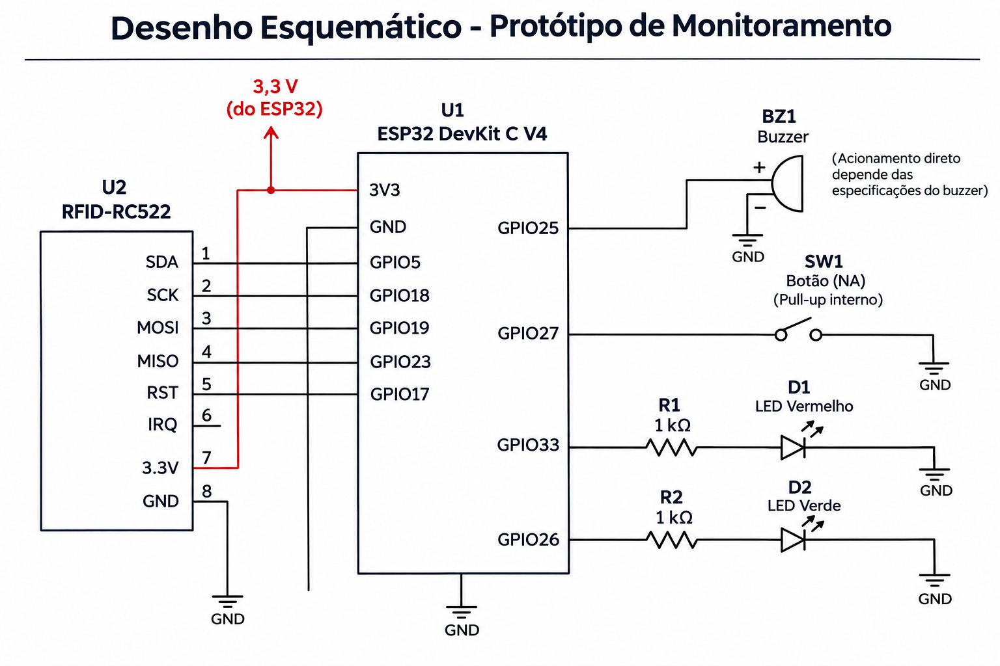
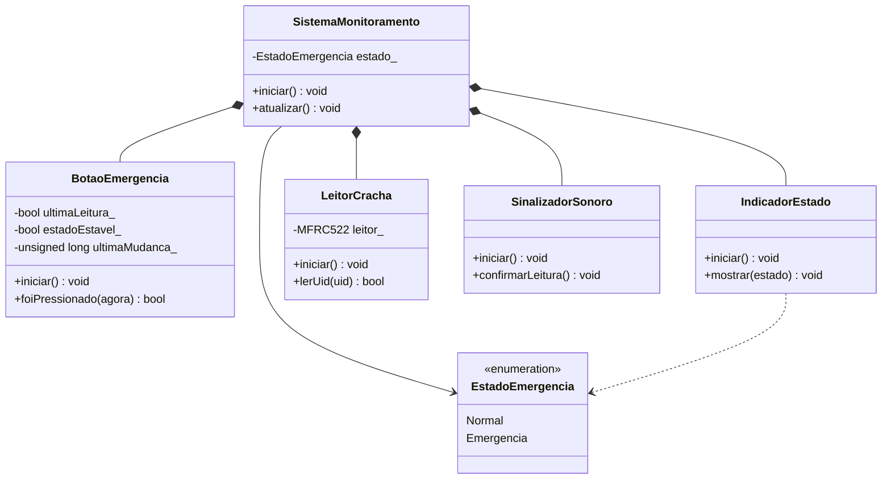

# Documentação IoTDoc - Módulo 4 - Inteli

## Synthetix

### C.R.I.S.I.S - Controle e Resposta Inteligente em Situações de Incidente e Segurança

#### Integrantes:

- Davi Tricarico
- Felipe Rabinovich
- Gustavo Fantasia
- Felipe Escobar
- Lucas Oliveira
- Pedro Negri
- Vinicius Ramos
- Arthur Rodrigues

## Sumário

[1. Introdução](#c1)

[2. Metodologia](#c2)

[3. Desenvolvimento e Resultados](#c3)

[4. Conclusões e Recomendações](#c4)

[5. Referências](#c5)

 

# 1. Introdução

A Unipar é uma empresa brasileira do setor químico e petroquímico, com mais de 55 anos de operação, que produz cloro, soda e PVC (Veja [...], 2024). A empresa tem mais de 1.400 colaboradores diretos (Veja [...], 2024) e fechou 2025 com receita líquida consolidada de R$ 5,1 bilhões (Unipar Carbocloro S.A., 2026b). Suas fábricas ficam em Cubatão (SP), Santo André (SP), Bahía Blanca, na Argentina (Veja [...], 2024), e Camaçari (BA), inaugurada em 2025 (Unipar [...], 2025). A Unipar é líder na produção de cloro e soda e a segunda maior produtora de PVC da América do Sul (Unipar [...], 2025).

Este projeto é feito com a fábrica de Cubatão, a unidade com a maior capacidade de produção de cloro da empresa (Unipar Carbocloro S.A., 2023), onde trabalham cerca de 355 funcionários diretos e cerca de 400 de empresas parceiras (informação verbal)[^1]. Em uma emergência, como um vazamento de cloro, essas pessoas precisam sair da área rápido e chegar aos pontos de encontro. Hoje, esse processo é quase todo manual: o alarme é acionado por um operador, a empresa só sabe quem entrou e saiu pela portaria, sem saber onde cada pessoa está dentro da planta, e a confirmação de quem chegou ao ponto de encontro é feita pelos líderes, por chamada. Além disso, durante a emergência, as catracas são liberadas para dar vazão e deixam de registrar quem passa. Com isso, a evacuação fica mais lenta e é difícil saber, rápido, quem ainda não chegou (informação verbal)[^1].

Para isso, a Synthetix propõe o C.R.I.S.I.S, uma solução de Internet das Coisas (IoT) que confirma a chegada de cada pessoa ao ponto de encontro pela leitura do crachá, registra a última zona por onde ela passou e reúne essas informações em uma aplicação web para a equipe de Segurança, Saúde e Meio Ambiente (SSMA) e para o Centro de Controle Operacional (CCO).

[^1]: Informação fornecida por representantes da Unipar na reunião de kickoff do projeto, em 16 de outubro de 2026.

## 1.1 Objetivos

Os objetivos abaixo foram definidos a partir do Termo de Abertura do Projeto (Unipar, 2026a) e da reunião de kickoff com a Unipar (informação verbal)[^1].

**Objetivo geral:** tornar a evacuação das áreas fabris da Unipar em Cubatão mais rápida, precisa e rastreável, permitindo saber quem já chegou aos pontos de encontro e quem ainda precisa ser procurado durante uma emergência (Unipar, 2026a).

**Objetivos específicos:**

1. Confirmar individualmente a chegada de cada pessoa ao ponto de encontro, substituindo a conferência manual por listas.
2. Identificar quem ainda não confirmou a chegada a tempo de a SSMA decidir a busca dentro do prazo interno de 10 minutos informado pela Unipar (informação verbal)[^1].
3. Apoiar a orientação da busca feita pelos brigadistas com a última área registrada de cada pessoa não confirmada.
4. Dar à SSMA e ao CCO uma visão consolidada da evacuação, com a estimativa de pessoas na planta e as confirmações em cada ponto de encontro.
5. Manter registros rastreáveis de cada evacuação, para auditorias, simulados e melhoria do plano de emergência.
6. Proteger os dados dos colaboradores, usando a identificação nominal somente durante a emergência e somente por quem coordena a resposta.

## 1.2 Proposta da solução

O C.R.I.S.I.S, solução proposta pela Synthetix, é um sistema de Internet das Coisas (IoT) que acompanha a evacuação em três pontos da planta e reúne as informações em uma aplicação web:

- **Nas portarias**, sensores contam as entradas e saídas e estimam quantas pessoas estão dentro da planta, sem identificar ninguém.
- **Nas portas das zonas monitoradas**, leitores registram o crachá de quem passa e guardam a última zona de cada pessoa.
- **Nos pontos de encontro**, totens confirmam a chegada de cada pessoa quando ela aproxima o crachá do leitor.

Em uma emergência, o CCO inicia o protocolo na aplicação e indica os pontos de encontro ativos, conforme a orientação da SSMA. A aplicação mostra em um só lugar a estimativa de pessoas na planta, as confirmações em cada ponto e quem ainda não confirmou. Aos 10 minutos, a SSMA recebe a lista de quem não confirmou, com a última zona registrada, e decide a busca dos brigadistas. Os nomes só aparecem enquanto a emergência está ativa e para quem coordena a resposta.

Assim, cada objetivo da seção 1.1 é atendido: a confirmação no totem substitui a lista em papel (objetivo 1); a sinalização aos 10 minutos e a última zona registrada apoiam a decisão e a orientação da busca (objetivos 2 e 3); a aplicação consolida a evacuação e guarda o histórico (objetivos 4 e 5); e a exibição restrita dos nomes protege os dados dos colaboradores (objetivo 6).

O Termo de Abertura do Projeto de Inovação (TAPI) também prevê a orientação da rota de evacuação (Unipar, 2026a). Esse item ficou fora do escopo desta solução por dois motivos. Primeiro, as áreas de processo da Unipar são classificadas, com risco de vazamento e incêndio (Unipar, 2026a), o que restringe a instalação de sinalização eletrônica ao longo das rotas. Segundo, em um vazamento de cloro, o ponto de encontro usado depende da direção do vento e é definido pela SSMA no momento do incidente (informação verbal)[^1]. A solução apoia a orientação de outra forma: o CCO seleciona na aplicação os pontos de encontro ativos indicados pela SSMA, e os brigadistas recebem a última zona registrada de quem ainda não confirmou.

O protótipo da Sprint 1 testou a contagem de entradas e saídas que deu origem ao dispositivo das portarias. A partir da Sprint 2, os protótipos passam a representar os três dispositivos da solução, detalhados nas seções 3.1.3 e 3.3.

## 1.3 Justificativa

O cloro é um gás tóxico e mais denso que o ar, que se acumula perto do solo (NIOSH, 2019). Em um vazamento, cada minuto entre o alarme e a confirmação de que todos saíram conta. Hoje, essa confirmação depende de chamadas com lista e rádio nos pontos de encontro, sob ruído de sirene e vento, e o prazo interno de 10 minutos para decidir a busca corre enquanto os números ainda estão sendo somados (informação verbal)[^1].

**Potencial e benefícios.** A solução troca a chamada manual por uma confirmação feita pela própria pessoa, ao aproximar o crachá do totem. Com isso, a SSMA passa a saber quem já chegou sem esperar a soma das listas, recebe aos 10 minutos quem ainda falta e tem a última zona registrada de cada pessoa para orientar a busca. Cada evacuação também passa a deixar um registro com horários, confirmações e alertas, o que atende ao pedido de rastreabilidade do TAPI (Unipar, 2026a) e serve para auditorias e simulados.

**Por que esta combinação de tecnologias.** Antes de chegar a essa solução, a equipe comparou três abordagens:

- **Contagem anônima nas passagens:** diz quantas pessoas estão na planta, mas não diz quem falta nem onde procurar, e erros de contagem podem se compensar.
- **Identificação individual com localização contínua:** diria onde cada pessoa está, mas exigiria equipamento em toda a área de processo e trataria dados de localização o tempo todo. Além disso, o TAPI deixa a localização precisa em ambientes internos fora do escopo do projeto (Unipar, 2026a).
- **Confirmação por crachá em pontos definidos:** diz quem chegou e qual foi a última zona registrada, mas depende de a pessoa aproximar o crachá e não dá a posição exata.

A solução combina a primeira e a terceira: a contagem anônima nas portarias dá a referência de quantas pessoas estavam na planta, e a leitura do crachá nas zonas e nos pontos de encontro diz quem chegou e onde procurar quem não chegou. Ela evita a localização contínua e reduz o uso de dados pessoais, o que facilita o atendimento à Lei Geral de Proteção de Dados Pessoais (Brasil, 2018): os nomes só aparecem durante a emergência e para quem coordena a resposta.

**Diferencial.** A solução usa o crachá, que já é de uso obrigatório na planta (informação verbal)[^1], em vez de um novo dispositivo por pessoa, e não substitui o procedimento de emergência da Unipar: a decisão da busca continua com a SSMA. Os benefícios ainda dependem de validação em simulados, principalmente quanto ao tempo que a aproximação do crachá acrescenta à chegada nos pontos de encontro.

# 2. Metodologia (sprint 3)

_Descreva as etapas da metodologia RM-ODP que foram utilizadas para o desenvolvimento, citando o referencial teórico. Você deve apenas enunciar os métodos, sem dizer ainda como ele foi aplicado e quais resultados obtidos._

# 3. Desenvolvimento e Resultados

## 3.1. Domínio de Fundamentos de Negócio

_Link para os templates de negócios: https://drive.google.com/drive/folders/1lTqisJ_gxxtc5J5aXM8ula2kQ4MsII_M?usp=sharing_

### 3.1.1. Contexto da Indústria

#### Concorrência

A Unipar atua na indústria química e petroquímica, com foco nos mercados de cloro, soda cáustica, policloreto de vinila (PVC) e derivados. De acordo com o Formulário de Referência 2026 da empresa, seus principais competidores no mercado interno incluem Braskem, Dow, Olin, Chemtrade, Katrium, Chlorum e CMPC. Essa relação deve ser interpretada no nível do portfólio: o documento não afirma que todas essas empresas disputam os mesmos produtos, clientes e regiões com a mesma intensidade. A soda cáustica e o PVC também estão expostos aos preços e estoques internacionais e à entrada de produtos importados. Segundo a própria companhia, os principais fatores de competitividade são a disponibilidade e o custo de matérias-primas, a escala de produção e a localização das unidades (Unipar Carbocloro S.A., 2026a).

#### Modelo de negócio

A Unipar adota um modelo predominantemente _business-to-business_ (B2B), baseado na produção e na comercialização, em grande escala, de insumos utilizados por outras organizações. A empresa atende setores como papel e celulose, alumínio, construção civil, infraestrutura, alimentos, siderurgia e metalurgia, tratamento de água, sabões, detergentes e produtos de limpeza. Essa diversidade reduz a exposição a um único mercado consumidor; em 2025, nenhum cliente respondeu por mais de 10% da receita líquida total da companhia (Unipar Carbocloro S.A., 2026a).

Trata-se de um modelo intensivo em capital, infraestrutura e energia, no qual a competitividade depende da escala, do controle dos custos e da continuidade das operações. A localização das unidades próximas a polos industriais e aos mercados consumidores reduz a distância logística e favorece a confiabilidade do abastecimento, aspecto especialmente relevante para o cloro, cujo transporte apresenta restrições técnicas e de segurança. A proximidade geográfica, associada aos contratos de fornecimento e à autoprodução de energia, contribui para proteger a posição competitiva da empresa, embora não elimine sua exposição aos custos de insumos e aos ciclos internacionais de soda cáustica e PVC (Unipar Carbocloro S.A., 2026a).

#### Tendências do setor

Entre as principais tendências da indústria química e petroquímica estão a descarbonização, a eficiência energética, o uso de fontes renováveis, a modernização tecnológica e a economia circular. Essas tendências afetam tanto os custos operacionais quanto o acesso a capital, a conformidade ambiental e a preferência dos clientes industriais. Na Unipar, esse movimento aparece na substituição das tecnologias de mercúrio e diafragma por células de membrana na fábrica de Cubatão e na ampliação do uso de energia renovável. Em 2025, a companhia informou que 79% da energia elétrica consumida em suas operações veio de fontes renováveis (Unipar, 2026b).

A digitalização e a automação dos processos industriais e administrativos também se destacam. A Indústria 4.0 integra tecnologias como Internet das Coisas, análise de grandes volumes de dados, inteligência artificial, computação em nuvem e sistemas ciberfísicos para criar fábricas mais conectadas e apoiar a melhoria dos processos produtivos (INMETRO, 2026). Nesse contexto, a integração de sistemas, o uso de sensores, a análise de dados e a automatização de tarefas podem melhorar o monitoramento das operações, reduzir atividades repetitivas e apoiar a tomada de decisão.

No mercado brasileiro, a ampliação dos investimentos em saneamento pode favorecer a demanda por cloro e PVC, utilizados, respectivamente, no tratamento de água e em componentes de infraestrutura. Ao mesmo tempo, a indústria permanece exposta às oscilações cambiais, aos preços internacionais, às importações e ao desenvolvimento de materiais e tecnologias alternativas. Esse conjunto de tendências exige investimentos contínuos em inovação, eficiência operacional e sustentabilidade (Brasil, 2020; Unipar Carbocloro S.A., 2026a).

#### Cinco Forças de Porter

O modelo das Cinco Forças de Porter analisa como a rivalidade entre concorrentes, a ameaça de novos entrantes, a ameaça de produtos substitutos e os poderes de negociação de fornecedores e compradores afetam a atratividade e a rentabilidade de um setor (Harvard Business School, [s. d.]). A aplicação a seguir considera conjuntamente os mercados de cloro, soda cáustica e PVC. Como as condições competitivas variam entre esses produtos, as classificações representam uma síntese analítica do portfólio da Unipar, e não uma avaliação oficial divulgada pela companhia.

A Figura 1 apresenta uma visão integrada da análise. A rivalidade ocupa a posição central porque resulta da interação com as outras quatro forças: barreiras de entrada, disponibilidade de substitutos e capacidade de fornecedores e compradores influenciarem custos, preços e condições comerciais. O quadro também antecipa a intensidade atribuída a cada força, permitindo comparar as pressões antes de examinar suas justificativas individualmente.

  
Figura 1 – Cinco Forças de Porter aplicadas à Unipar

  
  
Fonte: elaboração dos autores (2026).

Em síntese, a figura indica que a rivalidade constitui a pressão central e mais intensa, enquanto o poder dos compradores aparece como moderado a alto. O poder dos fornecedores e a ameaça de substitutos possuem intensidade moderada, e a ameaça de novos entrantes é baixa. Essa representação funciona como síntese visual; os fatores que sustentam cada classificação são apresentados a seguir.

##### Rivalidade entre os concorrentes — alta

A rivalidade é classificada como **alta**. A soda cáustica e o PVC seguem referências internacionais de preço e concorrem com importações, o que limita a capacidade de diferenciação e aumenta a pressão sobre custos. No cloro, a competição é mais regional, pois localização e logística têm maior peso. Em todos os mercados, escala produtiva, disponibilidade de matérias-primas e confiabilidade de fornecimento são fatores relevantes. A liderança da Unipar em cloro e soda cáustica e sua posição como segunda maior produtora de PVC da América do Sul fortalecem a empresa, mas não eliminam a pressão exercida por concorrentes locais e produtos importados (Unipar Carbocloro S.A., 2026a).

##### Ameaça de novos entrantes — baixa

A ameaça de novos entrantes é classificada como **baixa** para a instalação de nova capacidade produtiva local. A entrada exige investimento elevado, escala mínima eficiente, tecnologia especializada, licenciamento ambiental, acesso contínuo a energia e matérias-primas e uma estrutura logística compatível com produtos químicos. O novo participante também precisa construir reputação de segurança e confiabilidade perante clientes que dependem de fornecimento contínuo. A entrada por importações, aquisições ou parcerias é mais viável do que a construção de uma nova planta, mas não elimina as barreiras industriais e regulatórias do setor (Unipar Carbocloro S.A., 2026a).

##### Ameaça de produtos substitutos — moderada

A ameaça de produtos substitutos é classificada como **moderada**. Outros plásticos, metais, concreto e vidro podem cumprir funções semelhantes às do PVC em determinadas aplicações, enquanto outros produtos alcalinos podem substituir a soda cáustica em processos específicos. No tratamento de água, ozônio e radiação ultravioleta podem substituir ou complementar algumas aplicações do cloro; entretanto, essas tecnologias exigem condições próprias de instalação e operação e, isoladamente, não mantêm proteção residual na rede de distribuição (EPA, 2009). As alternativas, portanto, existem, mas não reproduzem simultaneamente o custo, o desempenho e a amplitude de usos dos principais produtos da Unipar.

##### Poder de negociação dos fornecedores — moderado

O poder de negociação dos fornecedores é classificado como **moderado**. Etileno, energia elétrica, sal, água, gás natural e vapor representam, em conjunto, cerca de 90% dos custos variáveis consolidados da companhia. A criticidade desses insumos e o impacto de eventuais interrupções aumentam a dependência operacional. Em contrapartida, contratos de longo prazo, acordos de compra de energia, autoprodução renovável e a possibilidade de adquirir sal no mercado nacional ou por importação reduzem essa pressão. Portanto, embora os insumos tenham peso elevado na estrutura de custos, os mecanismos contratuais e de diversificação impedem que o poder agregado dos fornecedores seja classificado como alto (Unipar Carbocloro S.A., 2026a).

##### Poder de negociação dos compradores — moderado a alto

O poder de negociação dos compradores é classificado como **moderado a alto**. Grandes clientes industriais podem negociar preços, prazos, volumes e níveis de serviço e, nos mercados de soda cáustica e PVC, comparar a oferta doméstica com produtos importados. Entretanto, esse poder é limitado pela necessidade de fornecimento contínuo, pelos requisitos técnicos e logísticos e pela diversificação da carteira da Unipar. Em 2025, nenhum cliente representou mais de 10% da receita líquida total da companhia, o que reduz a dependência de compradores individuais. A classificação mais elevada aplica-se, portanto, principalmente aos clientes de grande volume que possuem alternativas viáveis de abastecimento (Unipar Carbocloro S.A., 2026a).

##### Conclusão

A **rivalidade entre os concorrentes** representa a maior pressão competitiva sobre a Unipar, sobretudo nos mercados expostos a preços internacionais e importações. O poder de negociação dos **compradores** constitui uma pressão moderada a alta, principalmente entre clientes de grande volume com alternativas de abastecimento. O poder dos **fornecedores** e a ameaça de **produtos substitutos** são moderados: os insumos têm peso relevante nos custos, mas existem mecanismos de mitigação, enquanto a viabilidade dos substitutos varia conforme a aplicação. A ameaça de **novos entrantes** é a força menos intensa, devido às barreiras financeiras, tecnológicas, regulatórias e logísticas. Para responder a esse cenário, a Unipar deve priorizar eficiência operacional, segurança e confiabilidade de fornecimento, disciplina de custos, proximidade dos mercados consumidores e redução da exposição a insumos críticos.

### 3.1.2. Análise SWOT (sprint 1)

A análise SWOT (ou FOFA) é uma ferramenta de planejamento estratégico que avalia quatro elementos: forças (fatores internos positivos), fraquezas (fatores internos negativos), oportunidades (fatores externos positivos) e ameaças (fatores externos negativos). Com base nisso, realizou-se a análise SWOT da Unipar, considerando suas características organizacionais, sua atuação no mercado e os fatores internos e externos que podem influenciar seu desempenho e sua competitividade, conforme apresentado na Figura 2.

  
Figura 2 – Análise SWOT da Unipar

  
  
Fonte: elaboração dos autores (2026).

**Forças**

A análise das forças da Unipar evidencia sua experiência consolidada no setor químico e petroquímico, construída ao longo de décadas de atuação no mercado. Sua presença industrial no Brasil e na Argentina fortalece sua posição na América do Sul e contribui para o atendimento de diferentes setores da economia. Além disso, a empresa possui uma cultura organizacional voltada à segurança e à prevenção de acidentes, aspecto fundamental para suas atividades industriais. A existência de sistemas de alarmes e brigadas de emergência demonstra uma estrutura de resposta a situações de risco, oferecendo uma base importante para o aprimoramento dos procedimentos de segurança.

**Fraquezas**

Em relação às fraquezas, destacam-se as limitações do processo de conferência de evacuação descrito no kickoff: dependência de listas e contagens manuais nos pontos de encontro e perda de registros de passagem quando as catracas são liberadas. Na figura, “ausência de monitoramento digital em tempo real” e “falta de infraestrutura dedicada ao rastreamento” se referem a esse recorte de acompanhamento da evacuação, não à ausência de automação ou sistemas de identificação em toda a Unipar. Essas limitações motivam o protótipo de contagem local da Sprint 1 e a avaliação de consolidação remota nas sprints seguintes; não tornam necessário adotar rastreamento individual contínuo.

**Oportunidades**

A crescente demanda do mercado por práticas industriais sustentáveis pode incentivar a adoção de processos mais eficientes e ambientalmente responsáveis, enquanto os avanços tecnológicos em digitalização e automação industrial oferecem oportunidades para melhorar o controle e a produtividade das atividades. Além disso, o crescimento da demanda por saneamento básico representa uma oportunidade comercial, considerando a importância de produtos como o cloro no tratamento de água. No cenário internacional, a possibilidade de ampliar as exportações pode permitir que a Unipar alcance novos mercados consumidores, diversifique sua base de clientes e reduza a dependência dos mercados em que já atua, fortalecendo sua competitividade e presença no setor químico global.

**Ameaças**

Por fim, as ameaças estão relacionadas às condições externas do mercado e às exigências regulatórias que afetam a indústria química. A concorrência no mercado químico internacional pode pressionar os preços e a competitividade da Unipar, enquanto as oscilações nos custos de energia e matérias-primas podem elevar suas despesas de produção. Além disso, as exigências regulatórias e ambientais rigorosas demandam investimentos contínuos em segurança, conformidade e modernização das instalações industriais. A esses fatores somam-se a instabilidade econômica e as variações cambiais nos países em que a empresa atua, que podem impactar seus custos operacionais, seus resultados financeiros e sua competitividade no mercado.

### 3.1.3. Descrição da Solução a ser Desenvolvida (sprint 1)

#### 3.1.3.1 Qual é o problema a ser resolvido

A Unipar opera uma planta química em Cubatão (SP), onde emergências operacionais como vazamentos de cloro gasoso ou incêndios exigem abandono imediato de área e conferência rápida nos Pontos de Encontro (PEs). Segundo o contexto operacional fornecido ao projeto, a população de referência para dimensionamento preliminar é de aproximadamente 755 pessoas, compreendendo cerca de 355 colaboradores próprios e 400 terceirizados (além de eventuais visitantes). Na prática operacional, a população presente em cada ocorrência depende do fluxo efetivo de entradas e saídas nas portarias da unidade.

Em situação de alarme de emergência, a liberação das catracas permite a vazão física rápida para evasão, conforme o princípio geral da Norma Regulamentadora NR-23 de manter saídas desobstruídas para abandono seguro (BRASIL, 2022), mas interrompe o registro eletrônico individual das passagens. Ao mesmo tempo, a ausência de visibilidade sobre a última zona acessada pelos trabalhadores e a dependência de chamadas manuais com listas em papel nos Pontos de Encontro dificultam e retardam a consolidação das informações pelo Centro de Controle Operacional (CCO) e pela equipe de Saúde, Segurança e Meio Ambiente (SSMA). Pela diretriz interna informada pela Unipar no Termo de Abertura do Projeto de Inovação (TAPI) e no kickoff, qualquer pessoa não confirmada em até 10 minutos após o acionamento do alarme é classificada como caso crítico, exigindo o acionamento imediato da Brigada de Emergência para busca e resgate. Esse limite de 10 minutos constitui uma regra operacional interna da parceira, e não um prazo fixado pela NR-23.

O cloro é tóxico, mais denso que o ar e não inflamável, embora seja um forte oxidante (NIOSH, 2019). Seu risco tóxico não caracteriza, por si só, uma área com atmosfera explosiva. A NR-20 trata de inflamáveis e combustíveis; sua aplicação depende das substâncias e atividades presentes. A classificação de áreas e a adequação dos equipamentos dependem de avaliação técnica específica. A NR-23 exige condições de abandono rápido e seguro, sem obstrução das passagens (Brasil, 2022, 2025).

**Rastreabilidade das informações internas:** dados de população aproximada, procedimento de liberação de catracas, conferência manual, prazo interno de 10 minutos, atuação do CCO a partir de sala segura e restrição de não realizar localização contínua de alta precisão em ambientes internos foram fornecidos no contexto do projeto (TAPI e reunião de kickoff realizada em **16/10/2026**, conforme confirmação registrada em 23/10/2026). A ata formal e a versão/data publicada do TAPI permanecem pendentes de disponibilização no repositório, não sendo tais parâmetros operacionais atribuídos ao relatório público de sustentabilidade.

#### 3.1.3.2 Qual a solução proposta (visão de negócios)

A solução proposta pela equipe Synthetix (Grupo G05) integra **três tipos de dispositivos baseados em ESP32** a uma **aplicação web centralizada** para apoiar o monitoramento e a confirmação da evacuação em emergências industriais na planta de Cubatão, respeitando a restrição do TAPI de não realizar localização contínua precisa em ambientes internos e sem substituir os procedimentos institucionais de emergência da Unipar. A implantação real poderá demandar múltiplas unidades físicas de cada tipo de dispositivo, conforme a quantidade de portarias, portas de zonas e pontos de encontro monitorados.

Na Sprint 1, o protótipo Wokwi utiliza Arduino Uno e **dois sensores HC-SR04**, um para entrada e outro para saída, LCD, buzzer e LEDs. O botão apenas alterna os LEDs e **não pausa a contagem**. A detecção usa sensores dedicados a cada sentido; não há algoritmo implementado de direção pela ordem de acionamento de dois feixes. Dashboard, comunicação em rede, integração às portarias, registros de horário, histórico e alerta automático ao CCO/brigada ainda são funcionalidades futuras. A seção 3.3.8 detalha os limites e o modelo técnico; a seção 3.4.1 registra CT01–CT10.

Os três módulos de hardware e a camada de software que compõem a arquitetura proposta são:

1. **Dispositivo de controle de entradas e saídas da planta (Portarias / Catracas):**
   - Utiliza **dois sensores ultrassônicos HC-SR04** (um dedicado ao registro de passagens de entrada e outro ao de saída) acoplados a um microcontrolador (evoluindo do protótipo inicial em Arduino Uno da Sprint 1 para **ESP32** na versão final conectada via Wi-Fi e MQTT) para calcular continuamente uma estimativa da quantidade de pessoas na planta, $P(t)$.
   - Como os sensores ultrassônicos não leem crachás, a contagem das portarias é **estritamente anônima e quantitativa**, servindo como referência numérica, mas sujeita a erros de medição (especialmente quando as catracas estão liberadas e múltiplas pessoas passam simultaneamente ou quando ocorre falha de leitura), não informando nominalmente quem está na planta.

2. **Dispositivo de monitoramento por zonas (Acessos às Zonas Monitoradas):**
   - Utiliza **ESP32** e **leitores RFID RC522** compatíveis com **tags MIFARE de 13,56 MHz**, instalando-se um nó junto ao leitor de cada porta monitorada (no protótipo acadêmico pode-se simular mais de uma porta, o que não comprova por si só a viabilidade física em locais distantes na fábrica).
   - A leitura válida de uma tag atualiza o estado da pessoa na zona correspondente por lógica de alternância: a primeira leitura no acesso registra a entrada na zona e a leitura seguinte registra a saída. Quando uma tag é lida em uma nova zona, a aplicação web encerra automaticamente a associação ativa à zona anterior e registra a nova zona. De modo análogo, a confirmação posterior em um Ponto de Encontro encerra a associação ativa à zona, preservando o histórico permitido para o evento.
   - Esse modelo atende à restrição do TAPI: o sistema registra apenas a **última passagem detectada em porta de zona**, sem acompanhar a trajetória da pessoa entre leitores nem determinar sua posição exata no interior do ambiente.

3. **Dispositivo de confirmação nos Pontos de Encontro (Totens nos PEs):**
   - Os Pontos de Encontro são áreas abertas situadas entre as portarias de entrada da planta e as zonas monitoradas; como não possuem leitores de zona em seus acessos, as pessoas nesses espaços abertos compõem o contingente não associado a nenhuma zona monitorada.
   - Cada Ponto de Encontro contará com um **totem baseado em ESP32 e leitor RFID** compatível com as tags adotadas, além de sinalização local por LED e buzzer (que confirmam unicamente o registro da leitura do crachá, e não a segurança física da pessoa).
   - Durante a evacuação, cada pessoa aproxima seu crachá RFID do totem para confirmar sua chegada, permitindo à aplicação associar o identificador ao cadastro correspondente. Caso ocorra falha de conexão de rede, o totem pode ser ativado por botão local e armazena as leituras em memória local para sincronização automática assim que a conectividade for restabelecida.

4. **Aplicação Web e Modelo de Indicadores do Balanço ($P(t)$, $B_0$, $Z(t)$, $M(t)$ e $G(t)$):**
   - A aplicação web reúne os dados dos três tipos de dispositivos e apresenta à SSMA, ao CCO e aos brigadistas a estimativa de pessoas na planta, as pessoas com última zona registrada, as confirmações nos Pontos de Encontro e o horário da última atualização.
   - Para fundamentar a interpretação operacional e explicitar seus limites, o modelo considera cinco variáveis:
     - $P(t)$: estimativa anônima da quantidade de pessoas dentro da planta no instante $t$, calculada pelos sensores ultrassônicos das portarias;
     - $B_0$: estimativa anônima de pessoas na planta no início da emergência, congelada no instante do alarme ($t_0$);
     - $Z(t)$: conjunto de identificadores RFID distintos associados ativamente a uma zona monitorada no instante $t$;
     - $M(t)$: conjunto de identificadores RFID distintos com confirmação registrada em Ponto de Encontro ativo no instante $t$;
     - $G(t)$: estimativa de pessoas dentro da planta que não estão associadas a uma zona monitorada ("gap" em áreas abertas/circulação), dada por:

$$G(t) = P(t) - |Z(t)|$$

   - Como os Pontos de Encontro situam-se fora das zonas monitoradas, as pessoas que neles se encontram integram $G(t)$ até que confirmem presença no totem. Sendo os registros ativos de zona e de Ponto de Encontro mutuamente exclusivos no mesmo instante $t$, a expressão $G(t) - |M(t)|$ estima quantas pessoas permanecem sem associação ativa a uma zona e sem confirmação em Ponto de Encontro.
   - Complementarmente, $B_0 - |M(t)|$ indica quantas pessoas da população de referência inicial ainda não foram confirmadas em um Ponto de Encontro (sem identificá-las nominalmente por si só e podendo incluir quem saiu da planta sem passar por um PE), enquanto $B_0 - |Z(t)|$ indica quantas pessoas da referência inicial não estão associadas ativamente a uma zona monitorada.

**Separação entre o escopo implementado na Sprint 1 e a solução final proposta:**
- **Planejado para a solução final (próximas sprints):** migração do contador das portarias para **ESP32** com nova lógica de botão/LEDs de emergência, inclusão dos nós **ESP32 + RFID RC522** nas portas de zonas e nos totens dos Pontos de Encontro, conectividade **Wi-Fi/MQTT**, armazenamento offline temporário nos totens e construção da **aplicação web** com controle de acesso e regras de privacidade atualizadas para tratamento de identificadores RFID. A solução **não calcula rotas de evacuação** (pilar de Orientação fora do escopo completo do grupo G05, tratado apenas parcialmente pelo apoio informativo à coordenação da SSMA, do CCO e dos brigadistas).

#### 3.1.3.3 Como a solução proposta deverá ser utilizada

A operação da solução proposta envolve a atuação coordenada do **Operador do CCO**, dos **Porteiros**, dos **Colaboradores, Terceiros e Visitantes**, dos **Brigadistas** e da **Equipe de SSMA**, distribuindo-se em cinco etapas operacionais:

1. **Operação de Rotina (Controle de Portarias e Monitoramento por Zonas):**
   - Nas portarias da planta, os dispositivos com dois sensores ultrassônicos contabilizam continuamente as entradas e saídas para atualizar a estimativa $P(t)$, mantendo o **LED verde aceso** e o **LED vermelho apagado** em estado normal.
   - Nas portas das zonas monitoradas, os colaboradores, terceiros e visitantes (previamente cadastrados e portando tags RFID MIFARE de 13,56 MHz) registram suas passagens nos leitores RC522. O sistema alterna o estado da tag entre entrada e saída naquela zona (ou transfere a associação ativa quando a tag é lida em nova zona), partindo de um estado inicial reconciliado e zerado nas trocas de turno ou quando a planta fica vazia. Fora de situações de emergência ativa, a identificação nominal permanece oculta na aplicação web.

2. **Deflagração da Emergência e Ativação Coordenada (CCO e Porteiros):**
   - Diante de uma emergência (como vazamento de cloro), o **CCO** aciona o protocolo de dentro da sala segura por meio da aplicação web, congelando a estimativa inicial $B_0$ no instante $t_0$, iniciando a contagem do prazo interno de 10 minutos e ativando remotamente o modo de leitura dos totens RFID nos Pontos de Encontro designados pela SSMA (selecionados conforme a área afetada e a direção do vento).
   - Simultaneamente, o CCO comunica-se por **radiocomunicador com os porteiros** para que pressionem o botão físico nos dispositivos instalados nos acessos de entrada e saída da planta. Na versão ESP32 final, esse acionamento apaga o LED verde e mantém o **LED vermelho aceso**, sinalizando localmente o protocolo de emergência ativo nas portarias.
   - Caso ocorra falha de comunicação de rede antes que algum totem de Ponto de Encontro receba o comando remoto do CCO, um integrante da SSMA ou brigadista ativa o modo de leitura pressionando o **botão físico local do totem**.

3. **Deslocamento e Confirmação Nominal por RFID nos Pontos de Encontro:**
   - Durante a evacuação, os trabalhadores dirigem-se aos Pontos de Encontro ativos. Ao chegar ao totem do Ponto de Encontro, cada pessoa **aproxima seu crachá/tag RFID do leitor**.
   - A leitura válida aciona a sinalização visual e sonora local do totem (LED e buzzer, que indicam apenas que o crachá foi lido), encerra a associação ativa daquela pessoa à última zona monitorada e registra sua confirmação no conjunto $M(t)$ da aplicação web (ou armazena o evento localmente no ESP32 caso a rede esteja indisponível, sincronizando-o quando a conexão retornar).

4. **Monitoramento na Aplicação Web e Coordenação de Resgate aos 10 Minutos:**
   - Durante a emergência ativa, a aplicação web habilita a visualização nominal restrita aos usuários autorizados da SSMA e do CCO, exibindo $P(t)$, $B_0$, as pessoas confirmadas nos Pontos de Encontro ($M(t)$), as pessoas que permanecem com última passagem registrada em alguma zona monitorada ($Z(t)$), os indicadores de diferença ($G(t) = P(t) - |Z(t)|$, $G(t) - |M(t)|$, $B_0 - |M(t)|$ e $B_0 - |Z(t)|$) e o horário da última atualização.
   - Quando o limite interno de **10 minutos** definido no TAPI é atingido, a aplicação sinaliza à SSMA as pessoas ainda sem confirmação em Ponto de Encontro. A equipe de SSMA analisa os dados, coordena a resposta e orienta os brigadistas pelos canais operacionais da Unipar, utilizando o registro da última zona conhecida ($Z(t)$) como subsídio investigativo de busca (ciente de que esse dado informa apenas a última porta lida, e não a localização exata do indivíduo).

5. **Tratamento de Limitações Operacionais e Encerramento do Protocolo:**
   - **Limitações e contingências na interpretação:** (i) leituras perdidas ou duplicadas nos leitores RFID de zona podem inverter o estado de entrada/saída e exigem conferência operacional; (ii) a contagem ultrassônica nas portarias ($P(t)$ e $B_0$) é anônima e tem maior risco de erro com catracas liberadas e pessoas passando juntas; (iii) para obter uma lista nominal completa de esperados no início da emergência, é indispensável uma fonte cadastral confiável de quem entrou na planta (incluindo terceiros e visitantes com tags distribuídas), pois o sensor ultrassônico não gera lista nominal e as zonas monitoradas não cobrem áreas abertas; e (iv) se uma pessoa sair diretamente da planta sem passar por um Ponto de Encontro, ela poderá continuar constando como não confirmada em $B_0 - |M(t)|$ até a reconciliação.
   - **Encerramento formal:** somente após a equipe de SSMA avaliar e confirmar que todos estão seguros, o protocolo é encerrado na aplicação web e a SSMA comunica os porteiros para que pressionem novamente o botão nos dispositivos das catracas, apagando o LED vermelho e reacendendo o LED verde.

#### 3.1.3.4 Quais os benefícios trazidos pela solução proposta

Os benefícios descritos a seguir representam **resultados esperados e potenciais** da arquitetura completa proposta (versão 7), cuja comprovação dependerá das próximas etapas de desenvolvimento, integração e testes em simulados:

1. **Apoio à Proteção da Vida e Resposta dentro do Prazo de 10 Minutos:**
   - Potencial para substituir a chamada manual em papel nos Pontos de Encontro pela confirmação rápida via aproximação de crachá RFID nos totens, agilizando a identificação de quem já atingiu local seguro ($M(t)$);
   - Apoio informativo à atuação da Brigada de Emergência e da SSMA ao atingir o limite de 10 minutos, fornecendo a última zona registrada ($Z(t)$) das pessoas ainda não confirmadas para orientar a priorização de buscas sem depender exclusivamente de relatos verbais.

2. **Visibilidade Situacional Integrada e Resiliência Operacional:**
   - Consolidação, em uma única aplicação web para a SSMA e o CCO, das três camadas do fluxo de evacuação: portarias ($P(t)$ e $B_0$), zonas internas monitoradas ($Z(t)$) e Pontos de Encontro ($M(t)$), permitindo estimar inclusive o contingente em áreas abertas intermediárias ($G(t)$);
   - Redundância operacional nos acionamentos críticos e na coleta: combinação de ativação remota pelo CCO com acionamento físico local nas portarias (via porteiros avisados por rádio) e nos totens dos PEs (via botão local e armazenamento offline temporário em caso de queda de Wi-Fi/MQTT).

3. **Governança, Privacidade por Contexto e Escalabilidade Modular:**
   - Cumprimento da diretriz do TAPI de não realizar rastreamento contínuo de alta precisão em ambiente interno, trabalhando apenas com eventos discretos de passagem em portas de zona e confirmação em totens;
   - Proteção de dados pessoais alinhada à finalidade de salvamento de vidas: embora a solução final trate dados vinculados a indivíduos via RFID, a exibição nominal na aplicação web fica bloqueada na rotina e restrita a usuários autorizados exclusivamente durante emergências ativas;
   - Arquitetura modular em ESP32 que, após validação técnica de segurança e capacidade em Cubatão, poderá servir de base para estudos de expansão em outras unidades da Unipar.

#### 3.1.3.5 Qual será o critério de sucesso e qual medida será utilizada para o avaliar

**Aceitação da Sprint 1:** o protótipo deve reproduzir CT01–CT10 com as entradas e saídas da seção 3.4.1, ter código e circuito versionados, funções `setup()` e `loop()`, ao menos duas funções auxiliares utilizadas e uma classe instanciada em uso. A medida é a quantidade de casos aprovados sobre dez, acompanhada das evidências e da versão ensaiada. A revisão do diagrama exige nova execução antes de confirmar a aprovação da versão corrigida.

A avaliação da arquitetura integrada, ainda sujeita à validação com a parceira, combina critérios quantitativos de desempenho operacional, fidelidade de leitura/contagem e resiliência técnica, distinguindo o que foi verificado no protótipo da Sprint 1 do que será validado na arquitetura integrada com três dispositivos ESP32 e aplicação web:

1. **Tempo de Confirmação e Atendimento ao Prazo Interno de 10 Minutos:**
   - **Meta proposta:** redução mínima de 60% no tempo de apuração nos Pontos de Encontro em comparação ao procedimento manual em papel, assegurando que o dimensionamento de totens RFID nos PEs e de acessos comporte o fluxo da população dentro da janela crítica de 10 minutos (600 s) definida no TAPI.
   - **Condição de avaliação:** como a confirmação nos Pontos de Encontro na solução final exige a interação física de aproximar o crachá do leitor RFID no totem (e, nas portarias, respeitar o tempo de rearmamento dos sensores ultrassônicos), a vazão efetiva por dispositivo deverá ser medida empiricamente em ensaios controlados e simulados de evacuação, dimensionando-se a quantidade necessária de totens e nós para evitar filas que atrasem a confirmação (conforme modelagem das seções 3.3.8 e 3.4.1.1).

2. **Acurácia de Contagem nas Portarias e Confiabilidade de Leitura RFID (Zonas e PEs):**
   - **Meta proposta:** atingir taxa de acurácia por evento igual ou superior a 99% em condições controladas tanto na detecção bidirecional de passagem pelos sensores ultrassônicos das portarias quanto no registro e associação de tags RFID MIFARE (13,56 MHz) nos leitores RC522 de zonas e totens de Ponto de Encontro.
   - **Medidas decompostas:** nos sensores ultrassônicos das portarias, avaliar separadamente omissões, duplicidades, erros de sentido e falhas por passagem simultânea com catracas liberadas; nos nós RFID de zonas e PEs, medir a taxa de leituras válidas na primeira aproximação, a ausência de leituras fantasma/duplicadas que desalinhem o estado de entrada/saída da zona ($Z(t)$) e a exatidão da baixa automática da zona quando a tag é confirmada no totem do Ponto de Encontro ($M(t)$). Resultados inferiores (como 90% em ensaios de estresse) são tratados como diagnóstico de falha que exige correção, e não como aprovação operacional.

3. **Latência de Sincronização na Aplicação Web e Persistência Offline nos Totens:**
   - **Meta proposta:** resposta local imediata nos dispositivos de borda (até 0,5 s para sinalização de LED/buzzer/LCD) e atualização remota na aplicação web via Wi-Fi/MQTT em até 3,0 segundos após o evento em condições normais de rede, além de 0% de perda de confirmações registradas nos totens durante interrupções temporárias de conectividade (com sincronização integral do buffer local após o restabelecimento da conexão).

4. **Verificação Funcional por Etapa do Projeto:**
   - **Evidência atual da Sprint 1 (Protótipo Wokwi):** execução documentada dos dez casos de teste funcionais `CT01` a `CT10` (seção 3.4.1) no protótipo inicial com Arduino Uno e dois sensores HC-SR04 (cobrindo inicialização, entrada, liberação, saída, botão/LEDs, proteção contra saldo negativo, objeto fora de alcance, bloqueio de leitura conflitante e falha do pino `ECHO`), os quais constituem validação funcional preliminar em simulador e não comprovam ainda as metas de tempo, acurácia estatística ou operação industrial.
   - **Validação das próximas sprints:** execução de baterias de teste integrando os três dispositivos ESP32 (portaria ultrassônica com botão de protocolo de emergência, porta de zona RFID RC522 e totem RFID de Ponto de Encontro com armazenamento offline) à aplicação web, verificando a consistência dos indicadores $P(t)$, $B_0$, $Z(t)$, $M(t)$ e $G(t)$ e o disparo do alerta de não confirmados aos 10 minutos.

### 3.1.4. Value Proposition Canvas

O Value Proposition Canvas relaciona o perfil do cliente (tarefas, dores e ganhos) com o mapa de valor (produtos e serviços, aliviadores de dor e criadores de ganho) da solução (Osterwalder et al., 2014). O cliente considerado é a gestão de SSMA, representada pela persona Tuco Salamanca (seção 3.2.1.3), que coordena a resposta à emergência e os brigadistas e líderes de ponto responsáveis pela conferência nos pontos de encontro.

  
Figura 3 – Value Proposition Canvas do C.R.I.S.I.S

  
  
Fonte: elaboração dos autores (2026), com auxílio de inteligência artificial (Claude), com base em Osterwalder et al. (2014).

**Proposta de valor:** saber quem chegou aos pontos de encontro e onde procurar quem falta.

**Perfil do cliente**

- **Tarefas:** coordenar a evacuação e a resposta à emergência; saber quem chegou aos pontos de encontro; decidir quando e onde fazer buscas; registrar a ocorrência para auditorias; revisar o Plano de Ação de Emergência e conduzir simulados.
- **Dores:** contagem manual por listas e rádio, lenta e sujeita a erro; não saber quem falta nem onde procurar; números que chegam fragmentados e fora de ordem; o prazo de 10 minutos correndo durante a conferência; falta de registro confiável para análise posterior.
- **Ganhos:** saber em minutos quem já chegou e quem falta; decidir a busca com uma pista de onde procurar; números confiáveis, com origem e horário; registro de cada evacuação para auditorias e simulados.

**Mapa de valor**

- **Produtos e serviços:** dispositivo de contagem nas portarias, leitores de crachá nas zonas monitoradas, totens de confirmação nos pontos de encontro e aplicação web para a SSMA e o CCO.
- **Aliviadores de dor:** confirmação pelo crachá no totem no lugar da chamada manual; lista de quem não confirmou aos 10 minutos, com a última zona registrada; portarias, zonas e pontos de encontro consolidados em uma só tela, com o horário de cada dado; registro automático de horários e confirmações.
- **Criadores de ganho:** sinalização à SSMA no prazo de 10 minutos para decidir a busca; aviso quando os dados não são confiáveis, como dispositivo sem conexão ou leituras pendentes; relatório do evento após o encerramento; nomes exibidos só durante a emergência, protegendo os dados dos colaboradores.

**Encaixe entre perfil e mapa de valor**

Cada dor principal tem um aliviador correspondente: a contagem manual é substituída pela confirmação no totem; o "não saber quem falta nem onde procurar" é respondido pela lista dos 10 minutos com a última zona registrada; os números fragmentados passam a aparecer consolidados e com horário; e a falta de registro é suprida pelo histórico de cada evento e pelo relatório após o encerramento.

O canvas também deixa claro o que a solução não promete. Ela não informa a posição exata das pessoas, não aciona a brigada sozinha e não considera a evacuação concluída só porque os números se igualaram: essas decisões continuam com a SSMA. Os ganhos são esperados e dependem de validação em simulados.

### 3.1.5. Matriz de Riscos

A matriz considera o protótipo de contagem local da Sprint 1 e as dependências de sua eventual evolução. Chaveiros, acelerômetros, triangulação por antenas e rede mesh não fazem parte da solução confirmada. Os riscos abaixo foram revistos a partir do firmware, do circuito e dos testes registrados, sem atribuir ocorrências em campo que não foram observadas.

#### Critérios de classificação

Probabilidade e impacto usam escala ordinal de 1 a 5. A probabilidade é uma estimativa qualitativa da equipe, não frequência medida: muito baixa (1), baixa (2), média (3), alta (4) e muito alta (5). O impacto sobre a validade da contagem e da entrega é muito baixo (1, ajuste editorial), baixo (2, ajuste local), moderado (3, retrabalho), alto (4, resultado ou entrega comprometidos) e muito alto (5, informação capaz de induzir decisão insegura se usada fora do ensaio). A prioridade `P × I` é baixa de 1 a 4, média de 5 a 9, alta de 10 a 15 e crítica de 16 a 25. Não representa uma análise formal de segurança industrial.

Quadro 1 – Ameaças ao projeto e respostas planejadas

| ID  | Evento e escopo                                                                            |   P |   I | Prioridade  | Justificativa e resposta planejada                                                                                                                                                                | Responsável proposto / verificação                   |
| --- | ------------------------------------------------------------------------------------------ | --: | --: | ----------- | ------------------------------------------------------------------------------------------------------------------------------------------------------------------------------------------------- | ---------------------------------------------------- |
| R01 | Perda de passagens próximas ou em sentidos opostos — atual                                 |   4 |   5 | 20, crítica | O bloqueio é compartilhado e exige 1 s livre; CT09 mostra saída ignorada. Medir vazão e ensaiar duplas, respeitando a evasão; rever lógica antes de uso físico.                                   | Firmware e testes / campanha da seção 3.4.1.1        |
| R02 | Saldo divergente por saída sem entrada inicial, reinício ou passagem não detectada — atual |   4 |   4 | 16, crítica | O total começa em zero e não persiste; CT07 mascara saldo negativo. Reconciliar a ocupação e registrar reinícios/erros.                                                                           | Testes / CT07 e ensaio de reinicialização planejado  |
| R03 | Eco ausente ou sensor desconectado parecer ausência de pessoas — atual                     |   3 |   5 | 15, alta    | CT10 descarta a leitura, mas não identifica falha nem alerta o operador. Planejar diagnóstico e conferência manual.                                                                               | Firmware / CT10; RF009 futuro                        |
| R04 | Igualdade de totais ser tomada como confirmação nominal — atual e futuro                   |   3 |   5 | 15, alta    | Contagem anônima não identifica ausentes nem detecta erros compensados. Explicitar limites na interface e manter conferência da SSMA.                                                             | Negócios e UX / RN07, RN09                           |
| R05 | Montagem física incompatível com diagrama/BOM — transição à bancada                        |   4 |   4 | 16, crítica | Foram identificados alimentação invertida do sensor de entrada, protoboard cotada menor que a simulada e buzzer a conferir. Corrigir circuito, recotar itens e conferir pinos antes de energizar. | Hardware / checklist elétrico e nova simulação       |
| R06 | Botão e LEDs serem interpretados como alarme, pausa ou indicação de segurança — atual      |   3 |   4 | 12, alta    | O botão só alterna LEDs. Rotular a demonstração e verificar entendimento com os usuários.                                                                                                         | UX / RF014, CT06                                     |
| R07 | Ruído acústico, geometria ou múltiplas pessoas invalidarem a detecção — bancada futura     |   3 |   5 | 15, alta    | O Wokwi não comprova cobertura física nem discriminação humana. Ensaiar posição, reflexões e fluxo; revisar sensores se necessário.                                                               | Hardware e testes / seção 3.3.8                      |
| R08 | População B incorreta ou ausência de integração com portarias — futuro                     |   3 |   5 | 15, alta    | Sem referência válida, D não permite estimar pendências. Validar origem, congelamento e reconciliação de B.                                                                                       | Integração e SSMA / RF003, RF004                     |
| R09 | Rede indisponível ou retransmissão distorcer consolidação — futuro                         |   3 |   4 | 12, alta    | Comunicação não existe na Sprint 1. Planejar conectividade explícita, mensagens identificadas e estado de desatualização.                                                                         | Integração / RF010, RF016                            |
| R10 | Expansão introduzir dados pessoais sem política adequada — futuro                          |   3 |   4 | 12, alta    | Conta de usuário e eventual crachá mudam o tratamento. Revisar agentes, finalidade, base legal, retenção e acesso antes da coleta.                                                                | Gestão e privacidade / RF011, RF013                  |
| R11 | Extrapolação de bancada para instalação industrial inadequada — futuro                     |   3 |   5 | 15, alta    | Não há validação de alimentação, proteção ambiental, vazão ou classificação de área. Submeter a localização e os equipamentos à avaliação técnica do parceiro.                                    | Hardware e SSMA / seção 3.3.8                        |
| R12 | Documentação, evidências e firmware divergirem — atual                                     |   4 |   4 | 16, crítica | A revisão encontrou RTM de outra lógica, links inexistentes e riscos de outra arquitetura. Manter baseline, revisar RF/RN/CT e repetir testes após alterações.                                    | Documentação e testes / RTM e conferência documental |

Fonte: elaboração dos autores (2026).

#### Distribuição na matriz

  
Figura 4 – Matriz de riscos do C.R.I.S.I.S

  
  
Fonte: elaboração dos autores (2026), com auxílio de inteligência artificial, adaptada do modelo disponibilizado à turma.

A figura usa posições, sem codificação de prioridade por cor. Na metade das ameaças, o impacto cresce da esquerda para a direita; na metade das oportunidades, a ordem é espelhada. A escala ordinal evita apresentar estimativas qualitativas como probabilidades percentuais medidas. As prioridades e justificativas estão no quadro anterior.

#### Oportunidades

Quadro 2 – Oportunidades do projeto e ações propostas

| ID  | Evento positivo                                                         |   P |   I | Justificativa / ação proposta                                                                               |
| --- | ----------------------------------------------------------------------- | --: | --: | ----------------------------------------------------------------------------------------------------------- |
| O01 | Reuso dos casos simulados reduzir retrabalho em bancada                 |   4 |   3 | CT01–CT10 fornecem entradas e saídas; reproduzi-los no hardware físico e comparar os resultados.            |
| O02 | Contagem agregada reduzir necessidade de dados pessoais                 |   4 |   4 | Não há identidade no fluxo atual; preservar essa minimização ao avaliar a consolidação remota.              |
| O03 | Retorno de SSMA/CCO melhorar a legibilidade e o processo de conferência |   3 |   4 | As proto-personas ainda precisam de validação; apresentar LCD e limites antes de especificar telas futuras. |

Fonte: elaboração dos autores (2026).

As oportunidades usam a mesma escala com impacto entendido como benefício: O01 em (P4,I3), O02 em (P4,I4) e O03 em (P3,I4). Sua distribuição é separada das ameaças para não confundir benefício com severidade. Os responsáveis são papéis propostos, sujeitos à divisão de tarefas do grupo. As prioridades imediatas são R01, R02, R05 e R12; as demais serão reavaliadas a cada sprint. Nenhuma resposta planejada deve ser interpretada como mitigação já testada.

### 3.1.6. Política de privacidade do projeto (Sprint 1)

Esta política preliminar considera exclusivamente o escopo do MVP definido até o momento: um protótipo de bancada com Arduino Uno, dois sensores ultrassônicos HC-SR04 para contar separadamente entradas e saídas, display LCD 16 × 2 para apresentar o total, botão para simular a alternância do estado de emergência pela sinalização verde/vermelha sem pausar a contagem, LEDs verde e vermelho e buzzer para sinalização. Não fazem parte deste escopo cadastro de pessoas, crachá ou RFID, câmera, biometria, painel web, conexão de rede, banco de dados, nuvem ou rastreamento individual.

Parte-se do pressuposto técnico de que cada HC-SR04 fornece apenas medições de distância usadas para detectar uma passagem, sem produzir imagem, áudio ou qualquer identificador da pessoa. Também se pressupõe que o firmware mantém somente a contagem agregada necessária ao funcionamento imediato e não grava histórico na memória EEPROM ou em outro meio persistente. Nessas condições, as informações do fluxo principal não se relacionam a uma pessoa natural identificada ou identificável e, portanto, não caracterizam dados pessoais para os fins da LGPD. Essa conclusão decorre dos conceitos de dado pessoal e dado anonimizado previstos nos arts. 5º e 12 da Lei nº 13.709/2018 (Brasil, 2018). Caso qualquer um desses pressupostos deixe de ser verdadeiro, a análise deverá ser refeita antes do teste ou da implantação.

#### 3.1.6.1 Informações gerais sobre a empresa / organização

O projeto é desenvolvido pelo Inteli em parceria com a Unipar, denominação que abrange a Unipar Carbocloro S.A. e suas sociedades controladas diretas e indiretas, conforme o Aviso de Privacidade da empresa (Unipar, [s. d.]a). O MVP tem finalidade acadêmica e busca validar a lógica de contagem agregada de entradas e saídas e a sinalização local do protótipo; ele não representa, nesta etapa, um sistema industrial pronto para operação.

Como o fluxo descrito não trata dados pessoais, não há, para ele, a atribuição de papéis de controlador e operador. Se uma evolução passar a coletar informações identificáveis, a entidade da Unipar responsável pelas decisões sobre esse tratamento deverá ser indicada como controladora, e a participação do Inteli ou de terceiros deverá ser avaliada e documentada conforme as atividades efetivamente desempenhadas e as orientações da ANPD (ANPD, 2022).

#### 3.1.6.2 Informações sobre o tratamento de dados

Os sensores detectam passagens em dois pontos distintos. O sensor dedicado acionado determina se o Arduino aumenta ou diminui um contador agregado, cujo valor é exibido no LCD. O botão simula o estado de emergência pela sinalização verde/vermelha sem abrir um evento na plataforma, os LEDs indicam o estado selecionado e o buzzer fornece aviso sonoro durante as contagens. O sistema não identifica quem passou, não cria um registro por pessoa e não confirma a localização ou a situação individual de ninguém.

A avaliação desta política depende dos seguintes pressupostos:

- os sensores não capturam imagens, áudio, biometria ou identificadores;
- nenhuma detecção é associada a nome, matrícula, crachá, dispositivo ou perfil;
- o circuito não está integrado a sistemas de controle de acesso ou bases corporativas;
- não há comunicação por rede, painel remoto ou armazenamento persistente;
- os ensaios são realizados em ambiente acadêmico controlado, e não em operação industrial real.

Se o protótipo for utilizado em local ou configuração que permita combinar o horário da passagem com câmeras, registros de acesso ou outras fontes capazes de identificar a pessoa, o evento poderá se tornar dado pessoal por associação. Nesse caso, será necessário mapear o novo tratamento, definir finalidade, base legal, retenção, agentes e salvaguardas antes do uso.

#### 3.1.6.3 Quais são os dados coletados

O MVP processa somente dados operacionais do circuito:

- medições de distância e pulsos de detecção gerados pelos dois sensores;
- indicação de entrada ou saída determinada pelo sensor dedicado acionado;
- quantidade agregada calculada pelo Arduino;
- estado visual selecionado pelo botão, verde ou vermelho;
- estados dos LEDs, do display e do buzzer.

Não são coletados nome, matrícula, CPF, RG, imagem, voz, biometria, dado de saúde, localização individual, identificador de crachá ou dispositivo, endereço IP ou credencial de acesso. Pelos pressupostos apresentados, as medições e a contagem agregada não permitem identificar as pessoas detectadas e não constituem dados pessoais. Também não se deve registrar manualmente informações que permitam associar as contagens a indivíduos durante os testes.

#### 3.1.6.4 Onde os dados são coletados

As medições são geradas localmente no campo de alcance dos dois sensores instalados no protótipo de bancada, simulando um ponto de entrada e um ponto de saída. O contexto de negócio é a unidade de Cubatão, mas nenhum acesso real foi homologado: os testes desta etapa são simulados e a montagem física ficará em ambiente acadêmico controlado. A escolha de um local real de operação está fora do escopo atual e exigirá nova avaliação, inclusive sobre a possibilidade de identificação indireta das pessoas.

#### 3.1.6.5 Para quais finalidades os dados serão utilizados

Os dados operacionais são utilizados exclusivamente para:

- detectar e diferenciar movimentos de entrada e saída no cenário simulado;
- atualizar e exibir a quantidade agregada no LCD;
- validar o funcionamento do botão e da sinalização visual e sonora;
- avaliar erros de contagem e aperfeiçoar o firmware e a montagem do MVP.

O protótipo não deve ser usado para identificar pessoas, controlar acesso, registrar presença ou jornada, avaliar produtividade, acompanhar trajetórias ou tomar decisões sobre indivíduos. Essas finalidades não são necessárias para validar o MVP e representariam mudança de escopo.

#### 3.1.6.6 Onde os dados ficam armazenados

O escopo atual não inclui banco de dados, cartão de memória, serviço de nuvem ou conexão de rede. Assim, as medições são processadas localmente e de forma transitória pelo Arduino; apenas o valor corrente do contador e o estado do sistema permanecem na memória necessária à execução e são apresentados no LCD.

A inspeção de `sketch.ino` nesta revisão não encontrou gravação em EEPROM, arquivos ou rede. O código emite mensagens no monitor serial, que podem aparecer nas capturas acadêmicas; isso não constitui histórico persistente implementado no dispositivo. Qualquer gravação futura exigirá especificar conteúdo, finalidade, prazo e exclusão. As evidências de teste devem conter apenas código, circuito e resultados simulados, sem dados pessoais de participantes, listas de presença ou credenciais. Os nomes e links profissionais dos autores no README são créditos acadêmicos separados do fluxo de contagem; sua publicação deve ser validada pela equipe.

#### 3.1.6.7 Qual o período de armazenamento dos dados (retenção)

Cada medição de distância é descartada após ser usada no cálculo da detecção. A contagem agregada e o modo selecionado permanecem somente enquanto o protótipo está ligado ou até que o sistema seja reiniciado, conforme o pressuposto de ausência de gravação persistente. Portanto, não há prazo de retenção de dados pessoais a definir para o fluxo atual.

Resultados agregados, como número de acertos, falhas e contagens simuladas, podem ser mantidos no repositório pelo período necessário à avaliação acadêmica, pois não identificam participantes. Se os testes passarem a registrar horário detalhado, vídeo ou qualquer elemento que permita reconhecer alguém, deverá ser definida previamente uma tabela de retenção e descarte conforme a finalidade e a LGPD (Brasil, 2018).

#### 3.1.6.8 Uso de cookies e/ou tecnologias semelhantes

O firmware do MVP não possui site, painel web ou conexão com a internet e não utiliza cookies. O Wokwi e o GitLab são serviços externos usados para desenvolvimento e publicação; contas, IPs, cookies e registros de uso dessas plataformas são tratados conforme suas próprias políticas, separadamente do fluxo do circuito. A presente política não afirma ausência de tratamento pelas plataformas. A futura inclusão de uma interface conectada estará fora deste escopo e exigirá atualização desta política antes da coleta.

#### 3.1.6.9 Com quem esses dados são compartilhados (parceiros, fornecedores, subcontratados)

Não há compartilhamento de dados pessoais, pois o protótipo não os coleta. A equipe do Inteli, os avaliadores acadêmicos e os representantes da Unipar poderão acessar o valor agregado exibido e os resultados técnicos dos testes. O circuito não envia telemetria a fornecedores. Código e capturas simuladas são disponibilizados pelo Wokwi e pelo repositório GitLab, conforme as permissões desses serviços; o compartilhamento de evidências deve excluir dados identificáveis de participantes.

Se uma evolução depender de terceiro ou de integração corporativa e envolver dados pessoais, os participantes e suas responsabilidades deverão ser identificados antes do tratamento, com regras de finalidade, acesso, segurança, retenção e exclusão.

#### 3.1.6.10 Informações sobre medidas de segurança adotadas pela empresa

Embora o fluxo atual não contenha dados pessoais, o projeto adota minimização desde a concepção: realiza a contagem sem criar identificadores individuais e mantém o processamento local. Também devem ser observadas as seguintes medidas:

- limitar o acesso físico ao protótipo durante os testes;
- revisar o firmware para confirmar que não há gravação na EEPROM, telemetria ou bibliotecas que enviem dados;
- não conectar o circuito a bases, câmeras ou sistemas de controle de acesso;
- não inserir credenciais, dados reais ou listas de pessoas no código e no repositório;
- registrar a versão do firmware e os pressupostos usados em cada ensaio;
- reiniciar o contador e apagar arquivos auxiliares quando deixarem de ser necessários;
- utilizar apenas resultados agregados nas evidências acadêmicas.

Essas medidas reduzem o risco de uma mudança informal transformar a contagem anônima em acompanhamento individual. Se houver tratamento futuro de dados pessoais, deverão ser adotadas medidas técnicas e administrativas proporcionais ao risco, em conformidade com os arts. 46 a 49 da LGPD e com as orientações da ANPD (ANPD, 2021; Brasil, 2018).

#### 3.1.6.11 Orientações sobre como a empresa/organização atende aos direitos dos usuários

Como o contador não registra nem identifica pessoas, a equipe não consegue localizar, consultar, corrigir ou excluir uma passagem atribuída a determinado indivíduo. Também não há decisão automatizada que produza efeito sobre uma pessoa. Isso não impede que alguém peça esclarecimentos sobre o funcionamento do protótipo ou informe suspeita de coleta indevida.

Se o escopo passar a envolver dados pessoais, a organização responsável deverá assegurar os direitos previstos no art. 18 da LGPD, incluindo confirmação, acesso, correção, informação sobre compartilhamento e, quando aplicável, anonimização, bloqueio, portabilidade, oposição ou eliminação (ANPD, [s. d.]; Brasil, 2018).

#### 3.1.6.12 Informações sobre como o titular de dados pode solicitar e exercer os seus direitos

Uma pessoa que queira esclarecer o uso do protótipo ou suspeite que houve coleta de dado pessoal poderá contatar o encarregado da Unipar pelo e-mail **lgpd-encarregado@unipar.com**, canal divulgado no Aviso de Privacidade da empresa (Unipar, [s. d.]a). O pedido deve indicar o contexto do teste e a dúvida ou o direito que se pretende exercer. Como a solução atual mantém apenas uma contagem anônima, pode não existir registro que permita vincular uma passagem ao solicitante; essa limitação deverá ser explicada com clareza na resposta.

#### 3.1.6.13 Informações de contato do Data Protection Officer (DPO) ou encarregado de proteção de dados da organização

O canal oficial publicado pela Unipar para contato com seu Encarregado de Proteção de Dados Pessoais é:

- **E-mail:** lgpd-encarregado@unipar.com
- **Aviso de Privacidade:** <https://unipar.com/aviso-de-privacidade>

O nome da pessoa que exerce a função não é apresentado no aviso público consultado; por isso, registra-se somente o canal institucional confirmado (Unipar, [s. d.]a).

Esta política deverá ser revisada antes de qualquer alteração que inclua identificação por crachá ou RFID, cadastro, câmera, áudio, biometria, registro individual de horário ou localização, integração com sistemas corporativos, painel conectado, banco de dados, nuvem ou armazenamento persistente. Esses recursos não estão previstos no MVP analisado e não podem ser tratados como se já fizessem parte da entrega da Sprint 1. O contato institucional da Unipar foi conferido no aviso público nesta revisão; ele não comprova a designação do encarregado para tratamentos acadêmicos do Inteli, cuja responsabilidade deverá ser definida se houver pesquisa identificável.

### 3.1.7. Bill of Material (BOM) (sprint 1)

A Bill of Materials (BOM) apresenta o levantamento de materiais para uma montagem de bancada baseada no protótipo simulado da Sprint 1. Não é uma lista de equipamentos industriais homologados. A revisão documental não altera o circuito nem o firmware; as decisões de montagem serão verificadas pela equipe antes da etapa física.

Esta BOM considera **uma unidade** do protótipo ilustrado, com Arduino Uno, dois sensores ultrassônicos, sinalização visual e sonora, display LCD, botão para alternância dos LEDs e materiais de montagem. Os preços abaixo são do levantamento original da equipe, sujeitos a atualização; não incluem frete, impostos adicionais ou reposição. O quadro preserva esse levantamento, enquanto a reconciliação logo abaixo identifica os itens que precisam ser especificados e recotados. Seu total não deve ser usado como orçamento fechado de aquisição.

Tabela 1 – Levantamento inicial de materiais e preços do protótipo da Sprint 1

| Categoria                 | Quantidade | Referência do componente no protótipo/PCI                      | Código do componente (fabricante)                                                                                                        |                                                                                                                                                                                                                                                                                                                                                                                                                                                                                                                                                                                                                                                                                                                                                                                                                               Valor do componente (R$) |
| ------------------------- | ---------: | -------------------------------------------------------------- | ---------------------------------------------------------------------------------------------------------------------------------------- | -----------------------------------------------------------------------------------------------------------------------------------------------------------------------------------------------------------------------------------------------------------------------------------------------------------------------------------------------------------------------------------------------------------------------------------------------------------------------------------------------------------------------------------------------------------------------------------------------------------------------------------------------------------------------------------------------------------------------------------------------------------------------------------------------------------------------------------------------------: |
| Processamento             |          1 | Arduino Uno                                                    | Arduino Uno R3                                                                                                                           |          R$39,54 ([Mercado Livre](https://www.mercadolivre.com.br/cabo-usb-compativel-com-placa-de-desenvolvimento-arduino-uno-r3-atmega328p-ch340/p/MLB44072268?pdp_filters=item_id%3AMLB5229650730&from=gshop&matt_tool=56164162&matt_word=&matt_source=google&matt_campaign_id=22090193744&matt_ad_group_id=194474654154&matt_match_type=&matt_network=g&matt_device=c&matt_creative=792355615410&matt_keyword=&matt_ad_position=&matt_ad_type=pla&matt_merchant_id=735125422&matt_product_id=MLB44072268-product&matt_product_partition_id=2495059736147&matt_target_id=pla-2495059736147&cq_src=google_ads&cq_cmp=22090193744&cq_net=g&cq_plt=gp&cq_med=pla&gad_source=4&gad_campaignid=22090193744&gbraid=0AAAAAD93qcDWMW_AFPrQLlrvCxOyNb_89&gclid=CjwKCAjwotzWBhBFEiwA1JhPoJRuM1jdBvwQsy-JbDuO2GqZUVevX9I5SgDqMi81aZh_Pusf2a-KQhoC7PwQAvD_BwE)) |
| Sensoriamento             |          2 | Sensores ultrassônicos de entrada e saída                      | HC-SR04                                                                                                                                  | R$15,00 (unidade); R$30,00 (2 unidades) ([Mercado Livre](https://www.mercadolivre.com.br/modulo-sensor-ultrassonico-distancia-hc-sr04-para-arduino/p/MLB64164978?pdp_filters=item_id%3AMLB5130062737&from=gshop&matt_tool=56164162&matt_word=&matt_source=google&matt_campaign_id=22090193744&matt_ad_group_id=194474654154&matt_match_type=&matt_network=g&matt_device=c&matt_creative=792355615410&matt_keyword=&matt_ad_position=&matt_ad_type=pla&matt_merchant_id=735128761&matt_product_id=MLB64164978-product&matt_product_partition_id=2495059736347&matt_target_id=pla-2495059736347&cq_src=google_ads&cq_cmp=22090193744&cq_net=g&cq_plt=gp&cq_med=pla&gad_source=4&gad_campaignid=22090193744&gbraid=0AAAAAD93qcDWMW_AFPrQLlrvCxOyNb_89&gclid=CjwKCAjwotzWBhBFEiwA1JhPoIQ9ytYCHxi7QMFA-RU1aROmSXUtXE3xD1biz_vwK9s3dwk-8Ro6oxoCIOoQAvD_BwE)) |
| Interação                 |          1 | Botão de pressão                                               | Board Push Button Switch (tactile)                                                                                                       |                                                                                                                                                                                                                                                                                                                                                                                                                                                                                                                                                                                            R$1,21 (unidade) ([Mercado Livre](https://www.mercadolivre.com.br/conjunto-de-50-botoes-de-pressao-para-placa-de-circuito/p/MLB2052130334?matt_tool=18956390&utm_source=google_shopping&utm_medium=organic&pdp_filters=item_id%3AMLB7635767930&from=gshop)) |
| Sinalização visual        |          1 | LED verde                                                      | LED difuso 5 mm                                                                                                                          |                                                                                                                                                                                                                                                                                                                                                                                                                                                                                                                       R$0,15 ([Eletrogate](https://www.eletrogate.com/led-difuso-5mm-verde?utm_source=Site&utm_medium=GoogleMerchant&utm_campaign=GoogleMerchant&gad_source=1&gad_campaignid=22470016551&gbraid=0AAAAADqxjs-J182in_CBPr1nyA54F-LL9&gclid=CjwKCAjwotzWBhBFEiwA1JhPoCaLKeb9vaLT7u49dThE1TEGwTfv0C6_EYGFI6dS3biP6Xoqy1ZgVxoCiEIQAvD_BwE)) |
| Sinalização visual        |          1 | LED vermelho                                                   | LED difuso 5 mm                                                                                                                          |                                                                                                                                                                                                                                                                                                                                                                                                                                                                                                                    R$0,15 ([Eletrogate](https://www.eletrogate.com/led-difuso-5mm-vermelho?utm_source=Site&utm_medium=GoogleMerchant&utm_campaign=GoogleMerchant&gad_source=1&gad_campaignid=20223015315&gbraid=0AAAAADqxjs_RKxEA4lB8OTz9kzOy_b2y9&gclid=CjwKCAjwotzWBhBFEiwA1JhPoN-apmwJkkXYYznxTECGwrAfUUdQMOGaQL_4-m8zeFGfzU6AOYhiNxoCqJgQAvD_BwE)) |
| Sinalização sonora        |          1 | Buzzer                                                         | Buzzer ativo 5V                                                                                                                          |                                                                                                                                                                                                                                                                                                                                                                                                                                                                                                                            R$2,90 ([Eletrogate](https://www.eletrogate.com/buzzer-ativo-5v?utm_source=Site&utm_medium=GoogleMerchant&utm_campaign=GoogleMerchant&gad_source=1&gad_campaignid=20223015315&gbraid=0AAAAADqxjs_RKxEA4lB8OTz9kzOy_b2y9&gclid=CjwKCAjwotzWBhBFEiwA1JhPoLPBf6mtcZizCQRpZRRLmGNgwewSSuaihP1VIORbIt2h8imNmBty9RoCrG8QAvD_BwE)) |
| Visualização              |          1 | Display LCD                                                    | LCD 16 × 2 com interface I²C                                                                                                             |                                    R$25,55 ([Mercado Livre](https://www.mercadolivre.com.br/display-lcd-16x2-1602-fundo-azul-com-modulo-i2c-soldado/up/MLBU4549779439?pdp_filters=item_id%3AMLB7321088826&from=gshop&matt_tool=56885173&matt_word=&matt_source=google&matt_campaign_id=22090354256&matt_ad_group_id=192555051054&matt_match_type=&matt_network=g&matt_device=c&matt_creative=799032781561&matt_keyword=&matt_ad_position=&matt_ad_type=pla&matt_merchant_id=119897001&matt_product_id=MLBU4549779439&matt_product_partition_id=2498613880064&matt_target_id=pla-2498613880064&cq_src=google_ads&cq_cmp=22090354256&cq_net=g&cq_plt=gp&cq_med=pla&gad_source=1&gad_campaignid=22090354256&gbraid=0AAAAAD93qcAf98DVye3WhOkZqJU1o3eSE&gclid=CjwKCAjwotzWBhBFEiwA1JhPoMgiK21_IFmDbVmbNMgDC3o03ZARpy4oBINxyPna8AsDNp4ISmYalRoCR_MQAvD_BwE)) |
| Condicionamento elétrico  |          2 | Resistores                                                     | 5V ou 3.3V, 1k Ohm, (1/4W)                                                                                                               |                                                                                                                                                                                                                                                                                                                                                                                                                                                                                                                                                                                 R$0,12 (unidade) ([Saravati](https://www.saravati.com.br/resistor-1k-5-1-4w.html?gad_source=1&gad_campaignid=23551463662&gbraid=0AAAAAC2QUl9NJxOJbt89j1o1regZh5Nz1&gclid=CjwKCAjwotzWBhBFEiwA1JhPoG38v08Hq-K_8VKXdxS8REO0qaNgkFziIwVTl9Rc2LXpGSD3o1KboRoCCEkQAvD_BwE)) |
| Montagem                  |          1 | Protoboard                                                     | Protoboard para montagem sem solda                                                                                                       |                                                                                                                                                                                                                                                                                                                                                                                                                                                                                                                      R$8,90 ([Eletrogate](https://www.eletrogate.com/protoboard-400-pontos?utm_source=Site&utm_medium=GoogleMerchant&utm_campaign=GoogleMerchant&gad_source=4&gad_campaignid=20223015315&gbraid=0AAAAADqxjs--_IDti_OP_PomQr4wJeFmq&gclid=CjwKCAjwotzWBhBFEiwA1JhPoPlT3_2SAg4EbLjDVCFA_2Gb0qBCgwXD5npVhSjZdn-yagDte4bg4BoCZoMQAvD_BwE)) |
| Alimentação planejada     |          1 | Pilha de lítio tipo moeda, ainda não implementada no protótipo | CR2023, 3 V, não recarregável                                                                                                            |                                                                                                                                                                                                                                                                                                                                                                                                                                                                                                                                                                                                                                                                                                                                                                     R$13,90 ([Mercado Livre](https://lista.mercadolivre.com.br/bateria-maxell-cr2032)) |
| Interconexão              |          4 | Jumpers macho-fêmea                                            | Alternativa A: conexão do display LCD I²C; utilizar com 16 jumpers macho-macho                                                           |                R$1,05 (unidade); R$4,20 (4 unidades) ([Mercado Livre](https://www.mercadolivre.com.br/20pcs-jumper-mxf-20cm--20pcs-jumper-fxf-20cm/up/MLBU2370810037?pdp_filters=item_id%3AMLB4078036044&from=gshop&matt_tool=19390443&matt_word=&matt_source=google&matt_campaign_id=22090354205&matt_ad_group_id=191786774561&matt_match_type=&matt_network=g&matt_device=c&matt_creative=782869962440&matt_keyword=&matt_ad_position=&matt_ad_type=pla&matt_merchant_id=5458938305&matt_product_id=MLBU2370810037&matt_product_partition_id=2495493043879&matt_target_id=pla-2495493043879&cq_src=google_ads&cq_cmp=22090354205&cq_net=g&cq_plt=gp&cq_med=pla&gad_source=4&gad_campaignid=22090354205&gbraid=0AAAAAD93qcBWh7S0-tQRtyURYUhdok1-w&gclid=CjwKCAjwotzWBhBFEiwA1JhPoO4nhPq-F2KwwBsDI-Hn3A0iwomUAHbI1TRcldDnimZUYjGi7kAF6xoCG5oQAvD_BwE)) |
| Interconexão              |   16 ou 20 | Jumpers macho-macho                                            | Alternativa A: 16 unidades com 4 jumpers macho-fêmea; alternativa B: 20 unidades, caso todos os módulos sejam conectados pela protoboard |                                                                                                                                                                                                                                                                                                                                                                                                                                                                                                                                                                                                                                                      R$0,42 (unidade); Alternativa A: R$6,72; Alternativa B: R$8,40; ambos em [Mercado Livre](https://www.mercadolivre.com.br/cabo-jumper-mxm-20cm-40-pinos-para-arduino-protoboard/up/MLBU2098535281) |
| **Total estimado do MVP** |            |                                                                |                                                                                                                                          |                                                                                                                                                                                                                                                                                                                                                                                                                                                                                                                                                                                                                                                                                                                                                                                                   **Alternativa A: R$133,46; Alternativa B: R$130,94** |

Fonte: elaboração dos autores (2026), com base nas cotações de Eletrogate ([s. d.]a, [s. d.]b, [s. d.]c, [s. d.]d), Mercado Livre ([s. d.]a, [s. d.]b, [s. d.]c, [s. d.]d, [s. d.]e, [s. d.]f, [s. d.]g) e Saravati ([s. d.]).

> **Origem dos valores:** datas de consulta e preços foram informados no levantamento original, com referências de 20 a 22/10/2026. Não representam nova cotação nesta revisão. Os valores unitários rateados de kits não equivalem necessariamente ao desembolso para comprar os kits completos.

A coluna <i>Categoria</i> identifica a função do item no protótipo, enquanto <i>Quantidade</i> registra o número de unidades necessárias. A <i>Referência</i> descreve o componente empregado no circuito, e o <i>Código do componente</i> apresenta o modelo ou a especificação adotada. A coluna <i>Valor do componente</i> registra o valor estimado e disponibiliza o respectivo link de consulta. Nos itens vendidos por unidade, o custo total foi calculado pela multiplicação do valor unitário pela quantidade indicada.

**Reconciliação com o protótipo e correções para a próxima cotação**

Quadro 3 – Reconciliação dos materiais e pontos de revisão para as próximas sprints

| Item / referência no diagrama             | Quantidade | Especificação a considerar                                                                                                            | Situação do orçamento                                                                                                      |
| ----------------------------------------- | ---------: | ------------------------------------------------------------------------------------------------------------------------------------- | -------------------------------------------------------------------------------------------------------------------------- |
| Processamento — uno                       |          1 | Placa compatível com Arduino Uno R3; confirmar se a oferta inclui a placa e o cabo, pois o título do link original menciona cabo USB. | R$ 39,54 é referência histórica; confirmar conteúdo do anúncio.                                                            |
| Sensoriamento — ultrasonic1 e ultrasonic2 |          2 | HC-SR04, um dedicado à saída e outro à entrada.                                                                                       | R$ 15,00 por unidade; subtotal histórico R$ 30,00.                                                                         |
| Interação — btn1                          |          1 | Botão momentâneo; muda a sinalização, sem pausar a contagem.                                                                          | R$ 1,21 por unidade rateada; conferir lote mínimo.                                                                         |
| Sinalização — led1 e led2                 |          2 | Um LED vermelho e um verde.                                                                                                           | R$ 0,15 por unidade; subtotal histórico R$ 0,30.                                                                           |
| Sinalização sonora — bz1                  |          1 | Transdutor compatível com frequência controlada pelo firmware; avaliar buzzer passivo e corrente necessária antes da montagem.        | O preço de R$ 2,90 refere-se ao buzzer ativo do levantamento; não comprova equivalência ao simulado. Recotar após revisão. |
| Visualização — lcd1                       |          1 | LCD 16 × 2 com interface I²C e endereço compatível com o firmware.                                                                    | R$ 25,55 no levantamento original.                                                                                         |
| Resistores — r1 e r2                      |          2 | 1 kΩ, 1/4 W, tolerância de 5%; a tensão de alimentação não é o valor do resistor.                                                     | R$ 0,12 por unidade; subtotal R$ 0,24.                                                                                     |
| Montagem — bb1                            |          1 | Protoboard que comporte o layout ilustrado, a conferir como modelo de 830 pontos.                                                     | O link de 400 pontos não reproduz a disposição atual. Recotar.                                                             |
| Interconexão                              |         20 | Alternativa A: 16 macho-macho e 4 macho-fêmea; alternativa B: 20 macho-macho, dependendo dos terminais e da montagem final.           | A: R$ 10,92; B: R$ 8,40, por rateio histórico.                                                                             |
| Alimentação/programação                   | 1 conjunto | Cabo USB compatível e alimentação de bancada adequada ao Uno e periféricos; confirmar cabo incluído na placa e fonte disponível.      | Custo não confirmado separadamente; não assumir item gratuito.                                                             |

Fonte: elaboração dos autores (2026).

Os totais originais de R$ 133,46 (A) e R$ 130,94 (B) incluem R$ 13,90 de pilha que não integra o circuito. Sua exclusão resulta em **subtotais históricos de R$ 119,56 (A) e R$ 117,04 (B)**. Esses valores ainda precisam incorporar as correções da placa/cabo, protoboard, buzzer e alimentação, além do custo efetivo dos kits. A diferença histórica entre as alternativas de jumpers é R$ 2,52. Portanto, o **custo total de uma montagem física validada permanece a confirmar**, sem substituir preços ausentes por zero.

No protótipo, o Arduino Uno realiza o processamento das entradas e controla as saídas. Dois sensores ultrassônicos HC-SR04 identificam separadamente a entrada e a saída de pessoas, e o total é apresentado no display LCD 16 × 2 conectado por I²C. O botão alterna a sinalização entre os LEDs verde e vermelho, enquanto o buzzer fornece o aviso sonoro das contagens. Os dois resistores de 1 kΩ limitam a corrente dos LEDs. A protoboard e os jumpers viabilizam a montagem e as conexões do circuito sem a necessidade de solda.

A referência correta do anúncio da pilha é **CR2032**, e não CR2023. Ela foi uma hipótese do levantamento inicial, não foi implementada e não constitui alimentação validada para o conjunto Uno e periféricos. Fica excluída da montagem de referência e dos subtotais reconciliados. Qualquer solução de autonomia será dimensionada em etapa futura.

A lista apresentada é adequada ao protótipo de bancada, mas não caracteriza, por si só, uma solução pronta para uso no ambiente industrial. Para uma futura implantação, será necessário especificar itens adicionais, como gabinete de proteção, alimentação apropriada, conectores, cabeamento, fixação mecânica e componentes com grau de proteção compatível com as condições de operação da Unipar.

Assim, a BOM preserva o levantamento inicial, explicita suas correções e identifica os componentes do diagrama. Antes da aquisição, a equipe deverá consolidar a revisão elétrica, a opção de interconexão e as cotações no template de materiais da turma. Esta documentação não declara essa montagem física executada ou aprovada.

## 3.2. Domínio de Fundamentos de Experiência de Usuário

### 3.2.1. Personas

Esta seção apresenta as proto-personas que orientam a compreensão das necessidades dos públicos envolvidos na evacuação do complexo industrial da Unipar em Cubatão. Os perfis organizam contextos de trabalho, comportamentos, dores, necessidades e desejos, e servem de base para os requisitos (seção 3.3), as jornadas e os storyboards (seção 3.2.2).

O mapeamento considera cinco grupos de partes interessadas: colaboradores, operadores do Centro de Controle Operacional (CCO), gestores de Segurança, Saúde e Meio Ambiente (SSMA), brigadistas e líderes de ponto de encontro, e profissionais de Infraestrutura e TI. Três personas são detalhadas: Gustavo Fring, técnico de operação, representa quem precisa evacuar e ter a chegada confirmada; Maria Schrader, operadora de CCO, representa quem inicia o protocolo de emergência e acompanha a ocorrência; e Tuco Salamanca, gestor de SSMA, representa quem coordena a resposta e decide a busca. Os brigadistas e líderes de ponto, que fazem a conferência nos pontos de encontro, são representados dentro da persona de Tuco, porque atuam sob a coordenação da SSMA. Infraestrutura e TI é um público secundário, ligado ao suporte dos dispositivos e da rede.

Os três perfis são proto-personas: foram construídos a partir do kickoff e das reviews com a Unipar, do Termo de Abertura do Projeto de Inovação (TAPI) e dos demais materiais do projeto, sem entrevistas com usuários. Nomes, idades, famílias, hábitos e falas são fictícios. As descrições a seguir são hipóteses da equipe e devem ser validadas em pesquisa com os públicos representados.

**Processo de construção:** a equipe reuniu os relatos e materiais sobre evacuação, conferência e comunicação, organizou as necessidades por papel e sintetizou três perfis em um template com dados demográficos, perfil socioeconômico, biografia, dores, necessidades, desejos, tarefas, comportamento em emergência e letramento digital. Na Sprint 2, os perfis foram atualizados com o retorno da avaliação da Sprint 1 e com a solução definida na seção 3.1.3.

**Uso de inteligência artificial:** as imagens das personas foram geradas com o ChatGPT e o Gemini. Os textos foram escritos pela equipe, com apoio de IA na revisão. Na atualização da Sprint 2, a IA (Claude) apoiou a revisão e a reorganização do texto a partir do feedback e da nova solução; as decisões de conteúdo foram da equipe. Nenhuma fala, entrevista ou validação foi produzida por IA.

#### 3.2.1.1. Persona – Técnico de Operação

A Figura 5 apresenta Gustavo Fring, que representa os trabalhadores das áreas operacionais do complexo de Cubatão.

  
Figura 5 – Proto-persona Gustavo Fring, técnico de operação

  
  
Fonte: elaboração dos autores (2026), com imagem gerada por inteligência artificial (ChatGPT e Gemini).

**Dados demográficos**

- **Nome:** Gustavo Fring
- **Idade:** 32 anos
- **Formação:** técnico em Química
- **Ocupação:** técnico de operação industrial
- **Local:** Cubatão, São Paulo
- **Perfil socioeconômico:** classe média; renda de técnico industrial com adicional de turno; mora em casa financiada em Cubatão

**Biografia**

Gustavo trabalha há oito anos em ambiente industrial. Conhece bem os procedimentos da área dele, mas circula por outras zonas durante o turno. Vive com a esposa e um filho pequeno. Nas folgas, joga futebol e visita a família. Usa todos os EPIs exigidos. Numa emergência, a prioridade dele é sair com segurança e saber que alguém sabe que ele saiu.

Quadro 4 – Dores, necessidades e desejos da proto-persona Gustavo Fring

| Prioridade | Dor ou necessidade | O que deseja da solução |
| :--- | :--- | :--- |
| **1. Crítica** | Perceber o alarme e entender o que fazer na área onde está. | Que nenhum dispositivo novo deixe a saída mais lenta ou mais confusa. |
| **2. Crítica** | Encontrar uma saída segura quando a rota habitual está bloqueada. | Que, se ele não chegar ao ponto de encontro, a brigada saiba a última zona onde ele passou. |
| **3. Alta** | Conseguir ajuda se estiver ferido, isolado ou desorientado. | Que a falta de confirmação dele vire um alerta para a SSMA, sem depender de ele conseguir pedir ajuda. |
| **4. Alta** | Ter a chegada reconhecida no ponto de encontro. | Confirmar a chegada aproximando o crachá do totem, com sinal sonoro e luminoso, sem esperar a chamada. |
| **5. Média** | Lembrar o procedimento em áreas menos familiares e em outros turnos. | Treinamentos e simulados que incluam o uso do crachá nos leitores das portas e no totem. |

Fonte: elaboração dos autores (2026).

**Tarefas**

Gustavo opera equipamentos, acompanha as condições das máquinas e da área e faz as inspeções e manutenções previstas para a função. Participa de treinamentos e simulados de emergência. Numa emergência, interrompe a atividade, segue a orientação da brigada até o ponto de encontro e informa sua chegada.

**Comportamento em uma emergência**

Quando o alarme toca numa área que ele não conhece, Gustavo para o que está fazendo, procura a placa de rota mais próxima e segue o brigadista ou o colega que trabalha ali. Se não encontra ninguém, volta pelo caminho por onde entrou. No ponto de encontro, procura o líder de ponto para dizer que chegou e fica perto dele até ouvir o próprio nome na chamada. Se a chamada demora, pergunta aos colegas se alguém da equipe dele ainda não apareceu.

**Interesses e hábitos**

Gustavo valoriza procedimentos claros, sinalização fácil de entender e treinamentos parecidos com a rotina real. No dia a dia, está concentrado nas tarefas operacionais; a evacuação aparece nos treinamentos, nos simulados e nos alarmes reais.

**Letramento digital**

Intermediário. Usa aplicativos comuns e as ferramentas do trabalho, mas não usa celular na área operacional. Na evacuação, depende de sinais físicos, das orientações da equipe e, na solução, do crachá.

**Falas ilustrativas, não coletadas em entrevista**

> "Quando o alarme toca, procuro a orientação da brigada e sigo para o ponto de encontro."

> "Depois que chego, preciso esperar a chamada para saberem que estou aqui."

> "Se eu estiver em outra área, sigo quem trabalha ali, porque eles conhecem a saída."

**Interação com a solução**

Gustavo não usa a aplicação. Na solução descrita na seção 3.1.3, ele interage com três pontos: passa pela catraca, onde a contagem é anônima; aproxima o crachá dos leitores nas portas das zonas monitoradas; e, numa evacuação, aproxima o crachá do totem no ponto de encontro e recebe um sinal sonoro e luminoso de que a leitura foi registrada. Os protótipos da Sprint 2 simulam essas leituras em bancada (seção 3.4.2).

**Abrangência e limites**

Gustavo representa o trabalhador habitual de área operacional. Terceirizados, equipes de manutenção, novos colaboradores e pessoas com deficiência podem conhecer menos as rotas, ter outro tipo de crachá ou precisar de apoio diferente. Visitantes ficam fora do público representado por ele.

#### 3.2.1.2. Persona – Operadora de Centro de Controle Operacional (CCO)

A Figura 6 apresenta Maria Schrader, que representa os profissionais de operação do Centro de Controle Operacional.

  
Figura 6 – Proto-persona Maria Schrader, operadora de CCO

  
  
Fonte: elaboração dos autores (2026), com imagem gerada por inteligência artificial (ChatGPT e Gemini).

**Dados demográficos**

- **Nome:** Maria Schrader
- **Idade:** 38 anos
- **Formação:** técnica em Automação Industrial
- **Ocupação:** operadora do Centro de Controle Operacional (CCO)
- **Local:** Cubatão, São Paulo
- **Perfil socioeconômico:** classe média; trabalha em regime de turnos; mora em Cubatão com o companheiro e a filha

**Biografia**

Maria trabalhou em funções de apoio à operação antes de ir para a sala de controle. Trabalha em turnos. Acompanha indicadores e alarmes, recebe informações do campo e registra tudo para a equipe seguinte. É ela quem inicia o protocolo de emergência no CCO. Nas folgas, gosta de fotografia e de andar de bicicleta.

Quadro 5 – Dores, necessidades e desejos da proto-persona Maria Schrader

| Prioridade | Dor ou necessidade | O que deseja da solução |
| :--- | :--- | :--- |
| **1. Crítica** | Distinguir rapidamente um alarme relevante de outros avisos simultâneos. | Que a solução não acrescente alarmes às telas que ela já acompanha, e que o alerta dos 10 minutos vá para a SSMA. |
| **2. Crítica** | Comunicar a ocorrência às equipes certas, sem perder informação. | Iniciar o modo de emergência na aplicação, o que ativa os totens dos pontos de encontro selecionados, e avisar os porteiros por rádio. |
| **3. Alta** | Acompanhar o processo enquanto chegam relatos do campo em momentos diferentes. | Ver em um só lugar a ocupação estimada, as últimas zonas registradas e as confirmações, com o horário de atualização de cada dado. |
| **4. Alta** | Entender o andamento da evacuação sem confundir status de área com presença de pessoas. | Que a aplicação separe a contagem das portarias, as zonas e as confirmações nos pontos de encontro. |
| **5. Média** | Deixar um histórico claro para a troca de turno. | Ter os horários de acionamento, confirmações e alertas registrados na aplicação para consulta posterior. |

Fonte: elaboração dos autores (2026).

**Tarefas**

Na passagem de turno, Maria recebe as ocorrências em aberto. Durante o trabalho, acompanha os painéis de processo e as câmeras, verifica alarmes e relatos do campo e consulta os procedimentos antes de caracterizar uma ocorrência. Numa emergência, inicia o protocolo, comunica a SSMA, a brigada e a portaria e acompanha as atualizações. No fim, registra alarmes, comunicações e providências para a equipe seguinte.

**Comportamento em uma emergência**

Quando dois alarmes tocam ao mesmo tempo, Maria olha primeiro para o que pode virar vazamento e deixa os outros para depois. Antes de iniciar a emergência, liga para o operador de campo da área para confirmar o que está vendo nas telas. Durante a evacuação, anota à mão os números que chegam pelo rádio, porque eles chegam fora de ordem e às vezes se repetem. Trabalha na sala de controle, que a Unipar descreve como sala segura.

**Interesses e hábitos**

Maria valoriza estabilidade operacional, comunicação sem ambiguidade com o campo e registros confiáveis para a troca de turno. Passa longos períodos diante de painéis e câmeras.

**Letramento digital**

Alto nas ferramentas operacionais que usa todos os dias: interpreta indicadores e navega entre telas de processo e câmeras com facilidade. Para um sistema novo, precisa de interface clara, que mostre a origem e o horário de cada informação, e de treinamento antes de usá-lo sob pressão.

**Falas ilustrativas, não coletadas em entrevista**

> "Preciso confirmar o que o alarme indica antes de repassar a ocorrência."

> "Enquanto converso com o campo, continuo acompanhando as condições do processo."

> "O painel mostra a condição da área, mas quem confere as pessoas é a equipe no ponto de encontro."

**Interação com a solução**

Na solução descrita na seção 3.1.3, Maria inicia o modo de emergência na aplicação web, seleciona os pontos de encontro ativos indicados pela SSMA (conforme a direção do vento e a área afetada) e avisa os porteiros por rádio para acionarem o botão dos dispositivos das portarias. Durante a evacuação, acompanha na aplicação a ocupação estimada, as últimas zonas registradas e as confirmações; os nomes só aparecem enquanto a emergência está ativa. A aplicação está prevista para as Sprints 4 e 5.

**Abrangência e limites**

Maria representa as necessidades comuns aos profissionais de operação do CCO: interpretar alarmes, iniciar o protocolo de emergência, acompanhar o processo, comunicar ocorrências e manter registros entre turnos. Tempo de experiência, turno, área monitorada e permissões de acesso variam e devem ser observados em pesquisa. Maria não representa as atribuições da SSMA, da brigada ou dos trabalhadores em evacuação.

#### 3.2.1.3. Persona – Gestor de SSMA (Segurança, Saúde e Meio Ambiente)

A Figura 7 apresenta Tuco Salamanca, que representa a gestão de Segurança, Saúde e Meio Ambiente e, dentro dela, a equipe de campo que faz a conferência nos pontos de encontro.

  
Figura 7 – Proto-persona Tuco Salamanca, gestor de SSMA

  
  
Fonte: elaboração dos autores (2026), com imagem gerada por inteligência artificial (ChatGPT e Gemini).

**Dados demográficos**

- **Nome:** Tuco Salamanca
- **Idade:** 43 anos
- **Formação:** graduação em Engenharia Química e pós-graduação em Engenharia de Segurança do Trabalho
- **Ocupação:** gestor de Segurança, Saúde e Meio Ambiente (SSMA)
- **Local:** mora em Santos e trabalha em Cubatão, São Paulo
- **Perfil socioeconômico:** classe média alta; cargo de gestão; mora em Santos com a esposa e dois filhos adolescentes

**Biografia**

Tuco tem 18 anos de experiência no setor químico e petroquímico, seis deles na Unipar. Lidera as diretrizes de prevenção de acidentes e o Plano de Ação de Emergência (PAE) da unidade. Tem como meta o "Zero Acidentes". Nas folgas, gosta de velejar e de acompanhar novidades sobre tecnologia industrial. Numa emergência, quer saber quem falta e onde procurar, sem mandar a brigada para o lugar errado.

Quadro 6 – Dores, necessidades e desejos da proto-persona Tuco Salamanca

| Prioridade | Dor ou necessidade | O que deseja da solução |
| :--- | :--- | :--- |
| **1. Crítica** | Acompanhar as confirmações nos pontos de encontro durante a evacuação. | Ver na aplicação as confirmações por crachá em cada ponto de encontro e quantas pessoas ainda não confirmaram. |
| **2. Crítica** | Saber se ainda há pessoas em áreas de risco e onde procurar. | Aos 10 minutos, receber a lista de quem tem registro de zona e não confirmou, com a última zona registrada, para decidir a busca. |
| **3. Alta** | Decidir sem depender de informações fragmentadas. | Uma interface simples, que mostre a origem e o horário de cada dado e avise quando os números não são confiáveis. |
| **4. Alta** | Acabar com a lentidão e os erros da contagem por listas em papel. | Confirmação digital nos pontos de encontro, conduzida pelos brigadistas e líderes de ponto. |
| **5. Média** | Ter dados do tempo de evacuação para auditorias e simulados. | Um relatório do evento após o encerramento, com tempos, alertas e confirmações. |

Fonte: elaboração dos autores (2026).

**Tarefas**

Tuco elabora e revisa o PAE e as rotas de evacuação, acompanha os indicadores de SSMA e coordena simulados com as equipes operacionais e a brigada. Numa emergência, coordena a resposta, orienta os brigadistas e decide quando e onde fazer buscas. Depois, encaminha os relatórios de simulados e ocorrências à diretoria e aos órgãos fiscalizadores.

**Equipe de campo: brigadistas e líderes de ponto**

Tuco coordena os brigadistas e os líderes de ponto, que fazem a conferência nos pontos de encontro. Hoje, eles chamam nome por nome com lista e prancheta e repassam os números pelo rádio, com sirene e vento ao fundo. Na solução, são eles que orientam as pessoas a aproximar o crachá do totem, ativam o totem pelo botão local se a conexão cair e fazem a busca orientada pela última zona registrada. As necessidades desse público estão incluídas nesta persona até que ele ganhe uma persona própria.

**Comportamento em uma emergência**

Quando o alarme toca, Tuco vai para a coordenação da emergência e a primeira coisa que pede pelo rádio é o número de cada ponto de encontro. Se a soma não bate com quem estava na planta, ele pede aos líderes de ponto uma segunda chamada antes de mandar a brigada, porque não quer arriscar uma equipe por um erro de contagem. Só encerra a emergência quando cada líder de ponto confirma que fechou a lista.

**Interesses e hábitos**

Tuco valoriza dados confiáveis, processos auditáveis, equipamentos adequados para áreas classificadas e ferramentas que reduzam o erro humano sob estresse. No dia a dia, acompanha relatórios e faz inspeções.

**Letramento digital**

Entre intermediário e avançado. Usa sistemas corporativos de gestão, ferramentas de análise de dados e programas de gestão de riscos, e entende os conceitos gerais de Internet das Coisas e automação industrial. Mesmo assim, espera que o sistema da evacuação seja simples de usar numa emergência.

**Falas ilustrativas, não coletadas em entrevista**

> "Preciso olhar a tela e saber em segundos quantos já chegaram e quem ainda falta."

> "A contagem em papel funcionou por décadas, mas é lenta demais quando cada minuto conta."

> "Não mando a brigada atrás de um número; mando atrás de uma pessoa e de um lugar."

**Interação com a solução**

Na solução descrita na seção 3.1.3, Tuco acompanha na aplicação as confirmações e as pendências e, aos 10 minutos, recebe a sinalização de quem ainda não confirmou, com a última zona registrada. A decisão de buscar é dele: a aplicação não aciona a brigada sozinha. É a SSMA quem encerra o modo de emergência, depois de avaliar se todos estão seguros. Como a última zona registrada não é a posição exata da pessoa e a contagem das portarias é estimada, os números apoiam a decisão de Tuco, mas não a substituem.

**Abrangência e limites**

Tuco representa a gestão da emergência na unidade de Cubatão e, dentro dela, a equipe de campo que faz a conferência. A visão dele difere da do brigadista, que precisa de mobilidade e orientação no local, e da do operador, focado em sair com segurança. Plantas da Unipar em outras localidades podem demandar adaptações. A estrutura de coordenação da emergência na unidade deve ser confirmada com a Unipar.

Em conjunto, Gustavo, Maria e Tuco conectam três perspectivas da evacuação: quem se desloca até um local seguro, quem inicia e acompanha a ocorrência e quem coordena a resposta. A necessidade de Gustavo de ter a chegada confirmada se liga à necessidade de Maria de acompanhar a evacuação com dados confiáveis e à de Tuco de saber quem falta e onde procurar. Essa relação orienta a solução: confirmação por crachá nos pontos de encontro, última zona registrada como apoio à busca e informações organizadas para a SSMA e o CCO, sem que a falta de confirmação seja lida automaticamente como pessoa em área de risco.

#### 3.2.1.4. Processo de Elaboração das Personas

As personas foram construídas como proto-personas (Gothelf; Seiden, 2016), método que organiza hipóteses sobre os usuários antes de haver pesquisa de campo. O processo teve três etapas.

##### 1. Pesquisa documental

- **Termo de Abertura do Projeto de Inovação (TAPI) (Unipar, 2026a):** forneceu o escopo do desafio, os usuários previstos (gestores de SSMA, equipes de resposta, liderança local, colaboradores e terceiros) e a restrição de que o projeto não trata de localização precisa em ambientes internos.
- **Normas Regulamentadoras (Brasil, 2022; Brasil, 2025):** a NR-23 (proteção contra incêndios) orientou a atenção a saídas de emergência desobstruídas e comunicação clara; a NR-20 foi consultada, mas sua aplicação depende das substâncias de cada área.
- **Riscos do cloro (NIOSH, 2019):** o comportamento do cloro (gás tóxico, mais denso que o ar, que se acumula perto do solo) mostrou a importância do tempo de evacuação e da escolha do ponto de encontro conforme a direção do vento.

##### 2. Imersão no contexto da Unipar (kickoff)

Na reunião de kickoff com a Unipar, em 16 de outubro de 2026 (informação verbal)[^kickoff-personas], foram levantados os pontos que mais pesaram nos perfis:

1. **População de referência:** cerca de 755 pessoas na unidade de Cubatão, sendo 355 colaboradores diretos e cerca de 400 terceirizados.
2. **Catracas liberadas no alarme:** no acionamento da emergência, as catracas e portas são liberadas para agilizar a saída, o que interrompe o registro habitual de passagem.
3. **Conferência manual:** a checagem nos pontos de encontro é feita por líderes e brigadistas, com listas e rádio, sob ruído de sirene e vento.
4. **Prazo de 10 minutos:** a pessoa sem confirmação no ponto de encontro em até 10 minutos após o alarme passa a ser caso crítico para a SSMA decidir a busca.

##### 3. Seleção dos perfis

Foram identificados cinco grupos: colaboradores, operadores de CCO, gestores de SSMA, brigadistas e líderes de ponto, e profissionais de Infraestrutura e TI. Três foram detalhados como personas:

- **Técnico de operação (Gustavo Fring):** quem precisa evacuar com segurança e ter a chegada confirmada no ponto de encontro com o crachá, sem procedimentos complexos.
- **Operadora de CCO (Maria Schrader):** quem trabalha na sala segura da unidade, distingue alarmes de processo de emergências reais, inicia o modo de emergência e seleciona os pontos de encontro ativos.
- **Gestor de SSMA (Tuco Salamanca):** quem coordena a resposta, acompanha os indicadores da evacuação (como `B₀ − |M(t)|`, as pessoas ainda não confirmadas) e decide quando e onde fazer buscas. Os brigadistas e líderes de ponto estão representados nesta persona, porque atuam sob a coordenação da SSMA.

Infraestrutura e TI ficou como público secundário, ligado ao suporte dos dispositivos e da rede.

##### 4. Articulação com a proposta de valor e os requisitos

As dores e necessidades das personas foram conectadas ao Value Proposition Canvas (seção 3.1.4), à Matriz de Riscos (seção 3.1.5), às regras de negócio e aos requisitos funcionais. A necessidade de Gustavo de ter a chegada confirmada se reflete na confirmação por crachá no totem (RF009) e na regra de contagem por identificadores distintos (RN06). A necessidade de Maria de iniciar e acompanhar a ocorrência se reflete no início manual do modo de emergência pelo CCO (RN01 e RF016) e no painel da evacuação (RF018). A necessidade de Tuco de saber quem falta e onde procurar se reflete na última zona registrada (RF007), na sinalização aos 10 minutos (RN07.1 e RF019) e na decisão da busca pela SSMA (RN07.2). A exibição de nomes só durante a emergência (RN12 e RF024) responde à preocupação com a privacidade dos três públicos.

[^kickoff-personas]: Informações fornecidas pela Unipar na reunião de kickoff do projeto, em 16 de outubro de 2026.

### 3.2.2. Jornada do Usuário e Storyboard (sprint 2)

_Coloque aqui seu Mapa de Jornada do Usuário (seguindo as instruções na descrição do artefato)_

_Coloque aqui seu Storyboard (seguindo as instruções na descrição do artefato)_

## 3.3. Solução Técnica

_Nesta seção, detalhe a especificação da solução, de acordo com o disposto nas subseções._

### 3.3.1. Requisitos Funcionais (Sprint 1, refinar nas próximas sprints)

Esta especificação distingue a entrega local demonstrada dos requisitos preliminares da solução futura. A documentação de Wi-Fi, MQTT, cadastro de dispositivos, acesso ao dashboard e representação gráfica atende à abrangência solicitada no ART. 4; **não amplia a implementação ou o escopo confirmado da Sprint 1**. Esses itens dependem de decisão e validação nas sprints seguintes.

**Atores:** A01 — Tuco, gestor de SSMA; A02 — brigadistas e responsáveis pela conferência no PE (público secundário, sem proto-persona própria); A03 — Gustavo, técnico de operação; A04 — Infraestrutura/TI (público secundário); A05 — Maria, operadora de CCO. As responsabilidades específicas da unidade permanecem sujeitas à pesquisa descrita em 3.2.1.

**Vocabulário único:** `B` é a população de referência congelada no alarme; `A` é a **ocupação atual estimada dos PEs**, incluindo ocupação inicial reconciliada, entradas somadas e saídas descontadas; `D = B − A`. Não se confunde `A` com chegadas acumuladas. Na Sprint 1 existe somente o contador local; `B`, `D`, evento e painel ainda não existem no firmware.

Quadro 7 – Requisitos funcionais e critérios de verificação

| ID    | Funcionalidade e critério verificável                                                                                                                                                                                                                                                                                                                                                                                                             | Atores        | Origem / RN                     | Situação                                                                                            |
| ----- | ------------------------------------------------------------------------------------------------------------------------------------------------------------------------------------------------------------------------------------------------------------------------------------------------------------------------------------------------------------------------------------------------------------------------------------------------- | ------------- | ------------------------------- | --------------------------------------------------------------------------------------------------- |
| RF001 | Contar localmente: com sensor livre e `0 < distância < 200 cm`, entrada incrementa 1 e saída decrementa 1 sem total negativo; atualizar LCD e emitir 1.000 Hz por 100 ms. Em saída com zero, manter zero e emitir buzzer/mensagem de detecção. Funciona com LED verde ou vermelho.                                                                                                                                                                | A01, A02, A03 | 3.1.3; 3.4.1 / RN12, RN13       | Implementado; CT01–CT05, CT07 registrados; repetir no diagrama corrigido                            |
| RF002 | Cadastrar cada dispositivo futuro com `device_id` único, PE/portaria, sensores e sentidos; rejeitar evento de nó desconhecido, desativado ou associado a local incompatível.                                                                                                                                                                                                                                                                      | A04           | 3.1.3 / RN03                    | Preliminar, futuro                                                                                  |
| RF003 | Consolidar entradas menos saídas das portarias P1/P2 com os registros identificados disponíveis durante a emergência e reconciliar a referência antes de utilizá-la, sem inferir localização interna. A integração com o controle de acesso depende do parceiro.                                                                                                                                                                                                                                                        | A01, A04, A05 | Kickoff; 3.1.3 / RN02           | Preliminar, futuro                                                                                  |
| RF004 | Receber do sistema de alarme da Unipar o acionamento de emergência por integração a cargo da parceira; então abrir evento com identificador, `t0`, PEs designados e `B` congelado. Mudanças posteriores nas portarias não alteram `B`; o tempo não reinicia por passagem. O botão da Sprint 1 apenas simula o estado local.                                                                                                                                                                                                                         | A01, A05      | 1.1; 3.1.3 / RN01, RN02         | Preliminar, futuro                                                                                  |
| RF005 | Consolidar `A` a partir da ocupação inicial reconciliada de cada PE, entradas e saídas válidas durante o evento. Transferências exigem saída na origem e entrada no destino; as confirmações identificadas por crachá no PE são registradas separadamente em `M(t)`.                                                                                                                                                                              | A01, A05      | 3.3.8 / RN03, RN04, RN09        | Preliminar, futuro                                                                                  |
| RF006 | Calcular `D = B − A` com dados válidos; diferenciar pendência (`D > 0`), convergência sujeita a conferência (`D = 0`) e inconsistência (`D < 0`). Nunca concluir segurança individual pela igualdade.                                                                                                                                                                                                                                             | A01, A02, A05 | 3.1.3 / RN05, RN07, RN08        | Preliminar, futuro                                                                                  |
| RF007 | Exibir no dashboard `B`, `A`, `D`, confirmações nominais `M(t)` e pendências, saídas diretas identificadas, tempo desde o alarme, gráfico da ocupação por PE ao longo do tempo, estado dos dispositivos e última atualização. Dados ausentes/desatualizados devem aparecer como inconclusivos, sem serem convertidos em zero.                                                                                                                                                                                              | A01, A05      | 1.1; ART. 4 / RN05, RN08, RN09  | Preliminar, futuro                                                                                  |
| RF008 | Ao atingir 600 s desde `t0`, com dados válidos e (`D > 0` ou pendências nominais), emitir alerta visual e sonoro no painel para SSMA/CCO, com quantidade e pessoas pendentes quando identificáveis, apoiando o acionamento da brigada. Dados inválidos seguem RF009. | A01, A02, A05 | Prazo interno do kickoff / RN06 | Preliminar, futuro |
| RF009 | Sinalizar balanço inconclusivo diante de `A > B`, referência quantitativa ou nominal inválida, sensor/nó indisponível ou dados atrasados. Não mostrar evacuação concluída; indicar a origem da falha para conferência humana. Timeout do HC-SR04 isolado não comprova diagnóstico de defeito. | A01, A04, A05 | R02, R03, R08, R09 / RN18, RN20 | Preliminar, futuro |
| RF010 | Publicar telemetria MQTT estruturada com `device_id`, local, função, `event_id`, `session_id`, `seq_id`, instante e `delta` (+1 entrada/−1 saída), além de heartbeat. Eventos de leitura identificada nas catracas e nos PEs incluem referência ao crachá/pessoa; eventos do sensor de contagem não a incluem. Autenticar dispositivos no broker, proteger o transporte com TLS e limitar tópicos; validar origem e conteúdo. Deduplicar mensagens por dispositivo/sessão/sequência e confirmações no PE por pessoa/evento. Formato e arquitetura serão definidos e testados em etapa futura. | A04 | ART. 4; 3.3.8 / RN03, RN11 | Preliminar, futuro |
| RF011 | Avaliar consulta autorizada ao sistema de crachás já existente, somente se a Unipar aprovar acesso, finalidade e viabilidade. A leitura de crachá no PE identifica quem chegou; os registros identificados das catracas ajudam a formar e reconciliar a relação de quem estava na planta em `t0` e a sinalizar saídas diretas.                                                                                                                                                                                 | A01, A04, A05 | 3.1.6 / RN09, RN10              | Possibilidade a validar; fora da Sprint 1                                                           |
| RF012 | Registrar eventual conclusão do evento somente por usuário autorizado do CCO após conferência, com usuário, instante e justificativa. `D = 0` não encerra o evento automaticamente. Propagar o estado de encerramento aos sistemas integrados, conforme interface e responsabilidades validadas com a Unipar.                                                                                                                                     | A05           | 3.1.3 / RN07, RN10              | Proposta documental para futura validação                                                           |
| RF013 | Autenticar usuários do dashboard com chave única `user_id`, perfil e permissões. Negar consultas/alterações não autorizadas e registrar acessos e ações; credenciais não podem constar no firmware ou repositório. Dados de usuários exigem atualização da política antes da coleta.                                                                                                                                                              | A01, A04, A05 | ART. 4; 3.1.6 / RN10            | Proposta documental para futura validação                                                           |
| RF014 | Alternar verde/vermelho por pressionamento válido no botão D11, com verificação após 10 ms. Preservar o total e continuar contando em ambos os estados. Inicializar verde; simular a mudança do estado de emergência, sem gerar alarme real, abrir evento na plataforma, pausar ou zerar a contagem.                                                                                                                                              | A01, A02      | 3.4.1; R06 / RN14               | Implementado; CT01/CT06 registrados; retorno ao verde e robustez do botão ainda a ensaiar           |
| RF015 | Bloquear novos eventos enquanto o sensor ativo detectar presença; rearmar após ao menos 1.000 ms sem detecção. Ignorar o outro sensor durante o bloqueio; no ciclo livre priorizar saída. Descartar eco ausente após 30 ms. Não diagnosticar automaticamente defeito nem garantir ausência de perdas.                                                                                                                                             | A01, A04      | 3.3.8; 3.4.1 / RN13             | Implementado; CT03/CT05/CT08–CT10 registrados; fronteiras e simultaneidade no mesmo ciclo a ensaiar |
| RF016 | Na versão conectada, tentar reconexão Wi-Fi sem reiniciar o total local, armazenar temporariamente leituras pendentes dentro da capacidade definida e retransmiti-las com identificadores para deduplicação. Sinalizar indisponibilidade e dados atrasados no painel. Testar capacidade, persistência e reconciliação após reconexão.                                                                                                             | A04, A05      | ART. 4; R09 / RN15              | Proposta documental para futura validação                                                           |

Fonte: elaboração dos autores (2026).

RF001, RF014 e RF015 são os requisitos implementados no recorte atual, com cobertura experimental limitada aos casos existentes. Os outros 13 requisitos são preliminares. RF012/RF013, antes reservados, e RF016 explicitam lacunas da rubrica e precisam de validação do grupo antes de compromisso de implementação. Arduino Uno não possui Wi-Fi nativo; o hardware da etapa conectada será definido posteriormente. Nenhuma credencial, broker ou plataforma foi configurada nesta revisão.

### 3.3.2. Regras de Negócio

RN12–RN14 descrevem o protótipo atual; as demais regras tratam da integração futura. **PE** significa ponto de encontro; **SSMA**, Segurança, Saúde e Meio Ambiente; **CCO**, Centro de Controle Operacional; e **RF**, requisito funcional. **Evento** é o registro da emergência na plataforma, com identificador `event_id`. **`t0`** é o instante em que o acionamento do alarme da Unipar abre o evento integrado; `t` é um instante posterior. `P(t0)` é o saldo reconciliado de entradas e saídas identificadas nas portarias P1/P2 (portarias 1 e 2), e `B` ou `B₀` é a população de referência congelada: `B = B₀ = P(t0)`. `A(t)` é a ocupação atual estimada dos PEs; `D(t) = B₀ − A(t)` é a diferença quantitativa. `M(t)` é o conjunto de pessoas distintas que confirmaram chegada por crachá nos PEs desde `t0` até `t`; as barras em `|M(t)|` indicam sua quantidade. Uma pessoa que sai do PE permanece no histórico `M(t)`, mas deixa de compor `A(t)`. `G(t)` é a relação nominal reconciliada de pessoas que devem ser conferidas no evento até `t`, formada com registros identificados das catracas; saídas diretas ficam sinalizadas separadamente e não viram confirmação no PE. `Z(t)` é o conjunto futuro de pessoas cuja última leitura de crachá indica associação a uma zona. Nenhum desses dados integrados está no firmware da Sprint 1.

Quadro 8 – Regras de negócio e requisitos associados

| ID   | Regra e condição                                                                                                                                                                                                                                                                                                                                                                                                                                               | Consequência se descumprida                                                                       | RFs associados / estágio                                          |
| ---- | -------------------------------------------------------------------------------------------------------------------------------------------------------------------------------------------------------------------------------------------------------------------------------------------------------------------------------------------------------------------------------------------------------------------------------------------------------------- | ------------------------------------------------------------------------------------------------- | ----------------------------------------------------------------- |
| RN01 | Um **evento** é o registro da emergência na plataforma, com `event_id`, `t0` e PEs designados. A abertura decorre do acionamento por botão no sistema de alarme existente da Unipar; a integração desse sinal ao nosso sistema é responsabilidade da empresa parceira. A contagem de rotina não abre evento. | Misturar rotina com evacuação ou abrir evento sem acionamento do alarme. | RF004 / futuro |
| RN02 | Antes da abertura, a referência das portarias P1/P2 é reconciliada com registros identificados. Em `t0`, a plataforma congela `B = P(t0)`; entradas e saídas posteriores permanecem registradas com identidade, mas não alteram `B` daquele evento. | Comparar o PE com base variável ou perder a trilha de quem entrou e saiu. | RF003, RF004, RF006 / futuro |
| RN03 | A plataforma aceita somente mensagens MQTT de dispositivos cadastrados e ativos, autenticados no broker e autorizados a publicar em seus tópicos. A comunicação deve usar TLS; a aplicação valida `device_id`, local, função, sentido, evento, formato e referência à pessoa nos eventos identificados antes de somar a passagem ou registrar confirmação. Credenciais não ficam no repositório. | Aceitar origem desconhecida, mensagem adulterada ou passagem atribuída à pessoa ou ao local errado. | RF002, RF005, RF010 / futuro |
| RN04 | `A(t)` é a ocupação inicial reconciliada mais entradas válidas menos saídas válidas dos PEs designados. Não é o histórico acumulado de chegadas; as confirmações por crachá identificam as pessoas em `M(t)`. Transferência entre PEs requer saída na origem e entrada no destino.                                                                                                                                                                             | Contar retornos duas vezes ou omitir quem já estava no PE.                                        | RF004, RF005, RF006 / futuro                                      |
| RN05 | `D(t) > 0` representa diferença entre a população de referência e a ocupação atual dos PEs; sozinho, esse valor não indica quem falta nem onde está. A relação nominal pendente é apurada separadamente com `G(t)` e `M(t)`. | Tratar um número como identificação ou localização individual. | RF006, RF007 / futuro |
| RN06 | Aos dez minutos desde `t0`, prazo interno informado no kickoff, diferença quantitativa positiva ou pessoas nominalmente não confirmadas, com dados válidos, exigem alerta à SSMA e ao CCO para apoiar a resposta conforme procedimento da Unipar. Leituras não reiniciam o prazo; o painel não aciona a brigada sozinho. | Retardar a resposta ou ocultar pendências compensadas na contagem. | RF004, RF008 / futuro |
| RN07 | `D = 0` exige conferência humana; não comprova segurança individual nem encerra o evento automaticamente. A proposta atual reserva o registro de conclusão a usuário autorizado da CCO, com instante e justificativa.                                                                                                                                                                                                                                          | Encerrar a emergência sem conferência ou por perfil indevido.                                     | RF006, RF012 / futuro                                             |
| RN08 | `D(t) = B₀ − A(t)` descreve a diferença de ocupação atual. A lista nominal de pessoas de `G(t)` que não constam em `M(t)` mostra quem ainda não confirmou chegada ao PE; `M(t)` é histórico de chegadas, não ocupação atual. O painel apresenta os dois resultados e sinaliza divergências. Igualdade numérica ou lista vazia não encerram a emergência automaticamente. | Confundir chegada passada com presença atual ou concluir segurança por um único indicador. | RF005, RF006, RF007 / futuro |
| RN09 | Durante a emergência, os registros identificados das catracas mostram quem entrou ou saiu da planta, e a leitura de crachá no PE mostra quem confirmou chegada. O acesso a nomes e movimentos fica restrito aos perfis autorizados e à finalidade de resposta à emergência. | Perder a conferência nominal ou expor dados pessoais sem necessidade. | RF003, RF005, RF011, RF013 / futuro |
| RN10 | O painel restringe consultas e alterações por perfil vinculado a `user_id`, registra ações e aplica a autorização de conclusão da RN07. Todos os protótipos da equipe compartilham o estado de emergência na integração. Os protótipos das catracas continuam contabilizando entradas e saídas identificadas, e os PEs registram confirmações por crachá. | Estados divergentes entre protótipos ou perda da associação entre pessoa e passagem. | RF003, RF005, RF012, RF013 / futuro |
| RN11 | A combinação dispositivo, sessão e sequência processa uma mensagem uma única vez, inclusive após retransmissão. No PE, a combinação pessoa e evento impede que leituras repetidas do mesmo crachá gerem duas confirmações; uma nova passagem física continua sujeita às regras de entrada e saída. | Duplicar mensagens de rede ou confirmações da mesma pessoa. | RF005, RF010 / futuro |
| RN12 | O total local do protótipo começa em zero; entrada válida soma 1 e saída válida subtrai 1 sem produzir total negativo. LCD e buzzer indicam a detecção. Esse total não representa sozinho a população da planta.                                                                                                                                                                                                                                               | Saldo local inválido ou interpretação indevida como balanço geral.                                | RF001 / atual                                                     |
| RN13 | O protótipo conta somente distância válida em sensor livre, respeita bloqueio e rearme após 1 s livre e prioriza a saída no ciclo livre. Eco ausente ou inválido não é passagem; leituras perdidas exigem investigação.                                                                                                                                                                                                                                        | Duplicar passagens ou tratar ausência de eco como pessoa.                                         | RF001, RF015 / atual                                              |
| RN14 | O botão D11 do protótipo alterna verde/vermelho para **simular o estado de emergência** sem pausar ou alterar a contagem. Ele não aciona o alarme real nem abre evento na plataforma. Na implementação real, o estado será recebido por integração com o sistema de alarme da empresa.                                                                                                                                                                         | Confundir a simulação local com o acionamento real da emergência.                                 | RF004 / futuro; RF014 / atual                                     |
| RN15 | Na versão conectada, a perda de Wi-Fi preserva o total local; leituras ainda não enviadas devem ser armazenadas temporariamente e retransmitidas após reconexão com identificação para deduplicação. A capacidade, a persistência após falta de energia e o limite de atraso precisam ser dimensionados e testados. Até a sincronização, o painel marca o dado como desatualizado.                                                                             | Perder passagens ou apresentar saldo antigo como atual.                                           | RF010, RF016 / futuro                                             |
| RN16 | Se uma pessoa sair pela portaria após `t0` sem confirmação no PE, a plataforma sinaliza sua identidade e o status de saída direta para verificação da Unipar. A saída não altera `B` do evento nem é registrada como confirmação no PE. | Iniciar busca por pessoa que saiu ou tratar saída direta como presença confirmada no PE. | RF003, RF007, RF009, RF011 / futuro |
| RN17 | Pessoas cadastradas recebem crachá, conforme o fluxo informado pelo revisor; exceções sem identificação continuam visíveis para conferência. O sensor da Sprint 1 apenas conta passagens; na integração futura, catracas registram entradas e saídas identificadas e a leitura de crachá no PE identifica quem chegou. | Ocultar exceções ou confundir contagem do protótipo com conferência nominal futura. | RF001 / atual; RF003, RF005, RF011 / futuro |
| RN18 | O dashboard apresenta graficamente, por PE e ao longo do tempo, a ocupação `A(t)`, a diferença `D(t)`, as confirmações nominais, as saídas diretas, a validade dos dados e o horário da última atualização. Dados ausentes ou atrasados não aparecem como zero nem como evacuação concluída. | Ocultar divergências ou induzir decisão com dado desatualizado. | RF007, RF009 / futuro |
| RN19 | **Zona** é uma área monitorada da planta cuja última leitura de crachá pode indicar passagem ou associação histórica, sem provar localização em tempo real. Se essa integração futura for aprovada, a confirmação da pessoa no PE encerra sua associação ativa à zona, preservando o histórico permitido no evento. | Mostrar a pessoa simultaneamente em zona ativa e no PE ou tratar última leitura como localização atual. | Futuro; requer RF específico e validação com a Unipar |
| RN20 | Durante a emergência, `G(t)` parte da relação identificada em `t0` e incorpora entradas posteriores que exigem conferência; saídas posteriores são sinalizadas em estado próprio, sem alterar `B` nem virar confirmação no PE. `M(t)` guarda as chegadas confirmadas. Fonte nominal incompleta ou divergente torna a lista inconclusiva e exige conferência humana. Fora da emergência, não se produz lista de ausentes dos PEs. | Apresentar lista incompleta como definitiva ou confundir saída da planta com chegada ao PE. | RF003, RF007, RF009, RF011, RF013 / futuro |

Fonte: elaboração dos autores (2026), com base no escopo documentado e nos esclarecimentos da revisão; regras futuras sujeitas à validação com a Unipar.

Essas regras não substituem o procedimento de emergência da Unipar. A validação futura deve ligar cada regra ao teste específico e à versão da implementação.

### 3.3.3. Requisitos Não Funcionais — 8 Eixos ISO/IEC 25010 (sprints 2 a 5)

_Preencha os 8 eixos. Cada eixo deve ter ao menos um RNF verificável (com métrica, limite ou critério concreto) ou justificativa explícita de ausência. Evolua do conceitual (sprint 2) ao técnico mensurável (sprint 5)._

Quadro 9 – Modelo de requisitos não funcionais para as próximas sprints

| Eixo                     | Requisito | Métrica / Critério | Justificativa |
| ------------------------ | --------- | ------------------ | ------------- |
| USAB — Usabilidade       | ...       | ...                | ...           |
| CONF — Confiabilidade    | ...       | ...                | ...           |
| DES — Desempenho         | ...       | p95 < X ms         | ...           |
| SUP — Suportabilidade    | ...       | ...                | ...           |
| SEG — Segurança          | ...       | ...                | ...           |
| CAP — Capacidade         | ...       | ...                | ...           |
| REST — Restrições Design | ...       | ...                | ...           |
| ORG — Organizacionais    | ...       | ...                | ...           |

Fonte: modelo da documentação do projeto, disponibilizado pelo Inteli (2026).

### 3.3.4. Matriz de Rastreabilidade (RTM)

A RTM liga necessidade, requisito, regra e evidência. **Registrado** significa resultado informado no ensaio original da seção 3.4.1, com imagem existente; não significa nova execução nesta revisão. A correção do circuito requer repetir a bateria. **Planejado** significa critério de aceitação futuro, sem resultado executado. A relação com uma persona indica a necessidade atendida, não participação dessa pessoa fictícia no teste.

Quadro 10 – Rastreabilidade dos testes registrados na Sprint 1

| Caso | Necessidade / persona                      | RF           | RN         | Evidência e alcance                                                                                                                                                                                                   | Status                                  |
| ---- | ------------------------------------------ | ------------ | ---------- | --------------------------------------------------------------------------------------------------------------------------------------------------------------------------------------------------------------------- | --------------------------------------- |
| CT01 | Leitura inicial compreensível / Tuco       | RF001, RF014 | RN12, RN14 | [T01](../assets/casos_teste_prototipos/inicial/T01.png): total 0, verde aceso.                                                                                                                                        | Registrado; repetir                     |
| CT02 | Passagem contabilizada / Gustavo           | RF001        | RN12, RN13 | [T02](../assets/casos_teste_prototipos/inicial/T02.png): entrada a 2 cm, total 1.                                                                                                                                     | Registrado; repetir                     |
| CT03 | Não duplicar ao afastar / Tuco             | RF015        | RN13       | [T03](../assets/casos_teste_prototipos/inicial/T03.png): entrada afastada a 400 cm, total 1; imagem não mede sozinha 1 s.                                                                                             | Registrado; repetir                     |
| CT04 | Descontar saída / Tuco                     | RF001        | RN12, RN13 | [T04](../assets/casos_teste_prototipos/inicial/T04.png): saída a 43 cm, de 1 para 0.                                                                                                                                  | Registrado; repetir                     |
| CT05 | Rearmar sem novo decremento / Tuco         | RF015        | RN13       | [T05](../assets/casos_teste_prototipos/inicial/T05.png): saída a 400 cm, total 0.                                                                                                                                     | Registrado; repetir                     |
| CT06 | Compreender o estado visual / Maria        | RF014        | RN14       | [T06](../assets/casos_teste_prototipos/inicial/T06.png): vermelho aceso, total preservado; não prova pausa.                                                                                                           | Registrado; repetir                     |
| CT07 | Evitar saldo negativo / Tuco               | RF001        | RN12       | [T07](../assets/casos_teste_prototipos/inicial/T07.png): saída a 6 cm com zero preservado.                                                                                                                            | Registrado; repetir                     |
| CT08 | Descartar alvo fora do limiar / Gustavo    | RF015        | RN13       | [T08](../assets/casos_teste_prototipos/inicial/T08.png): 400 cm não altera total.                                                                                                                                     | Registrado; repetir                     |
| CT09 | Entender conflito entre acessos / Tuco     | RF015        | RN13       | [T09.1](../assets/casos_teste_prototipos/inicial/T09.1.png), [T09.2](../assets/casos_teste_prototipos/inicial/T09.2.png): entrada primeiro, saída ignorada durante bloqueio. Não prova simultaneidade no mesmo ciclo. | Registrado para essa sequência; repetir |
| CT10 | Leitura inválida não gerar contagem / Tuco | RF015        | RN13       | [T10](../assets/casos_teste_prototipos/inicial/T10.png): ECHO desconectado; não comprova diagnóstico remoto do RF009.                                                                                                 | Registrado; repetir                     |

Fonte: elaboração dos autores (2026).

#### Casos planejados para o protótipo físico offline

CT11–CT15 registram o planejamento anterior de leitura autorizada com ESP32 e RC522, ainda não executado. Os vínculos e os comportamentos esperados precisam de readequação à versão integrada do modelo 2, conforme a [seção 3.4.2.4](#testes-prototipos). As evidências de execução física por caso permanecem pendentes.

Quadro 10A – Rastreabilidade planejada do protótipo físico offline

| Caso | Necessidade / persona | RF | RN | Evidência prevista | Status |
| ---- | --------------------- | -- | -- | ------------------ | ------ |
| CT11 | Reconhecer que o dispositivo está pronto / apoio de TI | RF011, a refinar | RN09; inicialização a definir | Foto da montagem energizada e registro serial da inicialização do ESP32 e do RC522; estado inicial dos LEDs identificado. | Planejado; não executado |
| CT12 | Receber retorno visual de leitura aceita / Gustavo | RF011, a refinar | RN09; aceite local a definir | Foto ou vídeo da aproximação de uma tag fictícia válida, UID mascarado no registro e LED verde aceso pelo intervalo definido no firmware. | Planejado; não executado |
| CT13 | Evitar registros repetidos involuntários / Gustavo, Tuco | RF011, a refinar | RN09; repetição a definir | Vídeo de uma mesma tag mantida no campo de leitura e log que permita verificar a política de bloqueio ou intervalo entre leituras. | Planejado; não executado |
| CT14 | Tornar uma leitura não autorizada compreensível / Gustavo | RF011, a refinar | RN09; rejeição local a definir | Foto ou vídeo de tag fictícia fora da lista de teste, com LED vermelho e sem indicação de aceite. | Planejado; não executado |
| CT15 | Sinalizar indisponibilidade do sensor / apoio de TI, Tuco | RF009, RF011, a refinar | RN08, RN09 | Foto da condição controlada de falha, saída serial de diagnóstico e LED vermelho; o sistema não deve registrar aceite. | Planejado; não executado |

Fonte: elaboração dos autores (2026).

#### Rastreabilidade da simulação de monitoramento

Os casos abaixo verificam o comportamento local do firmware ESP32 preservado com as evidências. Os RFs e RNs desta branch ainda descrevem o protótipo Arduino e integrações futuras. A formalização dos requisitos de modo de emergência e leitura RFID permanece pendente, portanto os vínculos abaixo não representam cobertura integral de requisito aprovado.

| Caso | Necessidade / persona | Vínculo com os requisitos atuais | Evidência | Resultado e alcance |
| --- | --- | --- | --- | --- |
| CT16 | Reconhecer o estado inicial / Maria | Inicialização do monitoramento ESP32 a formalizar. A mensagem inicial não valida o diagnóstico de RF009. | [Inicialização](../assets/casos_teste_prototipos/wokwi-monitoramento/ct16-inicializacao.png) | Aprovado no escopo visual/serial. |
| CT17 | Acionar a sinalização de emergência / Maria | Regra de alternância local do ESP32 a formalizar. RF014 e RN14 descrevem o botão do Arduino. | [Emergência](../assets/casos_teste_prototipos/wokwi-monitoramento/ct17-emergencia.png) | Aprovado no escopo visual/serial. |
| CT18 | Restaurar a sinalização normal / Maria | Mesmo vínculo pendente de CT17. | [Normal](../assets/casos_teste_prototipos/wokwi-monitoramento/ct18-normal.png) | Aprovado no escopo visual/serial. |
| CT19 | Evitar alternâncias durante pressão contínua / Maria | Debounce e acionamento único do ESP32 a formalizar. | [Pressão contínua](../assets/casos_teste_prototipos/wokwi-monitoramento/ct19-pressao-continua.png) | Parcial. Duração e sequência contínua sem comprovação temporal. |
| CT20 | Obter retorno da leitura local / Gustavo | Aquisição de UID a formalizar. RF011 e RN09 tratam da consulta corporativa e da privacidade, cuja integração segue pendente. | [Cartão em modo normal](../assets/casos_teste_prototipos/wokwi-monitoramento/ct20-rfid-normal.png) | Parcial. UID e LEDs observados, áudio pendente. |
| CT21 | Ler cartão durante emergência / Gustavo, Tuco | Regra de leitura nos dois modos a formalizar. Confirmação de presença ainda pendente. | [Cartão em emergência](../assets/casos_teste_prototipos/wokwi-monitoramento/ct21-rfid-emergencia.png) | Parcial. UID e LEDs observados, áudio pendente. |
| CT22 | Distinguir leitura de autorização / Gustavo, Tuco | Autorização de cartão e cadastro ainda pendentes de requisito e implementação. | [Segundo cartão](../assets/casos_teste_prototipos/wokwi-monitoramento/ct22-segundo-cartao.png) | Parcial. Dois UIDs fictícios lidos, áudio pendente. |
| CT23 | Conhecer o estado após reinício / Maria, Tuco | Recuperação do modo de emergência a formalizar. RF016 e RN15 tratam de reconexão e saldo, não de persistência desse modo. | [Antes](../assets/casos_teste_prototipos/wokwi-monitoramento/ct23-antes-reinicio.png) e [depois](../assets/casos_teste_prototipos/wokwi-monitoramento/ct23-reinicio-normal.png) | Aprovado para o retorno implementado a NORMAL. Persistência da emergência pendente de decisão. |

#### Rastreabilidade preliminar da evolução

Os identificadores **PV** abaixo são propostas de validação, não casos CT executados. Serão detalhados e convertidos em novos CT quando a respectiva implementação existir.

Quadro 11 – Rastreabilidade das validações previstas para as próximas sprints

| Validação proposta           | RF           | RN                           | Persona beneficiada | Entrada / resultado esperado                                                                                               | Etapa proposta         |
| ---------------------------- | ------------ | ---------------------------- | ------------------- | -------------------------------------------------------------------------------------------------------------------------- | ---------------------- |
| PV01 — Dispositivos          | RF002        | RN03                         | Tuco / apoio de TI  | Cadastrar um nó; rejeitar ID duplicado e evento de nó desconhecido.                                                        | Sprints 3–4            |
| PV02 — Referência e evento   | RF003, RF004 | RN01, RN02                   | Maria, Tuco         | Simular sinal do alarme da Unipar com base 10 e nova entrada identificada na portaria; B continua 10 e t0 não muda. | Sprint 3 |
| PV03 — Ocupação e balanço    | RF005, RF006 | RN03, RN04, RN05, RN07, RN08 | Tuco                | B=10, A inicial=2, +3 entradas e −1 saída: A=4, D=6; uma pessoa que sai do PE permanece no histórico M, mas não em A.                           | Sprint 3               |
| PV04 — Representação gráfica | RF007        | RN05, RN08, RN18             | Maria, Tuco         | Eventos em dois PEs geram série temporal por local, total e horário; nó parado aparece desatualizado.                      | Sprints 3–4            |
| PV05 — Prazo                 | RF008        | RN06                         | Maria, Tuco         | D positivo ou pendência nominal válida aos 600 s gera alerta; nova passagem não reinicia relógio.                                    | Sprint 3               |
| PV06 — Falhas                | RF009        | RN15, RN18, RN20             | Maria, Tuco         | Invalidar B ou a relação nominal, interromper heartbeat ou simular sensor indisponível: balanço inconclusivo sem conclusão automática. | Sprints 3–4 |
| PV07 — MQTT                  | RF010        | RN03, RN11                   | Tuco / apoio de TI  | Repetir mensagem e leitura de crachá; testar referência nominal obrigatória, mensagem inválida e tópico não autorizado. Só eventos válidos alteram o estado. | Sprint 3 |
| PV08 — Crachás, se aprovado  | RF003, RF005, RF011 | RN09, RN10, RN16, RN17, RN20 | Maria, Tuco | Consulta autorizada a base fictícia; identificar entradas e saídas, confirmar crachá no PE, sinalizar saída direta e exceção sem identificação. | A decidir com parceiro |
| PV09 — Conclusão             | RF012        | RN07, RN10                   | Maria                | A=B não encerra; ação autorizada registra usuário, instante e justificativa; perfil sem permissão é recusado.              | Sprint 4               |
| PV10 — Acesso ao painel      | RF013        | RN10                         | Maria, Tuco         | Chaves de usuários distintas, login válido/inválido e perfis diferentes; negar alteração não autorizada e registrar ação.  | Sprint 4               |
| PV11 — Wi-Fi                 | RF016        | RN15                         | Maria / apoio de TI | Conectar, derrubar rede e restabelecer: preservar total local, sinalizar desatualização e recuperar conexão.               | Sprints 3–4            |
| PV12 — Zonas, se aprovadas | RF a definir | RN19 | Maria, Tuco | Confirmar no PE uma pessoa com última zona registrada; encerrar associação ativa sem apagar o histórico nem apresentar a zona como localização atual. | Etapa futura a definir |

Fonte: elaboração dos autores (2026).

#### Cobertura e atualização

A especificação atual reúne 56 requisitos funcionais, organizados em 25 grupos, e 31 regras de negócio, organizadas em 27 grupos, incluindo suas subdivisões. O atendimento deve ser acompanhado por requisito, distinguindo implementação, implementação parcial e validação pendente. CT01–CT10 registram os ensaios da Sprint 1 e precisam ser repetidos no circuito corrigido. CT11–CT15 correspondem a um planejamento sujeito a readequação e execução. CT16–CT23 possuem evidências de simulação do protótipo de monitoramento, com o alcance e as limitações descritos na Seção 3.4.2.4; CT20–CT22 apoiam a verificação parcial de RF006.1. Os testes de botão e sinalização local do protótipo de zonas ainda dependem de definição de requisitos específicos. O totem possui funcionalidades locais implementadas ou parcialmente implementadas, mas seus casos de teste permanecem pendentes. A integração entre dispositivos e aplicação requer implementação e validação próprias.

A bateria da Sprint 1 requer nova execução após a revisão do circuito. Na Sprint 2, CT11–CT15 aguardam readequação ao firmware e execução física, enquanto CT16–CT23 possuem registros de simulação com o alcance descrito na seção 3.4.2. A atualização da RTM acompanha a versão ensaiada, os resultados e as evidências de cada caso.

### 3.3.5. Arquitetura da Solução (sprint 3)

_Vídeo de explicação sobre a arquitetura da solução: (coloque aqui o link do vídeo)_

\_Descreva a arquitetura técnica da solução de forma detalhada (visão de arquitetura).

Justifique como a arquitetura suporta os requisitos funcionais e não funcionais.

O diagrama de arquitetura deve:\_

- _Mostrar microcontroladores, incluindo descrições de sua função no sistema (por exemplo: "Irá processar o sinal dos sensores a cada X minutos")_
- _Mostrar sensores, incluindo descrição de função e especificações técnicas do tipo de informação que será coletada_
- _Mostrar apresentadores de informação (displays), incluindo descrição de que tipo de informação será apresentada (por exemplo, "Mostrar temperatura dos sensores")_
- _Mostrar atuadores, caso existam na solução, incluindo descrições do que irão acionar (por exemplo, "Ligar motor de irrigação durante x minutos")_
- _Mostrar o broker MQTT e o dashboard, que é a interface do usuário_
- _Mostrar ligações entre os elementos (com fio ou sem fio) – incluindo conexões com sensores e atuadores, conexão com WiFi, entre outros_

### 3.3.6. Arquitetura do Protótipo (sprint 4)

_Vídeo de explicação sobre a arquitetura do protótipo físico: (coloque aqui o link do vídeo)_

\_Descreva as tecnologias utilizadas de forma detalhada (visão de tecnologia).

Descreva a arquitetura usando um diagrama de blocos similar à visão anterior, porém especificando as tecnologias utilizadas. O diagrama de arquitetura deve:\_

- _Mostrar microcontroladores, incluindo descrições de sua função no sistema (por exemplo: "Irá processar o sinal dos sensores a cada X minutos")_
- _Mostrar sensores, incluindo descrição de função e especificações técnicas do tipo de informação que será coletada_
- _Mostrar apresentadores de informação (displays), incluindo descrição de que tipo de informação será apresentada (por exemplo, "Mostrar temperatura dos sensores")_
- _Mostrar atuadores, caso existam na solução, incluindo descrições do que irão acionar (por exemplo, "Ligar motor de irrigação durante x minutos")_
- _Mostrar o broker MQTT e o dashboard, que é a interface do usuário_
- _Mostrar ligações entre os elementos (com fio ou sem fio) – incluindo conexões com sensores e atuadores, conexão com WiFi, entre outros._
  _Faça uma tabela dos possíveis componentes utilizados. Todos os componentes devem estar presentes na arquitetura._

Quadro 12 – Modelo de descrição dos componentes da arquitetura futura

| **Componente**             | **Descrição**                                                                                                                                                               | **Tipo**              |
| -------------------------- | --------------------------------------------------------------------------------------------------------------------------------------------------------------------------- | --------------------- |
| E.g. ESP32 WROOM 32 Devkit | E.g. Trata-se de um microcontrolador amplamente usado na indústria e em projetos educacionais, que possui interfaces mais amigáveis para conexão de componentes diversos... | E.g. Microcontrolador |
| E.g. sensor XPTO           | E.g. Este sensor mede o sinal de XYZ em unidades q/s, e possui tolerância de abcd...                                                                                        | E.g. Sensor           |

Fonte: modelo da documentação do projeto, disponibilizado pelo Inteli (2026).

### 3.3.7. Arquitetura Refinada da Solução (sprint 5)

\_Descreva a revisão da arquitetura técnica da solução de forma detalhada (visão de arquitetura).  

Justifique como a arquitetura suporta os requisitos funcionais e não funcionais.  

A revisão deverá incluir comentários sobre cada ponto levantado, mostrando como os ajustes foram realizados, além da descrição da arquitetura revisada.\_

### 3.3.8. Modelo de contagem, capacidade e limites operacionais (Sprint 2)

#### Referência e saldo de evacuação

Nas portarias P1/P2, os acumulados reconciliados de entrada e saída usam a mesma origem de contagem. Se houver pessoas presentes na abertura da contagem, elas entram no saldo inicial reconciliado de entradas. No instante do alarme t0, congelar a referência B = E_total(t0) − S_total(t0), equivalente a B₀ na seção 3.1.3. Passagens posteriores podem apoiar a reconciliação, mas não alteram silenciosamente B. O cenário de 755 pessoas serve para dimensionamento.

Em cada ponto de encontro j, C_PE,j(t) é a quantidade de confirmações válidas atribuídas ao ponto no evento aberto. A aplicação deduplica por identificador e evento, e mantém uma única associação ativa por pessoa entre todos os PEs. Repetições mantêm a mesma confirmação. Uma transferência confirmada muda a associação entre PEs sem aumentar o total. Assim, A(t) = Σ C_PE,j(t) = cardinalidade de M(t), e D(t) = B − A(t). Uma confirmação RFID registra chegada, e o balanço não comprova permanência física nem identifica nominalmente os ausentes sem uma lista de referência confiável. Saídas diretas da planta e pessoas presentes no PE ao disparar o alarme exigem reconciliação com a SSMA.

| Estado | Condição | Ação |
| --- | --- | --- |
| Nominal | Referência válida, fontes atualizadas e D = 0. | Exibir saldo conciliado e solicitar conferência. Somente a SSMA autorizada registra o encerramento. |
| Divergente | Referência válida, fontes atualizadas e D > 0. | Exibir a pendência quantitativa. Aos 600 s desde t0, alertar CCO e SSMA para acionamento da brigada conforme o procedimento da planta. |
| Inconclusivo | D < 0, base inválida, nó crítico indisponível, dados atrasados ou sequência ainda não reconciliada. | Exibir causa e horário do último dado válido, acionar a contingência manual e manter o relógio original. Aos 600 s, destacar que a conferência segue pendente. |

A ocupação por entradas menos saídas na RN04 e em PV03 representa a variante anônima anterior. Para os totens RFID, o indicador da Sprint 2 é o conjunto de confirmações válidas. A RTM explicita a diferença e a revisão pendente dos RFs e RNs correlatos.

#### Vazão dos leitores RFID e distribuição por PE

Com 755 pessoas em 600 s, a vazão agregada mínima é de 75,5 pessoas/min. Reservando 180 s para deslocamento no cenário exploratório, restam 420 s, o que exige cerca de 107,9 pessoas/min durante o atendimento. O tempo efetivo s por pessoa inclui aproximação, leitura, retorno local, liberação do campo e novas tentativas. Para cada PE com demanda B_j, janela útil T_j e margem de capacidade m, usar k_j = ceil(B_j × s_j / ((1 − m) × T_j)). A vazão nominal por totem é 60/s_j pessoas/min. O total de totens é a soma dos k_j e depende da distribuição das chegadas.

Tabela 2 – Cenários exploratórios para 755 confirmações com demanda equilibrada

| Tempo efetivo por pessoa | Vazão por totem | Totens com 600 s | Totens com 420 s | Totens com 420 s e reserva de 20% |
| --- | --- | --- | --- | --- |
| 1,5 s | 40 pessoas/min | 2 | 3 | 4 |
| 2,0 s | 30 pessoas/min | 3 | 4 | 5 |
| 3,0 s | 20 pessoas/min | 4 | 6 | 7 |

Com s = 2 s e reserva de 20%, um PE que receba 500 pessoas precisa de três totens em 420 s e outro que receba 255 precisa de dois. Se o primeiro receber 600, precisa de quatro, mesmo que sobre capacidade no segundo. A SSMA deve validar a distribuição, as chegadas tardias, a indisponibilidade de um totem e o posicionamento das filas. Os números são estimativas de projeto. O ensaio de carga deve medir a vazão efetiva, incluindo releituras e interrupções, antes de confirmar o dimensionamento.

#### Leitura, latência e contingência

- **RFID e botão local.** Adotar como ponto de partida uma janela de 1.000 ms para suprimir repetições do mesmo crachá no mesmo leitor, sem bloquear crachás distintos. Leituras contínuas do mesmo crachá geram um único evento até a retirada do campo. A deduplicação de confirmação por pessoa e evacuação continua válida após a janela e entre totens. Para o botão local, aceitar uma transição após 50 ms de estado estável e rearmar após soltura estável. Medir esses tempos com crachás sucessivos, leitura mantida e acionamentos repetidos.
- **Processamento.** Medir desde a captura até a sinalização local, com limite proposto de 0,5 s, e até a atualização remota, com limite de 3,0 s sob rede operacional. Registrar separadamente a duração de leitura, gravação local e entrega ao painel. Usar heartbeat proposto de 5 s e sinalizar desatualização após 15 s sem heartbeat ou quando houver lacuna conhecida.
- **MQTT ou Wi-Fi indisponível.** Persistir localmente cada evento antes de sinalizar aceitação. Dimensionar o buffer para pelo menos 900 eventos por totem, equivalentes a 15 min a 1 evento/s. Ao reconectar, retransmitir com identidade estável de dispositivo, sessão e sequência, preservar o horário original e remover o evento do buffer após confirmação de processamento persistente pela aplicação. O painel deduplica reenvios e mantém o estado inconclusivo até a reconciliação. Fila de armazenamento cheia, leitura falha ou atraso persistente exigem sinalização local e conferência manual.
- **Filas físicas e falhas de leitura.** Encaminhar para totens disponíveis conforme o procedimento da SSMA, preservando as rotas de saída. Encaminhar crachá ilegível, pessoa sem crachá ou saída direta da planta para conferência manual com registro separado e reconciliação autorizada. Evitar confirmação dupla na consolidação.
- **Limites do protótipo da Sprint 1.** O Arduino Uno usa HC-SR04 dedicados por sentido e contagem local. O limite de detecção é maior que zero e menor que 200 cm na direção do sensor, com rearme após 1.000 ms livres, timeout de eco de 30 ms por medição e botão que alterna LEDs sem pausar a contagem. O limite de distância não define largura útil. Os dois sensores compartilham o bloqueio e não equivalem a duas filas independentes. Os CT01–CT10 registram o comportamento local, enquanto RFID, persistência, MQTT e vazão aguardam os ensaios integrados.

## 3.4. Resultados

_Nesta seção, detalhe os resultados obtidos com a implementação, de acordo com o disposto nas subseções._

### 3.4.1. Protótipo Inicial do Projeto usando o Simulador Wokwi (sprint 1)

O protótipo inicial está disponível no [projeto publicado no Wokwi](https://wokwi.com/projects/478404642645348353). O código-fonte e o diagrama do circuito estão armazenados no diretório [`src/firmware/prototipo`](../src/firmware/prototipo-contagem/).

As versões seguintes adotam ESP32, com conectividade Wi-Fi para a integração MQTT planejada. CT01–CT10 registram os resultados da Sprint 1 com Arduino Uno. A simulação com ESP32 e RFID está documentada em CT16–CT23, na seção 3.4.2.

O protótipo consiste em um contador de pessoas desenvolvido com Arduino Uno e dois sensores ultrassônicos HC-SR04. Um dos sensores registra a entrada de pessoas e incrementa o contador, enquanto o segundo registra a saída e decrementa o total. O valor atualizado é apresentado em um display LCD 16 × 2 conectado por I²C. Cada entrada ou saída válida também aciona um buzzer na frequência de 1.000 Hz durante 100 ms.

Uma pessoa é detectada quando a distância medida pelo sensor é maior que zero e menor que 200 cm. Depois de uma detecção, o sensor permanece bloqueado até deixar de detectar a pessoa e permanecer livre durante pelo menos um segundo. Esse mecanismo evita contagens repetidas causadas pela permanência de uma pessoa em frente ao sensor. Durante o bloqueio, leituras conflitantes do outro sensor são ignoradas. O contador também possui uma proteção que impede a apresentação de valores negativos.

O botão alterna a sinalização visual entre os LEDs verde e vermelho sem interromper o funcionamento dos sensores. Dessa forma, o usuário recebe uma indicação visual do estado selecionado sem perder o monitoramento de entradas e saídas. Caso um sensor não retorne o pulso de eco dentro de 30 ms, a medição é considerada inválida e descartada sem alterar o contador ou acionar o buzzer.

O software contém as funções obrigatórias `setup()` e `loop()`, além de funções auxiliares como `iniciarLCD()`, `atualizarContador()`, `medirDistancia()` e `detectarPessoa()`. Também foi definida a classe `ContadorPessoas`. A instância `contador` dessa classe é utilizada no `loop()` para registrar entradas, registrar saídas e consultar o total atual. A documentação original informa execução no Wokwi sem erros de sintaxe ou compilação. Nesta revisão, foi feita inspeção do código; a versão do circuito corrigida ainda deve ser reexecutada no simulador.

#### Preparação e reprodução

Na próxima execução, usar juntos os arquivos locais `sketch.ino` e `diagram.json` em um projeto Arduino Uno no Wokwi. Para reproduzir CT01, preparar ambos os sensores em 400 cm e manter o botão solto. O diagrama recebeu ajustes locais na etapa anterior desta revisão, mas sua conferência elétrica e a execução ficaram pendentes para a equipe. Nenhuma alteração no circuito ou no firmware foi feita nesta etapa documental. As capturas abaixo pertencem ao ensaio registrado anteriormente e não comprovam nova execução da versão local.

Antes de cada caso isolado, restaurar o ECHO e as conexões normais, afastar ambos os sensores e aguardar pelo menos 1 s livre; quando houver reinício, o saldo esperado é zero. CT01–CT05 são sequenciais. CT06–CT10 requerem preparação própria indicada na tabela; CT09 começa com zero e detecta a entrada antes da saída. Para CT10, manter o sensor não testado em 400 cm e desconectar apenas o ECHO do sensor testado. Não restaurar conexões de alimentação invertidas para imitar a captura antiga.

#### Casos de teste

Os testes CT01 a CT05 representam uma sequência completa de entrada e saída. Os testes seguintes verificam o botão e os LEDs, condições de limite, leituras simultâneas e falha de leitura. A simulação foi reiniciada quando necessário para isolar a situação avaliada.

Quadro 13 – Casos de teste e resultados registrados na Sprint 1

| **CT#** | **Bloco**                         | **Componente de entrada**             | **Leitura da entrada**                                                              | **Componente de saída**             | **Leitura da saída**                                                                          | **Descrição e resultado observado**                                                                                                                                                                                                                                                                                                      |
| ------- | --------------------------------- | ------------------------------------- | ----------------------------------------------------------------------------------- | ----------------------------------- | --------------------------------------------------------------------------------------------- | ---------------------------------------------------------------------------------------------------------------------------------------------------------------------------------------------------------------------------------------------------------------------------------------------------------------------------------------- |
| CT01    | Inicialização                     | Arduino Uno                           | Simulação iniciada sem pessoas próximas aos sensores                                | LED verde e LCD 16 × 2              | LED verde aceso, LED vermelho apagado e `Total: 0`                                            | O sistema inicializa com o contador zerado e fica pronto para receber leituras. **Aprovado.**                                                                                                                                                                                                                                            |
| CT02    | Entrada de pessoa                 | HC-SR04 de entrada                    | 2 cm, abaixo do limite de 200 cm                                                    | LCD 16 × 2, buzzer e monitor serial | `Total: 1`, aviso sonoro de 1.000 Hz por 100 ms e mensagem `Pessoa entrou: +1`                | A pessoa é detectada pelo sensor de entrada e o contador é incrementado uma única vez. **Aprovado.**                                                                                                                                                                                                                                     |
| CT03    | Liberação do sensor de entrada    | HC-SR04 de entrada                    | Distância alterada para 400 cm depois da entrada                                    | LCD 16 × 2                          | Total permanece em `1`                                                                        | O afastamento não gera uma nova contagem. Após um segundo sem presença, os sensores são liberados para o próximo evento. **Aprovado.**                                                                                                                                                                                                   |
| CT04    | Saída de pessoa                   | HC-SR04 de saída                      | 43 cm, com o total anterior igual a `1`                                             | LCD 16 × 2, buzzer e monitor serial | `Total: 0`, aviso sonoro de 1.000 Hz por 100 ms e mensagem `Pessoa saiu: -1`                  | A pessoa é detectada pelo sensor de saída e o contador é reduzido em uma unidade. **Aprovado.**                                                                                                                                                                                                                                          |
| CT05    | Liberação do sensor de saída      | HC-SR04 de saída                      | Distância alterada para 400 cm depois da saída                                      | LCD 16 × 2                          | Total permanece em `0`                                                                        | O afastamento não gera outro decremento. Após um segundo sem presença, os sensores são liberados para a próxima leitura. **Aprovado.**                                                                                                                                                                                                   |
| CT06    | Sinalização vermelha              | Botão                                 | Um pressionamento válido                                                            | LEDs e LCD 16 × 2                   | LED vermelho aceso, LED verde apagado e total preservado em `0`                               | O botão alterna a sinalização para o LED vermelho sem reiniciar ou modificar o contador. **Aprovado.**                                                                                                                                                                                                                                   |
| CT07    | Proteção contra valor negativo    | HC-SR04 de saída                      | 6 cm com o contador já em `0`                                                       | LCD 16 × 2, buzzer e monitor serial | LCD permanece em `Total: 0`, aviso sonoro de 1.000 Hz por 100 ms e mensagem `Pessoa saiu: -1` | A saída é detectada, mas o método `saida()` impede que o total seja reduzido abaixo de zero. **Aprovado.**                                                                                                                                                                                                                               |
| CT08    | Objeto fora do alcance            | HC-SR04                               | 400 cm, acima do limite de detecção de 200 cm                                       | LCD 16 × 2 e buzzer                 | Total permanece em `0` e buzzer não é acionado                                                | O objeto fora do alcance definido não é interpretado como uma pessoa e não altera o contador. **Aprovado.**                                                                                                                                                                                                                              |
| CT09    | Bloqueio de leituras conflitantes | HC-SR04 de entrada e HC-SR04 de saída | Entrada detectada a 2 cm e, antes da liberação, leitura de 86 cm no sensor de saída | LCD 16 × 2, buzzer e monitor serial | Apenas uma entrada é registrada e o total permanece em `1`                                    | Neste ensaio, a entrada foi acionada antes da saída e permanece ativa. A leitura do sensor de saída é ignorada até a liberação do sensor inicial. Se ambos já estiverem detectando no início do mesmo ciclo, o firmware dá prioridade à saída; esse cenário não é comprovado por esta evidência. **Aprovado para a sequência ensaiada.** |
| CT10    | Falha de leitura do sensor        | HC-SR04 com o fio `ECHO` desconectado | Sensor configurado em 63 cm, mas sem pulso de retorno durante 30 ms                 | LCD 16 × 2 e buzzer                 | Total permanece em `0` e buzzer não é acionado                                                | A função `medirDistancia()` devolve `-1` após o tempo limite. A leitura inválida é descartada e o sistema continua funcionando sem contabilizar uma pessoa incorretamente. **Aprovado.**                                                                                                                                                 |

Fonte: elaboração dos autores (2026).

#### Evidências dos testes

As Figuras 8 a 17 apresentam as capturas dos ensaios CT01 a CT10. Os títulos identificam o estado observado em cada captura; os resultados e as limitações de cada ensaio estão descritos no quadro de casos de teste. A Figura 16 reúne duas capturas da sequência do CT09.

  
Figura 8 – CT01: inicialização com LED verde aceso e contador em zero

  
  
Fonte: captura dos autores no Wokwi (2026).

  
Figura 9 – CT02: entrada detectada a 2 cm e contador em um

  
  
Fonte: captura dos autores no Wokwi (2026).

  
Figura 10 – CT03: sensor de entrada a 400 cm e contador preservado em um

  
  
Fonte: captura dos autores no Wokwi (2026).

  
Figura 11 – CT04: saída detectada a 43 cm e contador reduzido a zero

  
  
Fonte: captura dos autores no Wokwi (2026).

  
Figura 12 – CT05: sensor de saída a 400 cm e contador preservado em zero

  
  
Fonte: captura dos autores no Wokwi (2026).

  
Figura 13 – CT06: sinalização vermelha sem alteração do contador

  
  
Fonte: captura dos autores no Wokwi (2026).

  
Figura 14 – CT07: saída detectada a 6 cm com contador preservado em zero

  
  
Fonte: captura dos autores no Wokwi (2026).

  
Figura 15 – CT08: objeto a 400 cm sem alteração do contador

  
  
Fonte: captura dos autores no Wokwi (2026).

  
Figura 16 – CT09: registro da entrada e bloqueio da leitura conflitante de saída

  
  
  
Fonte: capturas dos autores no Wokwi (2026). Nota: à esquerda, a captura A registra a entrada; à direita, a captura B mostra a leitura de saída durante o bloqueio.

  
Figura 17 – CT10: ECHO desconectado e contador preservado em zero

  
  
Fonte: captura dos autores no Wokwi (2026).

#### 3.4.1.1. Alcance dos resultados e protocolo de validação futura

**Evidência disponível:** CT01–CT10 são dez cenários funcionais com resultados e imagens registrados acima. A numeração e as descrições de referência são: CT01 — Inicialização; CT02 — Entrada de pessoa; CT03 — Liberação do sensor de entrada; CT04 — Saída de pessoa; CT05 — Liberação do sensor de saída; CT06 — Sinalização vermelha; CT07 — Proteção contra valor negativo; CT08 — Objeto fora do alcance; CT09 — Bloqueio de leituras conflitantes; CT10 — Falha de leitura do sensor. A conformidade **reportada no ensaio original** é `10/10` nos cenários documentados, com a ressalva de sequência do CT09. A aprovação da versão corrigida permanece pendente de nova execução. Isso não significa acurácia de 100% por passagem nem validação física/industrial. Não foram fornecidas séries de medições de tempo ou amostras auditadas de passagens que comprovem 60% de redução ou 99% de acurácia.

**Redução do tempo de apuração quantitativa — meta ainda não validada:** utilizar o mesmo grupo e condições equivalentes nos dois métodos. O início da medição será o sinal de liberação da primeira pessoa de um grupo posicionado na mesma linha de chegada ao acesso do PE. O fim será a disponibilização, ao mesmo responsável pela conferência, do total quantitativo de todas as pessoas do grupo: no manual, após chamada, anotação e soma final; no protótipo, após atualização do LCD e comunicação do total ao responsável. Se houver erro, o relógio continua até a correção e disponibilização do total correto. Registrar separadamente o instante da última passagem e o tempo de reconciliação. A confirmação nominal continua sendo uma atividade complementar; contagem anônima e chamada nominal não entregam a mesma informação.

Planejar inicialmente três rodadas pareadas com 20 voluntários, alternando a ordem dos métodos para reduzir efeito de aprendizagem, com as mesmas pessoas, organização inicial, percurso, responsáveis e condições. Registrar `T_manual,r` e `T_sensor,r` de cada rodada, tamanho do grupo, erros e correções; nenhum desses ensaios é declarado executado. Calcular a redução sobre as médias dos tempos pareados:

$$R = 100\left(1 - \frac{\overline{T}_{sensor}}{\overline{T}_{manual}}\right)$$

A meta exploratória é `R >= 60%`, sem equivaler a redução já comprovada para a planta. Esse intervalo começa na linha de chegada ao PE e exclui o deslocamento desde a área de trabalho. Para avaliar o **SLA de emergência**, medir separadamente desde o disparo do alarme geral (`t0`) até a disponibilização do balanço consolidado de todos os PEs ao CCO/SSMA, com pendências e inconsistências explicitadas. Na etapa conectada, a medição incluirá transmissão e consolidação. Aos 600 s deve haver avaliação e acionamento conforme o SLA, mesmo que o balanço ainda esteja incompleto; não se espera a última chegada para tratar casos críticos. O ensaio local de 20 pessoas não demonstra cumprimento do SLA de 755 pessoas.

**Acurácia por evento — meta ainda não validada:** comparar cada passagem real, inclusive direção, com a alteração do contador, usando observador independente e gravação autorizada para auditoria. Um evento correto exige exatamente uma alteração de sinal correto; omissão, duplicidade, sinal incorreto e contagem sem passagem são falhas, registradas individualmente sem compensar sobrecontagem com subcontagem. Relatar separadamente, para entradas e saídas, `eventos corretos / passagens reais`, omissões, erros de direção, registros extras e divergência do saldo. Medir falsos positivos em períodos sem passagem por unidade de tempo; uma taxa alta de acertos entre passagens não neutraliza registros extras durante ociosidade.

Como campanha exploratória futura, planejar cinco baterias de 20 passagens por sentido, reiniciando/reconciliando o saldo entre baterias e garantindo ocupação inicial nas saídas. Em uma amostra de 100 passagens de um sentido, 99 acertos representam **99% observado em amostra pequena**, sem demonstrar que a acurácia populacional seja de pelo menos 99%. A amostra reduzida e a dependência entre repetições limitam a generalização. Para sustentar a meta de engenharia, será necessário ampliar a campanha em condições físicas representativas, definir previamente o plano amostral e analisar a incerteza estatística por direção e condição, com avaliação da SSMA. Não há certificação de segurança decorrente dessa meta, mesmo que seja alcançada.

**Estresse e condições de falha — diagnóstico, sem aprovação para uso real:** planejar testes com permanência de cinco segundos, passagens próximas sem um segundo livre, duplas, sentidos opostos, acionamento simultâneo, ausência de eco, reinicialização e períodos sem passagem. Registrar todas as perdas, duplicidades e saídas ignoradas durante o bloqueio. Um resultado de **90% de acurácia é insuficiente para aprovação operacional**: expõe falha que exige correção, restrição de uso ou revisão da solução antes de nova validação. A contagem em bancada ou Wokwi não autoriza instalação em área industrial; a aceitação depende de ensaios de campo e avaliação formal de segurança, capacidade e adequação dos equipamentos.

**Resposta local e futura latência remota:** medir o intervalo entre a passagem pela referência física de detecção e a atualização legível no LCD, sincronizando a observação por vídeo ou instrumentação. A meta exploratória local é até 0,5 s; não foi comprovada por cronometrias nos CT01–CT10. Para o sistema conectado futuro, medir separadamente do registro do evento no nó até a exibição no dashboard, com relógios sincronizados, meta proposta de até 3 s e pelo menos 50 eventos, relatando máximo, distribuição e perdas. Histórico e registros de horário necessários a essa análise ainda precisam ser implementados.

### 3.4.2. Protótipo Físico do Projeto (offline)

Esta seção contextualiza o protótipo físico offline da Sprint 2 e sua relação com a solução proposta para a evacuação industrial. O conteúdo apresenta o cenário de uso e o papel esperado dos dispositivos; as subseções seguintes organizam a descrição funcional, os protótipos e os registros de validação, distinguindo o que foi implementado nesta etapa das capacidades previstas para a solução integrada.

> **Maturidade das entregas:** o dispositivo 2, de monitoramento por zonas, constitui a entrega principal da Sprint 2. O dispositivo 1 preserva o protótipo de contagem da Sprint 1, com formalização da arquitetura e do desenho esquemático prevista para a Sprint 3. O dispositivo 3 é apresentado preliminarmente por suas montagens física e digital, funcionalidades, componentes e código; sua arquitetura, desenho esquemático formal, casos de teste, requisitos funcionais e regras de negócio específicos serão desenvolvidos na Sprint 3. Os três dispositivos são apresentados em escopo offline, ainda sem o sistema web de integração.

#### 3.4.2.1. Contexto da Solução

Em uma emergência industrial na unidade da Unipar em Cubatão, como um vazamento de cloro, os colaboradores e terceiros devem deixar as áreas de trabalho e dirigir-se ao ponto de encontro indicado. A conferência manual de quem chegou pode atrasar a consolidação das informações. A Unipar estabelece o prazo de 10 minutos para que pessoas ainda sem confirmação sejam consideradas para o acionamento dos Brigadistas. Nesse processo, o CCO inicia o protocolo de emergência, a SSMA acompanha a evacuação e coordena a resposta, e os Brigadistas podem realizar buscas quando necessário, mesmo se houver contato com áreas contaminadas pelo cloro.

A solução proposta integra três tipos de dispositivos baseados em ESP32 a uma aplicação web. O dispositivo nas portarias utiliza sensores ultrassônicos para estimar entradas, saídas e a quantidade de pessoas dentro da planta; essa contagem é agregada e não identifica indivíduos. Os dispositivos instalados junto a portas de zonas monitoradas utilizam leitores RFID para registrar a última zona associada ao crachá. Nos pontos de encontro, que são áreas abertas situadas entre as portarias e as zonas monitoradas, totens RFID registram a confirmação de chegada. Em cada unidade, o ESP32 processa as leituras dos sensores, leitores e botões e controla as saídas locais, como LCD, LEDs e buzzer, conforme a função do dispositivo. O CCO ativa os totens por integração com o alarme; se não houver conexão, um membro da SSMA ou um Brigadista pode ativá-los localmente, com armazenamento das leituras para sincronização posterior.

O cálculo do _gap_ relaciona a estimativa corrente de pessoas dentro da planta à quantidade de identificadores distintos associados a zonas: `G(t) = P(t) − |Z(t)|`. Como os pontos de encontro ficam fora das zonas monitoradas, as pessoas reunidas nesses locais também fazem parte do _gap_ até a confirmação pelo totem. Consideradas leituras exclusivas e sincronizadas, a subtração das confirmações distintas nos pontos (`G(t) − |M(t)|`) estima o contingente ainda sem associação a uma zona e sem confirmação em ponto de encontro. Esse resultado orienta a análise da SSMA, mas não informa por si só a identidade ou a posição exata das pessoas.

No escopo físico offline desta seção, os dispositivos são contextualizados como componentes da solução completa, mas sua existência não significa que a aplicação web, a comunicação MQTT ou a integração entre todos eles já estejam implementadas. O LCD, os LEDs, o buzzer e os botões fornecem informações ou interação local conforme a função de cada dispositivo. A leitura de crachá exige aproximação ao leitor e pode influenciar o fluxo de evacuação; as leituras por zona representam somente a última passagem registrada. A solução não realiza localização precisa em ambientes internos nem calcula rotas. A apresentação nominal na aplicação ocorre somente enquanto uma emergência está ativa e para usuários autorizados; a contagem ultrassônica, por si só, não produz uma lista nominal de pessoas presentes.

> **\*totens**: estruturas cilíndricas, similares a um poste, com aproximadamente 1,20 metros de altura e feitos de um material rígido. (madeira, plástico ou PVC, por exemplo).

#### 3.4.2.2. Funcionalidades dos Dispositivos Físicos

As funcionalidades são organizadas pelos três tipos de dispositivo da solução, seguindo seu propósito, entradas, processamento, saídas, interação e limitações. A descrição considera a descrição da solução (Seção 3.1.3) e as especificações de Requisitos Funcionais (Seção 3.3.1), Regras de Negócio (Seção 3.3.2) e Requisitos Não Funcionais (Seção 3.3.3). Os identificadores RF, RN e RNF relacionam as funcionalidades às respectivas especificações. A situação de implementação é delimitada pelo código disponível.

O quadro-resumo apresenta os componentes e as funções locais codificadas em cada protótipo. As referências à aplicação explicam o destino dos dados e as dependências de integração dos dispositivos.

**Quadro-resumo dos dispositivos físicos**

| Dispositivo e controlador do protótipo                                           | Sensores e entradas                                  | Atuadores e saídas                                | Comunicação                                                              | Funcionalidades implementadas no firmware                                                                                         |
| -------------------------------------------------------------------------------- | ---------------------------------------------------- | ------------------------------------------------- | ------------------------------------------------------------------------ | --------------------------------------------------------------------------------------------------------------------------------- |
| Controle de entradas e saídas — Arduino Uno; ESP32 definido para a solução final | Dois sensores ultrassônicos HC-SR04 e botão          | LCD, LEDs verde/vermelho, buzzer e monitor serial | Local, sem rede; Wi-Fi/MQTT previstos na versão ESP32                    | Contagem de entradas e saídas, bloqueio entre detecções, total mínimo zero e sinalização local.                                   |
| Monitoramento por zonas — ESP32                                                  | Leitor RFID RC522 e botão                            | LEDs verde/vermelho, buzzer e monitor serial      | Local, sem rede; envio de leituras previsto na integração                | Leitura de UID, sinal sonoro e alternância do estado local normal/emergência pelo botão.                                          |
| Confirmação nos pontos de encontro — ESP32                                       | Leitor RFID RC522, botão e comandos seriais de teste | LEDs azul/verde, buzzer e monitor serial          | Local, sem rede; ativação remota e sincronização previstas na integração | Ativação local, registro de até 50 UIDs distintos, persistência, recuperação após reinicialização e tratamento de algumas falhas. |

Fonte: elaboração dos autores, com base nos firmwares dos protótipos.

##### Dispositivo 1 — Controle de entradas e saídas da planta

O controle das portarias ainda não possui protótipo com ESP32 nesta sprint. Todas as funcionalidades locais descritas como implementadas provêm do firmware do Arduino Uno da Sprint 1, registrado em [`prototipo-contagem/sketch.ino`](../src/firmware/prototipo-contagem/sketch.ino) e preservado como histórico do projeto. O dispositivo final deve utilizar ESP32 para fornecer a referência quantitativa de ocupação da planta e comunicar-se com a solução integrada; os comportamentos dessa versão são indicados como previstos.

- **Propósito:** estimar continuamente o total local de pessoas a partir das passagens de entrada e saída, fornecendo uma referência para a conferência da evacuação. A detecção produz uma contagem anônima (RN13 e RN14).
- **Entradas e sensores:** dois sensores ultrassônicos HC-SR04, dedicados separadamente à entrada e à saída, e um botão para alternar a sinalização local. No firmware do primeiro protótipo, uma detecção é aceita quando a distância é maior que zero e menor que 200 cm; a ausência de eco em até 30 ms não produz passagem (RF001.1–RF001.3, RF003.3 e RN15).
- **Processamento e comportamento:** o contador inicia em zero, acrescenta uma unidade por entrada aceita e reduz uma unidade por saída quando há saldo, sem assumir valores negativos. Após uma detecção, ambos os sensores ficam bloqueados até que o sensor acionado permaneça sem detecção por pelo menos 1.000 ms; quando livre, o programa verifica primeiro a saída. O botão alterna os LEDs sem interromper a contagem. No dispositivo final com ESP32, conforme a descrição da solução (Seção 3.1.3), o porteiro aciona o botão após o aviso do CCO por rádio e volta ao estado normal após o encerramento comunicado pela SSMA. Essa interação representa o protocolo no local (RF003, RF004, RN05 e RN16).
- **Saídas informacionais:** o LCD apresenta o total local; o buzzer emite um sinal de 1.000 Hz por 100 ms quando uma detecção é aceita; os LEDs verde e vermelho representam o estado selecionado. O monitor serial informa entradas, saídas, alternância e liberação dos sensores. Mesmo com saldo zero, uma detecção de saída aciona o buzzer e imprime `Pessoa saiu: -1`, embora o total permaneça zero; essa mensagem ainda não atende à redação de RF001.3.
- **Interação com os demais dispositivos:** o primeiro protótipo funciona isoladamente. O dispositivo final com ESP32 deve enviar os eventos por Wi-Fi e MQTT para permitir a consolidação das portarias e a comparação com os registros de zonas e pontos de encontro. A integração utiliza os eventos anônimos do contador (RF005, RF012 e RF013, previstos).
- **Limitações conhecidas:** passagens simultâneas, grupos e catracas liberadas podem produzir erros; durante o bloqueio, passagens no outro sensor podem não ser contabilizadas. A reinicialização perde o saldo mantido em memória volátil. O firmware do primeiro protótipo não possui persistência ou rede. A contagem permanece anônima também na versão final com ESP32.

##### Dispositivo 2 — Monitoramento por zonas

O dispositivo representa o ponto de leitura de crachá que fornecerá indícios da última zona registrada. O firmware disponível em [`prototipo-monitoramento/sketch.ino`](../src/firmware/prototipo-monitoramento/sketch.ino) implementa leitura RFID e sinalização local em ESP32; a manutenção dos estados de zona descrita na solução final ainda não está implementada nesse código.

- **Propósito:** capturar o identificador de um crachá em um acesso monitorado, criando a base física para apoiar a busca coordenada pela SSMA e pelos brigadistas. O registro representa a última passagem detectada pelo leitor.
- **Entradas e sensores:** um leitor RFID RC522 para aproximação de tags compatíveis com a solução, que adota MIFARE de 13,56 MHz, e um botão de simulação do estado local. O firmware e o diagrama disponíveis representam um único leitor. Na implantação prevista, cada porta monitorada terá seu próprio nó.
- **Processamento e comportamento:** o ESP32 inicia no estado normal e alterna entre normal e emergência quando reconhece um pressionamento estabilizado por mais de 25 ms. A leitura de UID permanece disponível nos dois estados. Uma leitura obtida pelo leitor gera sinal sonoro e impressão no monitor serial; não há consulta a cadastro, validação de autorização ou registro persistente. Para a solução final, a descrição da solução (Seção 3.1.3) define alternância entre entrada e saída por tag, uma leitura por passagem e no máximo uma zona ativa por pessoa; a entrada em outra zona e a confirmação em ponto de encontro encerram a associação anterior. Esses comportamentos dependem da integração posterior (RF006, RF007 e RN17–RN20).
- **Saídas informacionais:** o LED verde indica o estado local normal e o vermelho indica emergência. Cada UID lido gera um bipe de 2.000 Hz por 50 ms e é impresso em hexadecimal no monitor serial, junto às mensagens de inicialização ou mudança de estado. O bipe indica a leitura obtida.
- **Interação com os demais dispositivos:** não há comunicação entre nós no firmware atual. Na solução integrada, as leituras deverão ser associadas ao dispositivo, à zona e ao horário para envio à aplicação; a associação com o cadastro e a conciliação com confirmações dos totens ocorrerão nessa integração. A consulta nominal operacional ficará restrita à emergência ativa e aos usuários autorizados, conforme a descrição da solução (Seção 3.1.3) e a RN12.
- **Limitações conhecidas:** o código não identifica sentido físico de passagem, não alterna estados por tag, não elimina repetições conforme a RN20 e não mantém histórico ou fila offline. Falhas de leitura e aproximações repetidas podem comprometer a futura inferência de zona. A descrição da solução (Seção 3.1.3) prevê zeramento nas trocas de turno ou com a planta vazia; esse procedimento ainda exige conferência do estado inicial, pois pode retirar a associação de pessoas que permaneçam no local. A impressão de UID bruto no monitor serial também precisa ser revista para atender ao RNF04 antes do uso de dados vinculáveis a participantes reais.

##### Dispositivo 3 — Confirmação nos pontos de encontro

O totem registra crachás apresentados no ponto de encontro. O firmware [`prototipo-totem/sketch.ino`](../src/firmware/prototipo-totem/sketch.ino) implementa ativação local, leitura RFID, controle de duplicidades e armazenamento persistente em ESP32. Essas funcionalidades compõem o protótipo offline; a integração com o alarme e a sincronização continuam pendentes.

- **Propósito:** registrar a chegada de crachás distintos em um ponto de encontro e preservar os registros localmente, oferecendo suporte à conferência pela SSMA e pelos brigadistas. Os pontos são áreas abertas dentro da planta e fora das zonas monitoradas. O total do protótipo corresponde aos UIDs distintos armazenados naquele equipamento; a associação ao cadastro e a consolidação entre pontos dependem da integração.
- **Entradas e sensores:** ESP32 com leitor RC522, tags compatíveis e botão de ativação local. Para os testes do protótipo, o monitor serial recebe os comandos `L`, que lista os registros, e `R`, que reinicia o dispositivo sem apagar a lista. Esses comandos são ferramentas de teste, não funcionalidades operacionais da solução final. O botão exige estabilização por pelo menos 40 ms. A leitura aceita UIDs de 4, 7 ou 10 bytes; a validação de cadastro e autorização depende da integração.
- **Processamento e comportamento:** no primeiro uso, o totem inicia inativo e não registra chegadas até o acionamento do botão. Depois de ativado, rejeita UIDs já presentes e armazena até 50 identificadores distintos na memória persistente do ESP32, usando `Preferences`. Esse limite é uma configuração específica do protótipo, definida pela constante `CAPACIDADE = 50`, e deve ser ampliado para a implantação. Cada registro contém UID, número da inicialização e tempo decorrido desde essa inicialização. O programa atualiza a contagem e emite a indicação de registro somente após a rotina de gravação retornar sucesso. Reinicializações recuperam a lista e o estado de ativação; pressionar novamente o botão mantém os registros, sem encerrar o atendimento. Falhas detectadas na memória ou na disponibilidade inicial do leitor bloqueiam o atendimento, e uma lista cheia impede novas inclusões (implementação parcial de RF008.2, RF009, RF011, RN04 e RN06).
- **Saídas informacionais:** após a inicialização, o LED azul indica atendimento ativo com memória e leitor considerados disponíveis. Um novo registro gravado acende o LED verde por aproximadamente 300 ms e aciona o buzzer em 2.000 Hz por 120 ms. O monitor serial apresenta UIDs, total, repetições e erros. Durante a inicialização, o programa executa uma sequência de acionamento dos LEDs e do buzzer para verificação das saídas. Durante o atendimento, a sinalização de um novo registro indica a gravação local concluída.
- **Interação com os demais dispositivos:** o código atual não possui Wi-Fi, MQTT, recepção de comando do CCO ou sincronização. Conforme a descrição da solução (Seção 3.1.3), a integração com o alarme deverá ativar os totens dos pontos designados pela SSMA; em falha de conexão, um membro da SSMA ou um brigadista poderá ativá-los localmente. Os registros preservados deverão ser enviados após o restabelecimento da comunicação e conciliados com os demais pontos e zonas. A associação ao cadastro será realizada pela aplicação (RF008.1, RF012, RF013, RN03, RN04 e RN19).
- **Limitações conhecidas:** a deduplicação vale apenas para a lista local, sem distinguir eventos de emergência ou registros em outros totens. Não existem encerramento, descarte controlado ou abertura de uma nova lista por evento; por isso, a retomada automática após reinicialização pode manter o atendimento ativo depois do término da emergência. O botão não identifica o operador que o acionou. Os tempos armazenados são relativos à inicialização e excluem períodos desligados; a sincronização exige uma referência adicional ao horário original de calendário. A capacidade de 50 registros é uma limitação específica deste protótipo. Para a implantação na planta, frequentada diariamente por mais de 700 pessoas, conforme informado pela Unipar no kickoff (informação verbal)[^1], o limite deve ser ampliado e dimensionado conforme a população de referência da emergência e a demanda dos pontos ativos, incluindo concentração de pessoas e indisponibilidade de outros pontos. Essa ampliação exige revisar também os tipos dos contadores e as estruturas de armazenamento, além de validar memória, persistência e tempo de atendimento. O dimensionamento deve contemplar a meta de 900 eventos por totem do RNF02 e o cenário de evacuação do RNF06. Os UIDs são exibidos no serial e não há proteção de transporte ou controle de acesso implementados para atender aos RNF04 e RNF05. Falhas de leitura sem UID obtido também não recebem diagnóstico específico.

A descrição registra comportamentos identificados nos firmwares. A execução física, os tempos de resposta, a capacidade e a recuperação após falhas precisam ser verificados nos testes, conforme os RNFs. Os sinais locais indicam estados, leituras ou gravações e não atestam a segurança das pessoas; os registros de zona representam passagens discretas, sem localização precisa. A adequação ao ambiente industrial exige avaliação específica. A montagem, as versões e as evidências de execução são documentadas nas subseções seguintes.

#### 3.4.2.3. Protótipos Físicos e Códigos

Esta subseção reúne os componentes representados nas montagens digitais, suas conexões e os códigos dos três protótipos. O levantamento foi realizado a partir dos arquivos `diagram.json` e confrontado com os pinos definidos nos respectivos firmwares. As listas complementam a BOM (Seção 3.1.7), cuja pesquisa para os dispositivos da solução integrada está prevista para a Sprint 3; não incluem preços, fornecedores ou quantidades de aquisição.

As figuras distinguem o esquema digital no Wokwi do registro fotográfico da montagem física. A numeração será ajustada na revisão geral da documentação. Os componentes e valores listados correspondem aos esquemas; eventuais diferenças da montagem física devem ser registradas junto às fotografias. Os resultados dos testes pertencem à Seção 3.4.2.4.

##### Protótipo do Dispositivo 1 — Controle de entradas e saídas da planta

**Código-fonte e esquema:** [sketch.ino do contador](../src/firmware/prototipo-contagem/sketch.ino) e [diagram.json da montagem](../src/firmware/prototipo-contagem/diagram.json). A simulação está disponível no [projeto do contador no Wokwi](https://wokwi.com/projects/478404642645348353).

O primeiro protótipo utiliza Arduino Uno e preserva a implementação da Sprint 1 que fundamenta o controle das portarias. A versão final do dispositivo deve utilizar ESP32; o circuito abaixo documenta a montagem inicial.

**Componentes utilizados no esquema**

| Componente                           | Quantidade | Identificação e função                                     |
| ------------------------------------ | ---------: | ---------------------------------------------------------- |
| Arduino Uno                          |          1 | Controlador da contagem e da sinalização local.            |
| Sensor ultrassônico HC-SR04          |          2 | Um sensor de entrada e um de saída.                        |
| Display LCD 16 × 2 com interface I²C |          1 | Apresentação do total local.                               |
| LED verde e LED vermelho             |  1 de cada | Indicação do estado local.                                 |
| Resistor de 1 kΩ                     |          2 | Um em série com cada LED.                                  |
| Buzzer                               |          1 | Sinalização sonora de detecção.                            |
| Botão momentâneo de 6 mm             |          1 | Alternância da sinalização.                                |
| Protoboard                           |          1 | Organização dos componentes e distribuição de alimentação. |

Os fios de interligação são representados no diagrama; a quantidade de jumpers e o cabo de alimentação da montagem física ainda precisam ser registrados na BOM.

**Montagem, conexões e alimentação:** o esquema distribui 5 V e GND do Uno pelos barramentos da protoboard para os sensores e o LCD. O sensor de saída utiliza TRIG no pino 3 e ECHO no pino 2; o de entrada utiliza TRIG no pino 5 e ECHO no pino 4. O LCD utiliza SDA em A4 e SCL em A5, com endereço `0x27` definido no firmware. O LED verde está associado ao pino 13, o vermelho ao 12, o buzzer ao 6 e o botão ao 11, com `INPUT_PULLUP` e acionamento para GND. LEDs, resistores, botão, buzzer e sensores estão organizados na protoboard; Uno e LCD aparecem ao lado dela. O esquema representa as tensões do circuito, enquanto a fonte e o cabo usados em bancada devem ser identificados no registro físico.

**Figuras da montagem**

  
Figura – Montagem digital do primeiro protótipo de controle das portarias, com Arduino Uno

  
  
Fonte: elaboração dos autores no Wokwi; captura do protótipo inicial já registrada na Sprint 1.

  
Figura – Montagem física do protótipo de controle de entradas e saídas – vista 1

  
  
Fonte: acervo da equipe Synthetix.

  
Figura – Montagem física do protótipo de controle de entradas e saídas – vista 2

  
  
Fonte: acervo da equipe Synthetix.

**Versão do código e ambiente:** código e esquema registrados no commit `91d5329`. O firmware utiliza a API Arduino e a biblioteca `Wire`, com comunicação serial a 9.600 baud e controle do LCD implementado no próprio sketch. O alvo da montagem digital é Arduino Uno. A versão do compilador e do núcleo Arduino não está registrada nos arquivos consultados.

##### Protótipo do Dispositivo 2 — Monitoramento por zonas

**Código-fonte e esquema:** [sketch.ino do monitoramento](../src/firmware/prototipo-monitoramento/sketch.ino), [diagram.json da montagem](../src/firmware/prototipo-monitoramento/diagram.json). A simulação está disponível no [projeto do monitoramento por zonas no Wokwi](https://wokwi.com/projects/479252249534862337).

O protótipo utiliza ESP32 e um leitor RFID para representar um acesso monitorado. O botão e os LEDs permitem alternar e visualizar o estado local durante a demonstração, enquanto o buzzer sinaliza a leitura do crachá.

**Componentes utilizados no esquema**

| Componente               | Quantidade | Identificação e função                                              |
| ------------------------ | ---------: | ------------------------------------------------------------------- |
| ESP32 DevKitC V4         |          1 | Controlador representado no Wokwi como `board-esp32-devkit-c-v4`.   |
| Leitor RFID RC522        |          1 | Leitura de tags por aproximação, representado como `board-mfrc522`. |
| LED verde e LED vermelho |  1 de cada | Indicação do estado local normal/emergência.                        |
| Resistor de 1 kΩ         |          3 | Dois associados aos LEDs e um em série com o buzzer.                |
| Buzzer                   |          1 | Sinalização sonora de leitura.                                      |
| Botão momentâneo         |          1 | Alternância do estado local.                                        |
| Protoboard               |          1 | Organização das entradas e saídas e do retorno comum.               |

As tags compatíveis com a solução, de 13,56 MHz, são necessárias à interação com o leitor. A quantidade de crachás físicos de teste, dos jumpers e dos cabos não é especificada pelo `diagram.json` e deve constar do levantamento da montagem física.

**Montagem, conexões e alimentação:** o RC522 recebe 3,3 V do ESP32 e compartilha GND com a protoboard. A comunicação SPI utiliza SCK no GPIO 18, MISO no 19 e MOSI no 23; o terminal SDA do módulo atua como seleção SPI (SS), ligado ao GPIO 5, e RST utiliza o GPIO 17. O LED verde utiliza GPIO 26, o vermelho GPIO 33 e o buzzer GPIO 25. O botão utiliza GPIO 27, configurado com `INPUT_PULLUP` e fechamento para GND. Os barramentos negativos superior e inferior da protoboard estão interligados; os resistores ficam em série com as respectivas saídas. ESP32 e leitor aparecem ao lado da protoboard no esquema. O cabo e a fonte efetivamente utilizados na bancada devem ser identificados no registro fotográfico.

**Desenho Esquemático**

Um desenho esquemático representa os componentes de um circuito e suas ligações elétricas por meio de símbolos e linhas, sem reproduzir a posição física das peças. Aqui, seu objetivo é mostrar como o ponto de leitura RFID é alimentado e conectado ao controlador e como o protótipo recebe comandos e sinaliza seu estado.

  
Figura – Desenho esquemático do protótipo de monitoramento por zonas

  
  
Fonte: elaboração dos autores.

No centro, o **ESP32 (U1)** controla a leitura e as saídas. À esquerda, o **RC522 (U2)** recebe 3,3 V e GND do circuito e troca dados com o ESP32 pela interface SPI; o pino SDA do leitor funciona como seleção do dispositivo, e RST permite reiniciá-lo. À direita, o **botão (SW1)** fecha o GPIO 27 para GND quando pressionado e alterna o estado local; a indicação de _pull-up interno_ mostra que o pino permanece em nível alto enquanto o botão está solto. O **LED vermelho (D1)** indica emergência e o **verde (D2)** indica operação normal. Os **resistores de 1 kΩ (R1 e R2)** limitam a corrente dos LEDs. O **buzzer (BZ1)** emite um sinal sonoro a cada UID lido. As linhas representam as conexões elétricas; os símbolos de **GND** indicam o retorno comum.

Para reproduzir a montagem, devem prevalecer as conexões descritas acima e no `diagram.json`: a figura troca os rótulos MOSI e MISO em relação aos GPIOs 19 e 23 e não mostra o terceiro resistor de 1 kΩ em série com o buzzer, presente na montagem digital.

**Diagrama de Classes UML Conceitual — Protótipo de monitoramento em tempo real**

O diagrama abaixo representa **somente o firmware offline atualmente implementado** em [`prototipo-monitoramento/sketch.ino`](../src/firmware/prototipo-monitoramento/sketch.ino). `SistemaMonitoramento` coordena os componentes físicos e mantém `EstadoEmergencia`; não representa a aplicação web ou a solução integrada descrita acima. O botão alterna o estado local após debounce, os LEDs o exibem, e a leitura RFID produz um bipe e imprime o UID no monitor serial. O UID é uma leitura transitória, não uma entidade de pessoa nem uma confirmação de chegada persistida.

Esta arquitetura deliberadamente não inclui classes para pessoa, zona, ponto de encontro, MQTT, armazenamento ou dashboard: nenhuma dessas responsabilidades existe neste sketch. A leitura do crachá continua disponível tanto no estado normal quanto no de emergência; o protótipo não valida autorização, não deduplica UIDs e não envia dados à rede. Essas capacidades da solução proposta exigem implementação e testes próprios antes de constarem no diagrama do firmware.

**Figuras da montagem**

  
Figura – Montagem digital do protótipo de monitoramento por zonas no Wokwi

  
  
Fonte: elaboração dos autores no Wokwi.

  
Figura – Montagem física do protótipo de monitoramento por zonas – vista 1

  
  
Fonte: acervo da equipe Synthetix.

  
Figura – Montagem física do protótipo de monitoramento por zonas – vista 2

  
  
Fonte: acervo da equipe Synthetix.

  
Figura – Montagem física do protótipo de monitoramento por zonas – vista 3

  
  
Fonte: acervo da equipe Synthetix.

  
Figura – Montagem física do protótipo de monitoramento por zonas – vista 4

  
  
Fonte: acervo da equipe Synthetix.

**Versão do código e ambiente:** firmware na revisão `c096117`, com esquema registrado em `91d5329`. O código utiliza a API Arduino para ESP32 e as bibliotecas `SPI` e `MFRC522`, com comunicação serial a 115.200 baud. O arquivo `libraries.txt` declara `MFRC522`, sem fixar sua versão. As versões do núcleo Arduino-ESP32 e do compilador ainda precisam ser registradas para reprodução do ambiente.

##### Protótipo do Dispositivo 3 — Confirmação nos pontos de encontro

O protótipo do totem utiliza ESP32 e RFID para registrar localmente crachás distintos, com persistência e sinalização de atendimento. O circuito de bancada representa a eletrônica do dispositivo; o invólucro do totem não aparece no esquema digital.

**Componentes utilizados no esquema**

| Componente        | Quantidade | Identificação e função                                        |
| ----------------- | ---------: | ------------------------------------------------------------- |
| ESP32 DevKitC V4  |          1 | Controlador e armazenamento dos registros na memória interna. |
| Leitor RFID RC522 |          1 | Captura dos identificadores das tags.                         |
| LED azul          |          1 | Indicação de atendimento ativo.                               |
| LED verde         |          1 | Sinalização de um novo registro gravado.                      |
| Resistor de 330 Ω |          2 | Um em série com cada LED.                                     |
| Buzzer            |          1 | Sinalização sonora local.                                     |
| Botão momentâneo  |          1 | Ativação local do atendimento.                                |
| Protoboard        |          1 | Organização do circuito e das interligações.                  |

Também são necessárias tags compatíveis de 13,56 MHz para os ensaios. A quantidade de tags, jumpers e cabos físicos deve ser registrada na BOM. A persistência utiliza a memória interna do ESP32; o esquema não inclui cartão de memória ou módulo de armazenamento externo.

**Montagem, conexões e alimentação:** o RC522 recebe 3,3 V do ESP32 e utiliza GND comum. As conexões SPI são SCK no GPIO 18, MISO no 19 e MOSI no 23; SDA/SS utiliza GPIO 21 e RST utiliza GPIO 22. O LED azul está associado ao GPIO 25, o verde ao GPIO 26, o buzzer ao GPIO 27 e o botão ao GPIO 32. O botão utiliza `INPUT_PULLUP` e acionamento para GND. No esquema, parte dos terminais do ESP32 está inserida na protoboard, cujos barramentos negativos são interligados. Os resistores de 330 Ω ficam em série com os LEDs e o leitor aparece separado, conectado por fios. A fonte e o cabo utilizados na montagem física devem ser identificados junto à fotografia.

**Figuras da montagem**

  
Figura – Montagem digital do protótipo de confirmação nos pontos de encontro no Wokwi

  
  
Fonte: elaboração dos autores no Wokwi.

  
Figura – Montagem física do protótipo de confirmação nos pontos de encontro – vista 1

  
  
Fonte: acervo da equipe Synthetix.

  
Figura – Montagem física do protótipo de confirmação nos pontos de encontro – vista 2

  
  
Fonte: acervo da equipe Synthetix.

  
Figura – Montagem física do protótipo de confirmação nos pontos de encontro – vista 3

  
  
Fonte: acervo da equipe Synthetix.

**Código-fonte e esquema:** [sketch.ino do totem](../src/firmware/prototipo-totem/sketch.ino), [diagram.json da montagem](../src/firmware/prototipo-totem/diagram.json) e [libraries.txt](../src/firmware/prototipo-totem/libraries.txt). A simulação está disponível no [projeto do totem no Wokwi](https://wokwi.com/projects/479314160569873409).

**Versão do código e ambiente:** conjunto do protótipo registrado no commit `f86c7ca`. O firmware utiliza Arduino para ESP32, `SPI`, `MFRC522` e `Preferences`, além de `cstring`, com comunicação serial a 115.200 baud. O arquivo `libraries.txt` declara `MFRC522`; as versões dessa biblioteca, do núcleo e do compilador ainda precisam ser registradas. O código mantém a capacidade experimental de 50 UIDs descrita na Seção 3.4.2.2.

As revisões identificam os arquivos usados neste levantamento. A correspondência entre fotografias, esquemas e códigos deve considerar eventuais diferenças de componentes, conexões e alimentação.

#### 3.4.2.4. Casos de Teste

Os registros são organizados pelo dispositivo e pela versão ensaiada. A montagem, o código e o ambiente de cada modelo estão na [seção 3.4.2.3](#prototipos-codigos). As fotografias dessa subseção documentam as montagens de bancada. Os resultados por caso são acompanhados das evidências de execução correspondentes.

| Modelo | Casos e documentação | Situação |
| --- | --- | --- |
| 1 — Contagem com Arduino Uno | [CT01–CT10, documentados anteriormente na Sprint 1](#testes-modelo-1), com [firmware](../src/firmware/prototipo-contagem/sketch.ino) e [evidências originais](../assets/casos_teste_prototipos/inicial/). | Resultados históricos da simulação. A versão ESP32 do contador aguarda desenvolvimento e nova validação. |
| 2 — Monitoramento com ESP32 e RC522 | CT16–CT23 abaixo, [firmware](../src/firmware/prototipo-monitoramento/sketch.ino), [capturas do Wokwi](../assets/casos_teste_prototipos/wokwi-monitoramento/) e [revisão #113](outros/revisao-prototipo-digital-113.md). | Execução visual/serial registrada, com ressalvas temporais e de áudio. Os registros de execução física por caso estão pendentes. |
| 3 — Totem offline com ESP32 | [Código e montagem do totem](#codigo-modelo-3), incluindo persistência e limite de 50 UIDs. | Documentação preliminar. A elaboração e a execução dos casos específicos permanecem previstas para a Sprint 3. |

##### Modelo 1 — Testes documentados na Sprint 1

Os casos CT01–CT10 foram documentados anteriormente na [seção 3.4.1](#testes-modelo-1), com entradas, resultados e imagens T01–T10. Eles abrangem inicialização, entrada, saída, bloqueio/rearme, sinalização, saldo mínimo e falha de eco do protótipo Arduino Uno. A mesma versão do contador está preservada em prototipo-contagem.

A inclusão das fotos de bancada na [descrição do modelo 1](#codigo-modelo-1) complementa o registro da montagem. A execução desses dez casos na bancada e a migração para ESP32 exigem resultados e evidências próprios.

##### Modelo 2 — Monitoramento por zonas

O firmware e o circuito estão em [prototipo-monitoramento](../src/firmware/prototipo-monitoramento/). A versão integrada corresponde às cópias preservadas na bateria CT16–CT23, após normalizar as quebras de linha. As [fotos da montagem do modelo 2](#codigo-modelo-2) estão na subseção anterior.

###### Planejamento anterior — CT11–CT15

CT11–CT15 foram elaborados para uma hipótese de leitura autorizada com LEDs de aceite e rejeição. Permanecem registrados para rastrear a evolução do planejamento, com status não executado. A versão integrada indica modos NORMAL e EMERGÊNCIA nos LEDs e imprime o UID sem consultar cadastro. O planejamento precisa ser readequado a esse firmware e aos requisitos antes da execução física.

Quadro 14 – Casos de teste planejados para o protótipo físico offline

| **CT#** | **Descrição** | **Pré-condição** | **Procedimento de teste** | **Pós-condição / resultado esperado** | **Evidência e status** |
| ------- | ------------- | ---------------- | ------------------------- | ------------------------------------- | ---------------------- |
| CT11 | Inicialização do ESP32 e do leitor RFID. | Montagem desenergizada, conexões revisadas e firmware da Sprint 2 gravado. | Energizar o ESP32, abrir o monitor serial e aguardar a rotina de inicialização. Não aproximar tags. | O ESP32 inicia sem reinicializações contínuas; o RC522 é reconhecido; o estado inicial dos LEDs corresponde ao definido no firmware e nenhuma leitura é aceita sem tag. | Pendente: foto da montagem energizada e captura serial. **Não executado.** |
| CT12 | Leitura aceita de tag fictícia válida. | CT11 aprovado; uma tag fictícia cadastrada para teste; nenhum LED de resposta ativo. | Aproximar a tag do RC522 uma vez e afastá-la após a leitura. Observar o monitor serial e os LEDs. | Uma única leitura é reconhecida; o LED verde acende pelo intervalo especificado; o vermelho permanece apagado; o log indica aceite sem expor UID completo. | Pendente: vídeo ou sequência de fotos e captura serial. **Não executado.** |
| CT13 | Controle de leitura repetida da mesma tag. | CT11 aprovado; tag fictícia válida; política de bloqueio ou intervalo definida no firmware. | Manter a mesma tag no campo do RC522 por tempo superior ao intervalo normal de leitura e depois afastá-la. | O comportamento coincide com a política documentada: não ocorre uma sequência indefinida de aceites; o LED e o log permitem distinguir uma leitura válida de repetições bloqueadas. | Pendente: vídeo contínuo e log com marcas de tempo. **Não executado.** |
| CT14 | Rejeição de tag fictícia não cadastrada. | CT11 aprovado; tag compatível com o RC522, mas ausente da lista fictícia de teste. | Aproximar a tag não cadastrada uma vez e afastá-la após a resposta. | Nenhum aceite é registrado; o LED vermelho acende pelo intervalo definido; o verde permanece apagado; o log informa rejeição sem expor UID completo. | Pendente: vídeo ou sequência de fotos e captura serial. **Não executado.** |
| CT15 | Falha controlada de comunicação com o RC522. | Montagem desenergizada e procedimento seguro definido; firmware com diagnóstico de inicialização ou leitura. | Desenergizar, desconectar de forma controlada uma conexão de comunicação do RC522, energizar novamente e observar a resposta. Ao terminar, desenergizar antes de restaurar a ligação. | O sistema não apresenta leitura como aceita; o LED vermelho ou outro estado de erro documentado é acionado; o log informa indisponibilidade do leitor e orienta inspeção, sem reinicialização infinita silenciosa. | Pendente: foto da condição, captura serial e vídeo do LED. **Não executado.** |

Fonte: elaboração dos autores (2026).

###### Execução do modelo 2 no Wokwi — CT16–CT23

A simulação do [PrototipoMonitoramento no Wokwi](https://wokwi.com/projects/479252249534862337), registrada em 4 de novembro de 2026, usa ESP32, RC522 por SPI, botão no GPIO 27, LEDs nos GPIOs 26 (verde) e 33 (vermelho) e buzzer no GPIO 25. O monitor serial opera a 115200 baud. As [cópias do firmware, circuito e dependências](../assets/casos_teste_prototipos/wokwi-monitoramento/) identificam a versão ensaiada.

Nessa versão, os LEDs representam os modos NORMAL e EMERGÊNCIA. A leitura de um cartão imprime seu UID fictício e aciona no código um bipe de 2.000 Hz por 50 ms. O firmware permite ler cartões nos dois modos e não contém lista de autorização, persistência de presença, MQTT ou diagnóstico explícito de falha do leitor. Esse comportamento difere do planejamento de CT11–CT15.

A execução registrada foi realizada por automação de navegador (Codex). As evidências disponíveis são capturas da simulação e um registro da interface com a saída serial. Elas sustentam os resultados visuais e seriais, com as ressalvas de cada caso. A duração da pressão contínua de CT19 e o áudio de CT20–CT22 permanecem sem comprovação nos arquivos. O hardware físico aguarda ensaio.

Quadro 14A – Casos de teste da versão de monitoramento do Artefato 5

| **CT#** | **Configuração do ambiente** | **Ação do usuário / procedimento** | **Resposta esperada do sistema** | **Evidência e status** |
| ------- | --------------------------- | ---------------------------------- | -------------------------------- | ---------------------- |
| CT16 | Circuito carregado, botão solto e nenhum cartão apresentado. | Iniciar a simulação e acompanhar LEDs e serial a 115200 baud. | Verde aceso, vermelho apagado; mensagens `Sistema inicializado!` e `STATUS: NORMAL`; nenhum bipe ou registro de cartão. A mensagem inicial não comprova funcionamento do leitor. | Inicialização com `Sistema inicializado!` e `STATUS: NORMAL`; verde aceso e vermelho apagado, sem registro de cartão. **Aprovado no escopo visual/serial.** [Captura](../assets/casos_teste_prototipos/wokwi-monitoramento/ct16-inicializacao.png). |
| CT17 | CT16 aprovado; modo NORMAL. | Pressionar o botão por 100 ms ou mais e soltar. | Uma transição para EMERGÊNCIA: verde apaga, vermelho acende e serial imprime `EMERGENCIA`. O botão não solicita bipe. | Pressão acionou `EMERGENCIA`, vermelho aceso e verde apagado, uma vez. **Aprovado no escopo visual/serial.** [Captura](../assets/casos_teste_prototipos/wokwi-monitoramento/ct17-emergencia.png). |
| CT18 | Modo EMERGÊNCIA; botão solto por pelo menos 100 ms. | Pressionar novamente por 100 ms ou mais e soltar. | Verde acende, vermelho apaga; serial imprime `NORMAL` uma vez para esse acionamento. | Nova pressão retornou a `NORMAL`, verde aceso e vermelho apagado. **Aprovado no escopo visual/serial.** [Captura](../assets/casos_teste_prototipos/wokwi-monitoramento/ct18-normal.png). |
| CT19 | Modo NORMAL e nenhum cartão apresentado. | Manter o botão pressionado por 2 s; soltar por pelo menos 100 ms e pressionar novamente por 100 ms. | Pressão contínua gera uma única transição para EMERGÊNCIA; soltar não alterna o modo; nova pressão retorna a NORMAL. O debounce exige estabilidade por mais de 25 ms. | A captura registra uma mensagem `EMERGENCIA`. CT18 registra o retorno a `NORMAL`. **Parcial.** A imagem isolada não comprova pressão contínua por 2 s, soltura sem transição ou o limiar de 25 ms. Falta um registro temporal da sequência. [Captura](../assets/casos_teste_prototipos/wokwi-monitoramento/ct19-pressao-continua.png). |
| CT20 | Modo NORMAL; leitor configurado e cartão compatível com UID fictício. | Apresentar o cartão uma vez e afastá-lo após a leitura. | Serial imprime `Cartao detectado! UID: ` e bytes em hexadecimal; comando de bipe de 2.000 Hz por 50 ms; verde permanece aceso e vermelho apagado. Não há validação de autorização. | Blue Card: `Cartao detectado! UID: 01 02 03 04`; modo NORMAL preservado. **Parcial: leitura e LEDs confirmados; buzzer não medido.** [Captura](../assets/casos_teste_prototipos/wokwi-monitoramento/ct20-rfid-normal.png). |
| CT21 | Modo EMERGÊNCIA; cartão fictício compatível. | Apresentar o cartão uma vez e afastá-lo após a leitura. | Mesmo registro e bipe do CT20; vermelho permanece aceso e verde apagado. A emergência não suspende leituras nem registra chegada ao ponto de encontro. | Green Card: `Cartao detectado! UID: 11 22 33 44` após `EMERGENCIA`; modo preservado. **Parcial: leitura e LEDs confirmados; buzzer não medido.** [Captura](../assets/casos_teste_prototipos/wokwi-monitoramento/ct21-rfid-emergencia.png). |
| CT22 | Modo NORMAL; outro cartão compatível, com UID fictício diferente do CT20. | Apresentar o segundo cartão sem alterar o firmware. | Também gera UID no serial e bipe, sem mudar o modo. Não ocorre rejeição por falta de cadastro, pois não existe lista de autorização; registrar essa limitação. | Green Card (UID `11 22 33 44`) também lido no modo NORMAL, sem cadastro ou rejeição. **Parcial: ausência de bloqueio confirmada; buzzer não medido.** [Captura](../assets/casos_teste_prototipos/wokwi-monitoramento/ct22-segundo-cartao.png). |
| CT23 | Modo EMERGÊNCIA; cartão afastado e botão solto. | Parar e reiniciar a simulação ou reiniciar o ESP32 na bancada. | Retorna a NORMAL com verde aceso, vermelho apagado e mensagens iniciais. O modo anterior não é persistido; registrar a perda do estado de emergência como limitação a avaliar. | Comando Restart aplicado após emergência; mensagens iniciais e modo NORMAL restaurados. **Aprovado no escopo visual/serial para o comportamento implementado.** O retorno a NORMAL após reinício é uma limitação para operação em emergência. [Antes](../assets/casos_teste_prototipos/wokwi-monitoramento/ct23-antes-reinicio.png) e [depois](../assets/casos_teste_prototipos/wokwi-monitoramento/ct23-reinicio-normal.png). |

Fonte: elaboração dos autores (2026), com base no firmware do projeto Wokwi indicado acima.

A revisão técnica da task #113, realizada em 05/11/2026, está registrada no [parecer do protótipo digital](outros/revisao-prototipo-digital-113.md), com conferência de código e pinagem, nova execução no Wokwi e ensaio de inicialização com MISO desconectado. O parecer solicita alterações no diagnóstico do leitor e no tratamento de reinício, além de registrar as pendências de integração e medição.

##### Modelo 3 — Testes previstos para a Sprint 3

O [totem offline](#codigo-modelo-3) possui firmware e fotos de montagem nesta branch. A bateria específica será detalhada na Sprint 3, conforme o escopo de maturidade da entrega. Ela deverá verificar ativação local, registro de UID distinto, rejeição de repetidos, recuperação após reinício e tratamento de memória cheia e falhas de leitor ou armazenamento, com dados fictícios e evidências da versão executada.

A numeração dos novos casos começa em CT24, compartilhada com os demais ensaios da Sprint 3. Nenhum resultado dos modelos 1 ou 2 é atribuído ao totem.

##### Registro dos resultados

O registro de cada ensaio reúne data, responsável, versão do firmware, entrada aplicada, resultado observado, evidência e status, com atualização correspondente na [RTM da seção 3.3.4](#rtm). CT01–CT10 mantêm seu registro histórico, CT11–CT15 aguardam readequação, e CT16–CT23 preservam os resultados e as ressalvas da simulação. Os ensaios físicos por caso e a bateria do modelo 3 permanecem pendentes.

#### 3.4.2.5. Conclusão e Ressalvas

A Sprint 2 amplia a solução com o protótipo 2, principal entrega desta etapa, baseado em ESP32 e leitor RFID para apoiar o monitoramento por zonas. O firmware realiza a leitura de crachás, a sinalização sonora e visual e a alternância do estado local pelo botão. Essa entrega estabelece a base física para o registro de passagens; a associação de pessoas a zonas depende da integração posterior. O protótipo 1, desenvolvido com Arduino Uno na Sprint 1, permanece como referência da contagem de entradas e saídas, enquanto o protótipo 3 introduz o totem offline de confirmação nos pontos de encontro, com leitura RFID e armazenamento local.

O detalhamento dos dispositivos apresenta níveis distintos de maturidade. Para o protótipo 1, estão previstas para a Sprint 3 a atualização do controlador de Arduino Uno para ESP32 e a formalização da arquitetura e do desenho esquemático correspondentes, preservando-se o circuito inicial como registro histórico da Sprint 1. A inclusão do protótipo 3 nesta etapa é preliminar e abrange suas montagens física e digital, funcionalidades, componentes e código. Sua arquitetura, desenho esquemático formal, casos de teste, requisitos funcionais e regras de negócio específicos serão desenvolvidos na Sprint 3. Os diagramas de montagem no Wokwi servem de referência aos circuitos e não substituem essa documentação técnica.

Os protótipos operam localmente, sem o sistema web de integração, a consolidação dos registros entre dispositivos ou a sincronização em rede. Os testes do modelo 1 estão documentados na [seção 3.4.1](#testes-modelo-1). A [seção 3.4.2.4](#testes-prototipos) reúne a bateria simulada do modelo 2, suas limitações e o planejamento anterior. Os resultados de execução física por caso e os testes específicos do modelo 3 continuam pendentes. Assim, esta entrega documenta a evolução física e offline da solução; a validação do desempenho, da confiabilidade e da adequação ao ambiente industrial permanece dependente das próximas etapas de implementação e testes.

### 3.4.3. Protótipo do Projeto com MQTT e I²C (sprint 3)

A integração MQTT e I²C e seus ensaios estão planejados para a Sprint 3. Os novos casos serão numerados a partir de CT24 e deverão cobrir a operação integrada, a perda de conexão e a recuperação dos dispositivos. O detalhamento dos cenários, os resultados e as evidências estão pendentes.

### 3.4.4. Protótipo Físico do Projeto (online) (sprint 4)

_Aqui você deve registrar diversas situações de uso de seu sistema como um todo, indicando exemplos de ação do usuário e resposta do sistema, apontando como o ambiente deverá estar configurado para receber a ação e produzir a resposta. Estes registros serão utilizados para testar seu sistema, portanto, descreva várias situações, incluindo não apenas casos de sucesso, mas também de falha nos comportamentos do sistema.  
**Desta vez, utilize diagramas de sequência UML para descrever os fluxos de teste do sistema.**  
Siga as nomenclaturas e convenções já utilizadas anteriormente, e não se esqueça dos alinhamentos de negócios e experiência do usuário para pensar em situações representativas. Inclua figuras do protótipo físico e dashboards, além de descrições dos testes realizados para ilustrar o funcionamento do protótipo._

### 3.4.5. Protótipo Final do Projeto (sprint 5)

_Registre as situações de uso do sistema revisadas utilizando a modelagem UML para descrever os fluxos de teste.  
Também inclua figuras da versão final do protótipo físico e dashboards, além de descrições dos testes realizados para ilustrar o funcionamento do protótipo._

## 4. Conclusões e Recomendações

Na Sprint 1, o C.R.I.S.I.S consolidou o entendimento inicial do problema de conferência da evacuação, a proposta de valor, três proto-personas e os requisitos preliminares da solução. O protótipo simulado explora a contagem local anônima de entradas e saídas, com apresentação do total no LCD e sinalização por LEDs e buzzer. Os dez casos documentados registram situações de uso e de falha, mas suas capturas não comprovam desempenho industrial, identificação individual ou validação da montagem física.

Recomenda-se utilizar essa entrega como base para os próximos experimentos, mantendo a conferência humana e os procedimentos de emergência do parceiro. Antes da evolução física, será necessário revisar a montagem, consolidar a BOM e repetir os testes com identificação da versão e registro dos resultados. A consolidação remota, o dashboard e as possíveis integrações com registros de acesso permanecem planejados e dependem de viabilidade técnica, validação com o parceiro e revisão das condições de privacidade. A expansão nas próximas sprints deverá ser orientada por essas evidências; a contagem local, isoladamente, não permite afirmar que todas as pessoas estão seguras.

## 5. Referências

AGÊNCIA NACIONAL DE PROTEÇÃO DE DADOS (ANPD). **Direito dos titulares**. Brasília, DF: ANPD, [s. d.]. Disponível em: https://www.gov.br/anpd/pt-br/assuntos/titular-de-dados/direito-dos-titulares. Acesso em: 22 out. 2026.

AGÊNCIA NACIONAL DE PROTEÇÃO DE DADOS (ANPD). **Guia orientativo para definições dos agentes de tratamento de dados pessoais e do encarregado**. Brasília, DF: ANPD, 2022. Disponível em: https://www.gov.br/anpd/pt-br/centrais-de-conteudo/materiais-educativos-e-publicacoes/guia-orientativo-para-definicoes-dos-agentes-de-tratamento-de-dados-pessoais-e-do-encarregado. Acesso em: 22 out. 2026.

AGÊNCIA NACIONAL DE PROTEÇÃO DE DADOS (ANPD). **Guia orientativo sobre segurança da informação para agentes de tratamento de pequeno porte**. Brasília, DF: ANPD, 2021. Disponível em: https://www.gov.br/anpd/pt-br/centrais-de-conteudo/materiais-educativos-e-publicacoes/guia-orientativo-sobre-seguranca-da-informacao-para-agentes-de-tratamento-de-pequeno-porte. Acesso em: 22 out. 2026.

ASSOCIAÇÃO BRASILEIRA DA INDÚSTRIA DE ÁLCALIS, CLORO E DERIVADOS (ABICLOR). **Produção brasileira de cloro cresce 5,4% entre janeiro e outubro de 2024**. [S. l.]: Abiclor, 13 jan. 2025. Disponível em: https://www.abiclor.com.br/producao-brasileira-de-cloro-cresce-54-entre-janeiro-e-outubro-de-2024/. Acesso em: 22 out. 2026.

BANCO NACIONAL DE DESENVOLVIMENTO ECONÔMICO E SOCIAL (BNDES). Novo marco legal do saneamento: impactos na cadeia de fornecedores – parte 2. **BNDES Setorial**, Rio de Janeiro, v. 28, n. 55, p. 179–239, mar. 2022. Disponível em: https://web.bndes.gov.br/bib/jspui/bitstream/1408/22426/3/PR_BS_v28_n55_Saneamento_parte%202_.pdf. Acesso em: 22 out. 2026.

BRASIL. **Lei nº 13.709, de 14 de agosto de 2018**: Lei Geral de Proteção de Dados Pessoais (LGPD). Brasília, DF: Presidência da República, 2018. Disponível em: https://www.planalto.gov.br/ccivil_03/_ato2015-2018/2018/lei/l13709compilado.htm. Acesso em: 22 out. 2026.

BRASIL. **Lei nº 14.026, de 15 de julho de 2020**: atualiza o marco legal do saneamento básico. Brasília, DF: Presidência da República, 2020. Disponível em: https://www.planalto.gov.br/ccivil_03/_ato2019-2022/2020/lei/l14026.htm. Acesso em: 15 out. 2026.

BRASIL. Ministério do Trabalho e Emprego. **Normas regulamentadoras (NR)**. Brasília, DF: Ministério do Trabalho e Emprego, [s. d.]. Disponível em: https://www.gov.br/trabalho-e-emprego/pt-br/assuntos/inspecao-do-trabalho/seguranca-e-saude-no-trabalho/ctpp-nrs/normas-regulamentadoras-nrs. Acesso em: 15 out. 2026.

BRASIL. Ministério do Trabalho e Emprego. **NR-20**: segurança e saúde no trabalho com inflamáveis e combustíveis. Brasília, DF: Ministério do Trabalho e Emprego, 2025. Texto atualizado em 2025. Disponível em: https://www.gov.br/trabalho-e-emprego/pt-br/acesso-a-informacao/participacao-social/conselhos-e-orgaos-colegiados/comissao-tripartite-partitaria-permanente/normas-regulamentadora/normas-regulamentadoras-vigentes/nr-20-atualizada-2025.pdf. Acesso em: 23 out. 2026.

BRASIL. Ministério do Trabalho e Emprego. **NR-23**: proteção contra incêndios. Brasília, DF: Ministério do Trabalho e Emprego, 2022. Texto atualizado em 2022. Disponível em: https://www.gov.br/trabalho-e-emprego/pt-br/acesso-a-informacao/participacao-social/conselhos-e-orgaos-colegiados/comissao-tripartite-partitaria-permanente/arquivos/normas-regulamentadoras/nr-23-atualizada-2022.pdf. Acesso em: 23 out. 2026.

BRASKEM S.A. **Annual report 2025 (Form 20-F)**. Washington, DC: U.S. Securities and Exchange Commission, 2026. Disponível em: https://www.sec.gov/Archives/edgar/data/1071438/000129281426002427/bakform20f_2025.htm. Acesso em: 22 out. 2026.

DABROWSKA, Magda. Emergency mustering solution. **IoT Now**, [S. l.], 12 jan. 2024. Disponível em: https://iot-now.com/2024/01/12/141842-emergency-mustering-solution/. Acesso em: 20 out. 2026.

ELETROGATE. **Buzzer ativo 5 V**. [S. l.]: Eletrogate, [s. d.]a. Disponível em: https://www.eletrogate.com/buzzer-ativo-5v. Acesso em: 20 out. 2026.

ELETROGATE. **LED difuso 5 mm verde**. [S. l.]: Eletrogate, [s. d.]b. Disponível em: https://www.eletrogate.com/led-difuso-5mm-verde. Acesso em: 20 out. 2026.

ELETROGATE. **LED difuso 5 mm vermelho**. [S. l.]: Eletrogate, [s. d.]c. Disponível em: https://www.eletrogate.com/led-difuso-5mm-vermelho. Acesso em: 20 out. 2026.

ELETROGATE. **Protoboard 400 pontos**. [S. l.]: Eletrogate, [s. d.]d. Disponível em: https://www.eletrogate.com/protoboard-400-pontos. Acesso em: 20 out. 2026.

GOTHELF, Jeff; SEIDEN, Josh. **Lean UX**: designing great products with agile teams. 2. ed. Sebastopol: O'Reilly Media, 2016.

HARVARD BUSINESS SCHOOL. Institute for Strategy and Competitiveness. **The five forces**. [S. l.]: Harvard Business School, [s. d.]. Disponível em: https://www.isc.hbs.edu/strategy/business-strategy/Pages/the-five-forces.aspx. Acesso em: 23 out. 2026.

INSTITUTO NACIONAL DE METROLOGIA, QUALIDADE E TECNOLOGIA (INMETRO). **Maturidade da Indústria 4.0**. Brasília, DF: Inmetro, 2026. Disponível em: https://www.gov.br/inmetro/pt-br/assuntos/metrologia-cientifica/laboratorios/tecnologia-da-informacao-e-telecomunicacoes/maturidade-da-industria-4.0. Acesso em: 23 out. 2026.

INTELI. **Projeto parceiro: Unipar**: sistema de IoT para monitoramento, orientação e confirmação de evacuação em emergências industriais. São Paulo: Inteli, 2026. Material de apoio do Módulo 4. Disponível em: https://docs.google.com/document/d/1yKX2hho7oz5-i71Sfl6xBaFho90tpnsR/edit. Acesso em: 15 out. 2026.

MERCADO LIVRE. **Bateria Maxell CR2032 de lítio, 3 V, uma unidade**. [S. l.]: Mercado Livre, [s. d.]a. Disponível em: https://lista.mercadolivre.com.br/bateria-maxell-cr2032. Acesso em: 22 out. 2026.

MERCADO LIVRE. **Cabo jumper macho-macho 20 cm para Arduino e protoboard**. [S. l.]: Mercado Livre, [s. d.]b. Disponível em: https://www.mercadolivre.com.br/cabo-jumper-mxm-20cm-40-pinos-para-arduino-protoboard/up/MLBU2098535281. Acesso em: 20 out. 2026.

MERCADO LIVRE. **Cabo USB compatível com placa de desenvolvimento Arduino Uno R3 ATmega328P CH340**. [S. l.]: Mercado Livre, [s. d.]c. Disponível em: https://www.mercadolivre.com.br/cabo-usb-compativel-com-placa-de-desenvolvimento-arduino-uno-r3-atmega328p-ch340/p/MLB44072268?pdp_filters=item_id%3AMLB5229650730. Acesso em: 20 out. 2026.

MERCADO LIVRE. **Conjunto de 50 botões de pressão para placa de circuito**. [S. l.]: Mercado Livre, [s. d.]d. Disponível em: https://www.mercadolivre.com.br/conjunto-de-50-botoes-de-pressao-para-placa-de-circuito/p/MLB2052130334?pdp_filters=item_id%3AMLB7635767930. Acesso em: 20 out. 2026.

MERCADO LIVRE. **Display LCD 16 × 2 1602 com módulo I²C soldado**. [S. l.]: Mercado Livre, [s. d.]e. Disponível em: https://www.mercadolivre.com.br/display-lcd-16x2-1602-fundo-azul-com-modulo-i2c-soldado/up/MLBU4549779439?pdp_filters=item_id%3AMLB7321088826. Acesso em: 20 out. 2026.

MERCADO LIVRE. **Kit de cabos jumper macho-fêmea 20 cm**. [S. l.]: Mercado Livre, [s. d.]f. Disponível em: https://www.mercadolivre.com.br/20pcs-jumper-mxf-20cm--20pcs-jumper-fxf-20cm/up/MLBU2370810037?pdp_filters=item_id%3AMLB4078036044. Acesso em: 20 out. 2026.

MERCADO LIVRE. **Módulo sensor ultrassônico de distância HC-SR04 para Arduino**. [S. l.]: Mercado Livre, [s. d.]g. Disponível em: https://www.mercadolivre.com.br/modulo-sensor-ultrassonico-distancia-hc-sr04-para-arduino/p/MLB64164978?pdp_filters=item_id%3AMLB5130062737. Acesso em: 20 out. 2026.

NATIONAL INSTITUTE FOR OCCUPATIONAL SAFETY AND HEALTH (NIOSH). **NIOSH pocket guide to chemical hazards: chlorine**. [S. l.]: Centers for Disease Control and Prevention, 2019. Revisão de 30 out. 2019. Disponível em: https://www.cdc.gov/niosh/npg/npgd0115.html. Acesso em: 23 out. 2026.

OSTERWALDER, Alexander; PIGNEUR, Yves; BERNARDA, Gregory; SMITH, Alan. **Value proposition design**: how to create products and services customers want. Hoboken: John Wiley & Sons, 2014.

SARAVATI. **Resistor 1 kΩ 5% 1/4 W**. [S. l.]: Saravati, [s. d.]. Disponível em: https://www.saravati.com.br/resistor-1k-5-1-4w.html. Acesso em: 20 out. 2026.

SYNTHETIX. **C.R.I.S.I.S: protótipo inicial e evidências CT01–CT10**. São Paulo: Inteli, 2026. Disponível em: https://wokwi.com/projects/478404642645348353. Acesso em: 23 out. 2026. Arquivos associados: [firmware](../src/firmware/prototipo-contagem/sketch.ino), [circuito](../src/firmware/prototipo-contagem/diagram.json) e [evidências locais](../assets/casos_teste_prototipos/inicial/). A consulta aos arquivos não equivale à reexecução da simulação.

UNIPAR. **Aviso de privacidade**. [S. l.]: Unipar, [s. d.]a. Disponível em: https://unipar.com/aviso-de-privacidade. Acesso em: 22 out. 2026.

UNIPAR. **Cloro: fabricação, transporte e aplicações**. [S. l.]: Unipar, [s. d.]b. Disponível em: https://unipar.com/produtos/cloro. Acesso em: 22 out. 2026.

UNIPAR. **Manual da marca**. [S. l.]: Unipar, 2022. Disponível em: https://drive.google.com/file/d/1_XkquJbTrDnP6CyCtCTjtASRwI4qLL2P/view. Acesso em: 15 out. 2026.

UNIPAR. **Perfil corporativo**. [S. l.]: Unipar, [s. d.]c. Disponível em: https://ri.unipar.com/sobre-a-unipar/perfil-corporativo/. Acesso em: 23 out. 2026.

UNIPAR. **Projeto parceiro Unipar**: sistema de IoT para monitoramento, orientação e confirmação de evacuação em emergências industriais. São Paulo: Inteli, 2026a. Termo de Abertura do Projeto de Inovação (TAPI), Turma 25, Módulo 4. Documento interno. Os dados bibliográficos foram informados pela equipe; a versão e o endereço de consulta do TAPI ainda precisam ser confirmados.

UNIPAR. **Relações com investidores: nossos números**. [S. l.]: Unipar, [s. d.]d. Disponível em: https://ri.unipar.com/. Acesso em: 22 out. 2026.

UNIPAR. **Relatório de sustentabilidade 2023**. [S. l.]: Unipar, [s. d.]e. Disponível em: https://unipar-institucional-prd.s3.sa-east-1.amazonaws.com/downloads_list_item/4073-unipar__r_s_2023__d6.pdf. Endereço identificado em: 23 out. 2026. Referência complementar do levantamento; a data de publicação e a leitura integral não foram verificadas.

UNIPAR. **Relatório de sustentabilidade 2024**. São Paulo: Unipar, 2025. Disponível em: https://unipar.com/sustentabilidade. Acesso em: 20 out. 2026.

UNIPAR. **Relatório de sustentabilidade 2025**. São Paulo: Unipar, 2026b. Disponível em: https://ri.unipar.com/sustentabilidade/relatorio-de-sustentabilidade/. Acesso em: 23 out. 2026.

UNIPAR. **Sobre a Unipar**. [S. l.]: Unipar, [s. d.]f. Disponível em: https://unipar.com/sobre/. Acesso em: 15 out. 2026.

UNIPAR CARBOCLORO S.A. **Formulário de referência 2026**. Versão 1. São Paulo: Unipar Carbocloro S.A., 2026a. Disponível em: https://api.mziq.com/mzfilemanager/v2/d/3c0b3516-7dff-44a5-946f-20e7ec87dfa0/396d9e64-cbbd-f172-97df-b409609b9c6b?origin=2. Acesso em: 22 out. 2026.

UNIPAR CARBOCLORO S.A. **Informações trimestrais (ITR)**: 31 de março de 2025. [S. l.]: Unipar Carbocloro S.A., 2025a. Disponível em: https://api.mziq.com/mzfilemanager/v2/d/3c0b3516-7dff-44a5-946f-20e7ec87dfa0/605e2a07-9fb6-eb47-ecda-0350c5df8db7?origin=1. Acesso em: 15 out. 2026.

UNIPAR CARBOCLORO S.A. **Release de resultados 1T25**. São Paulo: Unipar Carbocloro S.A., 2025b. Disponível em: https://api.mziq.com/mzfilemanager/v2/d/3c0b3516-7dff-44a5-946f-20e7ec87dfa0/bc3d7aae-1800-44eb-9d21-2b8e87ea5466?origin=1. Acesso em: 22 out. 2026.

UNIPAR CARBOCLORO S.A. **Release de resultados 2T23**. São Paulo: Unipar Carbocloro S.A., 2023. Disponível em: https://static.poder360.com.br/2023/08/resultados-unipar-2T23.pdf. Acesso em: 19 out. 2026.

UNIPAR CARBOCLORO S.A. **Release de resultados 4T25**. São Paulo: Unipar Carbocloro S.A., 2026b. Disponível em: https://api.mziq.com/mzfilemanager/v2/d/3c0b3516-7dff-44a5-946f-20e7ec87dfa0/2d4c9ca6-1e44-6e77-e845-7392f3c2c4b0?origin=2. Acesso em: 19 out. 2026.

UNIPAR Carbocloro inaugura sua 1ª unidade no Nordeste. **Movimento Econômico**, [S. l.], 4 abr. 2025. Disponível em: https://movimentoeconomico.com.br/estados/bahia/2025/04/04/unipar-carbocloro-inaugura-sua-1a-unidade-no-nordeste/. Acesso em: 19 out. 2026.

UNIPAR; INTELI. **Kickoff do projeto: unidade de Cubatão**. [S. l.], 16 out. 2026. Reunião de apresentação do projeto. Informação verbal fornecida por representantes da Unipar; a ata não integra o repositório consultado.

UNITED STATES ENVIRONMENTAL PROTECTION AGENCY (EPA). **Water systems, disinfection byproducts, and the use of monochloramine**: other than chlorine and monochloramine, what options could water utilities consider? Washington, DC: EPA, 2009. Disponível em: https://www.epa.gov/sites/default/files/2015-09/documents/other_than_chlorine_and_monochloramine_what_options_could_water_utilities.pdf. Acesso em: 23 out. 2026.

VAZAMENTO de gás em porto deixa 13 mortos e mais de 250 feridos na Jordânia; veja vídeo. **Folha de Pernambuco**, Recife, jun. 2022. Disponível em: https://www.folhape.com.br/noticias/vazamento-de-gas-em-porto-deixa-13-mortos-na-jordania/231857/. Acesso em: 20 out. 2026.

VEJA o impacto gerado pela Unipar em 55 anos de história. **Exame**, São Paulo, 28 maio 2024. Disponível em: https://exame.com/esg/impacto-unipar-em-55-anos-de-historia/. Acesso em: 19 out. 2026.

WIRELESS, paperless tracking keeps employees safer. **Automation World**, [S. l.], [s. d.]. Disponível em: https://www.automationworld.com/article/technologies/sensors-process/wireless-paperless-tracking-keeps-employees-safer. Acesso em: 20 out. 2026.
