# Documentação IoTDoc - Módulo 4 - Inteli

**_Os trechos em itálico servem apenas como guia para o preenchimento da seção. Por esse motivo, não devem fazer parte da documentação final_**

## Nome do Grupo

#### Nomes dos integrantes do grupo

## Sumário

[1. Introdução](#c1)

[2. Metodologia](#c2)

[3. Desenvolvimento e Resultados](#c3)

[4. Conclusões e Recomendações](#c4)

[5. Referências](#c5)

 

# 1. Introdução

A Unipar é uma empresa brasileira do setor químico e petroquímico, com mais de 55 anos de operação, que produz cloro, soda e PVC (VEJA..., 2024). A empresa tem mais de 1.400 colaboradores diretos (VEJA..., 2024) e fechou 2025 com receita líquida consolidada de R$ 5,1 bilhões (UNIPAR CARBOCLORO, 2026). Suas fábricas ficam em Cubatão (SP), Santo André (SP), Bahía Blanca, na Argentina (VEJA..., 2024), e Camaçari (BA), inaugurada em 2025 (UNIPAR..., 2025). A Unipar é líder na produção de cloro e soda e a segunda maior produtora de PVC da América do Sul (UNIPAR..., 2025).

Este projeto é feito com a fábrica de Cubatão, a unidade com a maior capacidade de produção de cloro da empresa (UNIPAR CARBOCLORO, 2023), onde trabalham cerca de 355 funcionários diretos e cerca de 400 de empresas parceiras (informação verbal)[^1]. Em uma emergência, como um vazamento de cloro, essas pessoas precisam sair da área rápido e chegar aos pontos de encontro. Hoje, esse processo é quase todo manual: o alarme é acionado por um operador, a empresa só sabe quem entrou e saiu pela portaria, sem saber onde cada pessoa está dentro da planta, e a confirmação de quem chegou ao ponto de encontro é feita pelos líderes, por chamada. Além disso, durante a emergência, as catracas são liberadas para dar vazão e deixam de registrar quem passa. Com isso, a evacuação fica mais lenta e é difícil saber, rápido, quem ainda não chegou (informação verbal)[^1].

[^1]: Informação fornecida por representantes da Unipar na reunião de kickoff do projeto, em 16 de outubro de 2026.

## 1.1 Objetivos

Os objetivos abaixo foram definidos a partir do Termo de Abertura do Projeto (UNIPAR, 2026) e da reunião de kickoff com a Unipar (informação verbal)[^1].

**Objetivo geral**

Aumentar a rapidez, a precisão e a rastreabilidade da evacuação da fábrica de Cubatão em situações de emergência, fortalecendo a gestão de emergências e a proteção das pessoas que estão na planta.

**Objetivos específicos**

- Saber quantas pessoas estão em cada área da planta e quem são, sem precisar da posição exata delas dentro de cada área;
- Continuar acompanhando quantas pessoas ainda estão em cada área durante a emergência, quando as catracas e portas são liberadas;
- Confirmar a chegada das pessoas aos pontos de encontro sem depender de listas e da chamada feita pelos líderes;
- Identificar quem ainda não chegou aos pontos de encontro em até 10 minutos após o alarme, prazo a partir do qual a Unipar considera a pessoa não identificada um caso crítico;
- Avisar a sala de controle e as equipes de resposta sobre o andamento da evacuação, dando mais agilidade às decisões.

## 1.2 Proposta da solução

A proposta usa o crachá de acesso dos funcionários e as catracas e portas entre as áreas da planta para saber quem está em cada área, inclusive durante uma emergência. A planta é dividida em áreas, e cada passagem entre elas tem uma catraca ou porta liberada pelo crachá.

No dia a dia, toda vez que alguém passa o crachá, o sistema registra em qual área essa pessoa entrou. Assim, ele sabe quantas pessoas estão em cada área e quem são, sem precisar da posição exata delas dentro de cada espaço.

Quando o alarme de emergência toca, as catracas e portas são liberadas para dar vazão, e as pessoas deixam de passar o crachá. Para não perder a contagem nesse momento, a proposta do grupo sugere um sensor que é ativado junto com o alarme, posicionado estratégicamente nas passagens principais, e conta as pessoas que atravessam, mesmo quando muitas passam ao mesmo tempo. Como o sistema já sabe quem estava em cada área antes do alarme, ele usa essa contagem para acompanhar quantas pessoas já saíram de cada área, quantas ainda faltam sair e quantas chegaram aos pontos de encontro.

Essas informações vão para um painel na sala de controle, que mostra quantas pessoas ainda estão em cada área, quem estava presente nelas antes do alarme e quantas já chegaram aos pontos de encontro. Com isso, a equipe de emergência deixa de depender de listas e da chamada para saber quem pode ainda estar na planta e consegue agir dentro do prazo de 10 minutos definido pela Unipar.

> Neste momento (Sprint 1), é certo afirmar que a proposta da solução engloba apenas a área de confirmação, sendo representada pela contagem de pessoas de maneira automatizada. Não foram definidas extensões para a solução que englobam os objetivos das áreas de monitoramento e orientação. A primeira proposta de solução simples foi adotada pela equipe para que, nas próximas sprints, fosse possível expandir a complexidade com mais precisão e evitar que houvesse retrabalho.

## 1.3 Justificativa

Em uma fábrica que trabalha com cloro, a rapidez da evacuação pode salvar vidas. Em 2022, um vazamento de cloro no porto de Aqaba, na Jordânia, matou 13 pessoas e deixou mais de 250 feridos (VAZAMENTO..., 2022). Na Unipar, quem não é identificado em até 10 minutos após o alarme já é tratado como caso crítico (informação verbal)[^1], e hoje essa confirmação ainda depende de listas e chamada. A proposta mantém a contagem funcionando justamente no momento em que ela para hoje, quando as catracas são liberadas na emergência, e mostra à sala de controle quantas pessoas ainda estão em cada área e quem estava nelas. Com isso, a proposta busca entregar os benefícios que a Unipar espera do projeto: visibilidade, rastreabilidade e mais agilidade na decisão dos gestores de SSMA (UNIPAR, 2026). Esse tipo de ganho já aparece em outras indústrias: na Ferrero, a contagem com crachás eletrônicos ficou 70% mais rápida que o processo manual (DABROWSKA, 2024).

A solução se diferencia em dois pontos. O primeiro é aproveitar o crachá que os funcionários já usam para entrar na planta, sem um dispositivo novo para carregar. No kickoff, a Unipar destacou que um equipamento que atrapalhe o uso do EPI ou seja desconfortável tende a ser deixado de lado pelas pessoas (informação verbal)[^1]. O segundo é trabalhar por áreas: o sistema mostra em que área cada pessoa estava, sem rastrear a posição exata, o que respeita a restrição do TAPI de não tratar localização precisa em ambientes internos (UNIPAR, 2026). Isso coloca a proposta entre as soluções que só contam as pessoas no ponto de encontro, como a da Ferrero (DABROWSKA, 2024), e as que rastreiam a localização dos funcionários na planta, como a usada pela Chevron Oronite em Singapura (WIRELESS..., [20--]). Como potencial, o mesmo modelo pode ser levado para as outras fábricas da Unipar no Brasil e na Argentina, que o TAPI já aponta como beneficiadas (UNIPAR, 2026), e servir de base para etapas futuras discutidas no kickoff, como o uso de câmeras e drones (informação verbal)[^1].

# 2. Metodologia (sprint 3)

_Descreva as etapas da metodologia RM-ODP que foram utilizadas para o desenvolvimento, citando o referencial teórico. Você deve apenas enunciar os métodos, sem dizer ainda como ele foi aplicado e quais resultados obtidos._

# 3. Desenvolvimento e Resultados

## 3.1. Domínio de Fundamentos de Negócio

_Link para os templates de negócios: https://drive.google.com/drive/folders/1lTqisJ_gxxtc5J5aXM8ula2kQ4MsII_M?usp=sharing_

### 3.1.1. Contexto da Indústria

#### Concorrência 
A Unipar está inserida na indústria química e petroquímica, com atuação concentrada nos mercados de cloro, soda cáustica, PVC e derivados. De acordo com documentos corporativos da empresa, seus principais competidores incluem Braskem, Dow, Olin, Chemtrade, Katrium, Chlorum e CMPC. A Braskem se destaca como concorrente direta no mercado de PVC e em determinados produtos químicos, enquanto Dow, Olin, Chemtrade, Katrium e Chlorum exercem pressão competitiva principalmente no segmento de cloro, soda cáustica e derivados. Além dos fabricantes com operação nacional ou regional, a Unipar também enfrenta a concorrência de produtos importados, cuja competitividade varia conforme o câmbio, os custos logísticos e os preços internacionais. A disputa ocorre principalmente por preço, escala produtiva, qualidade, disponibilidade dos produtos, eficiência logística, segurança de fornecimento e relacionamento com clientes industriais.

#### Modelo de negócio 
A Unipar adota um modelo predominantemente business-to-business (B2B), baseado na produção e comercialização em grande escala de insumos químicos utilizados por outras organizações em seus processos produtivos. Seus principais clientes pertencem aos setores de saneamento, construção civil, papel e celulose, mineração, alumínio, indústria têxtil, produtos de limpeza e transformação de plásticos. Trata-se de um modelo intensivo em capital, infraestrutura e energia, no qual a rentabilidade depende da utilização eficiente da capacidade instalada, do controle dos custos produtivos e da continuidade das operações. A empresa também busca fortalecer sua competitividade por meio da proximidade entre suas plantas e os mercados consumidores, de contratos comerciais, da diversificação dos segmentos atendidos e da autoprodução de energia renovável.

#### Tendências do setor 
Entre as principais tendências da indústria química e petroquímica estão a descarbonização dos processos produtivos, o aumento do uso de energia renovável, a busca por maior eficiência energética e a substituição de tecnologias com impactos ambientais mais elevados. Também ganham importância a economia circular, a reciclagem de materiais, o desenvolvimento de produtos com menor pegada de carbono e o aumento das exigências de rastreabilidade, segurança e responsabilidade socioambiental. No mercado brasileiro, a expansão dos investimentos em saneamento básico pode ampliar a demanda por cloro, soda cáustica e PVC, especialmente para tratamento de água e fabricação de tubulações e ao mesmo tempo, a indústria permanece exposta às oscilações do câmbio, aos preços internacionais, à concorrência dos produtos importados e ao desenvolvimento de materiais alternativos. Essas tendências pressionam empresas como a Unipar a investir continuamente em inovação, modernização industrial, eficiência operacional e em conquistar o mercado focando em sustentabilidade.

### 5 Forças de Porter
O modelo das Cinco Forças de Porter permite analisar a posição competitiva da Unipar no setor qugitímico e petroquímico. A empresa atua principalmente na produção de cloro, soda cáustica e policloreto de vinila (PVC), além de fabricar produtos como hipoclorito de sódio, ácido clorídrico, dicloroetano e monocloreto de vinila. Suas mercadorias abastecem setores como saneamento, construção civil, papel e celulose, mineração, indústria têxtil e produtos de limpeza. A divisão da análise em cinco forças fornece a vizualização dos concorrentes atuais e potenciais, a disponibilidade de produtos substitutos e o poder de negociação dos fornecedores e compradores. Dessa forma, torna-se possível identificar as pressões enfrentadas pela empresa e compreender sua posição estratégica no mercado.

#### Rivalidade entre os concorrentes
 A Unipar disputa mercado com grandes empresas químicas e petroquímicas, como Braskem, Dow, Olin, Chemtrade, Katrium, Chlorum e CMPC. A concorrência ocorre por preço, escala produtiva, qualidade, disponibilidade dos produtos, eficiência logística, inovação e relacionamento com clientes industriais. Além dos produtores nacionais e regionais, a empresa enfrenta a concorrência de mercancias importadas, especialmente quando o câmbio e os preços internacionais tornam essas importações mais atrativas. Como parte dos produtos comercializados possui características de commodity, existe menor possibilidade de diferenciação apenas por suas propriedades, aumentando a pressão sobre custos e eficiência operacional. A rivalidade também envolve investimentos em sustentabilidade, segurança e confiabilidade de fornecimento. Portanto, a competição é elevada, embora a escala produtiva, a infraestrutura instalada e a posição da Unipar como maior produtora de cloro e soda cáustica e segunda maior produtora de PVC da América do Sul fortaleçam sua posição no mercado.

### 3.1.2. Análise SWOT (sprint 1)

A análise SWOT (ou FOFA) é uma ferramenta de planejamento estratégico que avalia quatro elementos: forças (fatores internos positivos), fraquezas (fatores internos negativos), oportunidades (fatores externos positivos) e ameaças (fatores externos negativos). Com base nisso, realizou-se a análise SWOT da Unipar, considerando suas características organizacionais, sua atuação no mercado e os fatores internos e externos que podem influenciar seu desempenho e sua competitividade, conforme apresentado na figura abaixo.

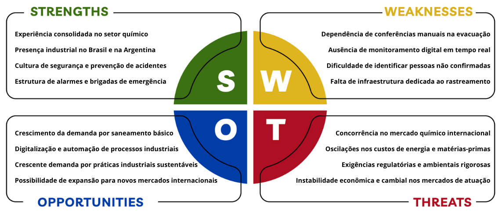

Fonte: Elaborado pelos autores (2026).

**Forças**

A análise das forças da Unipar evidencia sua experiência consolidada no setor químico e petroquímico, construída ao longo de décadas de atuação no mercado. Sua presença industrial no Brasil e na Argentina fortalece sua posição na América do Sul e contribui para o atendimento de diferentes setores da economia. Além disso, a empresa possui uma cultura organizacional voltada à segurança e à prevenção de acidentes, aspecto fundamental para suas atividades industriais. A existência de sistemas de alarmes e brigadas de emergência demonstra uma estrutura de resposta a situações de risco, oferecendo uma base importante para o aprimoramento dos procedimentos de segurança.

**Fraquezas**

Em relação às fraquezas, destacam-se limitações nos processos de monitoramento e confirmação de evacuação em situações de emergência. A conferência dos colaboradores nos pontos de encontro ainda depende de procedimentos manuais, como listas e contagens realizadas pelas equipes responsáveis. A ausência de monitoramento digital em tempo real dificulta o acompanhamento da evacuação e a identificação de pessoas que ainda não tiveram sua presença confirmada. Além disso, a falta de uma infraestrutura dedicada ao rastreamento, como sensores e dispositivos de identificação, limita a automatização desses processos. Essas dificuldades evidenciam a necessidade de aprimorar os mecanismos de acompanhamento e comunicação durante emergências industriais.

**Oportunidades**

A crescente demanda do mercado por práticas industriais sustentáveis pode incentivar a adoção de processos mais eficientes e ambientalmente responsáveis, enquanto os avanços tecnológicos em digitalização e automação industrial oferecem oportunidades para melhorar o controle e a produtividade das atividades. Além disso, o crescimento da demanda por saneamento básico representa uma oportunidade comercial, considerando a importância de produtos como o cloro no tratamento de água. No cenário internacional, a possibilidade de ampliar as exportações pode permitir que a Unipar alcance novos mercados consumidores, diversifique sua base de clientes e reduza a dependência dos mercados em que já atua, fortalecendo sua competitividade e presença no setor químico global.

**Ameaças**

Por fim, as ameaças estão relacionadas às condições externas do mercado e às exigências regulatórias que afetam a indústria química. A concorrência no mercado químico internacional pode pressionar os preços e a competitividade da Unipar, enquanto as oscilações nos custos de energia e matérias-primas podem elevar suas despesas de produção. Além disso, as exigências regulatórias e ambientais rigorosas demandam investimentos contínuos em segurança, conformidade e modernização das instalações industriais. A esses fatores somam-se a instabilidade econômica e as variações cambiais nos países em que a empresa atua, que podem impactar seus custos operacionais, seus resultados financeiros e sua competitividade no mercado.

### 3.1.3. Descrição da Solução a ser Desenvolvida (sprint 1)

#### 3.1.3.1 Qual é o problema a ser resolvido

#### 3.1.3.2 Qual a solução proposta (visão de negócios)

Na primeira sprint, o grupo concentrou o escopo do protótipo na **contabilização quantitativa de passagens** nos acessos aos Pontos de Encontro durante emergências ou simulados de vazamento de cloro gasoso na unidade de Cubatão (SP). No recorte do Produto Mínimo Viável (MVP), a detecção registra a travessia pelo acesso monitorado, sem identificar nominalmente a pessoa e sem realizar localização contínua em ambiente interno (em conformidade com a restrição do Termo de Abertura do Projeto — TAPI). No protótipo inicial simulado na Sprint 1 (seção 3.4.1), utiliza-se um sensor ultrassônico HC-SR04 com Arduino Uno R3 para contagem local unidirecional em fila única. Para a montagem física prevista na Lista de Materiais (seção 3.1.7), especificam-se dois sensores HC-SR04 por acesso para distinguir entrada e saída. A conexão dos dispositivos à rede e o painel centralizado estão planejados para as próximas sprints. A instalação de sensores em passagens entre áreas internas da planta depende de validação futura com a Unipar.

#### 3.1.3.3 Como a solução proposta deverá ser utilizada

O evento de emergência é iniciado por acionamento humano ou por integração com o alarme existente da planta; o sistema proposto não realiza detecção química automática de cloro. Nesse instante, o saldo operacional de entradas e saídas das Portarias P1 e P2 é congelado como população de referência **B**, sujeita a eventuais inconsistências prévias do controle de acesso. Durante a evacuação, as passagens nos Pontos de Encontro compõem o total **A**. A diferença **D = B − A** representa uma estimativa numérica: não identifica quem falta nem informa sua localização, e **D = 0** não substitui a conferência complementar e a decisão final da equipe de Saúde, Segurança e Meio Ambiente (SSMA).

#### 3.1.3.4 Quais os benefícios trazidos pela solução proposta

#### 3.1.3.5 Qual será o critério de sucesso e qual medida será utilizada para o avaliar

### 3.1.4. Value Proposition Canvas (sprint 1)

_O Canvas da proposta de valor deve ser feito considerando a solução que vocês estão desenvolvendo. Usar o template disponível no drive da turma._

### 3.1.5. Matriz de Riscos (sprint 1)

_A Matriz de Risco deve ser desenhada considerando o projeto que os alunos estão criando. Deve ser entregue no template disponível no drive da turma. Os alunos devem enumerar os riscos, distribuí-los na matriz e justificar suas decisões._

Esta política preliminar considera exclusivamente o escopo do MVP definido até o momento: um protótipo de bancada com Arduino Uno, dois sensores ultrassônicos HC-SR04 para contar separadamente entradas e saídas, display LCD 16 × 2 para apresentar o total, botão para alternar entre os modos normal e emergência, LEDs verde e vermelho e buzzer para sinalização. Não fazem parte deste escopo cadastro de pessoas, crachá ou RFID, câmera, biometria, painel web, conexão de rede, banco de dados, nuvem ou rastreamento individual.

Parte-se do pressuposto técnico de que cada HC-SR04 fornece apenas medições de distância usadas para detectar uma passagem, sem produzir imagem, áudio ou qualquer identificador da pessoa. Também se pressupõe que o firmware mantém somente a contagem agregada necessária ao funcionamento imediato e não grava histórico na memória EEPROM ou em outro meio persistente. Nessas condições, as informações do fluxo principal não se relacionam a uma pessoa natural identificada ou identificável e, portanto, não caracterizam dados pessoais para os fins da LGPD. Essa conclusão decorre dos conceitos de dado pessoal e dado anonimizado previstos nos arts. 5º e 12 da Lei nº 13.709/2018 [1]. Caso qualquer um desses pressupostos deixe de ser verdadeiro, a análise deverá ser refeita antes do teste ou da implantação.

#### 3.1.6.1 Informações gerais sobre a empresa / organização

O projeto é desenvolvido pelo Inteli em parceria com a Unipar, denominação que abrange a Unipar Carbocloro S.A. e suas sociedades controladas diretas e indiretas, conforme o Aviso de Privacidade da empresa [3]. O MVP tem finalidade acadêmica e busca validar a lógica de contagem agregada de entradas e saídas e a sinalização local do protótipo; ele não representa, nesta etapa, um sistema industrial pronto para operação.

Como o fluxo descrito não trata dados pessoais, não há, para ele, a atribuição de papéis de controlador e operador. Se uma evolução passar a coletar informações identificáveis, a entidade da Unipar responsável pelas decisões sobre esse tratamento deverá ser indicada como controladora, e a participação do Inteli ou de terceiros deverá ser avaliada e documentada conforme as atividades efetivamente desempenhadas e as orientações da ANPD [2].

#### 3.1.6.2 Informações sobre o tratamento de dados

Os sensores detectam passagens em dois pontos distintos. A sequência das detecções permite ao Arduino aumentar ou diminuir um contador agregado, cujo valor é exibido no LCD. O botão alterna o estado do protótipo entre os modos normal e emergência, os LEDs indicam o modo ativo e o buzzer fornece aviso sonoro durante as contagens. O sistema não identifica quem passou, não cria um registro por pessoa e não confirma a localização ou a situação individual de ninguém.

A avaliação desta política depende dos seguintes pressupostos:

- os sensores não capturam imagens, áudio, biometria ou identificadores;
- nenhuma detecção é associada a nome, matrícula, crachá, dispositivo ou perfil;
- o circuito não está integrado a sistemas de controle de acesso ou bases corporativas;
- não há comunicação por rede, painel remoto ou armazenamento persistente;
- os ensaios são realizados em ambiente acadêmico controlado, e não em operação industrial real.

Se o protótipo for utilizado em local ou configuração que permita combinar o horário da passagem com câmeras, registros de acesso ou outras fontes capazes de identificar a pessoa, o evento poderá se tornar dado pessoal por associação. Nesse caso, será necessário mapear o novo tratamento, definir finalidade, base legal, retenção, agentes e salvaguardas antes do uso.

#### 3.1.6.3 Quais são os dados coletados

O MVP processa somente dados operacionais do circuito:

- medições de distância e pulsos de detecção gerados pelos dois sensores;
- indicação de entrada ou saída derivada da sequência das detecções;
- quantidade agregada calculada pelo Arduino;
- estado selecionado pelo botão, normal ou emergência;
- estados dos LEDs, do display e do buzzer.

Não são coletados nome, matrícula, CPF, RG, imagem, voz, biometria, dado de saúde, localização individual, identificador de crachá ou dispositivo, endereço IP ou credencial de acesso. Pelos pressupostos apresentados, as medições e a contagem agregada não permitem identificar as pessoas detectadas e não constituem dados pessoais. Também não se deve registrar manualmente informações que permitam associar as contagens a indivíduos durante os testes.

#### 3.1.6.4 Onde os dados são coletados

As medições são geradas localmente no campo de alcance dos dois sensores instalados no protótipo de bancada, simulando um ponto de entrada e um ponto de saída. Como a documentação de escopo disponível não define unidade industrial, porta ou área real de instalação, pressupõe-se que os testes desta etapa ocorrerão apenas em ambiente acadêmico controlado. A escolha de um local real de operação está fora do escopo atual e exigirá nova avaliação, inclusive sobre a possibilidade de identificação indireta das pessoas.

#### 3.1.6.5 Para quais finalidades os dados serão utilizados

Os dados operacionais são utilizados exclusivamente para:

- detectar e diferenciar movimentos de entrada e saída no cenário simulado;
- atualizar e exibir a quantidade agregada no LCD;
- validar o funcionamento do botão e da sinalização visual e sonora;
- avaliar erros de contagem e aperfeiçoar o firmware e a montagem do MVP.

O protótipo não deve ser usado para identificar pessoas, controlar acesso, registrar presença ou jornada, avaliar produtividade, acompanhar trajetórias ou tomar decisões sobre indivíduos. Essas finalidades não são necessárias para validar o MVP e representariam mudança de escopo.

#### 3.1.6.6 Onde os dados ficam armazenados

O escopo atual não inclui banco de dados, cartão de memória, serviço de nuvem ou conexão de rede. Assim, as medições são processadas localmente e de forma transitória pelo Arduino; apenas o valor corrente do contador e o estado do sistema permanecem na memória necessária à execução e são apresentados no LCD.

Pressupõe-se que o firmware não grave a contagem na EEPROM do Arduino. Esse comportamento deverá ser confirmado na revisão do código. Caso exista gravação persistente, o documento deverá informar o conteúdo gravado, a finalidade, o prazo e o procedimento de exclusão. O repositório poderá conter código-fonte e resultados agregados dos testes, mas não deve receber nomes, imagens, listas de presença, credenciais ou qualquer outro dado pessoal.

#### 3.1.6.7 Qual o período de armazenamento dos dados (retenção)

Cada medição de distância é descartada após ser usada no cálculo da detecção. A contagem agregada e o modo selecionado permanecem somente enquanto o protótipo está ligado ou até que o sistema seja reiniciado, conforme o pressuposto de ausência de gravação persistente. Portanto, não há prazo de retenção de dados pessoais a definir para o fluxo atual.

Resultados agregados, como número de acertos, falhas e contagens simuladas, podem ser mantidos no repositório pelo período necessário à avaliação acadêmica, pois não identificam participantes. Se os testes passarem a registrar horário detalhado, vídeo ou qualquer elemento que permita reconhecer alguém, deverá ser definida previamente uma tabela de retenção e descarte conforme a finalidade e a LGPD [1].

#### 3.1.6.8 Uso de cookies e/ou tecnologias semelhantes

O MVP não possui site, aplicativo, painel web ou conexão com a internet. Por isso, não utiliza cookies, armazenamento local de navegador, ferramentas de análise ou tecnologias semelhantes. A futura inclusão de uma interface conectada estará fora deste escopo e exigirá atualização desta política antes da coleta.

#### 3.1.6.9 Com quem esses dados são compartilhados (parceiros, fornecedores, subcontratados)

Não há compartilhamento de dados pessoais, pois o protótipo não os coleta. A equipe do Inteli, os avaliadores acadêmicos e os representantes da Unipar poderão acessar o valor agregado exibido e os resultados técnicos dos testes. O escopo não prevê fornecedores de nuvem, conectividade, banco de dados ou análise de dados.

Se uma evolução depender de terceiro ou de integração corporativa e envolver dados pessoais, os participantes e suas responsabilidades deverão ser identificados antes do tratamento, com regras de finalidade, acesso, segurança, retenção e exclusão.

#### 3.1.6.10 Informações sobre medidas de segurança adotadas pela empresa

Embora o fluxo atual não contenha dados pessoais, o projeto adota minimização desde a concepção: realiza a contagem sem criar identificadores individuais e mantém o processamento local. Também devem ser observadas as seguintes medidas:

- limitar o acesso físico ao protótipo durante os testes;
- revisar o firmware para confirmar que não há gravação na EEPROM, telemetria ou bibliotecas que enviem dados;
- não conectar o circuito a bases, câmeras ou sistemas de controle de acesso;
- não inserir credenciais, dados reais ou listas de pessoas no código e no repositório;
- registrar a versão do firmware e os pressupostos usados em cada ensaio;
- reiniciar o contador e apagar arquivos auxiliares quando deixarem de ser necessários;
- utilizar apenas resultados agregados nas evidências acadêmicas.

Essas medidas reduzem o risco de uma mudança informal transformar a contagem anônima em acompanhamento individual. Se houver tratamento futuro de dados pessoais, deverão ser adotadas medidas técnicas e administrativas proporcionais ao risco, em conformidade com os arts. 46 a 49 da LGPD e com as orientações da ANPD [1][4].

#### 3.1.6.11 Orientações sobre como a empresa/organização atende aos direitos dos usuários

Como o contador não registra nem identifica pessoas, a equipe não consegue localizar, consultar, corrigir ou excluir uma passagem atribuída a determinado indivíduo. Também não há decisão automatizada que produza efeito sobre uma pessoa. Isso não impede que alguém peça esclarecimentos sobre o funcionamento do protótipo ou informe suspeita de coleta indevida.

Se o escopo passar a envolver dados pessoais, a organização responsável deverá assegurar os direitos previstos no art. 18 da LGPD, incluindo confirmação, acesso, correção, informação sobre compartilhamento e, quando aplicável, anonimização, bloqueio, portabilidade, oposição ou eliminação [1][5].

#### 3.1.6.12 Informações sobre como o titular de dados pode solicitar e exercer os seus direitos

Uma pessoa que queira esclarecer o uso do protótipo ou suspeite que houve coleta de dado pessoal poderá contatar o encarregado da Unipar pelo e-mail **lgpd-encarregado@unipar.com**, canal divulgado no Aviso de Privacidade da empresa [3]. O pedido deve indicar o contexto do teste e a dúvida ou o direito que se pretende exercer. Como a solução atual mantém apenas uma contagem anônima, pode não existir registro que permita vincular uma passagem ao solicitante; essa limitação deverá ser explicada com clareza na resposta.

#### 3.1.6.13 Informações de contato do Data Protection Officer (DPO) ou encarregado de proteção de dados da organização

O canal oficial publicado pela Unipar para contato com seu Encarregado de Proteção de Dados Pessoais é:

- **E-mail:** lgpd-encarregado@unipar.com
- **Aviso de Privacidade:** <https://unipar.com/aviso-de-privacidade>

O nome da pessoa que exerce a função não é apresentado no aviso público consultado; por isso, registra-se somente o canal institucional confirmado [3].

Esta política deverá ser revisada antes de qualquer alteração que inclua identificação por crachá ou RFID, cadastro, câmera, áudio, biometria, registro individual de horário ou localização, integração com sistemas corporativos, painel conectado, banco de dados, nuvem ou armazenamento persistente. Esses recursos não estão previstos no MVP analisado e não podem ser tratados como se já fizessem parte da solução.

### 3.1.7. Bill of Material (BOM) (sprint 1)

A Bill of Materials (BOM) apresenta os componentes necessários para a montagem do protótipo físico do MVP. O levantamento reúne os itens de processamento, sensoriamento, interação, sinalização, visualização e interconexão utilizados no circuito, permitindo a rastreabilidade dos materiais e apoiando o planejamento de aquisição.

Esta BOM considera **uma unidade** do protótipo ilustrado, composta por Arduino Uno, dois sensores ultrassônicos, elementos de sinalização visual e sonora, display LCD, botão para alternância entre os modos normal e emergência, e materiais de montagem. Os valores foram levantados em fornecedores brasileiros para apoiar uma estimativa inicial de custo; eles não incluem frete, impostos adicionais ou materiais de reposição.

Quadro X — Bill of Materials do MVP

| Categoria                 | Quantidade | Referência do componente no protótipo/PCI                      | Código do componente (fabricante)                                                                                                        |                                                                                                                                                                                                                                                                                                                                                                                                                                                                                                                                                                                                                                                                                                                                                                                                                               Valor do componente (R$) |
| ------------------------- | ---------: | -------------------------------------------------------------- | ---------------------------------------------------------------------------------------------------------------------------------------- | -----------------------------------------------------------------------------------------------------------------------------------------------------------------------------------------------------------------------------------------------------------------------------------------------------------------------------------------------------------------------------------------------------------------------------------------------------------------------------------------------------------------------------------------------------------------------------------------------------------------------------------------------------------------------------------------------------------------------------------------------------------------------------------------------------------------------------------------------------: |
| Processamento             |          1 | Arduino Uno                                                    | Arduino Uno R3                                                                                                                           |          R$39,54 ([Mercado Livre](https://www.mercadolivre.com.br/cabo-usb-compativel-com-placa-de-desenvolvimento-arduino-uno-r3-atmega328p-ch340/p/MLB44072268?pdp_filters=item_id%3AMLB5229650730&from=gshop&matt_tool=56164162&matt_word=&matt_source=google&matt_campaign_id=22090193744&matt_ad_group_id=194474654154&matt_match_type=&matt_network=g&matt_device=c&matt_creative=792355615410&matt_keyword=&matt_ad_position=&matt_ad_type=pla&matt_merchant_id=735125422&matt_product_id=MLB44072268-product&matt_product_partition_id=2495059736147&matt_target_id=pla-2495059736147&cq_src=google_ads&cq_cmp=22090193744&cq_net=g&cq_plt=gp&cq_med=pla&gad_source=4&gad_campaignid=22090193744&gbraid=0AAAAAD93qcDWMW_AFPrQLlrvCxOyNb_89&gclid=CjwKCAjwotzWBhBFEiwA1JhPoJRuM1jdBvwQsy-JbDuO2GqZUVevX9I5SgDqMi81aZh_Pusf2a-KQhoC7PwQAvD_BwE)) |
| Sensoriamento             |          2 | Sensores ultrassônicos de entrada e saída                      | HC-SR04                                                                                                                                  | R$15,00 (unidade); R$30,00 (2 unidades) ([Mercado Livre](https://www.mercadolivre.com.br/modulo-sensor-ultrassonico-distancia-hc-sr04-para-arduino/p/MLB64164978?pdp_filters=item_id%3AMLB5130062737&from=gshop&matt_tool=56164162&matt_word=&matt_source=google&matt_campaign_id=22090193744&matt_ad_group_id=194474654154&matt_match_type=&matt_network=g&matt_device=c&matt_creative=792355615410&matt_keyword=&matt_ad_position=&matt_ad_type=pla&matt_merchant_id=735128761&matt_product_id=MLB64164978-product&matt_product_partition_id=2495059736347&matt_target_id=pla-2495059736347&cq_src=google_ads&cq_cmp=22090193744&cq_net=g&cq_plt=gp&cq_med=pla&gad_source=4&gad_campaignid=22090193744&gbraid=0AAAAAD93qcDWMW_AFPrQLlrvCxOyNb_89&gclid=CjwKCAjwotzWBhBFEiwA1JhPoIQ9ytYCHxi7QMFA-RU1aROmSXUtXE3xD1biz_vwK9s3dwk-8Ro6oxoCIOoQAvD_BwE)) |
| Interação                 |          1 | Botão de pressão                                               | Board Push Button Switch (tactile)                                                                                                       |                                                                                                                                                                                                                                                                                                                                                                                                                                                                                                                                                                                            R$1,21 (unidade) ([Mercado Livre](https://www.mercadolivre.com.br/conjunto-de-50-botoes-de-pressao-para-placa-de-circuito/p/MLB2052130334?matt_tool=18956390&utm_source=google_shopping&utm_medium=organic&pdp_filters=item_id%3AMLB7635767930&from=gshop)) |
| Sinalização visual        |          1 | LED verde                                                      | LED difuso 5 mm                                                                                                                          |                                                                                                                                                                                                                                                                                                                                                                                                                                                                                                                       R$0,15 ([Eletrogate](https://www.eletrogate.com/led-difuso-5mm-verde?utm_source=Site&utm_medium=GoogleMerchant&utm_campaign=GoogleMerchant&gad_source=1&gad_campaignid=22470016551&gbraid=0AAAAADqxjs-J182in_CBPr1nyA54F-LL9&gclid=CjwKCAjwotzWBhBFEiwA1JhPoCaLKeb9vaLT7u49dThE1TEGwTfv0C6_EYGFI6dS3biP6Xoqy1ZgVxoCiEIQAvD_BwE)) |
| Sinalização visual        |          1 | LED vermelho                                                   | LED difuso 5 mm                                                                                                                          |                                                                                                                                                                                                                                                                                                                                                                                                                                                                                                                    R$0,15 ([Eletrogate](https://www.eletrogate.com/led-difuso-5mm-vermelho?utm_source=Site&utm_medium=GoogleMerchant&utm_campaign=GoogleMerchant&gad_source=1&gad_campaignid=20223015315&gbraid=0AAAAADqxjs_RKxEA4lB8OTz9kzOy_b2y9&gclid=CjwKCAjwotzWBhBFEiwA1JhPoN-apmwJkkXYYznxTECGwrAfUUdQMOGaQL_4-m8zeFGfzU6AOYhiNxoCqJgQAvD_BwE)) |
| Sinalização sonora        |          1 | Buzzer                                                         | Buzzer ativo 5V                                                                                                                          |                                                                                                                                                                                                                                                                                                                                                                                                                                                                                                                            R$2,90 ([Eletrogate](https://www.eletrogate.com/buzzer-ativo-5v?utm_source=Site&utm_medium=GoogleMerchant&utm_campaign=GoogleMerchant&gad_source=1&gad_campaignid=20223015315&gbraid=0AAAAADqxjs_RKxEA4lB8OTz9kzOy_b2y9&gclid=CjwKCAjwotzWBhBFEiwA1JhPoLPBf6mtcZizCQRpZRRLmGNgwewSSuaihP1VIORbIt2h8imNmBty9RoCrG8QAvD_BwE)) |
| Visualização              |          1 | Display LCD                                                    | LCD 16 × 2 com interface I²C                                                                                                             |                                    R$25,55 ([Mercado Livre](https://www.mercadolivre.com.br/display-lcd-16x2-1602-fundo-azul-com-modulo-i2c-soldado/up/MLBU4549779439?pdp_filters=item_id%3AMLB7321088826&from=gshop&matt_tool=56885173&matt_word=&matt_source=google&matt_campaign_id=22090354256&matt_ad_group_id=192555051054&matt_match_type=&matt_network=g&matt_device=c&matt_creative=799032781561&matt_keyword=&matt_ad_position=&matt_ad_type=pla&matt_merchant_id=119897001&matt_product_id=MLBU4549779439&matt_product_partition_id=2498613880064&matt_target_id=pla-2498613880064&cq_src=google_ads&cq_cmp=22090354256&cq_net=g&cq_plt=gp&cq_med=pla&gad_source=1&gad_campaignid=22090354256&gbraid=0AAAAAD93qcAf98DVye3WhOkZqJU1o3eSE&gclid=CjwKCAjwotzWBhBFEiwA1JhPoMgiK21_IFmDbVmbNMgDC3o03ZARpy4oBINxyPna8AsDNp4ISmYalRoCR_MQAvD_BwE)) |
| Condicionamento elétrico  |          2 | Resistores                                                     | 5V ou 3.3V, 1k Ohm, (1/4W)                                                                                                               |                                                                                                                                                                                                                                                                                                                                                                                                                                                                                                                                                                                 R$0,12 (unidade) ([Saravati](https://www.saravati.com.br/resistor-1k-5-1-4w.html?gad_source=1&gad_campaignid=23551463662&gbraid=0AAAAAC2QUl9NJxOJbt89j1o1regZh5Nz1&gclid=CjwKCAjwotzWBhBFEiwA1JhPoG38v08Hq-K_8VKXdxS8REO0qaNgkFziIwVTl9Rc2LXpGSD3o1KboRoCCEkQAvD_BwE)) |
| Montagem                  |          1 | Protoboard                                                     | Protoboard para montagem sem solda                                                                                                       |                                                                                                                                                                                                                                                                                                                                                                                                                                                                                                                      R$8,90 ([Eletrogate](https://www.eletrogate.com/protoboard-400-pontos?utm_source=Site&utm_medium=GoogleMerchant&utm_campaign=GoogleMerchant&gad_source=4&gad_campaignid=20223015315&gbraid=0AAAAADqxjs--_IDti_OP_PomQr4wJeFmq&gclid=CjwKCAjwotzWBhBFEiwA1JhPoPlT3_2SAg4EbLjDVCFA_2Gb0qBCgwXD5npVhSjZdn-yagDte4bg4BoCZoMQAvD_BwE)) |
| Alimentação planejada     |          1 | Pilha de lítio tipo moeda, ainda não implementada no protótipo | CR2023, 3 V, não recarregável                                                                                                            |                                                                                                                                                                                                                                                                                                                                                                                                                                                                                                                                                                                                                                                                                                                                                                     R$13,90 ([Mercado Livre](https://lista.mercadolivre.com.br/bateria-maxell-cr2032)) |
| Interconexão              |          4 | Jumpers macho-fêmea                                            | Alternativa A: conexão do display LCD I²C; utilizar com 16 jumpers macho-macho                                                           |                R$1,05 (unidade); R$4,20 (4 unidades) ([Mercado Livre](https://www.mercadolivre.com.br/20pcs-jumper-mxf-20cm--20pcs-jumper-fxf-20cm/up/MLBU2370810037?pdp_filters=item_id%3AMLB4078036044&from=gshop&matt_tool=19390443&matt_word=&matt_source=google&matt_campaign_id=22090354205&matt_ad_group_id=191786774561&matt_match_type=&matt_network=g&matt_device=c&matt_creative=782869962440&matt_keyword=&matt_ad_position=&matt_ad_type=pla&matt_merchant_id=5458938305&matt_product_id=MLBU2370810037&matt_product_partition_id=2495493043879&matt_target_id=pla-2495493043879&cq_src=google_ads&cq_cmp=22090354205&cq_net=g&cq_plt=gp&cq_med=pla&gad_source=4&gad_campaignid=22090354205&gbraid=0AAAAAD93qcBWh7S0-tQRtyURYUhdok1-w&gclid=CjwKCAjwotzWBhBFEiwA1JhPoO4nhPq-F2KwwBsDI-Hn3A0iwomUAHbI1TRcldDnimZUYjGi7kAF6xoCG5oQAvD_BwE)) |
| Interconexão              |   16 ou 20 | Jumpers macho-macho                                            | Alternativa A: 16 unidades com 4 jumpers macho-fêmea; alternativa B: 20 unidades, caso todos os módulos sejam conectados pela protoboard |                                                                                                                                                                                                                                                                                                                                                                                                                                                                                                                                                                                                                                                      R$0,42 (unidade); Alternativa A: R$6,72; Alternativa B: R$8,40; ambos em [Mercado Livre](https://www.mercadolivre.com.br/cabo-jumper-mxm-20cm-40-pinos-para-arduino-protoboard/up/MLBU2098535281) |
| **Total estimado do MVP** |            |                                                                |                                                                                                                                          |                                                                                                                                                                                                                                                                                                                                                                                                                                                                                                                                                                                                                                                                                                                                                                                                   **Alternativa A: R$133,46; Alternativa B: R$130,94** |

Fonte: elaboração dos autores (2026).

> Observação: Todos os links de compra dos componentes foram acessados em 20/10/2026. Os preços e a disponibilidade podem variar em função do tempo.

A coluna <i>Categoria</i> identifica a função do item no protótipo, enquanto <i>Quantidade</i> registra o número de unidades necessárias. A <i>Referência</i> descreve o componente empregado no circuito, e o <i>Código do componente</i> apresenta o modelo ou a especificação adotada. A coluna <i>Valor do componente</i> registra o valor estimado e disponibiliza o respectivo link de consulta. Nos itens vendidos por unidade, o custo total foi calculado pela multiplicação do valor unitário pela quantidade indicada.

O custo estimado da alternativa A é de R$ 133,46, considerando quatro jumpers macho-fêmea para o display LCD I²C e dezesseis jumpers macho-macho para as demais conexões. Na alternativa B, o custo estimado é de R$ 130,94, utilizando somente vinte jumpers macho-macho, caso todos os módulos possam ser conectados pela protoboard. Ambos os totais incluem uma pilha CR2023 de 3 V. A alternativa B é R$ 2,52 mais econômica e reduz a variedade de cabos necessária; contudo, a escolha deve respeitar o tipo de terminal presente nos componentes físicos.

No protótipo, o Arduino Uno realiza o processamento das entradas e controla as saídas. Dois sensores ultrassônicos HC-SR04 identificam separadamente a entrada e a saída de pessoas, e o total é apresentado no display LCD 16 × 2 conectado por I²C. O botão alterna a sinalização entre os LEDs verde e vermelho, enquanto o buzzer fornece o aviso sonoro das contagens. Os dois resistores de 1 kΩ limitam a corrente dos LEDs. A protoboard e os jumpers viabilizam a montagem e as conexões do circuito sem a necessidade de solda.

A pilha CR2023 de 3 V foi incluída na BOM como item de alimentação planejado, porém ainda não foi implementada no protótipo apresentado.

A lista apresentada é adequada ao protótipo de bancada, mas não caracteriza, por si só, uma solução pronta para uso no ambiente industrial. Para uma futura implantação, será necessário especificar itens adicionais, como gabinete de proteção, alimentação apropriada, conectores, cabeamento, fixação mecânica e componentes com grau de proteção compatível com as condições de operação da Unipar.

Assim, a BOM consolida os materiais e as duas possibilidades de interconexão identificadas para a implementação do MVP. A versão final deverá validar as especificações ainda pendentes e confirmar a alternativa de jumpers que será utilizada antes da aquisição dos componentes.

## 3.2. Domínio de Fundamentos de Experiência de Usuário

### 3.2.1. Personas

Esta seção apresenta as **proto-personas** que orientam a compreensão inicial das necessidades dos públicos envolvidos no processo de evacuação do complexo industrial da Unipar em Cubatão. São perfis preliminares, elaborados com base nas informações disponíveis e nas hipóteses da equipe, ainda sem validação por pesquisa com os usuários. Os perfis organizam contextos de trabalho, dores, necessidades e tarefas para apoiar as decisões iniciais de experiência do usuário e a definição dos requisitos de uma solução de acompanhamento da evacuação e confirmação de presença nos pontos de encontro.

O mapeamento inicial considera cinco grupos de partes interessadas: colaboradores, operadores do Centro de Controle Operacional (CCO), gestores de Segurança, Saúde e Meio Ambiente (SSMA), brigadistas e responsáveis por Infraestrutura e TI. Nesta seção, são detalhadas três personas primárias: Gustavo Fring, técnico de operação, representa a perspectiva de quem precisa evacuar e ter sua chegada reconhecida; Maria Schrader, operadora de CCO, reúne as necessidades de monitoramento operacional e comunicação durante uma ocorrência; e Tuco Salamanca, gestor de SSMA, representa a perspectiva de gestão da emergência e uso das informações consolidadas. Brigadistas e responsáveis por Infraestrutura e TI são considerados públicos secundários neste recorte, com participação na resposta em campo e no suporte tecnológico, mas ainda não possuem perfis detalhados nesta seção.

Os três perfis apresentados — Gustavo Fring, Maria Schrader e Tuco Salamanca — são proto-personas, e não personas validadas. Nesta etapa, as referências a “personas” ao longo da seção devem ser entendidas nesse sentido preliminar. Seus dados biográficos e falas ilustrativas são fictícios e não devem ser interpretados como relatos de pessoas reais; as atribuições, os comportamentos e as necessidades descritos são parte hipóteses e parte informações obtidas por meio das reuniões de kick-off com os parceiros, a verificar com os profissionais da unidade. Entrevistas, reviews com os parceiros e validações com os públicos representados deverão orientar a revisão dos perfis e sua evolução para personas mais bem fundamentadas e validadas.

#### 3.2.1.2. Persona - Técnico de Operação

A persona colaborador corresponde a todos os colaboradores e funcionários que trabalham dentro do complexo industrial de Cubatão da Unipar.

  Figura 02: Técnico de Operação
    

      

       
      

    

  Source: imagem produzida pela IA do Chatgpt, 2026.

**Nome:** Gustavo Fring.

**Dados demográficos**

- Idade: 32 anos.
- Ocupação: técnico de operação industrial.
- Localização: Cubatão, São Paulo.
- Escolaridade: técnico em Química.
- Setor: operador de máquina industrial.

**Biografia**

Gustavo trabalha há oito anos em ambiente industrial e conhece os procedimentos de sua área, mas pode estar em uma zona diferente quando surge um alarme. Vive com a esposa e um filho pequeno; nos dias de folga, joga futebol e visita familiares. Chega ao trabalho com EPI e, tem como prioridade durante uma emergência, sair com segurança e saber que a equipe de resposta recebeu seu pedido de ajuda, caso precise.

| Prioridade      | Dor ou necessidade                                                          | O que espera da solução(desejos)                                                                             |
| :-------------- | :-------------------------------------------------------------------------- | :----------------------------------------------------------------------------------------------------------- |
| **1 — Crítica** | Perceber o alarme e entender qual procedimento se aplica à área onde está.  | Em ambiente ruidoso, com EPI e sob pressão, depende do treinamento, da sinalização e das orientações locais. |
| **2 — Crítica** | Encontrar uma saída segura se a rota habitual estiver indisponível.         | Precisa seguir a orientação da brigada e a sinalização existente, sem improvisar um caminho.                 |
| **3 — Alta**    | Comunicar que precisa de ajuda caso esteja ferido, isolado ou desorientado. | Depende de contato com colegas, brigadistas ou outros meios previstos no procedimento local.                 |
| **4 — Alta**    | Ter sua chegada reconhecida no ponto de encontro.                           | Aguarda a chamada ou contagem manual, que pode demorar ou exigir nova conferência.                           |
| **5 — Média**   | Lembrar o procedimento em áreas menos familiares e em diferentes turnos.    | Recorre aos treinamentos, à liderança local e à equipe de resposta.                                          |

**Tarefas**

- Opera os equipamentos e acompanha as condições da máquina e da área em que está trabalhando.
- Realiza as atividades de inspeção e manutenção dos maquinários previstas para sua função.
- Utiliza os EPIs exigidos e segue os procedimentos de segurança e as orientações da liderança.
- Participa de treinamentos e simulados para reconhecer os alarmes, as rotas de saída e os pontos de encontro.
- Em uma emergência, interrompe a atividade conforme o procedimento, segue a orientação da brigada e se desloca ao ponto de encontro.
- Comunica a necessidade de ajuda pelos meios disponíveis e informa sua chegada para a conferência presencial.

**Cenários de interação atuais:** No início do turno, Gustavo Fring recebe orientações de segurança aplicáveis à sua atividade e utiliza o crachá de identificação e os EPIs exigidos para o local. Em um simulado, pratica as rotas e o deslocamento até o ponto de encontro. Em um alarme real, segue o procedimento da unidade e as orientações da brigada para evacuar a área afetada. Se não conseguir sair ou se alguém precisar de ajuda, busca contato pelos meios existentes. Ao chegar ao ponto de encontro, informa sua presença para a conferência manual por lista ou contagem. **Assim, atualmente não há um dispositivo individual de confirmação automática ou um aplicativo de evacuação em uso.**

**Interesses e hábitos relacionados ao processo:** Gustavo Fring valoriza procedimentos claros, sinalização compreensível, equipamentos de proteção adequados e treinamentos que se pareçam com a rotina real. Sua interação com a evacuação ocorre em orientações, simulados e eventuais alarmes; no cotidiano, está concentrado nas tarefas operacionais. Não consulta o painel de SSMA durante a evacuação, pois o painel digital faz parte da proposta do projeto, não da situação atual.

**Nível de letramento digital:** Intermediário. Usa aplicativos comuns e ferramentas de trabalho, mas o processo de evacuação atual que foi documentado para o projeto depende principalmente de sinais físicos, instruções da equipe e confirmação presencial. Não se pressupõe uso de telefone pessoal em área operacional.

**Falas ilustrativas, não coletadas em entrevista**

> “Quando o alarme toca, procuro a orientação da brigada e sigo para o ponto de encontro.”

> “Depois que chego, preciso esperar a conferência para saberem que estou aqui.”

> “Se eu estiver em outra área, quero reconhecer rapidamente o caminho previsto para sair.”

**Nível de letramento digital:** Intermediário. Usa aplicativos comuns e ferramentas de trabalho, mas o processo de evacuação atual que foi documentado para o projeto depende principalmente de sinais físicos, instruções da equipe e confirmação presencial. Não se pressupõe uso de telefone pessoal em área operacional.

**Variações do público e limites da persona:** Gustavo Fring representa um trabalhador habitual de área operacional, não todas as pessoas presentes na planta. Terceirizados, equipes de manutenção, visitantes, pessoas com deficiência e novos colaboradores podem conhecer menos as rotas, ter vínculos de identificação diferentes ou precisar de outro tipo de apoio. Essas diferenças precisam ser investigadas antes de generalizar a persona para todo o complexo.

**Abrangência e variações do público:** A persona reúne a necessidade comum de **todos os funcionários e colaboradores que trabalham no complexo**: perceber o alerta, sair da área afetada, receber apoio quando necessário e ser contabilizado. Função, turno, vínculo, área autorizada, conhecimento das rotas, EPI e necessidades de acessibilidade variam. Essas diferenças devem ser observadas na pesquisa para evitar que a experiência de um setor seja tomada como padrão para todos. Visitantes ocasionais ficam fora do público de trabalhadores representado por Gustavo Fring.

#### 3.2.1.3. Persona - Operador de Centro de Controle Operacional (CCO)

  Figura 03: Operador de Centro de Controle Operacional (CCO)
    

      

       
      

    

  Source: imagem produzida pela IA do Chatgpt, 2026.

- Nome fictício: Maria Schrader.
- Idade: 38 anos.
- Profissão: operadora de Centro de Controle Operacional (CCO).
- Localização: Cubatão, São Paulo.
- Formação: curso técnico em Automação Industrial e treinamentos internos aplicáveis à operação.
- Setor: Centro de Controle Operacional (CCO).

**Biografia**

Maria trabalhou em funções de apoio à operação antes de passar para a sala de controle. No retrato fictício, atua em turnos, acompanha indicadores e alarmes operacionais e responsável por alarmar emergências e evacuações, recebe informações de quem está em campo e registra alterações relevantes para a equipe seguinte. Mora com o companheiro e uma filha; gosta de fotografia e de passeios de bicicleta. Opera painéis, registrar alterações e informar lideranças e operadores. **Como o CCO da Unipar participa da resposta a emergências ainda precisa ser confirmado.**

| Prioridade      | Dor ou necessidade atual                                                                                | Consequência na rotina                                                                                                                                            |
| :-------------- | :------------------------------------------------------------------------------------------------------ | :---------------------------------------------------------------------------------------------------------------------------------------------------------------- |
| **1 — Crítica** | Distinguir rapidamente um alarme operacional relevante de outros avisos simultâneos.                    | Precisa verificar os sinais e seguir os critérios e responsáveis previstos nos procedimentos da unidade.                                                          |
| **2 — Crítica** | Comunicar a alteração observada às equipes certas, sem perda de contexto.                               | Depende dos canais e das confirmações de recebimento usados atualmente pela operação, pelo SSMA e pela brigada.                                                   |
| **3 — Alta**    | Acompanhar a condição do processo enquanto chegam relatos de campo sobre o mesmo evento.                | Informações podem chegar em momentos diferentes e exigir reconciliação antes de repassá-las.                                                                      |
| **4 — Alta**    | Entender o andamento da evacuação sem confundir status operacional de uma área com presença de pessoas. | A contagem de pessoas ocorre predominantemente por listas e confirmação manual nos pontos de encontro, fora dos painéis de processo descritos para esta hipótese. |
| **5 — Média**   | Deixar um histórico claro para a troca de turno e a análise posterior.                                  | Horários de alarmes, comunicações e providências precisam ser registrados e conferidos.                                                                           |

**Tarefas**

- Recebe informações sobre as condições operacionais e as ocorrências em aberto na passagem de turno.
- Acompanha os painéis de processo e as câmeras disponíveis durante o turno.
- Verifica alarmes e relatos de campo, consultando os procedimentos antes de caracterizar ou repassar uma ocorrência.
- Analisa se aquela situação de incidência necessita de evacuação e, se necessita, indica quais grupos devem evacuar e informa à equipe de segurança do ocorrido.
- Comunica as informações relevantes às áreas responsáveis e mantém contato com as equipes em campo pelos canais adotados pela unidade.
- Em uma emergência, executa as ações de comunicação e acompanhamento atribuídas ao CCO pelos procedimentos da unidade, incluindo o acionamento de alarmes quando aplicável.
- Acompanha atualizações da evacuação sem tratar informações de processo como confirmação da presença de pessoas nos pontos de encontro.
- Registra alarmes, comunicações e providências para dar continuidade ao acompanhamento e transmitir as informações à equipe seguinte.

**Cenários de interação atuais:** Na passagem de turno, Maria toma conhecimento das condições operacionais e das ocorrências em aberto. Durante a rotina, acompanha os painéis de processo, monitora as câmeras do complexo e das salas operacionais, aciona o alarme de emergência e troca informações com profissionais em campo. Diante de um alarme ou relato de incidente, verifica o que seus instrumentos e os procedimentos permitem afirmar, comunica as áreas responsáveis e mantém o acompanhamento da operação. Se houver evacuação, recebe atualizações pelos canais atualmente usados entre as equipes; não presume que um painel de processo informe automaticamente quem chegou ao ponto de encontro. Se a própria sala estiver na área afetada, mantem-se atuando no monitoramento, afinal, fica em um bunker que a protege dos possíveis incidentes e acidentes. Após o evento, registra e transmite a sequência conhecida à equipe de segurança.

**Interesses e hábitos relacionados ao processo:** Valoriza estabilidade operacional, interpretação correta de alarmes, comunicação inequívoca com o campo e registros confiáveis para a troca de turno. No perfil hipotético, trabalha por longos períodos diante de painéis e câmeras em tempo real, consulta procedimentos e registra ocorrências. A frequência, os canais e as telas específicas da Unipar devem ser observados em pesquisa com o CCO.

**Nível de letramento digital:** Alto para as ferramentas operacionais que usa no trabalho: lê indicadores e navega entre telas de processo e câmeras com familiaridade.

**Falas ilustrativas, não coletadas em entrevista**

> “Preciso confirmar o que o alarme indica antes de repassar a ocorrência.”

> “Enquanto converso com o campo, continuo acompanhando as condições do processo.”

> “O painel mostra a condição da área, mas a conferência das pessoas vem da equipe responsável.”

**Nível de letramento digital:** Alto no uso das ferramentas operacionais com as quais trabalha. Maria interpreta indicadores, acompanha alarmes e navega entre telas de processo e câmeras com familiaridade. Essa experiência não pressupõe domínio imediato de novos sistemas de apoio à evacuação: interfaces claras, identificação das fontes e dos horários das informações e treinamento específico são necessários para apoiar seu uso sob pressão. O perfil deve ser validado com os profissionais do CCO.

**Variações do público e limites da persona:** Maria representa uma operadora de CCO habituada ao monitoramento de processos e à comunicação com equipes em campo. Não representa as atribuições do SSMA, da brigada ou dos trabalhadores em evacuação. Seu perfil é hipotético e não permite concluir que todo operador tenha autonomia para determinar uma evacuação, acionar alarmes ou confirmar a presença de pessoas. Essas responsabilidades e os limites de atuação do CCO precisam ser confirmados nos procedimentos da unidade e na pesquisa com seus profissionais.

**Abrangência e variações do público:** A persona reúne necessidades comuns aos profissionais de operação do CCO: interpretar alarmes, acionar evacuações, acompanhar as condições do processo, comunicar ocorrências e manter registros confiáveis entre turnos. Tempo de experiência, formação, turno, área monitorada, permissões de acesso, familiaridade com as ferramentas e necessidades de acessibilidade podem variar. A pesquisa deve contemplar essas diferenças, incluindo profissionais recém-integrados e experientes, para que a rotina atribuída a Maria não seja tomada como padrão de toda a equipe.

#### 3.2.1.4 Persona - Gestor de SSMA (Segurança, Saúde e Meio Ambiente)

  Figura 04: Gestor de SSMA 
    

      

       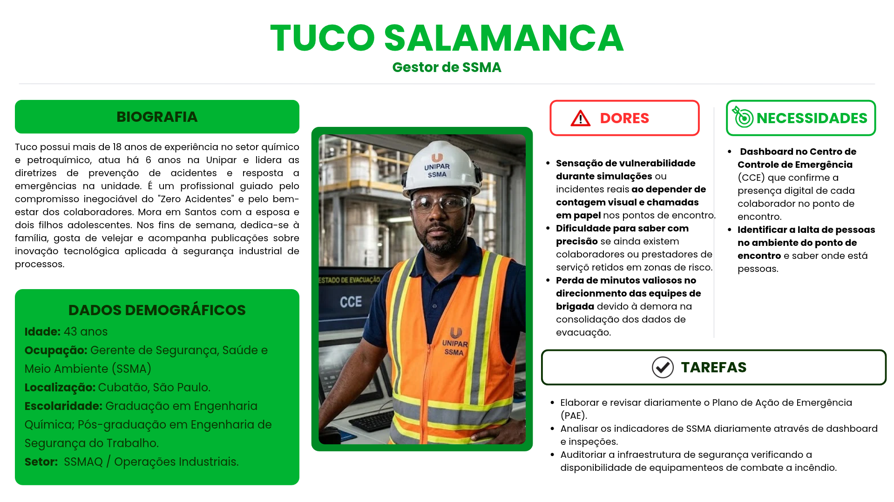
      

    

  Source: imagem produzida pela IA do Chatgpt, 2026.

- **Nome:** Tuco Salamanca
- **Idade:** 43 anos
- **Ocupação:** Gerente / Gestor de Segurança, Saúde e Meio Ambiente (SSMA)
- **Localização:** Santos / Cubatão, São Paulo
- **Escolaridade:** Graduação em Engenharia Química com pós-graduação em Engenharia de Segurança do Trabalho
- **Setor:** SSMAQ / Operações Industriais

**Biografia**

Tuco trabalha há 18 anos no setor químico e petroquímico e atua há 6 anos na Unipar, sendo o responsável por liderar as diretrizes de prevenção de acidentes e as estratégias do Plano de Ação de Emergência (PAE). Vive em Santos com a esposa e dois filhos adolescentes; nos dias de folga, gosta de velejar e acompanhar novidades sobre tecnologia industrial. Chega à fábrica focado na meta de "Zero Acidentes" e tem como prioridade máxima durante uma emergência obter visibilidade em tempo real sobre a evacuação de todos os colaboradores, orientar com precisão as equipes de resposta e garantir que ninguém fique para trás em áreas de risco.

**Matriz de Dores, Necessidades e Desejos**

| Prioridade      | Dor ou Necessidade                                                                                                              | O que espera da solução (Desejos)                                                                                                    |
| :-------------- | :------------------------------------------------------------------------------------------------------------------------------ | :----------------------------------------------------------------------------------------------------------------------------------- |
| **1 — Crítica** | Ter visibilidade em tempo real da contagem de pessoas nos pontos de encontro durante uma evacuação.                             | Deseja um dashboard unificado no Centro de Controle de Emergência (CCE) que confirme automaticamente a presença de cada colaborador. |
| **2 — Crítica** | Identificar com rapidez se ainda existem colaboradores ou terceiros retidos em áreas fabris de risco em situações de evacuação. | Espera alertas e notificações automáticas de pendência para direcionar a brigada de emergência com precisão.                         |
| **3 — Alta**    | Tomar decisões ágeis no comando da crise sem depender de informações fragmentadas.                                              | Precisa de uma interface simples, legível e "à prova de falhas" que consolide o status geral em instantes sob alta pressão.          |
| **4 — Alta**    | Eliminar a lentidão e as falhas da contagem presencial por listas em papel.                                                     | Busca a substituição do processo manual por uma validação digital rastreável e imediata.                                             |
| **5 — Média**   | Obter dados precisos do tempo de evacuação para análises e treinamentos pós-incidente.                                          | Deseja relatórios históricos automatizados para comprovar a eficácia do plano em auditorias e aprimorar os simulados.                |

---

**Tarefas e Responsabilidades**

- Define, revisa e supervisiona os procedimentos do Plano de Ação de Emergência (PAE) e as rotas de evacuação da planta.
- Acompanha os indicadores de SSMA e garante o cumprimento das normas regulamentadoras e da política de segurança da Unipar.
- Planeja e coordena a execução de simulados periódicos de evacuação com as equipes operacionais e de brigada.
- Em uma emergência, dirige-se ao Centro de Controle de Emergência (CCE) para comandar a resposta operacional e coordenar os brigadistas.
- Consolida os dados recebidos via rádio sobre o contingente de pessoas que chegaram aos pontos de encontro.
- Reporta os relatórios de simulados e ocorrências para a diretoria, liderança executiva e órgãos fiscalizadores.

**Cenários de Interação Atuais**

No início do turno, Tuco analisa os indicadores da fábrica e verifica as permissões de trabalho de alto risco em seu computador de mesa. Em um simulado ou alarme real, quando a sirene soa, ele assume o comando do CCE. Atualmente, aguarda que as equipes de brigada nos pontos de encontro realizem a conferência manual de cada pessoa utilizando papel e prancheta e repassem os números por rádio ruidoso. Esse processo gera atrasos, dúvidas sobre a precisão da contagem e perda de tempo na tomada de decisão sobre o resgate.

> **Nota:** Atualmente não há um dispositivo individual de confirmação automática ou um dashboard digital de monitoramento em tempo real em uso no CCE.

**Interesses e Hábitos Relacionados ao Processo**

Tuco valoriza confiabilidade absoluta dos dados, processos auditáveis, tecnologias homologadas para áreas classificadas e ferramentas que reduzam a margem de erro humano em momentos de estresse. Sua interação com o processo ocorre no planejamento, na avaliação de riscos, no comando dos simulados e na gestão de crises reais. No cotidiano, acompanha relatórios e realiza inspeções, não interagindo com dispositivos manuais nos pontos de encontro, pois sua atuação é focada na gestão centralizada no CCE.

**Nível de Letramento Digital**

**Classificação:** Avançado / Intermediário-Alto

Utiliza regularmente sistemas corporativos como ERP (SAP), ferramentas de análise de dados (Power BI) e softwares de gestão de riscos. Compreende de forma geral arquiteturas de tecnologia IoT, sensoriamento e automação industrial. Contudo, exige que o sistema de monitoramento de evacuação tenha uma curva de aprendizado nula e seja extremamente simples de operar durante situações de pânico ou emergência real.

**Citações Diretas (Falas Ilustrativas)**

> _"Preciso bater o olho na tela do CCE e saber em segundos quantos evacuaram e se há alguém na área afetada."_

> _"A contagem manual em papel funcionou por décadas, mas não nos dá a velocidade necessária para salvar vidas em tempo real."_

> _"A tecnologia IoT no CCE precisa ser indiscutível e direta; em uma emergência, não temos tempo para telas complexas ou sistemas lentos."_

**Variações do Público, Limites e Abrangência**

- **Limites da Persona:** Tuco Salamanca representa a perspectiva do gestor estratégico no CCE da unidade fabril de Cubatão. A sua visão difere da visão de um brigadista em campo (que precisa de mobilidade e alertas locais) ou de um operador (focado em sair com segurança). Além disso, as particularidades das plantas da Unipar na Argentina ou em outras localidades do Brasil podem demandar diferentes adaptações nos protocolos ou nos dashboards locais.
- **Abrangência:** A persona do Gestor de SSMA canaliza os objetivos corporativos de toda a liderança e equipe de resposta a emergências: garantir visibilidade total do contingente, acelerar decisões de resgate e manter a conformidade com o compromisso de zero acidentes. Embora os colaboradores operacionais e terceiros interajam na ponta (sendo monitorados e confirmando presença), o Gestor de SSMA é o usuário final primário das informações consolidadas da solução tecnológica proposta.

Em conjunto, as proto-personas Gustavo, Maria e Tuco conectam três perspectivas complementares da evacuação: a experiência de quem se desloca para um local seguro, o acompanhamento das condições operacionais e a gestão da resposta à emergência. A necessidade de Gustavo de ter sua chegada reconhecida se relaciona à necessidade de Maria de receber informações consistentes sobre o andamento da ocorrência e à de Tuco de acompanhar a conferência das pessoas e identificar pendências. Essa relação orienta o propósito do projeto: apoiar uma evacuação mais segura por meio de informações claras, ágeis e rastreáveis sobre a presença nos pontos de encontro, reduzindo a incerteza e o tempo necessário para consolidar os dados. As proto-personas, portanto, fornecem uma base inicial para orientar a pesquisa com usuários, propor prioridades de requisitos, elaborar jornadas e avaliar a solução em simulados, considerando tanto a experiência em campo quanto o uso das informações pelo CCO e pelo SSMA. Essas decisões deverão ser revistas à medida que as hipóteses dos perfis forem confirmadas ou corrigidas pela pesquisa. A confirmação de presença e as pendências de registro devem ser apresentadas de forma distinta, para que a ausência de confirmação não seja interpretada automaticamente como localização de uma pessoa em uma área de risco.

### 3.2.2. Jornada do Usuário e Storyboard (sprint 2)

_Coloque aqui seu Mapa de Jornada do Usuário (seguindo as instruções na descrição do artefato)_

_Coloque aqui seu Storyboard (seguindo as instruções na descrição do artefato)_

## 3.3. Solução Técnica

_Nesta seção, detalhe a especificação da solução, de acordo com o disposto nas subseções._

### 3.3.1. Requisitos Funcionais (sprint 1, refinar e atualizar até sprint 5)

Os requisitos funcionais descrevem as ações e os resultados que o sistema deve oferecer para apoiar a contagem de pessoas e o acompanhamento da evacuação. Esta lista preliminar foi elaborada com base nas reuniões e informações obtidas por meio das conversas com o parceiro, que inclusive permitiu a criação das personas. As funcionalidades ainda não implementadas ou dependentes de alinhamento com a Unipar estão identificadas na coluna “Situação”.

Para leitura dos requisitos, **B** é a população de referência presente na planta quando o alarme é acionado, **A** é o total de passagens contabilizadas nas entradas dos Pontos de Encontro ativos desde esse instante e **D = B − A** é a diferença numérica estimada. **D = 0** indica apenas convergência dos totais, sujeita à conferência da equipe de Saúde, Segurança e Meio Ambiente (SSMA). Os códigos de atores **A01 a A05** estão definidos na seção 3.2.1.

De forma geral, os atores e perfis operacionais referenciados nos requisitos funcionais são:

- **A01 — Gestor de SSMA | Público principal — proto-persona Tuco Salamanca:** acompanha o balanço de evacuação, coordena a conferência complementar em campo e utiliza os dados para apoiar as decisões sobre a emergência.
- **A02 — Brigadistas / Equipe de Emergência | Público secundário — sem proto-persona elaborada:** orientam a evacuação, verificam os Pontos de Encontro e comunicam informações de campo à gestão da emergência.
- **A03 — Técnico de Operação / Colaborador | Público principal — proto-persona Gustavo Fring:** representa quem precisa receber o alerta, evacuar e ser contabilizado ao passar pelo acesso monitorado, sem identificação nominal pelo sensor.
- **A04 — Responsável por Infraestrutura e TI | Público secundário — sem proto-persona elaborada:** configura os dispositivos e locais monitorados e apoia a conectividade e a integração da solução.
- **A05 — Operador do Centro de Controle Operacional (CCO) | Público principal — proto-persona Maria Schrader:** acompanha indicadores e alarmes, recebe relatos de campo e consulta o painel para apoiar a comunicação com a SSMA e as equipes responsáveis.

**Quadro 1 — Requisitos funcionais do sistema de apoio à contagem e balanço de evacuação.**

| ID    | Nome                                                                             | Descrição verificável                                                                                                                                                                                                                                                                                                                                                                                                                                                                                                                                                       | Tipo                     | Prioridade | Atores        | Origem                                                        | Situação                                                 |
| ----- | -------------------------------------------------------------------------------- | --------------------------------------------------------------------------------------------------------------------------------------------------------------------------------------------------------------------------------------------------------------------------------------------------------------------------------------------------------------------------------------------------------------------------------------------------------------------------------------------------------------------------------------------------------------------------- | ------------------------ | ---------- | ------------- | ------------------------------------------------------------- | -------------------------------------------------------- |
| RF001 | Contagem local de passagens no Ponto de Encontro                                 | Quando o modo de monitoramento estiver ativo, o dispositivo local (Arduino Uno R3 com sensor ultrassônico HC-SR04) deve detectar a presença de uma pessoa atravessando o acesso em distância inferior a 200 cm, incrementar em uma unidade o contador local, atualizar imediatamente o total no visor LCD 16x2 I2C (`Total: X`) e emitir um pulso sonoro de 100 ms no buzzer ativo.                                                                                                                                                                                         | Sensoriamento            | Alta       | A01, A02, A03 | Seção 1.2; Seção 3.1.3; BOM 3.1.7; Protótipo 3.4.1            | Simulado no Wokwi (Sprint 1); validação física planejada |
| RF002 | Identificação e configuração de função dos dispositivos                          | A solução integrada deve associar a cada nó de sensoriamento um identificador único (`device_id`), o local físico monitorado (Portaria P1, Portaria P2 ou Ponto de Encontro específico) e a regra direcional dos sensores (incremento de entrada ou decremento/descarte de saída a partir do par de sensores ultrassônicos).                                                                                                                                                                                                                                                | Configuração             | Alta       | A04           | Seção 3.1.3; BOM 3.1.7; RN03                                  | Planejado                                                |
| RF003 | Consolidação da população de referência nas portarias                            | A solução integrada deve contabilizar as entradas e subtrair as saídas registradas nas Portarias P1 e P2 durante a operação de rotina para manter atualizado o saldo estimado de pessoas presentes no interior da planta, sem rastrear a divisão por setores internos.                                                                                                                                                                                                                                                                                                      | Processamento            | Alta       | A01, A04, A05 | Kickoff Unipar; Seção 1.2; Seção 3.1.3.2; RN02                | Planejado                                                |
| RF004 | Abertura do evento de emergência e congelamento de B                             | Ao receber o comando de início de emergência ou simulado de vazamento de cloro, a solução deve registrar o carimbo de tempo inicial (`t = 0`), habilitar os Pontos de Encontro designados para a ocorrência, congelar o saldo corrente das Portarias P1 e P2 como a população de referência **B** e iniciar a contagem regressiva do prazo interno de 10 minutos definido pela SSMA da Unipar.                                                                                                                                                                              | Controle                 | Alta       | A01, A03, A05 | Kickoff Unipar; Seção 1.1; Seção 3.1.3.3; RN01; RN02          | Planejado                                                |
| RF005 | Totalização anônima de passagens nos Pontos de Encontro (A)                      | Enquanto houver um evento de emergência ativo, a solução deve somar na variável **A** todas as passagens válidas de entrada registradas pelos dispositivos dos Pontos de Encontro ativos a partir do instante do alarme, tratando cada leitura de forma estritamente numérica e anônima (sem associação a crachá, nome, vínculo ou setor).                                                                                                                                                                                                                                  | Processamento            | Alta       | A01, A03, A05 | TAPI Unipar; Seção 3.1.3.2; Seção 3.1.6 (LGPD); RN04; RN09    | Planejado                                                |
| RF006 | Cálculo dinâmico e classificação do balanço de evacuação                         | A solução deve calcular continuamente o saldo estimado de pendentes pela fórmula **D = B − A** e exibir conjuntamente **B**, **A**, **D** e o tempo decorrido desde o alarme, classificando explicitamente três estados operacionais: (i) pendência numérica (**D > 0**), (ii) convergência numérica sujeita à conferência da SSMA (**D = 0**, isto é, **A = B**) e (iii) inconsistência por sobrecontagem (**A > B**, isto é, **D < 0**).                                                                                                                                  | Processamento / Consulta | Alta       | A01, A02, A05 | Seção 1.1; Seção 3.1.3.2; RN05; RN07; RN08                    | Planejado                                                |
| RF007 | Painel centralizado de acompanhamento (Dashboard CCO/SSMA)                       | O painel de supervisão deve apresentar em tempo real os indicadores consolidados (**B**, **A**, **D** e cronômetro de 10 minutos), a evolução temporal das passagens contabilizadas por Ponto de Encontro, o estado de conectividade de cada dispositivo e o horário da última atualização recebida.                                                                                                                                                                                                                                                                        | Visualização             | Alta       | A01, A02, A05 | TAPI Unipar; Seção 3.1.3.2; RN05; RN09                        | Planejado                                                |
| RF008 | Emissão de alerta crítico ao atingir o prazo interno de 10 minutos               | Caso os dados do balanço estejam válidos e o saldo estimado **D** permaneça estritamente positivo (**D > 0**) ao se completarem 10 minutos desde o disparo do alarme, a solução deve emitir alerta visual e sonoro de alta prioridade no painel para a SSMA, o CCO e os brigadistas, destacando a quantidade total não contabilizada e a distribuição de chegadas por Ponto de Encontro.                                                                                                                                                                                    | Alerta                   | Alta       | A01, A02, A05 | Kickoff Unipar; Seção 1.1; Seção 3.1.3.3; RN06                | Planejado                                                |
| RF009 | Sinalização de balanço inconclusivo e falhas operacionais                        | A solução deve classificar e sinalizar imediatamente o balanço como **inconclusivo** para a SSMA e o CCO quando ocorrer qualquer uma das seguintes anomalias: (i) passagens contabilizadas superiores à referência (**A > B**), (ii) falha de leitura ou indisponibilidade de sensor em Ponto de Encontro ativo, (iii) perda de comunicação de rede de um dispositivo ou (iv) base de referência **B** das portarias marcada como inválida, impedindo que o sistema apresente a evacuação como concluída.                                                                   | Alerta / Confiabilidade  | Alta       | A01, A04, A05 | Seção 3.1.3.3; Matriz de Riscos 3.1.5; RN08                   | Planejado                                                |
| RF010 | Transmissão de telemetria IoT via MQTT com idempotência                          | Na etapa conectada do protótipo, cada dispositivo deve publicar os eventos de passagem e sinais periódicos de integridade (heartbeat) em broker MQTT por meio de mensagem estruturada contendo identificador do dispositivo (`device_id`), local, função, identificador do evento ativo, carimbo de tempo, número sequencial (`seq_id`) e valor do incremento, garantindo que mensagens retransmitidas com o mesmo `seq_id` sejam descartadas sem duplicar a contagem.                                                                                                      | Integração               | Alta       | A04           | Seção 3.1.3.5; RN03; RN11                                     | Planejado para próximas sprints                          |
| RF011 | Possível integração com o sistema existente de crachás                           | A solução deve prever a possibilidade de integração com o sistema de controle de acesso individual por crachá já utilizado nas catracas da Unipar. Se a integração for autorizada e tecnicamente viável, em uma emergência os responsáveis autorizados poderão consultar os dados pessoais já vinculados aos crachás nesse sistema. A contagem por sensores nos Pontos de Encontro permanece anônima; ela não identifica, por si só, quem chegou ou quem falta. Os dados disponíveis, as permissões de consulta e a forma de integração dependem de validação com a Unipar. | Integração / Consulta    | Média      | A01, A04, A05 | Informação da equipe; Seção 3.1.6 (LGPD)                      | Possibilidade a validar com a Unipar                     |
| RF014 | Controle local de ativação e pausa do monitoramento no dispositivo               | O dispositivo de Ponto de Encontro deve permitir ao operador/líder local alternar entre o modo de espera (pausado) e o modo de monitoramento ativo por meio de botão físico com tratamento de ruído (debounce): quando pausado, deve manter o LED verde aceso, o LED vermelho apagado e ignorar aproximações no sensor HC-SR04 preservando o total acumulado no visor LCD 16x2; quando ativo, deve manter o LED vermelho aceso e o LED verde apagado.                                                                                                                       | Controle Local           | Alta       | A01, A02      | BOM 3.1.7; Protótipo 3.4.1 (CT01, CT06, CT07); RN01           | Simulado no Wokwi (Sprint 1); validação física planejada |
| RF015 | Bloqueio de duplicidade por permanência e descarte de leitura inválida no sensor | O firmware do dispositivo local deve manter trava lógica de presença ocupada enquanto o objeto ou pessoa permanecer a menos de 200 cm do sensor HC-SR04 (liberando novo incremento somente após leitura igual ou superior a 200 cm) e deve descartar leituras nulas decorrentes de falha ou desconexão do pino `ECHO` (timeout de 30 ms), evitando contagens repetidas ou falsos positivos no visor LCD 16x2.                                                                                                                                                               | Confiabilidade Local     | Alta       | A01, A04      | Seção 3.1.3.3; Protótipo 3.4.1 (CT03, CT04, CT05, CT08); RN08 | Simulado no Wokwi (Sprint 1); validação física planejada |

**Nota do Quadro 1:** A classificação "Simulado no Wokwi (Sprint 1); validação física planejada" identifica os requisitos funcionais locais já implementados no código-fonte da Sprint 1 e verificados nos casos de teste CT01 a CT08 em ambiente virtual (seção 3.4.1), restando sua validação física em bancada nas etapas seguintes. O status "Planejado" indica capacidades necessárias à arquitetura integrada das próximas sprints. O RF011 registra uma possibilidade de integração a validar com a Unipar, sem afirmar que ela já foi aprovada ou implementada. Os identificadores RF012 e RF013 foram reservados, pois os temas anteriormente descritos neles ainda não haviam sido pensados pela equipe; não integram, por ora, o escopo aprovado de requisitos. Como a Lista de Materiais (seção 3.1.7) da Sprint 1 adota a placa Arduino Uno R3 (ATmega328P), que não dispõe de interface Wi-Fi nativa, a conectividade MQTT prevista no RF010 será implementada nas sprints subsequentes mediante módulo de comunicação serial/ ponte de rede ou atualização de hardware conforme definido na arquitetura técnica (seção 3.3.5).

### 3.3.2. Regras de Negócio (sprint 1, refinar até sprint 5)

As regras de negócio abaixo delimitam as condições formais para que uma leitura de passagem integre o balanço dinâmico de evacuação e estabelecem os parâmetros de interpretação operacional pela liderança de SSMA e pelo CCO. No recorte atual do MVP, elas aplicam-se a eventos de emergência e exercícios simulados de vazamento de cloro gasoso na unidade de Cubatão, considerando sensoriamento de passagem instalado nos Pontos de Encontro e população de referência obtida das Portarias P1 e P2. O sensoriamento entre áreas internas da planta, a orientação ativa de rotas de fuga e a identificação nominal de pessoas ausentes permanecem fora do escopo desta versão, em alinhamento com o TAPI e com a seção 3.1.3.

| ID   | Descrição | RF associado |
| ---- | --------- | ------------ |
| RN01 | ...       | RF001        |
| RN02 | ...       | RF001        |

### 3.3.3. Requisitos Não Funcionais — 8 Eixos ISO/IEC 25010 (sprints 2 a 5)

_Preencha os 8 eixos. Cada eixo deve ter ao menos um RNF verificável (com métrica, limite ou critério concreto) ou justificativa explícita de ausência. Evolua do conceitual (sprint 2) ao técnico mensurável (sprint 5)._

| Eixo                     | Requisito | Métrica / Critério | Justificativa |
| ------------------------ | --------- | ------------------ | ------------- |
| USAB — Usabilidade       | ...       | ...                | ...           |
| CONF — Confiabilidade    | ...       | ...                | ...           |
| DES — Desempenho         | ...       | p95 < X ms         | ...           |
| SUP — Suportabilidade    | ...       | ...                | ...           |
| SEG — Segurança          | ...       | ...                | ...           |
| CAP — Capacidade         | ...       | ...                | ...           |
| REST — Restrições Design | ...       | ...                | ...           |
| ORG — Organizacionais    | ...       | ...                | ...           |

### 3.3.4. Matriz de Rastreabilidade (RTM) (sprints 1 a 5)

_A RTM consolida a rastreabilidade completa do sistema. Um elo quebrado invalida toda a cadeia — mantenha-a atualizada a cada sprint. Referencie os casos de testes a partir das tabelas definidas na seção 3.4.x_

| Persona | RF    | RN   | Caso de Teste | Evidência                          |
| ------- | ----- | ---- | ------------- | ---------------------------------- |
| ...     | RF001 | RN01 | CT02          | print, log, relatório de cobertura |

### 3.3.5. Arquitetura da Solução (sprint 3)

_Vídeo de explicação sobre a arquitetura da solução: (coloque aqui o link do vídeo)_

\_Descreva a arquitetura técnica da solução de forma detalhada (visão de arquitetura).

Justifique como a arquitetura suporta os requisitos funcionais e não funcionais.

O diagrama de arquitetura deve:\_

- _Mostrar microcontroladores, incluindo descrições de sua função no sistema (por exemplo: "Irá processar o sinal dos sensores a cada X minutos")_
- _Mostrar sensores, incluindo descrição de função e especificações técnicas do tipo de informação que será coletada_
- _Mostrar apresentadores de informação (displays), incluindo descrição de que tipo de informação será apresentada (por exemplo, "Mostrar temperatura dos sensores")_
- _Mostrar atuadores, caso existam na solução, incluindo descrições do que irão acionar (por exemplo, "Ligar motor de irrigação durante x minutos")_
- _Mostrar o broker MQTT e o dashboard que é a interface do usuário_
- _Mostrar ligações entre os elementos (com fio ou sem fio) – incluindo conexões com sensores e atuadores, conexão com WiFi, entre outros_

### 3.3.6. Arquitetura do Protótipo(sprint 4)

_Vídeo de explicação sobre a arquitetura do protótipo físico: (coloque aqui o link do vídeo)_

\_Descreva as tecnologias utilizadas de forma detalhada (visão de tecnologia).

Descreva a arquitetura usando um diagrama de blocos similar à visão anterior, porém especificando as tecnologias utilizadas. O diagrama de arquitetura deve:\_

- _Mostrar microcontroladores, incluindo descrições de sua função no sistema (por exemplo: "Irá processar o sinal dos sensores a cada X minutos")_
- _Mostrar sensores, incluindo descrição de função e especificações técnicas do tipo de informação que será coletada_
- _Mostrar apresentadores de informação (displays), incluindo descrição de que tipo de informação será apresentada (por exemplo, "Mostrar temperatura dos sensores")_
- _Mostrar atuadores, caso existam na solução, incluindo descrições do que irão acionar (por exemplo, "Ligar motor de irrigação durante x minutos")_
- _Mostrar o broker MQTT e o dashboard que é a interface do usuário_
- _Mostrar ligações entre os elementos (com fio ou sem fio) – incluindo conexões com sensores e atuadores, conexão com WiFi, entre outros._
  _Faça uma tabela dos possíveis componentes utilizados. Todos os componentes devem estar presentes na arquitetura._

| **Componente**             | **Descrição**                                                                                                                                                               | **Tipo**              |
| -------------------------- | --------------------------------------------------------------------------------------------------------------------------------------------------------------------------- | --------------------- |
| E.g. ESP32 WROOM 32 Devkit | E.g. Trata-se de um microcontrolador amplamente usado na indústria e em projetos educacionais, que possui interfaces mais amigáveis para conexão de componentes diversos... | E.g. Microcontrolador |
| E.g. sensor XPTO           | E.g. Este sensor mede o sinal de XYZ em unidades q/s, e possui tolerância de abcd...                                                                                        | E.g. Sensor           |

### 3.3.7. Arquitetura Refinada da Solução (sprint 5)

\_Descreva a revisão da arquitetura técnica da solução de forma detalhada (visão de arquitetura).  

Justifique como a arquitetura suporta os requisitos funcionais e não funcionais.  

A revisão deverá incluir comentários sobre cada ponto levantado, mostrando como os ajustes foram realizados, além da descrição da arquitetura revisada.\_

## 3.4. Resultados

_Nesta seção, detalhe os resultados obtidos com a implementação, de acordo com o disposto nas subseções._

### 3.4.1. Protótipo Inicial do Projeto usando o Simulador Wokwi (sprint 1)

O protótipo inicial está disponível no [projeto publicado no Wokwi](https://wokwi.com/projects/478404642645348353). O código-fonte e o diagrama do circuito estão armazenados no diretório [`src/firmware/prototipo`](../src/firmware/prototipo/).

O protótipo consiste em um contador de pessoas desenvolvido com Arduino Uno e dois sensores ultrassônicos HC-SR04. Um dos sensores registra a entrada de pessoas e incrementa o contador, enquanto o segundo registra a saída e decrementa o total. O valor atualizado é apresentado em um display LCD 16x2 conectado por I2C. Cada entrada ou saída válida também aciona um buzzer na frequência de 1.000 Hz durante 100 ms.

Uma pessoa é detectada quando a distância medida pelo sensor é maior que zero e menor que 200 cm. Depois de uma detecção, o sensor permanece bloqueado até deixar de detectar a pessoa e permanecer livre durante pelo menos um segundo. Esse mecanismo evita contagens repetidas causadas pela permanência de uma pessoa em frente ao sensor. Durante o bloqueio, leituras conflitantes do outro sensor são ignoradas. O contador também possui uma proteção que impede a apresentação de valores negativos.

O botão alterna a sinalização visual entre os LEDs verde e vermelho sem interromper o funcionamento dos sensores. Dessa forma, o usuário recebe uma indicação visual do estado selecionado sem perder o monitoramento de entradas e saídas. Caso um sensor não retorne o pulso de eco dentro de 30 ms, a medição é considerada inválida e descartada sem alterar o contador ou acionar o buzzer.

O software contém as funções obrigatórias `setup()` e `loop()`, além de funções auxiliares como `iniciarLCD()`, `atualizarContador()`, `medirDistancia()` e `detectarPessoa()`. Também foi definida a classe `ContadorPessoas`. A instância `contador` dessa classe é utilizada no `loop()` para registrar entradas, registrar saídas e consultar o total atual. O código foi executado no Wokwi sem erros de sintaxe ou compilação.

#### Casos de teste

Os testes CT01 a CT05 representam uma sequência completa de entrada e saída. Os testes seguintes verificam o botão e os LEDs, condições de limite, leituras simultâneas e falha de leitura. A simulação foi reiniciada quando necessário para isolar a situação avaliada.

| **CT#** | **Bloco** | **Componente de entrada** | **Leitura da entrada** | **Componente de saída** | **Leitura da saída** | **Descrição e resultado observado** |
|---|---|---|---|---|---|---|
| CT01 | Inicialização | Arduino Uno | Simulação iniciada sem pessoas próximas aos sensores | LED verde e LCD 16x2 | LED verde aceso, LED vermelho apagado e `Total: 0` | O sistema inicializa com o contador zerado e fica pronto para receber leituras. **Aprovado.** |
| CT02 | Entrada de pessoa | HC-SR04 de entrada | 2 cm, abaixo do limite de 200 cm | LCD 16x2, buzzer e monitor serial | `Total: 1`, aviso sonoro de 1.000 Hz por 100 ms e mensagem `Pessoa entrou: +1` | A pessoa é detectada pelo sensor de entrada e o contador é incrementado uma única vez. **Aprovado.** |
| CT03 | Liberação do sensor de entrada | HC-SR04 de entrada | Distância alterada para 400 cm depois da entrada | LCD 16x2 | Total permanece em `1` | O afastamento não gera uma nova contagem. Após um segundo sem presença, os sensores são liberados para o próximo evento. **Aprovado.** |
| CT04 | Saída de pessoa | HC-SR04 de saída | 43 cm, com o total anterior igual a `1` | LCD 16x2, buzzer e monitor serial | `Total: 0`, aviso sonoro de 1.000 Hz por 100 ms e mensagem `Pessoa saiu: -1` | A pessoa é detectada pelo sensor de saída e o contador é reduzido em uma unidade. **Aprovado.** |
| CT05 | Liberação do sensor de saída | HC-SR04 de saída | Distância alterada para 400 cm depois da saída | LCD 16x2 | Total permanece em `0` | O afastamento não gera outro decremento. Após um segundo sem presença, os sensores são liberados para a próxima leitura. **Aprovado.** |
| CT06 | Sinalização vermelha | Botão | Um pressionamento válido | LEDs e LCD 16x2 | LED vermelho aceso, LED verde apagado e total preservado em `0` | O botão alterna a sinalização para o LED vermelho sem reiniciar ou modificar o contador. **Aprovado.** |
| CT07 | Proteção contra valor negativo | HC-SR04 de saída | 6 cm com o contador já em `0` | LCD 16x2, buzzer e monitor serial | LCD permanece em `Total: 0`, aviso sonoro de 1.000 Hz por 100 ms e mensagem `Pessoa saiu: -1` | A saída é detectada, mas o método `saida()` impede que o total seja reduzido abaixo de zero. **Aprovado.** |
| CT08 | Objeto fora do alcance | HC-SR04 | 400 cm, acima do limite de detecção de 200 cm | LCD 16x2 e buzzer | Total permanece em `0` e buzzer não é acionado | O objeto fora do alcance definido não é interpretado como uma pessoa e não altera o contador. **Aprovado.** |
| CT09 | Bloqueio de leituras conflitantes | HC-SR04 de entrada e HC-SR04 de saída | Entrada detectada a 2 cm e, antes da liberação, leitura de 86 cm no sensor de saída | LCD 16x2, buzzer e monitor serial | Apenas uma entrada é registrada e o total permanece em `1` | O sensor de entrada é processado primeiro e permanece ativo. A leitura do sensor de saída é ignorada até a liberação do sensor inicial, evitando alterações conflitantes ou contagens duplicadas. **Aprovado.** |
| CT10 | Falha de leitura do sensor | HC-SR04 com o fio `ECHO` desconectado | Sensor configurado em 63 cm, mas sem pulso de retorno durante 30 ms | LCD 16x2 e buzzer | Total permanece em `0` e buzzer não é acionado | A função `medirDistancia()` devolve `-1` após o tempo limite. A leitura inválida é descartada e o sistema continua funcionando sem contabilizar uma pessoa incorretamente. **Aprovado.** |

#### Evidências dos testes

  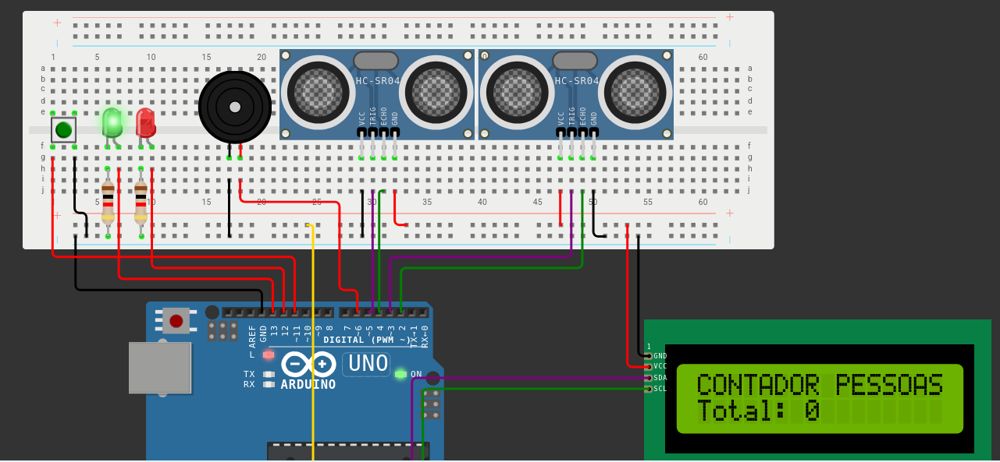 
  <i>Figura 1 — CT01: sistema inicializado, LED verde aceso e contador apresentado em zero.</i>

  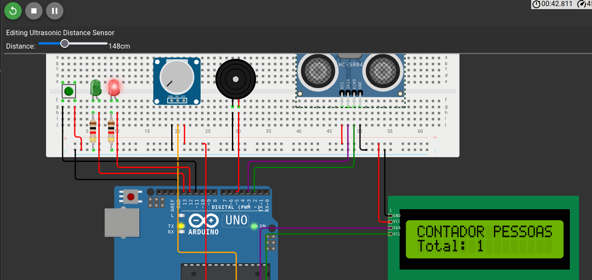 
  <i>Figura 2 — CT02: pessoa detectada a 2 cm pelo sensor de entrada, elevando o total para um.</i>

  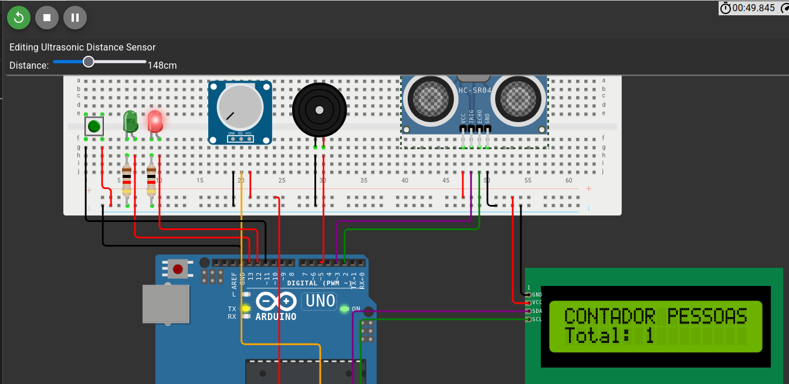 
  <i>Figura 3 — CT03: afastamento para 400 cm libera o sensor de entrada e mantém o total em um.</i>

  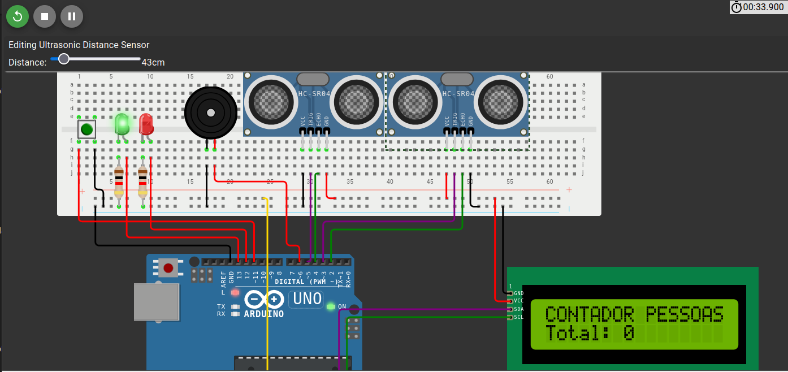 
  <i>Figura 4 — CT04: pessoa detectada a 43 cm pelo sensor de saída, reduzindo o total de um para zero.</i>

  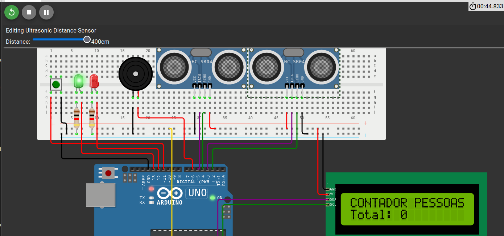 
  <i>Figura 5 — CT05: afastamento para 400 cm libera o sensor de saída e mantém o total em zero.</i>

  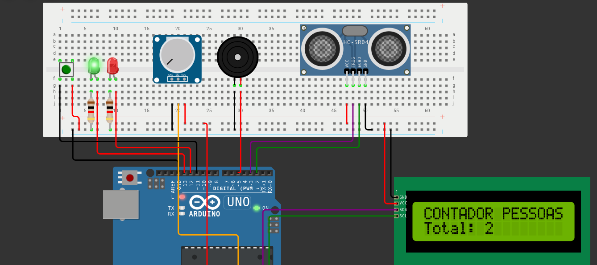 
  <i>Figura 6 — CT06: o botão alterna a sinalização para o LED vermelho sem modificar o contador.</i>

  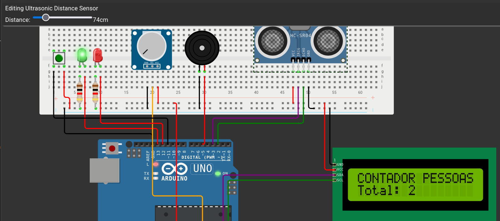 
  <i>Figura 7 — CT07: saída detectada a 6 cm; a proteção mantém o contador em zero.</i>

  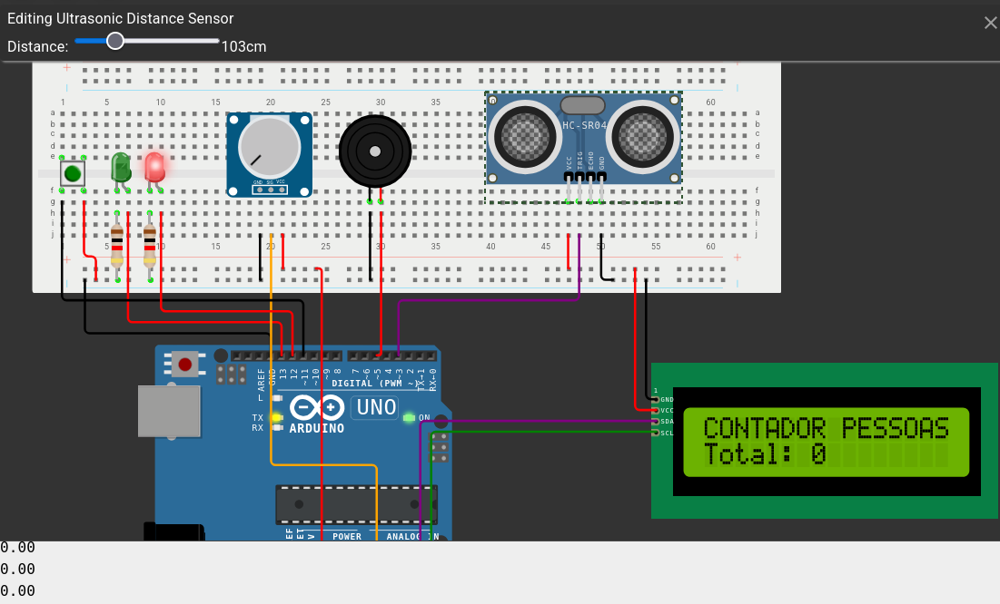 
  <i>Figura 8 — CT08: objeto posicionado a 400 cm, fora do limite de detecção, sem alteração no contador.</i>

  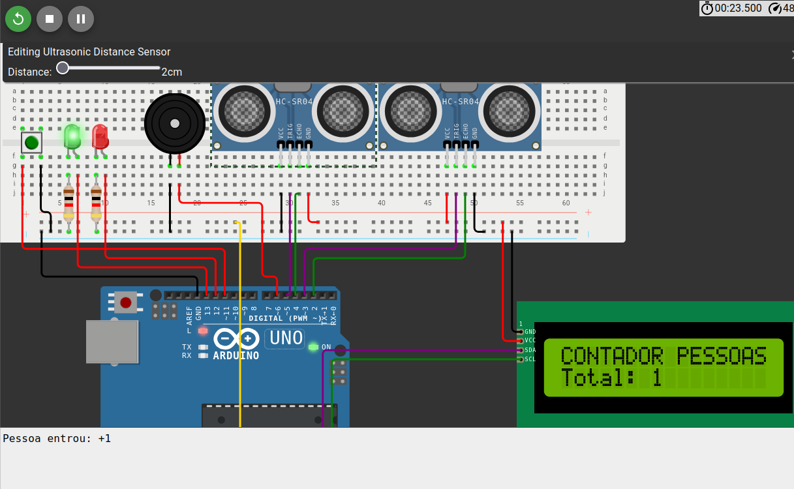
  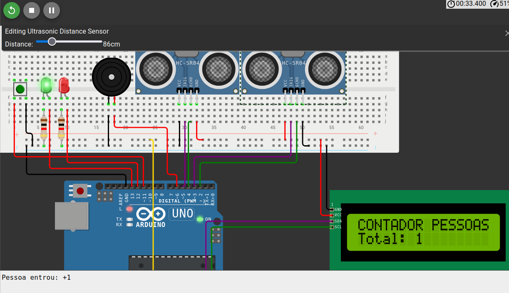 
  <i>Figura 9 — CT09: o sensor de entrada registra uma pessoa e a leitura do sensor de saída é ignorada enquanto o primeiro sensor permanece ativo.</i>

  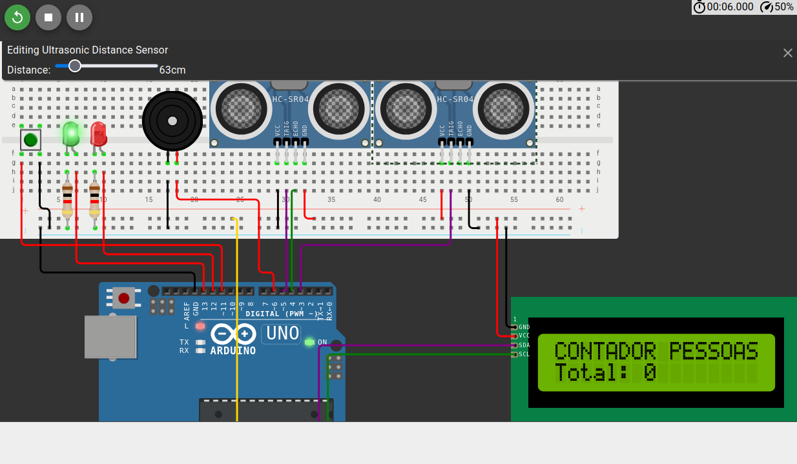 
  <i>Figura 10 — CT10: com o fio ECHO desconectado, a leitura inválida é descartada e o contador permanece em zero.</i>

### 3.4.2. Protótipo Físico do Projeto (offline) (sprint 2)

_Aqui você deve registrar diversas situações de teste, indicando exemplos de leitura (entrada) e escrita (saída) apresentadas pelo seu sistema físico. Estes registros serão utilizados para testar seus componentes, portanto, descreva várias situações, incluindo não apenas casos de sucesso, mas também de possíveis falhas nas leituras de entradas e saídas.  
Siga as nomenclaturas e convenções já utilizadas anteriormente, e não se esqueça dos alinhamentos de negócios e experiência do usuário para pensar em situações representativas. Inclua figuras do protótipo físico e descrições dos testes realizados para ilustrar o funcionamento do protótipo. Continue a numeração de CT a partir da tabela anterior. A tabela a seguir serve como exemplo._

| **CT#** | **Descrição**                                    | **Pré-condição**                  | **Procedimento de teste**                                                                                                 | **Pós-condição/Resultado esperado**                                                                         | **Observações** (opcional) |
| ------- | ------------------------------------------------ | --------------------------------- | ------------------------------------------------------------------------------------------------------------------------- | ----------------------------------------------------------------------------------------------------------- | -------------------------- |
| CT11    | ex. Verificação de conexão de rede bem-sucedida. | ex. O dispositivo está desligado. | ex. Ligue o dispositivo, aguarde alguns segundos e verifique se ele estabelece uma conexão bem-sucedida com a rede Wi-Fi. | ex. O LED verde indicador de conexão acende de forma contínua, sinalizando uma conexão bem-sucedida à rede. |

### 3.4.3. Protótipo do Projeto com MQTT e I2C (sprint 3)

_Aqui você deve registrar diversas situações de uso de seu sistema como um todo, indicando exemplos de ação do usuário e resposta do sistema, apontando como o ambiente deverá estar configurado para receber a ação e produzir a resposta. Estes registros serão utilizados para testar seu sistema, portanto, descreva várias situações, incluindo não apenas casos de sucesso, mas também de falha nos comportamentos do sistema.  
Siga as nomenclaturas e convenções já utilizadas anteriormente, e não se esqueça dos alinhamentos de negócios e experiência do usuário para pensar em situações representativas. Inclua figuras do protótipo físico e dashboards, além de descrições dos testes realizados para ilustrar o funcionamento do protótipo. Continue a numeração de CT a partir da tabela anterior. A tabela a seguir serve como exemplo._

| **CT#** | **Configuração do ambiente**                                                                                                                   | **Ação do usuário**                                                                     | **Resposta esperada do sistema**                                                                                                                 |
| ------- | ---------------------------------------------------------------------------------------------------------------------------------------------- | --------------------------------------------------------------------------------------- | ------------------------------------------------------------------------------------------------------------------------------------------------ |
| CT21    | ex. precisa de um computador conectado na interface, dois ou mais dispositivos que simulem o posicionamento de um item X no espaço físico etc. | ex. usuário logado busca a localização do item X, que está ativo e operando normalmente | ex. interface do sistema acessa os dados da última localização registrada do item X e apresenta, constando local e horário de última atualização |

### 3.4.4. Protótipo Físico do Projeto (online) (sprint 4)

_Aqui você deve registrar diversas situações de uso de seu sistema como um todo, indicando exemplos de ação do usuário e resposta do sistema, apontando como o ambiente deverá estar configurado para receber a ação e produzir a resposta. Estes registros serão utilizados para testar seu sistema, portanto, descreva várias situações, incluindo não apenas casos de sucesso, mas também de falha nos comportamentos do sistema.  
**Desta vez, utilize diagramas de sequência UML para descrever os fluxos de teste do sistema.**  
Siga as nomenclaturas e convenções já utilizadas anteriormente, e não se esqueça dos alinhamentos de negócios e experiência do usuário para pensar em situações representativas. Inclua figuras do protótipo físico e dashboards, além de descrições dos testes realizados para ilustrar o funcionamento do protótipo._

### 3.4.5. Protótipo Final do Projeto (sprint 5)

_Registre as situações de uso do sistema revisadas utilizando a modelagem UML para descrever os fluxos de teste.  
Também inclua figuras da versão final do protótipo físico e dashboards, além de descrições dos testes realizados para ilustrar o funcionamento do protótipo._

## 4. Conclusões e Recomendações

_Escreva, de forma resumida, sobre os principais resultados do seu projeto e faça recomendações formais ao seu parceiro de projeto em relação ao uso dessa solução. Você pode aproveitar este espaço para comentar sobre possíveis materiais extras._

## 5. Referências

BRASIL. Lei nº 14.026, de 15 de julho de 2020. Atualiza o marco legal do saneamento básico. Brasília, DF: Presidência da República, 2020. Disponível em: [https://www.planalto.gov.br/ccivil_03/\_ato2019-2022/2020/lei/l14026.htm](https://www.planalto.gov.br/ccivil_03/_ato2019-2022/2020/lei/l14026.htm). Acesso em: 15 out. 2026.

BRASIL. Ministério do Trabalho e Emprego. Normas Regulamentadoras (NR). Brasília, DF: Ministério do Trabalho e Emprego. Disponível em: [https://www.gov.br/trabalho-e-emprego/pt-br/assuntos/inspecao-do-trabalho/seguranca-e-saude-no-trabalho/ctpp-nrs/normas-regulamentadoras-nrs](https://www.gov.br/trabalho-e-emprego/pt-br/assuntos/inspecao-do-trabalho/seguranca-e-saude-no-trabalho/ctpp-nrs/normas-regulamentadoras-nrs). Acesso em: 15 out. 2026.

DABROWSKA, Magda. Emergency mustering solution. _IoT Now_, [s. l.], 12 jan. 2024. Disponível em: https://iot-now.com/2024/01/12/141842-emergency-mustering-solution/. Acesso em: 20 out. 2026.

ELETROGATE. _Buzzer ativo 5 V_. Disponível em: <https://www.eletrogate.com/buzzer-ativo-5v?utm_source=Site&utm_medium=GoogleMerchant&utm_campaign=GoogleMerchant&gad_source=1&gad_campaignid=20223015315&gbraid=0AAAAADqxjs_RKxEA4lB8OTz9kzOy_b2y9&gclid=CjwKCAjwotzWBhBFEiwA1JhPoLPBf6mtcZizCQRpZRRLmGNgwewSSuaihP1VIORbIt2h8imNmBty9RoCrG8QAvD_BwE>. Acesso em: 20 out. 2026.
MERCADO LIVRE. _Cabo USB compatível com placa de desenvolvimento Arduino Uno R3 ATmega328P CH340_. Disponível em: <https://www.mercadolivre.com.br/cabo-usb-compativel-com-placa-de-desenvolvimento-arduino-uno-r3-atmega328p-ch340/p/MLB44072268?pdp_filters=item_id%3AMLB5229650730&from=gshop&matt_tool=56164162&matt_word=&matt_source=google&matt_campaign_id=22090193744&matt_ad_group_id=194474654154&matt_match_type=&matt_network=g&matt_device=c&matt_creative=792355615410&matt_keyword=&matt_ad_position=&matt_ad_type=pla&matt_merchant_id=735125422&matt_product_id=MLB44072268-product&matt_product_partition_id=2495059736147&matt_target_id=pla-2495059736147&cq_src=google_ads&cq_cmp=22090193744&cq_net=g&cq_plt=gp&cq_med=pla&gad_source=4&gad_campaignid=22090193744&gbraid=0AAAAAD93qcDWMW_AFPrQLlrvCxOyNb_89&gclid=CjwKCAjwotzWBhBFEiwA1JhPoJRuM1jdBvwQsy-JbDuO2GqZUVevX9I5SgDqMi81aZh_Pusf2a-KQhoC7PwQAvD_BwE>. Acesso em: 20 out. 2026.

MERCADO LIVRE. _Módulo sensor ultrassônico de distância HC-SR04 para Arduino_. Disponível em: <https://www.mercadolivre.com.br/modulo-sensor-ultrassonico-distancia-hc-sr04-para-arduino/p/MLB64164978?pdp_filters=item_id%3AMLB5130062737&from=gshop&matt_tool=56164162&matt_word=&matt_source=google&matt_campaign_id=22090193744&matt_ad_group_id=194474654154&matt_match_type=&matt_network=g&matt_device=c&matt_creative=792355615410&matt_keyword=&matt_ad_position=&matt_ad_type=pla&matt_merchant_id=735128761&matt_product_id=MLB64164978-product&matt_product_partition_id=2495059736347&matt_target_id=pla-2495059736347&cq_src=google_ads&cq_cmp=22090193744&cq_net=g&cq_plt=gp&cq_med=pla&gad_source=4&gad_campaignid=22090193744&gbraid=0AAAAAD93qcDWMW_AFPrQLlrvCxOyNb_89&gclid=CjwKCAjwotzWBhBFEiwA1JhPoIQ9ytYCHxi7QMFA-RU1aROmSXUtXE3xD1biz_vwK9s3dwk-8Ro6oxoCIOoQAvD_BwE>. Acesso em: 20 out. 2026.

MERCADO LIVRE. _Conjunto de 50 botões de pressão para placa de circuito_. Disponível em: <https://www.mercadolivre.com.br/conjunto-de-50-botoes-de-pressao-para-placa-de-circuito/p/MLB2052130334?matt_tool=18956390&utm_source=google_shopping&utm_medium=organic&pdp_filters=item_id%3AMLB7635767930&from=gshop>. Acesso em: 20 out. 2026.

ELETROGATE. _LED difuso 5 mm verde_. Disponível em: <https://www.eletrogate.com/led-difuso-5mm-verde?utm_source=Site&utm_medium=GoogleMerchant&utm_campaign=GoogleMerchant&gad_source=1&gad_campaignid=22470016551&gbraid=0AAAAADqxjs-J182in_CBPr1nyA54F-LL9&gclid=CjwKCAjwotzWBhBFEiwA1JhPoCaLKeb9vaLT7u49dThE1TEGwTfv0C6_EYGFI6dS3biP6Xoqy1ZgVxoCiEIQAvD_BwE>. Acesso em: 20 out. 2026.

ELETROGATE. _LED difuso 5 mm vermelho_. Disponível em: <https://www.eletrogate.com/led-difuso-5mm-vermelho?utm_source=Site&utm_medium=GoogleMerchant&utm_campaign=GoogleMerchant&gad_source=1&gad_campaignid=20223015315&gbraid=0AAAAADqxjs_RKxEA4lB8OTz9kzOy_b2y9&gclid=CjwKCAjwotzWBhBFEiwA1JhPoN-apmwJkkXYYznxTECGwrAfUUdQMOGaQL_4-m8zeFGfzU6AOYhiNxoCqJgQAvD_BwE>. Acesso em: 20 out. 2026.

ELETROGATE. _Protoboard 400 pontos_. Disponível em: <https://www.eletrogate.com/protoboard-400-pontos?utm_source=Site&utm_medium=GoogleMerchant&utm_campaign=GoogleMerchant&gad_source=4&gad_campaignid=20223015315&gbraid=0AAAAADqxjs--_IDti_OP_PomQr4wJeFmq&gclid=CjwKCAjwotzWBhBFEiwA1JhPoPlT3_2SAg4EbLjDVCFA_2Gb0qBCgwXD5npVhSjZdn-yagDte4bg4BoCZoMQAvD_BwE>. Acesso em: 20 out. 2026.

ESTADÃO CONTEÚDO. Unipar tem 2025 desafiado pelo ciclo petroquímico, com quarto trimestre mais crítico. UOL Economia, 19 mar. 2026. Disponível em: [https://economia.uol.com.br/noticias/estadao-conteudo/2026/03/19/unipar-tem-2025-desafiado-pelo-ciclo-petroquimico-com-quarto-trimestre-mais-critico.htm](https://economia.uol.com.br/noticias/estadao-conteudo/2026/03/19/unipar-tem-2025-desafiado-pelo-ciclo-petroquimico-com-quarto-trimestre-mais-critico.htm). Acesso em: 15 out. 2026.

INTELI. Projeto parceiro: Unipar — Sistema de IoT para Monitoramento, Orientação e Confirmação de Evacuação em Emergências Industriais. 2026. Disponível em: [https://docs.google.com/document/d/1yKX2hho7oz5-i71Sfl6xBaFho90tpnsR/edit?usp=drive_link&ouid=118360090804793164161&rtpof=true&sd=true](https://docs.google.com/document/d/1yKX2hho7oz5-i71Sfl6xBaFho90tpnsR/edit?usp=drive_link&ouid=118360090804793164161&rtpof=true&sd=true). Acesso em: 15 out. 2026. Material de apoio correspondente ao Módulo 4 do Ciclo Comum de Graduação do Instituto de Tecnologia e Liderança, 2026.

MERCADO LIVRE. _Bateria Maxell CR2032 de lítio, 3 V, uma unidade_. Disponível em: <https://lista.mercadolivre.com.br/bateria-maxell-cr2032>. Acesso em: 22 out. 2026.

MERCADO LIVRE. _Cabo jumper macho-macho 20 cm para Arduino e protoboard_. Disponível em: <https://www.mercadolivre.com.br/cabo-jumper-mxm-20cm-40-pinos-para-arduino-protoboard/up/MLBU2098535281>. Acesso em: 20 out. 2026.

MERCADO LIVRE. _Cabo USB compatível com placa de desenvolvimento Arduino Uno R3 ATmega328P CH340_. Disponível em: <https://www.mercadolivre.com.br/cabo-usb-compativel-com-placa-de-desenvolvimento-arduino-uno-r3-atmega328p-ch340/p/MLB44072268?pdp_filters=item_id%3AMLB5229650730&from=gshop&matt_tool=56164162&matt_word=&matt_source=google&matt_campaign_id=22090193744&matt_ad_group_id=194474654154&matt_match_type=&matt_network=g&matt_device=c&matt_creative=792355615410&matt_keyword=&matt_ad_position=&matt_ad_type=pla&matt_merchant_id=735125422&matt_product_id=MLB44072268-product&matt_product_partition_id=2495059736147&matt_target_id=pla-2495059736147&cq_src=google_ads&cq_cmp=22090193744&cq_net=g&cq_plt=gp&cq_med=pla&gad_source=4&gad_campaignid=22090193744&gbraid=0AAAAAD93qcDWMW_AFPrQLlrvCxOyNb_89&gclid=CjwKCAjwotzWBhBFEiwA1JhPoJRuM1jdBvwQsy-JbDuO2GqZUVevX9I5SgDqMi81aZh_Pusf2a-KQhoC7PwQAvD_BwE>. Acesso em: 20 out. 2026.

MERCADO LIVRE. _Conjunto de 50 botões de pressão para placa de circuito_. Disponível em: <https://www.mercadolivre.com.br/conjunto-de-50-botoes-de-pressao-para-placa-de-circuito/p/MLB2052130334?matt_tool=18956390&utm_source=google_shopping&utm_medium=organic&pdp_filters=item_id%3AMLB7635767930&from=gshop>. Acesso em: 20 out. 2026.

MERCADO LIVRE. _Display LCD 16 × 2 1602 com módulo I²C soldado_. Disponível em: <https://www.mercadolivre.com.br/display-lcd-16x2-1602-fundo-azul-com-modulo-i2c-soldado/up/MLBU4549779439?pdp_filters=item_id%3AMLB7321088826&from=gshop&matt_tool=56885173&matt_word=&matt_source=google&matt_campaign_id=22090354256&matt_ad_group_id=192555051054&matt_match_type=&matt_network=g&matt_device=c&matt_creative=799032781561&matt_keyword=&matt_ad_position=&matt_ad_type=pla&matt_merchant_id=119897001&matt_product_id=MLBU4549779439&matt_product_partition_id=2498613880064&matt_target_id=pla-2498613880064&cq_src=google_ads&cq_cmp=22090354256&cq_net=g&cq_plt=gp&cq_med=pla&gad_source=1&gad_campaignid=22090354256&gbraid=0AAAAAD93qcAf98DVye3WhOkZqJU1o3eSE&gclid=CjwKCAjwotzWBhBFEiwA1JhPoMgiK21_IFmDbVmbNMgDC3o03ZARpy4oBINxyPna8AsDNp4ISmYalRoCR_MQAvD_BwE>. Acesso em: 20 out. 2026.

MERCADO LIVRE. _Kit de cabos jumper macho-fêmea 20 cm_. Disponível em: <https://www.mercadolivre.com.br/20pcs-jumper-mxf-20cm--20pcs-jumper-fxf-20cm/up/MLBU2370810037?pdp_filters=item_id%3AMLB4078036044&from=gshop&matt_tool=19390443&matt_word=&matt_source=google&matt_campaign_id=22090354205&matt_ad_group_id=191786774561&matt_match_type=&matt_network=g&matt_device=c&matt_creative=782869962440&matt_keyword=&matt_ad_position=&matt_ad_type=pla&matt_merchant_id=5458938305&matt_product_id=MLBU2370810037&matt_product_partition_id=2495493043879&matt_target_id=pla-2495493043879&cq_src=google_ads&cq_cmp=22090354205&cq_net=g&cq_plt=gp&cq_med=pla&gad_source=4&gad_campaignid=22090354205&gbraid=0AAAAAD93qcBWh7S0-tQRtyURYUhdok1-w&gclid=CjwKCAjwotzWBhBFEiwA1JhPoO4nhPq-F2KwwBsDI-Hn3A0iwomUAHbI1TRcldDnimZUYjGi7kAF6xoCG5oQAvD_BwE>. Acesso em: 20 out. 2026.

MERCADO LIVRE. _Módulo sensor ultrassônico de distância HC-SR04 para Arduino_. Disponível em: <https://www.mercadolivre.com.br/modulo-sensor-ultrassonico-distancia-hc-sr04-para-arduino/p/MLB64164978?pdp_filters=item_id%3AMLB5130062737&from=gshop&matt_tool=56164162&matt_word=&matt_source=google&matt_campaign_id=22090193744&matt_ad_group_id=194474654154&matt_match_type=&matt_network=g&matt_device=c&matt_creative=792355615410&matt_keyword=&matt_ad_position=&matt_ad_type=pla&matt_merchant_id=735128761&matt_product_id=MLB64164978-product&matt_product_partition_id=2495059736347&matt_target_id=pla-2495059736347&cq_src=google_ads&cq_cmp=22090193744&cq_net=g&cq_plt=gp&cq_med=pla&gad_source=4&gad_campaignid=22090193744&gbraid=0AAAAAD93qcDWMW_AFPrQLlrvCxOyNb_89&gclid=CjwKCAjwotzWBhBFEiwA1JhPoIQ9ytYCHxi7QMFA-RU1aROmSXUtXE3xD1biz_vwK9s3dwk-8Ro6oxoCIOoQAvD_BwE>. Acesso em: 20 out. 2026.

SARAVATI. _Resistor 1 kΩ 5% 1/4 W_. Disponível em: <https://www.saravati.com.br/resistor-1k-5-1-4w.html?gad_source=1&gad_campaignid=23551463662&gbraid=0AAAAAC2QUl9NJxOJbt89j1o1regZh5Nz1&gclid=CjwKCAjwotzWBhBFEiwA1JhPoG38v08Hq-K_8VKXdxS8REO0qaNgkFziIwVTl9Rc2LXpGSD3o1KboRoCCEkQAvD_BwE>. Acesso em: 20 out. 2026.

UNIPAR. Manual da marca. 2022. Disponível em: [https://drive.google.com/file/d/1_XkquJbTrDnP6CyCtCTjtASRwI4qLL2P/view?usp=sharing](https://drive.google.com/file/d/1_XkquJbTrDnP6CyCtCTjtASRwI4qLL2P/view?usp=sharing). Acesso em: 15 out. 2026. Material institucional da Unipar utilizado como referência no Módulo 4 do Ciclo Comum de Graduação do Instituto de Tecnologia e Liderança, 2026.

UNIPAR. Perfil corporativo. Relações com Investidores. Disponível em: [https://ri.unipar.com/sobre-a-unipar/perfil-corporativo/](https://ri.unipar.com/sobre-a-unipar/perfil-corporativo/). Acesso em: 15 out. 2026.

UNIPAR. Produtos: cloro. Disponível em: [https://unipar.com/produtos/cloro](https://unipar.com/produtos/cloro). Acesso em: 15 out. 2026.

UNIPAR. _Projeto parceiro Unipar_: sistema de IoT para monitoramento, orientação e confirmação de evacuação em emergências industriais. São Paulo: Inteli, 2026. Termo de Abertura do Projeto (TAPI), Turma 25, Módulo 4. Documento não publicado.

UNIPAR. Relatório de sustentabilidade. Relações com Investidores, 2025. Disponível em: [https://ri.unipar.com/sustentabilidade/relatorio-de-sustentabilidade/](https://ri.unipar.com/sustentabilidade/relatorio-de-sustentabilidade/). Acesso em: 15 out. 2026.

UNIPAR. Sobre a Unipar. Disponível em: [https://unipar.com/sobre/](https://unipar.com/sobre/). Acesso em: 15 out. 2026.

UNIPAR CARBOCLORO. _Release de resultados 2T23_. São Paulo: Unipar Carbocloro, 2023. Disponível em: https://static.poder360.com.br/2023/08/resultados-unipar-2T23.pdf. Acesso em: 19 out. 2026.

UNIPAR CARBOCLORO. _Release de resultados 4T25_. São Paulo: Unipar Carbocloro, 2026. Disponível em: https://api.mziq.com/mzfilemanager/v2/d/3c0b3516-7dff-44a5-946f-20e7ec87dfa0/2d4c9ca6-1e44-6e77-e845-7392f3c2c4b0?origin=2. Acesso em: 19 out. 2026.

UNIPAR CARBOCLORO S.A. Informações trimestrais (ITR): 31 de março de 2025. 2025. Disponível em: [https://api.mziq.com/mzfilemanager/v2/d/3c0b3516-7dff-44a5-946f-20e7ec87dfa0/605e2a07-9fb6-eb47-ecda-0350c5df8db7?origin=1](https://api.mziq.com/mzfilemanager/v2/d/3c0b3516-7dff-44a5-946f-20e7ec87dfa0/605e2a07-9fb6-eb47-ecda-0350c5df8db7?origin=1). Acesso em: 15 out. 2026.

UNIPAR Carbocloro inaugura sua 1ª unidade no Nordeste. _Movimento Econômico_, [s. l.], 4 abr. 2025. Disponível em: https://movimentoeconomico.com.br/estados/bahia/2025/04/04/unipar-carbocloro-inaugura-sua-1a-unidade-no-nordeste/. Acesso em: 19 out. 2026.

VAZAMENTO de gás em porto deixa 13 mortos e mais de 250 feridos na Jordânia; veja vídeo. _Folha de Pernambuco_, Recife, jun. 2022. Disponível em: https://www.folhape.com.br/noticias/vazamento-de-gas-em-porto-deixa-13-mortos-na-jordania/231857/. Acesso em: 20 out. 2026.

VEJA o impacto gerado pela Unipar em 55 anos de história. _Exame_, São Paulo, 28 maio 2024. Disponível em: https://exame.com/esg/impacto-unipar-em-55-anos-de-historia/. Acesso em: 19 out. 2026.

WIRELESS, paperless tracking keeps employees safer. _Automation World_, [s. l.], [20--]. Disponível em: https://www.automationworld.com/article/technologies/sensors-process/wireless-paperless-tracking-keeps-employees-safer. Acesso em: 20 out. 2026.

[1] BRASIL. **Lei nº 13.709, de 14 de agosto de 2018: Lei Geral de Proteção de Dados Pessoais (LGPD)**. Brasília, DF: Presidência da República, 2018. Disponível em: <https://www.planalto.gov.br/ccivil_03/_ato2015-2018/2018/lei/l13709compilado.htm>. Acesso em: 22 out. 2026.

[2] AGÊNCIA NACIONAL DE PROTEÇÃO DE DADOS. **Guia orientativo para definições dos agentes de tratamento de dados pessoais e do encarregado**. Brasília, DF: ANPD, 2022. Disponível em: <https://www.gov.br/anpd/pt-br/centrais-de-conteudo/materiais-educativos-e-publicacoes/guia-orientativo-para-definicoes-dos-agentes-de-tratamento-de-dados-pessoais-e-do-encarregado>. Acesso em: 22 out. 2026.

[3] UNIPAR. **Aviso de Privacidade**. Disponível em: <https://unipar.com/aviso-de-privacidade>. Acesso em: 22 out. 2026.

[4] AGÊNCIA NACIONAL DE PROTEÇÃO DE DADOS. **Guia orientativo sobre segurança da informação para agentes de tratamento de pequeno porte**. Brasília, DF: ANPD, 2021. Disponível em: <https://www.gov.br/anpd/pt-br/centrais-de-conteudo/materiais-educativos-e-publicacoes/guia-orientativo-sobre-seguranca-da-informacao-para-agentes-de-tratamento-de-pequeno-porte>. Acesso em: 22 out. 2026.

[5] AGÊNCIA NACIONAL DE PROTEÇÃO DE DADOS. **Direito dos titulares**. Disponível em: <https://www.gov.br/anpd/pt-br/assuntos/titular-de-dados/direito-dos-titulares>. Acesso em: 22 out. 2026.
ELETROGATE. _Buzzer ativo 5 V_. Disponível em: <https://www.eletrogate.com/buzzer-ativo-5v?utm_source=Site&utm_medium=GoogleMerchant&utm_campaign=GoogleMerchant&gad_source=1&gad_campaignid=20223015315&gbraid=0AAAAADqxjs_RKxEA4lB8OTz9kzOy_b2y9&gclid=CjwKCAjwotzWBhBFEiwA1JhPoLPBf6mtcZizCQRpZRRLmGNgwewSSuaihP1VIORbIt2h8imNmBty9RoCrG8QAvD_BwE>. Acesso em: 20 out. 2026.

MERCADO LIVRE. _Display LCD 16 × 2 1602 com módulo I²C soldado_. Disponível em: <https://www.mercadolivre.com.br/display-lcd-16x2-1602-fundo-azul-com-modulo-i2c-soldado/up/MLBU4549779439?pdp_filters=item_id%3AMLB7321088826&from=gshop&matt_tool=56885173&matt_word=&matt_source=google&matt_campaign_id=22090354256&matt_ad_group_id=192555051054&matt_match_type=&matt_network=g&matt_device=c&matt_creative=799032781561&matt_keyword=&matt_ad_position=&matt_ad_type=pla&matt_merchant_id=119897001&matt_product_id=MLBU4549779439&matt_product_partition_id=2498613880064&matt_target_id=pla-2498613880064&cq_src=google_ads&cq_cmp=22090354256&cq_net=g&cq_plt=gp&cq_med=pla&gad_source=1&gad_campaignid=22090354256&gbraid=0AAAAAD93qcAf98DVye3WhOkZqJU1o3eSE&gclid=CjwKCAjwotzWBhBFEiwA1JhPoMgiK21_IFmDbVmbNMgDC3o03ZARpy4oBINxyPna8AsDNp4ISmYalRoCR_MQAvD_BwE>. Acesso em: 20 out. 2026.

SARAVATI. _Resistor 1 kΩ 5% 1/4 W_. Disponível em: <https://www.saravati.com.br/resistor-1k-5-1-4w.html?gad_source=1&gad_campaignid=23551463662&gbraid=0AAAAAC2QUl9NJxOJbt89j1o1regZh5Nz1&gclid=CjwKCAjwotzWBhBFEiwA1JhPoG38v08Hq-K_8VKXdxS8REO0qaNgkFziIwVTl9Rc2LXpGSD3o1KboRoCCEkQAvD_BwE>. Acesso em: 20 out. 2026.

ELETROGATE. _Protoboard 400 pontos_. Disponível em: <https://www.eletrogate.com/protoboard-400-pontos?utm_source=Site&utm_medium=GoogleMerchant&utm_campaign=GoogleMerchant&gad_source=4&gad_campaignid=20223015315&gbraid=0AAAAADqxjs--_IDti_OP_PomQr4wJeFmq&gclid=CjwKCAjwotzWBhBFEiwA1JhPoPlT3_2SAg4EbLjDVCFA_2Gb0qBCgwXD5npVhSjZdn-yagDte4bg4BoCZoMQAvD_BwE>. Acesso em: 20 out. 2026.

MERCADO LIVRE. _Bateria Maxell CR2032 de lítio, 3 V, uma unidade_. Disponível em: <https://lista.mercadolivre.com.br/bateria-maxell-cr2032>. Acesso em: 22 out. 2026.

MERCADO LIVRE. _Kit de cabos jumper macho-fêmea 20 cm_. Disponível em: <https://www.mercadolivre.com.br/20pcs-jumper-mxf-20cm--20pcs-jumper-fxf-20cm/up/MLBU2370810037?pdp_filters=item_id%3AMLB4078036044&from=gshop&matt_tool=19390443&matt_word=&matt_source=google&matt_campaign_id=22090354205&matt_ad_group_id=191786774561&matt_match_type=&matt_network=g&matt_device=c&matt_creative=782869962440&matt_keyword=&matt_ad_position=&matt_ad_type=pla&matt_merchant_id=5458938305&matt_product_id=MLBU2370810037&matt_product_partition_id=2495493043879&matt_target_id=pla-2495493043879&cq_src=google_ads&cq_cmp=22090354205&cq_net=g&cq_plt=gp&cq_med=pla&gad_source=4&gad_campaignid=22090354205&gbraid=0AAAAAD93qcBWh7S0-tQRtyURYUhdok1-w&gclid=CjwKCAjwotzWBhBFEiwA1JhPoO4nhPq-F2KwwBsDI-Hn3A0iwomUAHbI1TRcldDnimZUYjGi7kAF6xoCG5oQAvD_BwE>. Acesso em: 20 out. 2026.

MERCADO LIVRE. _Cabo jumper macho-macho 20 cm para Arduino e protoboard_. Disponível em: <https://www.mercadolivre.com.br/cabo-jumper-mxm-20cm-40-pinos-para-arduino-protoboard/up/MLBU2098535281>. Acesso em: 20 out. 2026.
