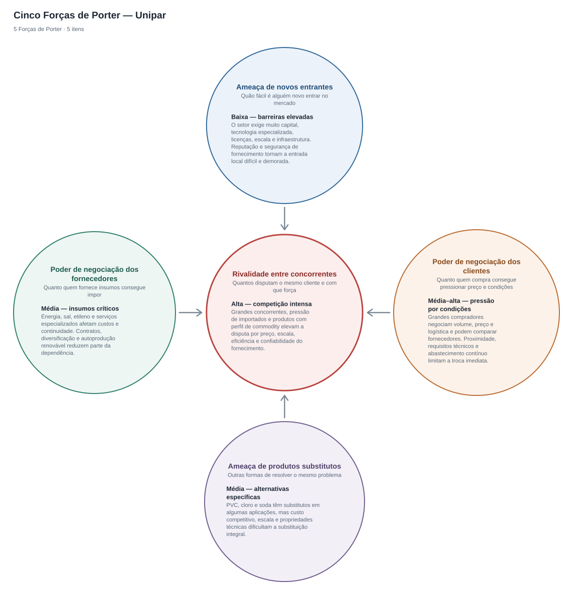
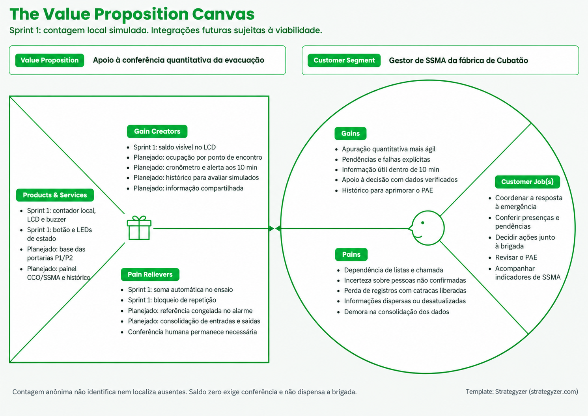
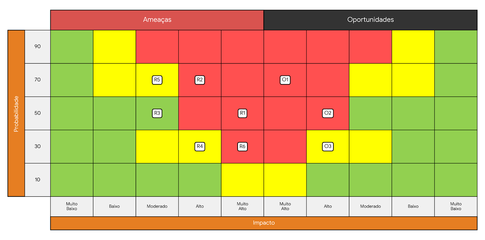

# Documentação IoTDoc - Módulo 4 - Inteli

## Synthetix

### C.R.I.S.I.S - Controle e Resposta Inteligente em Situações de Incidente e Segurança

#### Integrantes:

- Davi Tricarico
- Felipe Rabinovich
- Gustavo Fantasia
- Felipe Escobar
- Lucas Oliveira
- Pedro Negri
- Vinicius Ramos
- Arthur Rodrigues

## Sumário

[1. Introdução](#c1)

[2. Metodologia](#c2)

[3. Desenvolvimento e Resultados](#c3)

[4. Conclusões e Recomendações](#c4)

[5. Referências](#c5)

 

# 1. Introdução

A Unipar é uma empresa brasileira do setor químico e petroquímico, com mais de 55 anos de operação, que produz cloro, soda e PVC (Veja [...], 2024). A empresa tem mais de 1.400 colaboradores diretos (Veja [...], 2024) e fechou 2025 com receita líquida consolidada de R$ 5,1 bilhões (Unipar Carbocloro S.A., 2026b). Suas fábricas ficam em Cubatão (SP), Santo André (SP), Bahía Blanca, na Argentina (Veja [...], 2024), e Camaçari (BA), inaugurada em 2025 (Unipar [...], 2025). A Unipar é líder na produção de cloro e soda e a segunda maior produtora de PVC da América do Sul (Unipar [...], 2025).

Este projeto é feito com a fábrica de Cubatão, a unidade com a maior capacidade de produção de cloro da empresa (Unipar Carbocloro S.A., 2023), onde trabalham cerca de 355 funcionários diretos e cerca de 400 de empresas parceiras (informação verbal)[^1]. Em uma emergência, como um vazamento de cloro, essas pessoas precisam sair da área rápido e chegar aos pontos de encontro. Hoje, esse processo é quase todo manual: o alarme é acionado por um operador, a empresa só sabe quem entrou e saiu pela portaria, sem saber onde cada pessoa está dentro da planta, e a confirmação de quem chegou ao ponto de encontro é feita pelos líderes, por chamada. Além disso, durante a emergência, as catracas são liberadas para dar vazão e deixam de registrar quem passa. Com isso, a evacuação fica mais lenta e é difícil saber, rápido, quem ainda não chegou (informação verbal)[^1].

[^1]: Informação fornecida por representantes da Unipar na reunião de kickoff do projeto, em 16 de outubro de 2026.

## 1.1 Objetivos

Os objetivos abaixo foram definidos a partir do Termo de Abertura do Projeto (Unipar, 2026a) e da reunião de kickoff com a Unipar (informação verbal)[^1].

**Objetivo geral**

Aumentar a rapidez, a precisão e a rastreabilidade da evacuação da fábrica de Cubatão em situações de emergência, fortalecendo a gestão de emergências e a proteção das pessoas que estão na planta.

**Objetivos específicos**

- Melhorar a visibilidade sobre a população presente na planta e as pendências de conferência durante a evacuação;
- Apoiar a apuração quantitativa mesmo quando as catracas e portas são liberadas durante a emergência;
- Agilizar a conferência nos pontos de encontro, reduzindo o esforço manual sem dispensar a confirmação individual quando necessária;
- Apoiar a apuração de pessoas ainda não confirmadas em até dez minutos após o alarme, conforme o prazo interno informado pela Unipar;
- Avisar a sala de controle e as equipes de resposta sobre o andamento da evacuação, dando mais agilidade às decisões.

## 1.2 Proposta da solução

A proposta do C.R.I.S.I.S é apoiar a conferência da evacuação da Unipar em Cubatão por meio de contagem quantitativa nos acessos aos pontos de encontro. Na Sprint 1, o protótipo desenvolvido demonstra entradas e saídas simuladas, mantém um total local e oferece retorno visual e sonoro. Esse recorte permite estudar a lógica de contagem e suas falhas antes de ampliar a solução.

A contagem é anônima: informa quantas passagens foram reconhecidas e o saldo local estimado, mas não identifica quem chegou, quem falta ou onde uma pessoa está. A equipe continua responsável pela conferência humana e pelas decisões de emergência. O protótipo não orienta rotas nem controla catracas.

Na visão completa pensada para a solução, os registros de crachá e das portarias poderão fornecer a população de referência da planta. Os dispositivos dos pontos de encontro enviarão contagens para um painel compartilhado pelo CCO e pela SSMA, com ocupação por ponto, diferença quantitativa em relação à referência, tempo desde o alarme, alertas e histórico. Essa integração busca apoiar a conferência dentro do prazo interno de dez minutos.

Também se pretende analisar a viabilidade de aproveitar os registros de acesso entre áreas para informar a última área registrada antes do alarme. Esse dado seria uma referência histórica, não a localização atual de alguém nem prova de quem deixou de chegar ao ponto de encontro. Sua integração depende da disponibilidade dos dados, das permissões e da revisão de privacidade. Monitoramento por áreas, orientação durante a evacuação e contagem em fluxos simultâneos exigem análise e validação próprias antes de integrarem a implementação. Assim, a Sprint 1 demonstra o núcleo de contagem local, e as demais capacidades serão incorporadas progressivamente conforme a viabilidade e o avanço do projeto.

## 1.3 Justificativa

A conferência manual e a perda de registros de passagem quando as catracas são liberadas dificultam a consolidação rápida de informações durante a evacuação, conforme o contexto informado no kickoff. A proposta atua sobre esse problema ao experimentar uma contagem local que continua funcionando nos dois estados de sinalização, preservando a verificação humana. O benefício esperado é reduzir o esforço de apuração quantitativa e oferecer um dado adicional à equipe responsável pelo ponto de encontro.

O diferencial do recorte da Sprint 1 é dispensar dispositivos individuais e identificação pessoal no fluxo de contagem: a interação se resume à passagem pelo acesso simulado e à leitura do total local. Isso permite verificar entradas, saídas, bloqueio de repetição e falhas de leitura com uma montagem pequena e reproduzível. Não há comprovação, nesta etapa, de redução de tempo, acurácia em campo ou cumprimento do prazo de dez minutos. As metas e o protocolo de validação estão nas seções 3.1.3.5 e 3.4.1.1.

A expansão para consolidação remota poderá melhorar a visibilidade do CCO/SSMA nas próximas sprints. O aproveitamento dos registros de acesso existentes poderá reduzir a necessidade de introduzir dispositivos pessoais adicionais, se a integração for viável. O acompanhamento agregado por pontos de encontro e a eventual consulta à última área registrada buscam oferecer contexto para a conferência, sem rastreamento contínuo de alta precisão. Esses diferenciais pertencem à visão planejada; a versão atual demonstra somente a contagem e a sinalização locais, mantendo a conferência nominal pelos procedimentos do parceiro.

# 2. Metodologia (sprint 3)

_Descreva as etapas da metodologia RM-ODP que foram utilizadas para o desenvolvimento, citando o referencial teórico. Você deve apenas enunciar os métodos, sem dizer ainda como ele foi aplicado e quais resultados obtidos._

# 3. Desenvolvimento e Resultados

## 3.1. Domínio de Fundamentos de Negócio

_Link para os templates de negócios: https://drive.google.com/drive/folders/1lTqisJ_gxxtc5J5aXM8ula2kQ4MsII_M?usp=sharing_

### 3.1.1. Contexto da Indústria

#### Concorrência

A Unipar atua na indústria química e petroquímica, com foco nos mercados de cloro, soda cáustica, policloreto de vinila (PVC) e derivados. De acordo com o Formulário de Referência 2026 da empresa, seus principais competidores no mercado interno incluem Braskem, Dow, Olin, Chemtrade, Katrium, Chlorum e CMPC. Essa relação deve ser interpretada no nível do portfólio: o documento não afirma que todas essas empresas disputam os mesmos produtos, clientes e regiões com a mesma intensidade. A soda cáustica e o PVC também estão expostos aos preços e estoques internacionais e à entrada de produtos importados. Segundo a própria companhia, os principais fatores de competitividade são a disponibilidade e o custo de matérias-primas, a escala de produção e a localização das unidades (Unipar Carbocloro S.A., 2026a).

#### Modelo de negócio

A Unipar adota um modelo predominantemente _business-to-business_ (B2B), baseado na produção e na comercialização, em grande escala, de insumos utilizados por outras organizações. A empresa atende setores como papel e celulose, alumínio, construção civil, infraestrutura, alimentos, siderurgia e metalurgia, tratamento de água, sabões, detergentes e produtos de limpeza. Essa diversidade reduz a exposição a um único mercado consumidor; em 2025, nenhum cliente respondeu por mais de 10% da receita líquida total da companhia (Unipar Carbocloro S.A., 2026a).

Trata-se de um modelo intensivo em capital, infraestrutura e energia, no qual a competitividade depende da escala, do controle dos custos e da continuidade das operações. A localização das unidades próximas a polos industriais e aos mercados consumidores reduz a distância logística e favorece a confiabilidade do abastecimento, aspecto especialmente relevante para o cloro, cujo transporte apresenta restrições técnicas e de segurança. A proximidade geográfica, associada aos contratos de fornecimento e à autoprodução de energia, contribui para proteger a posição competitiva da empresa, embora não elimine sua exposição aos custos de insumos e aos ciclos internacionais de soda cáustica e PVC (Unipar Carbocloro S.A., 2026a).

#### Tendências do setor

Entre as principais tendências da indústria química e petroquímica estão a descarbonização, a eficiência energética, o uso de fontes renováveis, a modernização tecnológica e a economia circular. Essas tendências afetam tanto os custos operacionais quanto o acesso a capital, a conformidade ambiental e a preferência dos clientes industriais. Na Unipar, esse movimento aparece na substituição das tecnologias de mercúrio e diafragma por células de membrana na fábrica de Cubatão e na ampliação do uso de energia renovável. Em 2025, a companhia informou que 79% da energia elétrica consumida em suas operações veio de fontes renováveis (Unipar, 2026b).

A digitalização e a automação dos processos industriais e administrativos também se destacam. A Indústria 4.0 integra tecnologias como Internet das Coisas, análise de grandes volumes de dados, inteligência artificial, computação em nuvem e sistemas ciberfísicos para criar fábricas mais conectadas e apoiar a melhoria dos processos produtivos (INMETRO, 2026). Nesse contexto, a integração de sistemas, o uso de sensores, a análise de dados e a automatização de tarefas podem melhorar o monitoramento das operações, reduzir atividades repetitivas e apoiar a tomada de decisão.

No mercado brasileiro, a ampliação dos investimentos em saneamento pode favorecer a demanda por cloro e PVC, utilizados, respectivamente, no tratamento de água e em componentes de infraestrutura. Ao mesmo tempo, a indústria permanece exposta às oscilações cambiais, aos preços internacionais, às importações e ao desenvolvimento de materiais e tecnologias alternativas. Esse conjunto de tendências exige investimentos contínuos em inovação, eficiência operacional e sustentabilidade (Brasil, 2020; Unipar Carbocloro S.A., 2026a).

#### Cinco Forças de Porter

O modelo das Cinco Forças de Porter analisa como a rivalidade entre concorrentes, a ameaça de novos entrantes, a ameaça de produtos substitutos e os poderes de negociação de fornecedores e compradores afetam a atratividade e a rentabilidade de um setor (Harvard Business School, [s. d.]). A aplicação a seguir considera conjuntamente os mercados de cloro, soda cáustica e PVC. Como as condições competitivas variam entre esses produtos, as classificações representam uma síntese analítica do portfólio da Unipar, e não uma avaliação oficial divulgada pela companhia.

A Figura 1 apresenta uma visão integrada da análise. A rivalidade ocupa a posição central porque resulta da interação com as outras quatro forças: barreiras de entrada, disponibilidade de substitutos e capacidade de fornecedores e compradores influenciarem custos, preços e condições comerciais. O quadro também antecipa a intensidade atribuída a cada força, permitindo comparar as pressões antes de examinar suas justificativas individualmente.

  
Figura 1 – Cinco Forças de Porter aplicadas à Unipar

  
  
Fonte: elaboração dos autores (2026).

Em síntese, a figura indica que a rivalidade constitui a pressão central e mais intensa, enquanto o poder dos compradores aparece como moderado a alto. O poder dos fornecedores e a ameaça de substitutos possuem intensidade moderada, e a ameaça de novos entrantes é baixa. Essa representação funciona como síntese visual; os fatores que sustentam cada classificação são apresentados a seguir.

##### Rivalidade entre os concorrentes — alta

A rivalidade é classificada como **alta**. A soda cáustica e o PVC seguem referências internacionais de preço e concorrem com importações, o que limita a capacidade de diferenciação e aumenta a pressão sobre custos. No cloro, a competição é mais regional, pois localização e logística têm maior peso. Em todos os mercados, escala produtiva, disponibilidade de matérias-primas e confiabilidade de fornecimento são fatores relevantes. A liderança da Unipar em cloro e soda cáustica e sua posição como segunda maior produtora de PVC da América do Sul fortalecem a empresa, mas não eliminam a pressão exercida por concorrentes locais e produtos importados (Unipar Carbocloro S.A., 2026a).

##### Ameaça de novos entrantes — baixa

A ameaça de novos entrantes é classificada como **baixa** para a instalação de nova capacidade produtiva local. A entrada exige investimento elevado, escala mínima eficiente, tecnologia especializada, licenciamento ambiental, acesso contínuo a energia e matérias-primas e uma estrutura logística compatível com produtos químicos. O novo participante também precisa construir reputação de segurança e confiabilidade perante clientes que dependem de fornecimento contínuo. A entrada por importações, aquisições ou parcerias é mais viável do que a construção de uma nova planta, mas não elimina as barreiras industriais e regulatórias do setor (Unipar Carbocloro S.A., 2026a).

##### Ameaça de produtos substitutos — moderada

A ameaça de produtos substitutos é classificada como **moderada**. Outros plásticos, metais, concreto e vidro podem cumprir funções semelhantes às do PVC em determinadas aplicações, enquanto outros produtos alcalinos podem substituir a soda cáustica em processos específicos. No tratamento de água, ozônio e radiação ultravioleta podem substituir ou complementar algumas aplicações do cloro; entretanto, essas tecnologias exigem condições próprias de instalação e operação e, isoladamente, não mantêm proteção residual na rede de distribuição (EPA, 2009). As alternativas, portanto, existem, mas não reproduzem simultaneamente o custo, o desempenho e a amplitude de usos dos principais produtos da Unipar.

##### Poder de negociação dos fornecedores — moderado

O poder de negociação dos fornecedores é classificado como **moderado**. Etileno, energia elétrica, sal, água, gás natural e vapor representam, em conjunto, cerca de 90% dos custos variáveis consolidados da companhia. A criticidade desses insumos e o impacto de eventuais interrupções aumentam a dependência operacional. Em contrapartida, contratos de longo prazo, acordos de compra de energia, autoprodução renovável e a possibilidade de adquirir sal no mercado nacional ou por importação reduzem essa pressão. Portanto, embora os insumos tenham peso elevado na estrutura de custos, os mecanismos contratuais e de diversificação impedem que o poder agregado dos fornecedores seja classificado como alto (Unipar Carbocloro S.A., 2026a).

##### Poder de negociação dos compradores — moderado a alto

O poder de negociação dos compradores é classificado como **moderado a alto**. Grandes clientes industriais podem negociar preços, prazos, volumes e níveis de serviço e, nos mercados de soda cáustica e PVC, comparar a oferta doméstica com produtos importados. Entretanto, esse poder é limitado pela necessidade de fornecimento contínuo, pelos requisitos técnicos e logísticos e pela diversificação da carteira da Unipar. Em 2025, nenhum cliente representou mais de 10% da receita líquida total da companhia, o que reduz a dependência de compradores individuais. A classificação mais elevada aplica-se, portanto, principalmente aos clientes de grande volume que possuem alternativas viáveis de abastecimento (Unipar Carbocloro S.A., 2026a).

##### Conclusão

A **rivalidade entre os concorrentes** representa a maior pressão competitiva sobre a Unipar, sobretudo nos mercados expostos a preços internacionais e importações. O poder de negociação dos **compradores** constitui uma pressão moderada a alta, principalmente entre clientes de grande volume com alternativas de abastecimento. O poder dos **fornecedores** e a ameaça de **produtos substitutos** são moderados: os insumos têm peso relevante nos custos, mas existem mecanismos de mitigação, enquanto a viabilidade dos substitutos varia conforme a aplicação. A ameaça de **novos entrantes** é a força menos intensa, devido às barreiras financeiras, tecnológicas, regulatórias e logísticas. Para responder a esse cenário, a Unipar deve priorizar eficiência operacional, segurança e confiabilidade de fornecimento, disciplina de custos, proximidade dos mercados consumidores e redução da exposição a insumos críticos.

### 3.1.2. Análise SWOT (sprint 1)

A análise SWOT (ou FOFA) é uma ferramenta de planejamento estratégico que avalia quatro elementos: forças (fatores internos positivos), fraquezas (fatores internos negativos), oportunidades (fatores externos positivos) e ameaças (fatores externos negativos). Com base nisso, realizou-se a análise SWOT da Unipar, considerando suas características organizacionais, sua atuação no mercado e os fatores internos e externos que podem influenciar seu desempenho e sua competitividade, conforme apresentado na Figura 2.

  
Figura 2 – Análise SWOT da Unipar

  
  
Fonte: elaboração dos autores (2026).

**Forças**

A análise das forças da Unipar evidencia sua experiência consolidada no setor químico e petroquímico, construída ao longo de décadas de atuação no mercado. Sua presença industrial no Brasil e na Argentina fortalece sua posição na América do Sul e contribui para o atendimento de diferentes setores da economia. Além disso, a empresa possui uma cultura organizacional voltada à segurança e à prevenção de acidentes, aspecto fundamental para suas atividades industriais. A existência de sistemas de alarmes e brigadas de emergência demonstra uma estrutura de resposta a situações de risco, oferecendo uma base importante para o aprimoramento dos procedimentos de segurança.

**Fraquezas**

Em relação às fraquezas, destacam-se as limitações do processo de conferência de evacuação descrito no kickoff: dependência de listas e contagens manuais nos pontos de encontro e perda de registros de passagem quando as catracas são liberadas. Na figura, “ausência de monitoramento digital em tempo real” e “falta de infraestrutura dedicada ao rastreamento” se referem a esse recorte de acompanhamento da evacuação, não à ausência de automação ou sistemas de identificação em toda a Unipar. Essas limitações motivam o protótipo de contagem local da Sprint 1 e a avaliação de consolidação remota nas sprints seguintes; não tornam necessário adotar rastreamento individual contínuo.

**Oportunidades**

A crescente demanda do mercado por práticas industriais sustentáveis pode incentivar a adoção de processos mais eficientes e ambientalmente responsáveis, enquanto os avanços tecnológicos em digitalização e automação industrial oferecem oportunidades para melhorar o controle e a produtividade das atividades. Além disso, o crescimento da demanda por saneamento básico representa uma oportunidade comercial, considerando a importância de produtos como o cloro no tratamento de água. No cenário internacional, a possibilidade de ampliar as exportações pode permitir que a Unipar alcance novos mercados consumidores, diversifique sua base de clientes e reduza a dependência dos mercados em que já atua, fortalecendo sua competitividade e presença no setor químico global.

**Ameaças**

Por fim, as ameaças estão relacionadas às condições externas do mercado e às exigências regulatórias que afetam a indústria química. A concorrência no mercado químico internacional pode pressionar os preços e a competitividade da Unipar, enquanto as oscilações nos custos de energia e matérias-primas podem elevar suas despesas de produção. Além disso, as exigências regulatórias e ambientais rigorosas demandam investimentos contínuos em segurança, conformidade e modernização das instalações industriais. A esses fatores somam-se a instabilidade econômica e as variações cambiais nos países em que a empresa atua, que podem impactar seus custos operacionais, seus resultados financeiros e sua competitividade no mercado.

### 3.1.3. Descrição da Solução a ser Desenvolvida (sprint 1)

#### 3.1.3.1 Qual é o problema a ser resolvido

A Unipar opera uma planta química em Cubatão (SP), onde vazamentos de cloro ou incêndios exigem abandono de área e conferência rápida nos Pontos de Encontro (PEs). Segundo o contexto operacional fornecido ao projeto, a população de referência é de aproximadamente 755 pessoas, sendo 355 colaboradores próprios e 400 terceirizados. Esses valores orientam o dimensionamento preliminar; a população de cada emergência depende do saldo efetivo das portarias.

No alarme, a liberação das catracas permite a evasão, mas interrompe o registro individual das passagens. A chamada manual nos PEs dificulta a consolidação pelo Centro de Controle Operacional (CCO). A regra interna informada pela Unipar determina que pessoas não confirmadas em até dez minutos após o alarme sejam tratadas como casos críticos, com acionamento imediato da brigada. Esse prazo é uma diretriz do parceiro, não um prazo estabelecido pela NR-23.

O cloro é tóxico, mais denso que o ar e não inflamável, embora seja um forte oxidante (NIOSH, 2019). Seu risco tóxico não caracteriza, por si só, uma área com atmosfera explosiva. A NR-20 trata de inflamáveis e combustíveis; sua aplicação depende das substâncias e atividades presentes. A classificação de áreas e a adequação dos equipamentos dependem de avaliação técnica específica. A NR-23 exige condições de abandono rápido e seguro, sem obstrução das passagens (Brasil, 2022, 2025).

**Rastreabilidade das informações internas:** população, procedimento de portaria, SLA e restrição do TAPI foram fornecidos no contexto do projeto. O kickoff ocorreu em **16/10/2026**, conforme confirmação de Arthur Davi da Silva Rodrigues em 23/10/2026. A ata e a versão/data do TAPI ainda não estão disponíveis no repositório. Não se atribuem esses dados operacionais ao relatório público de sustentabilidade.

#### 3.1.3.2 Qual a solução proposta (visão de negócios)

Propõe-se apoiar a SSMA com contagem quantitativa e anônima nos acessos aos PEs, sem rastreamento contínuo de alta precisão em ambientes internos. No modelo integrado futuro, o saldo das Portarias P1/P2 será congelado no alarme como população inicial `B`. Nesta documentação, **`A` significa a quantidade estimada de pessoas atualmente nos PEs: entradas somadas e saídas descontadas**, e não o total histórico de chegadas. O saldo `D = B - A` apoiará a apuração de pendências, preservando a conferência humana: igualdade numérica não identifica pessoas nem garante que todos estejam seguros.

Na Sprint 1, o protótipo Wokwi utiliza Arduino Uno e **dois sensores HC-SR04**, um para entrada e outro para saída, LCD, buzzer e LEDs. O botão apenas alterna os LEDs e **não pausa a contagem**. A detecção usa sensores dedicados a cada sentido; não há algoritmo implementado de direção pela ordem de acionamento de dois feixes. A evolução futura poderá adotar ESP32, após definição de arquitetura. Dashboard, comunicação em rede, integração às portarias, registros de horário, histórico e alerta automático ao CCO/brigada ainda são funcionalidades futuras. A seção 3.3.8 detalha os limites e o modelo técnico; a seção 3.4.1 registra CT01–CT10.

#### 3.1.3.3 Como a solução proposta deverá ser utilizada

A jornada prevista compreende **cinco etapas**:

1. **Rotina:** na visão futura, os registros das portarias poderão sustentar o saldo da planta; essa integração ainda depende de validação. O protótipo local permanece contando nos dois estados dos LEDs.
2. **Alarme:** as catracas são liberadas conforme o procedimento da Unipar. No sistema integrado futuro, serão congelados `B` e o instante inicial do evento. O botão atual não inicia uma emergência nem zera o contador.
3. **Chegada e saída nos PEs:** os líderes orientam as passagens pelos acessos monitorados. Cada entrada válida incrementa o total local e cada saída válida o reduz, com indicação no LCD e buzzer. A quantidade de acessos deve ser dimensionada para evitar retenção, conforme a seção 3.3.8.
4. **Conferência e resposta:** atualmente, a leitura é local e a consolidação depende das equipes. Futuramente, o CCO acompanhará `D`; se `D > 0` aos dez minutos, haverá alerta automático para acionamento imediato da brigada conforme a regra interna. A SSMA coordena as ações. Baixo fluxo **pode indicar um problema que precisa ser investigado**, sem permitir concluir que uma rota está bloqueada.
5. **Contingência e reconciliação:** falha de sensor, referência inconsistente, saída não registrada ou perda de comunicação na versão futura exigem conferência manual. `A > B` representa inconsistência; `D = 0` exige validação operacional e não encerra automaticamente a emergência.

#### 3.1.3.4 Quais os benefícios trazidos pela solução proposta

Espera-se agilizar a apuração quantitativa, melhorar a visibilidade para SSMA/CCO e apoiar a identificação de pendências dentro do prazo interno de dez minutos. O LCD já fornece o total local; consolidação remota, histórico e análise temporal de simulados dependem das integrações futuras. Os benefícios são esperados, sem redução de tempo ou desempenho industrial comprovados nesta sprint.

#### 3.1.3.5 Qual será o critério de sucesso e qual medida será utilizada para o avaliar

**Aceitação da Sprint 1:** o protótipo deve reproduzir CT01–CT10 com as entradas e saídas da seção 3.4.1, ter código e circuito versionados, funções `setup()` e `loop()`, ao menos duas funções auxiliares utilizadas e uma classe instanciada em uso. A medida é a quantidade de casos aprovados sobre dez, acompanhada das evidências e da versão ensaiada. A revisão do diagrama exige nova execução antes de confirmar a aprovação da versão corrigida.

**Metas exploratórias das próximas sprints, ainda sujeitas ao parceiro:** os critérios propostos são redução de pelo menos 60% no tempo de apuração quantitativa frente ao processo manual, capacidade para atender a população dentro do SLA e meta de acurácia por evento de pelo menos 99% em condições definidas. O protocolo, os limites de medição e o dimensionamento estão nas seções 3.3.8 e 3.4.1.1. Os dez casos funcionais documentados em Wokwi constituem evidência inicial de comportamento, sem comprovar essas metas. Resultado de 90% em estresse não aprova uso real.

### 3.1.4. Value Proposition Canvas

O Value Proposition Canvas organiza o perfil do cliente — tarefas, dores e ganhos — e o mapa de valor — produtos e serviços, aliviadores de dor e criadores de ganho (Osterwalder et al., 2014). Neste projeto, considera a visão da solução descrita nas seções 1.2 e 3.1.3. As necessidades representam o contexto reunido pela equipe e hipóteses das proto-personas; o mapa diferencia a entrega da Sprint 1 das integrações planejadas, cuja implementação depende de viabilidade e validação nas próximas sprints.

  
Figura 3 – Value Proposition Canvas do C.R.I.S.I.S

  
  
Fonte: elaboração dos autores (2026), com auxílio de inteligência artificial, com base em Osterwalder et al. (2014).

**Segmento de cliente**

O cliente considerado no Canvas é o gestor de SSMA da fábrica de Cubatão, representado pela proto-persona Tuco Salamanca (seção 3.2). Seu perfil reúne necessidades de coordenação da resposta e de conferência da evacuação junto ao CCO e à brigada. As atribuições e permissões específicas devem seguir os procedimentos do parceiro; a proto-persona não constitui comprovação individual dessas responsabilidades.

**Perfil do cliente**

_Tarefas_

- Coordenar a resposta à emergência junto com o Centro de Controle Operacional (CCO);
- Apurar as presenças e as pendências nos pontos de encontro dentro do prazo interno de dez minutos após o alarme;
- Decidir se e para onde a brigada deve ser enviada para busca e resgate;
- Elaborar e revisar o Plano de Ação de Emergência (PAE);
- Acompanhar os indicadores de SSMA da unidade.

_Dores_

- Depender de contagem visual e de chamada em papel nos pontos de encontro;
- Não saber com precisão se ainda existem colaboradores ou terceiros em zonas de risco;
- Perder registro de quem passa, porque as catracas são liberadas durante a emergência;
- Trabalhar com listas impressas que não refletem visitantes, terceiros com crachá provisório e trocas de turno do dia;
- Ter a chamada atrapalhada pelo barulho das sirenes e dos equipamentos;
- Lidar com pessoas que vão para um ponto de encontro diferente do previsto, por causa da direção do vento, o que gera falsas ausências em um ponto e contagens duplicadas em outro;
- Perder minutos para direcionar a brigada enquanto os dados da evacuação ainda estão sendo consolidados;
- Expor os brigadistas a buscas em áreas de risco sem saber onde procurar, ou procurando pessoas que já saíram.

_Ganhos_

- Consultar um painel com contagens consolidadas e pendências claramente diferenciadas de confirmações individuais;
- Saber quantas pessoas ainda precisam de conferência e reunir informações complementares para orientar a resposta;
- Dispor de informação útil dentro do prazo de dez minutos, inclusive quando a conferência estiver incompleta;
- Apoiar o direcionamento da brigada com dados verificados e informações de campo;
- Ter o registro da evacuação com horários, para relatórios pós-incidente e para melhorar o PAE;
- Trabalhar com a mesma informação que o CCO, em tempo real.

**Mapa de valor**

A proposta de valor é agilizar a apuração quantitativa nos pontos de encontro e, na evolução integrada, consolidá-la para apoiar as decisões de SSMA/CCO dentro do prazo interno de dez minutos. A solução complementa a conferência humana: contagem anônima não substitui confirmação nominal, não localiza ausentes e não autoriza concluir a emergência automaticamente.

_Produtos e serviços_

- **Sprint 1:** protótipo simulado com sensores dedicados de entrada e saída, total local no LCD, buzzer por detecção e botão que alterna LEDs sem pausar a contagem. O LED não confirma uma chegada individual;
- **Planejado:** população de referência das portarias P1/P2, reconciliada e congelada no alarme;
- **Planejado:** dispositivos conectados e painel de CCO/SSMA com ocupação por ponto, saldo quantitativo pendente, tempo desde o alarme e alertas;
- **Planejado:** histórico dos eventos de contagem com horários. Eventual consulta aos crachás e às últimas áreas registradas será avaliada separadamente.

_Aliviadores de dor_

- **Sprint 1:** o total local é atualizado por detecções simuladas, reduzindo a necessidade de somar manualmente cada evento no ensaio;
- **Sprint 1:** o bloqueio de repetição e o descarte de eco inválido evitam alguns registros espúrios; permanecem limitações de fluxo e possíveis perdas, conforme a matriz de riscos;
- **Sprint 1:** o LCD oferece leitura visual do saldo, enquanto o buzzer sinaliza detecção; a legibilidade e a audibilidade em campo ainda precisam ser testadas;
- **Planejado:** a referência congelada preservará a base quantitativa do início do alarme, desde que os registros de acesso estejam completos e reconciliados, inclusive para terceiros e visitantes;
- **Planejado:** a consolidação somará a ocupação dos PEs designados, com entradas e saídas, apoiando a reconciliação de transferências sem prometer eliminar erros;
- **Planejado:** o painel indicará pendência ou dados inconclusivos aos dez minutos e apoiará a conferência e o acionamento da brigada conforme o procedimento do parceiro.

_Criadores de ganho_

- **Sprint 1:** saldo local visível e cenários reproduzíveis para estudar contagem e falhas, sem identificação pessoal no fluxo;
- **Planejado:** visão compartilhada da ocupação estimada por PE e da atualização dos dispositivos, facilitando a comunicação entre CCO e SSMA;
- **Planejado:** cronômetro e alerta no prazo interno para apoiar decisões, sem promessa de que toda a evacuação será concluída nesse intervalo;
- **Planejado:** histórico para analisar simulados e revisar procedimentos, com metas de desempenho medidas em etapas posteriores;
- **Possibilidade a avaliar:** consulta autorizada aos registros de acesso como contexto complementar. Última área registrada ou setor de trabalho não equivale à localização atual de uma pessoa pendente;
- **Limite permanente:** saldo zero representa convergência numérica e exige conferência. Não dispensa automaticamente busca, brigada ou confirmação nominal.

**Encaixe entre o perfil e o mapa de valor**

A entrega atual se relaciona à necessidade de apuração quantitativa por meio de RF001 e CT02/CT04, à sinalização local por RF014 e CT01/CT06 e ao tratamento de repetição e leitura inválida por RF015 e CT03/CT05/CT09/CT10. A consolidação remota e os alertas dependem de RF003–RF010 e RF016, ainda planejados. A solução busca reduzir esforço e incerteza, mas esses ganhos ainda precisam ser medidos. Nem o saldo anônimo nem uma eventual lista de pessoas presentes no alarme permitem identificar, por subtração, quem falta ou localizar ausentes. A conferência individual e as informações de campo permanecem necessárias.

### 3.1.5. Matriz de Riscos

A matriz considera o protótipo de contagem local da Sprint 1 e as dependências de sua eventual evolução. Chaveiros, acelerômetros, triangulação por antenas e rede mesh não fazem parte da solução confirmada. Os riscos abaixo foram revistos a partir do firmware, do circuito e dos testes registrados, sem atribuir ocorrências em campo que não foram observadas.

#### Critérios de classificação

Probabilidade e impacto usam escala ordinal de 1 a 5. A probabilidade é uma estimativa qualitativa da equipe, não frequência medida: muito baixa (1), baixa (2), média (3), alta (4) e muito alta (5). O impacto sobre a validade da contagem e da entrega é muito baixo (1, ajuste editorial), baixo (2, ajuste local), moderado (3, retrabalho), alto (4, resultado ou entrega comprometidos) e muito alto (5, informação capaz de induzir decisão insegura se usada fora do ensaio). A prioridade `P × I` é baixa de 1 a 4, média de 5 a 9, alta de 10 a 15 e crítica de 16 a 25. Não representa uma análise formal de segurança industrial.

Quadro 1 – Ameaças ao projeto e respostas planejadas

| ID  | Evento e escopo                                                                            |   P |   I | Prioridade  | Justificativa e resposta planejada                                                                                                                                                                | Responsável proposto / verificação                   |
| --- | ------------------------------------------------------------------------------------------ | --: | --: | ----------- | ------------------------------------------------------------------------------------------------------------------------------------------------------------------------------------------------- | ---------------------------------------------------- |
| R01 | Perda de passagens próximas ou em sentidos opostos — atual                                 |   4 |   5 | 20, crítica | O bloqueio é compartilhado e exige 1 s livre; CT09 mostra saída ignorada. Medir vazão e ensaiar duplas, respeitando a evasão; rever lógica antes de uso físico.                                   | Firmware e testes / campanha da seção 3.4.1.1        |
| R02 | Saldo divergente por saída sem entrada inicial, reinício ou passagem não detectada — atual |   4 |   4 | 16, crítica | O total começa em zero e não persiste; CT07 mascara saldo negativo. Reconciliar a ocupação e registrar reinícios/erros.                                                                           | Testes / CT07 e ensaio de reinicialização planejado  |
| R03 | Eco ausente ou sensor desconectado parecer ausência de pessoas — atual                     |   3 |   5 | 15, alta    | CT10 descarta a leitura, mas não identifica falha nem alerta o operador. Planejar diagnóstico e conferência manual.                                                                               | Firmware / CT10; RF009 futuro                        |
| R04 | Igualdade de totais ser tomada como confirmação nominal — atual e futuro                   |   3 |   5 | 15, alta    | Contagem anônima não identifica ausentes nem detecta erros compensados. Explicitar limites na interface e manter conferência da SSMA.                                                             | Negócios e UX / RN07, RN09                           |
| R05 | Montagem física incompatível com diagrama/BOM — transição à bancada                        |   4 |   4 | 16, crítica | Foram identificados alimentação invertida do sensor de entrada, protoboard cotada menor que a simulada e buzzer a conferir. Corrigir circuito, recotar itens e conferir pinos antes de energizar. | Hardware / checklist elétrico e nova simulação       |
| R06 | Botão e LEDs serem interpretados como alarme, pausa ou indicação de segurança — atual      |   3 |   4 | 12, alta    | O botão só alterna LEDs. Rotular a demonstração e verificar entendimento com os usuários.                                                                                                         | UX / RF014, CT06                                     |
| R07 | Ruído acústico, geometria ou múltiplas pessoas invalidarem a detecção — bancada futura     |   3 |   5 | 15, alta    | O Wokwi não comprova cobertura física nem discriminação humana. Ensaiar posição, reflexões e fluxo; revisar sensores se necessário.                                                               | Hardware e testes / seção 3.3.8                      |
| R08 | População B incorreta ou ausência de integração com portarias — futuro                     |   3 |   5 | 15, alta    | Sem referência válida, D não permite estimar pendências. Validar origem, congelamento e reconciliação de B.                                                                                       | Integração e SSMA / RF003, RF004                     |
| R09 | Rede indisponível ou retransmissão distorcer consolidação — futuro                         |   3 |   4 | 12, alta    | Comunicação não existe na Sprint 1. Planejar conectividade explícita, mensagens identificadas e estado de desatualização.                                                                         | Integração / RF010, RF016                            |
| R10 | Expansão introduzir dados pessoais sem política adequada — futuro                          |   3 |   4 | 12, alta    | Conta de usuário e eventual crachá mudam o tratamento. Revisar agentes, finalidade, base legal, retenção e acesso antes da coleta.                                                                | Gestão e privacidade / RF011, RF013                  |
| R11 | Extrapolação de bancada para instalação industrial inadequada — futuro                     |   3 |   5 | 15, alta    | Não há validação de alimentação, proteção ambiental, vazão ou classificação de área. Submeter a localização e os equipamentos à avaliação técnica do parceiro.                                    | Hardware e SSMA / seção 3.3.8                        |
| R12 | Documentação, evidências e firmware divergirem — atual                                     |   4 |   4 | 16, crítica | A revisão encontrou RTM de outra lógica, links inexistentes e riscos de outra arquitetura. Manter baseline, revisar RF/RN/CT e repetir testes após alterações.                                    | Documentação e testes / RTM e conferência documental |

Fonte: elaboração dos autores (2026).

#### Distribuição na matriz

  
Figura 4 – Matriz de riscos do C.R.I.S.I.S

  
  
Fonte: elaboração dos autores (2026), com auxílio de inteligência artificial, adaptada do modelo disponibilizado à turma.

A figura usa posições, sem codificação de prioridade por cor. Na metade das ameaças, o impacto cresce da esquerda para a direita; na metade das oportunidades, a ordem é espelhada. A escala ordinal evita apresentar estimativas qualitativas como probabilidades percentuais medidas. As prioridades e justificativas estão no quadro anterior.

#### Oportunidades

Quadro 2 – Oportunidades do projeto e ações propostas

| ID  | Evento positivo                                                         |   P |   I | Justificativa / ação proposta                                                                               |
| --- | ----------------------------------------------------------------------- | --: | --: | ----------------------------------------------------------------------------------------------------------- |
| O01 | Reuso dos casos simulados reduzir retrabalho em bancada                 |   4 |   3 | CT01–CT10 fornecem entradas e saídas; reproduzi-los no hardware físico e comparar os resultados.            |
| O02 | Contagem agregada reduzir necessidade de dados pessoais                 |   4 |   4 | Não há identidade no fluxo atual; preservar essa minimização ao avaliar a consolidação remota.              |
| O03 | Retorno de SSMA/CCO melhorar a legibilidade e o processo de conferência |   3 |   4 | As proto-personas ainda precisam de validação; apresentar LCD e limites antes de especificar telas futuras. |

Fonte: elaboração dos autores (2026).

As oportunidades usam a mesma escala com impacto entendido como benefício: O01 em (P4,I3), O02 em (P4,I4) e O03 em (P3,I4). Sua distribuição é separada das ameaças para não confundir benefício com severidade. Os responsáveis são papéis propostos, sujeitos à divisão de tarefas do grupo. As prioridades imediatas são R01, R02, R05 e R12; as demais serão reavaliadas a cada sprint. Nenhuma resposta planejada deve ser interpretada como mitigação já testada.

### 3.1.6. Política de privacidade do projeto

Esta política preliminar contempla a solução integrada da Synthetix: três tipos de dispositivos baseados em ESP32, responsáveis pela contagem nas portarias, pelo monitoramento por zonas e pela confirmação nos pontos de encontro, conectados a uma aplicação web. As disposições a seguir orientam o desenvolvimento e distinguem o tratamento previsto das funcionalidades já demonstradas; não constituem evidência de controles implementados ou de homologação para uso industrial.

A análise do primeiro protótipo permanece válida para as condições da Sprint 1, documentadas na Seção 3.4.1: Arduino Uno, contagem ultrassônica agregada, sinalização local e ausência de RFID, rede e histórico persistente. Sob esses pressupostos, sem associação das passagens a indivíduos ou combinação com fontes identificáveis, o fluxo de contagem não caracteriza tratamento de dados pessoais. Essa conclusão não se estende à solução integrada, cujos identificadores RFID podem ser associados a pessoas, zonas e horários, mesmo quando os nomes não são exibidos (Brasil, 2018).

#### 3.1.6.1 Informações gerais sobre a empresa / organização

O projeto é desenvolvido pela equipe Synthetix, no Inteli, em parceria com a Unipar. O Aviso de Privacidade da empresa abrange a Unipar Carbocloro S.A. e suas sociedades controladas diretas e indiretas (Unipar, [s. d.]a). A solução tem finalidade acadêmica de desenvolvimento e validação de recursos de apoio à evacuação, considerando o contexto operacional da unidade de Cubatão.

Antes do tratamento de dados reais, devem ser formalizadas as entidades responsáveis e suas atribuições: quem decide as finalidades e os meios do tratamento, quem o executa em nome de outra organização e quem atende aos titulares. A parceria não determina automaticamente os papéis de controlador e operador, nem atribui à Unipar responsabilidade por todos os tratamentos acadêmicos do Inteli. Essa definição depende das atividades efetivamente desempenhadas (ANPD, 2022; Brasil, 2018).

#### 3.1.6.2 Informações sobre o tratamento de dados

Os sensores ultrassônicos das portarias produzem uma estimativa anônima da quantidade de pessoas na planta. Os leitores RFID das zonas registram passagens por aproximação, enquanto os totens dos pontos de encontro registram confirmações durante a emergência. Os dispositivos enviam identificadores e eventos; cabe à aplicação associá-los ao cadastro correspondente. O registro de zona representa a última passagem detectada, sem fornecer localização precisa ou acompanhamento contínuo entre leitores.

A identificação nominal deve ser apresentada na aplicação somente durante uma emergência ativa e a usuários autorizados para a resposta ao incidente. Fora desse período, nomes e associações que permitam consultar nominalmente as leituras devem permanecer indisponíveis na interface e nos serviços que a atendem. A restrição de exibição não torna os registros anônimos: a coleta rotineira de identificadores vinculáveis a pessoas continua sendo tratamento de dados pessoais.

As bases legais devem ser definidas e documentadas por finalidade antes do uso de dados reais, distinguindo o registro rotineiro por zonas do uso de informações durante emergências. A finalidade de segurança não autoriza automaticamente qualquer forma de monitoramento, e a condição acadêmica do projeto não dispensa a análise das hipóteses legais aplicáveis. Esta política não presume consentimento, legítimo interesse ou outra base ainda não definida com os responsáveis (Brasil, 2018).

#### 3.1.6.3 Quais são os dados coletados

O quadro apresenta as categorias necessárias à solução planejada e seus limites de utilização.

| Origem ou processo | Dados previstos | Condição de tratamento |
|---|---|---|
| Controle das portarias | Leituras de distância, eventos de entrada/saída, contagem agregada, identificador do dispositivo e horário de atualização. | A leitura ultrassônica não fornece identidade. A associação com outras fontes identificáveis exige avaliação específica. |
| Monitoramento por zonas | Identificador da tag, leitor/zona, horário e estado de passagem inferido pela regra de atualização. | São dados pessoais quando vinculáveis a alguém; indicam a última zona registrada, não a posição exata. |
| Confirmação nos pontos de encontro | Identificador da tag, ponto de encontro, horário de leitura e vínculo com o evento de emergência. | Confirmam uma leitura de chegada; não comprovam, por si, condição clínica ou ausência de risco. |
| Cadastro de pessoas e tags | Identificador interno, nome e vínculo com a tag, limitados ao necessário à identificação na emergência. | A origem e a manutenção do cadastro, inclusive de terceiros e visitantes, ainda precisam ser definidas. |
| Acesso à aplicação | Identificador da conta, perfil de permissão e registros necessários à autenticação e à auditoria de acesso. | O mecanismo e os campos técnicos devem ser especificados conforme a implementação, com minimização. |

Não se prevê coleta de CPF, RG, imagem, voz, biometria ou dados de saúde. Nos testes acadêmicos, devem ser usados cadastros e situações fictícios. Uma tag associada a um participante real, mesmo sob um código, deixa de representar um dado exclusivamente fictício e exige avaliação do tratamento. Capturas de tela e evidências públicas não devem expor registros identificáveis.

#### 3.1.6.4 Onde os dados são coletados

Na solução proposta, as leituras são obtidas nas portarias, nas portas de zonas monitoradas e nos totens dos pontos de encontro, situados em áreas abertas dentro da planta. A aplicação recebe os eventos dos dispositivos e os dados necessários ao cadastro e ao acesso dos usuários autorizados. A fonte de uma relação nominal confiável de pessoas presentes no início da emergência permanece pendente; ela não pode ser deduzida do contador ultrassônico nem de leituras parciais das zonas.

Os protótipos acadêmicos representam esses locais em ambiente controlado. Uma implantação real depende da definição dos locais, dos fluxos de cadastro e da informação aos colaboradores, terceiros e visitantes sobre quais dados são tratados, para quais finalidades e por quais responsáveis.

#### 3.1.6.5 Para quais finalidades os dados serão utilizados

O tratamento previsto destina-se a:

- estimar a quantidade de pessoas na planta e apresentar indicadores agregados;
- manter a última zona registrada para apoiar a busca durante uma emergência;
- registrar confirmações nos pontos de encontro e apoiar a análise de pendências;
- disponibilizar informações necessárias à coordenação do CCO, da SSMA e dos brigadistas;
- controlar acessos à aplicação e avaliar o funcionamento da solução com dados de teste adequados.

O escopo não contempla controle de jornada, avaliação de produtividade, vigilância disciplinar, publicidade ou cálculo de rotas individuais. Os indicadores não autorizam conclusões automáticas sobre quem está em perigo ou onde uma pessoa se encontra. As decisões de resposta permanecem sob responsabilidade das equipes de emergência. Uma nova finalidade exige avaliação própria e atualização desta política.

#### 3.1.6.6 Onde os dados ficam armazenados

A solução prevê processamento nos ESP32 e armazenamento dos registros necessários à integração na infraestrutura da aplicação web. A tecnologia de persistência, a hospedagem, a localização dos servidores, os fornecedores e eventuais cópias mantidas pelo serviço MQTT ainda devem ser especificados; esta política não pressupõe banco de dados ou serviço de nuvem já implementado.

Durante falhas de conexão, os totens devem preservar localmente as leituras para posterior sincronização. Essa cópia também integra o tratamento de dados pessoais e precisa de proteção, controle de acesso e regra de descarte após confirmação de recebimento pela aplicação, conforme a política de retenção. A ativação local por SSMA ou brigadista não elimina essas obrigações.

Repositórios, capturas e relatórios acadêmicos devem conter código, circuitos e resultados simulados, sem listas nominais, identificadores vinculados a participantes reais ou credenciais. Créditos dos autores no README são um tratamento separado do fluxo de evacuação e devem ser avaliados conforme sua finalidade de publicação.

#### 3.1.6.7 Qual o período de armazenamento dos dados (retenção)

Os prazos ainda não foram definidos com a Unipar. Antes do uso de dados reais, deve existir uma tabela de retenção por categoria, abrangendo cadastros, passagens por zonas, confirmações, registros de acesso, cópias locais e eventuais cópias de segurança. Ela deve indicar finalidade, prazo ou critério de término, responsável e procedimento de exclusão ou anonimização, observadas as hipóteses legais de conservação (Brasil, 2018).

O encerramento da emergência interrompe a exibição nominal operacional, mas não equivale à exclusão de todos os registros. Da mesma forma, atualizar ou zerar um estado de zona não significa apagar seu histórico. Nenhum desses eventos justifica retenção indefinida. Os registros locais sincronizados devem ser descartados segundo a regra definida, sem eliminar a única cópia antes da confirmação de recebimento. Resultados acadêmicos agregados e não identificáveis podem ser preservados para avaliação do projeto.

#### 3.1.6.8 Uso de cookies e/ou tecnologias semelhantes

Os circuitos não utilizam cookies de navegador. A aplicação web poderá necessitar de cookies ou mecanismos equivalentes para autenticação e sessão; sua utilização efetiva, finalidade e duração devem ser informadas quando a implementação for definida. Não se prevê uso de rastreadores publicitários. A presença de uma interface web, por si só, não permite afirmar quais cookies existem.

Wokwi e GitLab são serviços externos usados no desenvolvimento. O tratamento de contas, cookies e registros de uso dessas plataformas segue suas próprias políticas e não deve ser confundido com o fluxo de dados dos dispositivos.

#### 3.1.6.9 Com quem esses dados são compartilhados (parceiros, fornecedores, subcontratados)

Durante uma emergência ativa, usuários autorizados da SSMA e do CCO devem acessar somente as informações necessárias às suas atribuições. Os brigadistas recebem os dados necessários à busca pelo canal operacional definido com a Unipar; isso não implica acesso irrestrito ao cadastro ou ao histórico. A matriz de permissões ainda precisa detalhar os acessos de cada perfil.

A equipe acadêmica e os avaliadores devem utilizar dados fictícios ou resultados efetivamente anonimizados. Eventual acesso a dados reais, uso de fornecedores de infraestrutura ou integração com sistemas corporativos exige identificação dos envolvidos e definição de responsabilidades, finalidade, segurança, retenção e condições de compartilhamento. O Aviso de Privacidade institucional da Unipar não substitui essas definições específicas do projeto.

#### 3.1.6.10 Informações sobre medidas de segurança adotadas pela empresa

Para a solução integrada, as medidas abaixo constituem requisitos de proteção a implementar e verificar, sem afirmar que já estejam disponíveis:

- autenticar usuários e aplicar permissões por perfil, inclusive nos serviços da aplicação;
- restringir a consulta nominal operacional ao período de emergência ativa e aos usuários autorizados;
- proteger a transmissão e o armazenamento, incluindo os registros mantidos localmente durante falhas de rede;
- limitar o acesso físico aos dispositivos e o acesso lógico aos cadastros e registros;
- manter credenciais fora do código público e impedir a divulgação de dados reais nas evidências;
- preservar a integridade das associações entre tags e pessoas e tratar duplicidades na sincronização;
- registrar acessos relevantes e prever procedimentos de correção, descarte e resposta a incidentes.

As medidas devem ser proporcionais ao tratamento e verificadas na implementação, conforme a LGPD e as orientações da ANPD (ANPD, 2021; Brasil, 2018). A apresentação de controles no aviso institucional da Unipar não comprova sua adoção no protótipo acadêmico.

#### 3.1.6.11 Orientações sobre como a empresa/organização atende aos direitos dos usuários

Para os tratamentos identificáveis, a organização responsável deve disponibilizar meios para confirmação da existência de tratamento, acesso, correção e informação sobre compartilhamento, além dos demais direitos aplicáveis, como anonimização, bloqueio, eliminação, portabilidade e revogação de consentimento quando essa for a base utilizada. O atendimento deve observar as condições legais de cada direito (Brasil, 2018).

Uma leitura incorreta ou uma associação equivocada entre tag e pessoa deve poder ser analisada e corrigida pelo responsável autorizado. O atendimento aos direitos dos titulares constitui um procedimento próprio, separado do painel operacional: a restrição de nomes fora da emergência não impede o atendimento legítimo de uma solicitação. No fluxo exclusivamente agregado do contador, pode não existir registro individual recuperável, limitação que deve ser explicada ao solicitante.

#### 3.1.6.12 Informações sobre como o titular de dados pode solicitar e exercer os seus direitos

Para tratamentos sob responsabilidade da Unipar, o titular pode utilizar o canal institucional **lgpd-encarregado@unipar.com**, divulgado em seu Aviso de Privacidade (Unipar, [s. d.]a). O pedido deve indicar o contexto e o direito ou esclarecimento pretendido; a verificação da identidade deve solicitar apenas as informações necessárias ao atendimento seguro.

O canal e o responsável pelo atendimento de participantes de testes acadêmicos ainda precisam ser definidos pelo Inteli e pelos envolvidos no tratamento. O contato da Unipar não deve ser apresentado automaticamente como responsável por esses testes. Antes da coleta de dados reais, os participantes devem receber informações claras sobre o tratamento e o canal aplicável.

#### 3.1.6.13 Informações de contato do Data Protection Officer (DPO) ou encarregado de proteção de dados da organização

O canal oficial publicado pela Unipar para contato com seu Encarregado de Proteção de Dados Pessoais é:

- **E-mail:** lgpd-encarregado@unipar.com
- **Aviso de Privacidade:** <https://unipar.com/aviso-de-privacidade>

O aviso público consultado não informa o nome da pessoa que exerce a função. O canal institucional foi mantido como referência, sem presumir a designação desse encarregado para os tratamentos acadêmicos do projeto (Unipar, [s. d.]a).

Permanecem pendentes de formalização os agentes responsáveis, as bases legais por finalidade, a origem e a manutenção dos cadastros, a matriz de permissões, os prazos de retenção, a infraestrutura de armazenamento e o canal de atendimento acadêmico. Essas definições devem anteceder o uso de dados reais. A política deve acompanhar a implementação e qualquer mudança de finalidade, dados, integrações ou fornecedores.

### 3.1.7. Bill of Material (BOM) (sprint 1)

A Bill of Materials (BOM) apresenta o levantamento de materiais para uma montagem de bancada baseada no protótipo simulado da Sprint 1. Não é uma lista de equipamentos industriais homologados. A revisão documental não altera o circuito nem o firmware; as decisões de montagem serão verificadas pela equipe antes da etapa física.

Esta BOM considera **uma unidade** do protótipo ilustrado, com Arduino Uno, dois sensores ultrassônicos, sinalização visual e sonora, display LCD, botão para alternância dos LEDs e materiais de montagem. Os preços abaixo são do levantamento original da equipe, sujeitos a atualização; não incluem frete, impostos adicionais ou reposição. O quadro preserva esse levantamento, enquanto a reconciliação logo abaixo identifica os itens que precisam ser especificados e recotados. Seu total não deve ser usado como orçamento fechado de aquisição.

Tabela 1 – Levantamento inicial de materiais e preços do protótipo da Sprint 1

| Categoria                 | Quantidade | Referência do componente no protótipo/PCI                      | Código do componente (fabricante)                                                                                                        |                                                                                                                                                                                                                                                                                                                                                                                                                                                                                                                                                                                                                                                                                                                                                                                                                               Valor do componente (R$) |
| ------------------------- | ---------: | -------------------------------------------------------------- | ---------------------------------------------------------------------------------------------------------------------------------------- | -----------------------------------------------------------------------------------------------------------------------------------------------------------------------------------------------------------------------------------------------------------------------------------------------------------------------------------------------------------------------------------------------------------------------------------------------------------------------------------------------------------------------------------------------------------------------------------------------------------------------------------------------------------------------------------------------------------------------------------------------------------------------------------------------------------------------------------------------------: |
| Processamento             |          1 | Arduino Uno                                                    | Arduino Uno R3                                                                                                                           |          R$39,54 ([Mercado Livre](https://www.mercadolivre.com.br/cabo-usb-compativel-com-placa-de-desenvolvimento-arduino-uno-r3-atmega328p-ch340/p/MLB44072268?pdp_filters=item_id%3AMLB5229650730&from=gshop&matt_tool=56164162&matt_word=&matt_source=google&matt_campaign_id=22090193744&matt_ad_group_id=194474654154&matt_match_type=&matt_network=g&matt_device=c&matt_creative=792355615410&matt_keyword=&matt_ad_position=&matt_ad_type=pla&matt_merchant_id=735125422&matt_product_id=MLB44072268-product&matt_product_partition_id=2495059736147&matt_target_id=pla-2495059736147&cq_src=google_ads&cq_cmp=22090193744&cq_net=g&cq_plt=gp&cq_med=pla&gad_source=4&gad_campaignid=22090193744&gbraid=0AAAAAD93qcDWMW_AFPrQLlrvCxOyNb_89&gclid=CjwKCAjwotzWBhBFEiwA1JhPoJRuM1jdBvwQsy-JbDuO2GqZUVevX9I5SgDqMi81aZh_Pusf2a-KQhoC7PwQAvD_BwE)) |
| Sensoriamento             |          2 | Sensores ultrassônicos de entrada e saída                      | HC-SR04                                                                                                                                  | R$15,00 (unidade); R$30,00 (2 unidades) ([Mercado Livre](https://www.mercadolivre.com.br/modulo-sensor-ultrassonico-distancia-hc-sr04-para-arduino/p/MLB64164978?pdp_filters=item_id%3AMLB5130062737&from=gshop&matt_tool=56164162&matt_word=&matt_source=google&matt_campaign_id=22090193744&matt_ad_group_id=194474654154&matt_match_type=&matt_network=g&matt_device=c&matt_creative=792355615410&matt_keyword=&matt_ad_position=&matt_ad_type=pla&matt_merchant_id=735128761&matt_product_id=MLB64164978-product&matt_product_partition_id=2495059736347&matt_target_id=pla-2495059736347&cq_src=google_ads&cq_cmp=22090193744&cq_net=g&cq_plt=gp&cq_med=pla&gad_source=4&gad_campaignid=22090193744&gbraid=0AAAAAD93qcDWMW_AFPrQLlrvCxOyNb_89&gclid=CjwKCAjwotzWBhBFEiwA1JhPoIQ9ytYCHxi7QMFA-RU1aROmSXUtXE3xD1biz_vwK9s3dwk-8Ro6oxoCIOoQAvD_BwE)) |
| Interação                 |          1 | Botão de pressão                                               | Board Push Button Switch (tactile)                                                                                                       |                                                                                                                                                                                                                                                                                                                                                                                                                                                                                                                                                                                            R$1,21 (unidade) ([Mercado Livre](https://www.mercadolivre.com.br/conjunto-de-50-botoes-de-pressao-para-placa-de-circuito/p/MLB2052130334?matt_tool=18956390&utm_source=google_shopping&utm_medium=organic&pdp_filters=item_id%3AMLB7635767930&from=gshop)) |
| Sinalização visual        |          1 | LED verde                                                      | LED difuso 5 mm                                                                                                                          |                                                                                                                                                                                                                                                                                                                                                                                                                                                                                                                       R$0,15 ([Eletrogate](https://www.eletrogate.com/led-difuso-5mm-verde?utm_source=Site&utm_medium=GoogleMerchant&utm_campaign=GoogleMerchant&gad_source=1&gad_campaignid=22470016551&gbraid=0AAAAADqxjs-J182in_CBPr1nyA54F-LL9&gclid=CjwKCAjwotzWBhBFEiwA1JhPoCaLKeb9vaLT7u49dThE1TEGwTfv0C6_EYGFI6dS3biP6Xoqy1ZgVxoCiEIQAvD_BwE)) |
| Sinalização visual        |          1 | LED vermelho                                                   | LED difuso 5 mm                                                                                                                          |                                                                                                                                                                                                                                                                                                                                                                                                                                                                                                                    R$0,15 ([Eletrogate](https://www.eletrogate.com/led-difuso-5mm-vermelho?utm_source=Site&utm_medium=GoogleMerchant&utm_campaign=GoogleMerchant&gad_source=1&gad_campaignid=20223015315&gbraid=0AAAAADqxjs_RKxEA4lB8OTz9kzOy_b2y9&gclid=CjwKCAjwotzWBhBFEiwA1JhPoN-apmwJkkXYYznxTECGwrAfUUdQMOGaQL_4-m8zeFGfzU6AOYhiNxoCqJgQAvD_BwE)) |
| Sinalização sonora        |          1 | Buzzer                                                         | Buzzer ativo 5V                                                                                                                          |                                                                                                                                                                                                                                                                                                                                                                                                                                                                                                                            R$2,90 ([Eletrogate](https://www.eletrogate.com/buzzer-ativo-5v?utm_source=Site&utm_medium=GoogleMerchant&utm_campaign=GoogleMerchant&gad_source=1&gad_campaignid=20223015315&gbraid=0AAAAADqxjs_RKxEA4lB8OTz9kzOy_b2y9&gclid=CjwKCAjwotzWBhBFEiwA1JhPoLPBf6mtcZizCQRpZRRLmGNgwewSSuaihP1VIORbIt2h8imNmBty9RoCrG8QAvD_BwE)) |
| Visualização              |          1 | Display LCD                                                    | LCD 16 × 2 com interface I²C                                                                                                             |                                    R$25,55 ([Mercado Livre](https://www.mercadolivre.com.br/display-lcd-16x2-1602-fundo-azul-com-modulo-i2c-soldado/up/MLBU4549779439?pdp_filters=item_id%3AMLB7321088826&from=gshop&matt_tool=56885173&matt_word=&matt_source=google&matt_campaign_id=22090354256&matt_ad_group_id=192555051054&matt_match_type=&matt_network=g&matt_device=c&matt_creative=799032781561&matt_keyword=&matt_ad_position=&matt_ad_type=pla&matt_merchant_id=119897001&matt_product_id=MLBU4549779439&matt_product_partition_id=2498613880064&matt_target_id=pla-2498613880064&cq_src=google_ads&cq_cmp=22090354256&cq_net=g&cq_plt=gp&cq_med=pla&gad_source=1&gad_campaignid=22090354256&gbraid=0AAAAAD93qcAf98DVye3WhOkZqJU1o3eSE&gclid=CjwKCAjwotzWBhBFEiwA1JhPoMgiK21_IFmDbVmbNMgDC3o03ZARpy4oBINxyPna8AsDNp4ISmYalRoCR_MQAvD_BwE)) |
| Condicionamento elétrico  |          2 | Resistores                                                     | 5V ou 3.3V, 1k Ohm, (1/4W)                                                                                                               |                                                                                                                                                                                                                                                                                                                                                                                                                                                                                                                                                                                 R$0,12 (unidade) ([Saravati](https://www.saravati.com.br/resistor-1k-5-1-4w.html?gad_source=1&gad_campaignid=23551463662&gbraid=0AAAAAC2QUl9NJxOJbt89j1o1regZh5Nz1&gclid=CjwKCAjwotzWBhBFEiwA1JhPoG38v08Hq-K_8VKXdxS8REO0qaNgkFziIwVTl9Rc2LXpGSD3o1KboRoCCEkQAvD_BwE)) |
| Montagem                  |          1 | Protoboard                                                     | Protoboard para montagem sem solda                                                                                                       |                                                                                                                                                                                                                                                                                                                                                                                                                                                                                                                      R$8,90 ([Eletrogate](https://www.eletrogate.com/protoboard-400-pontos?utm_source=Site&utm_medium=GoogleMerchant&utm_campaign=GoogleMerchant&gad_source=4&gad_campaignid=20223015315&gbraid=0AAAAADqxjs--_IDti_OP_PomQr4wJeFmq&gclid=CjwKCAjwotzWBhBFEiwA1JhPoPlT3_2SAg4EbLjDVCFA_2Gb0qBCgwXD5npVhSjZdn-yagDte4bg4BoCZoMQAvD_BwE)) |
| Alimentação planejada     |          1 | Pilha de lítio tipo moeda, ainda não implementada no protótipo | CR2023, 3 V, não recarregável                                                                                                            |                                                                                                                                                                                                                                                                                                                                                                                                                                                                                                                                                                                                                                                                                                                                                                     R$13,90 ([Mercado Livre](https://lista.mercadolivre.com.br/bateria-maxell-cr2032)) |
| Interconexão              |          4 | Jumpers macho-fêmea                                            | Alternativa A: conexão do display LCD I²C; utilizar com 16 jumpers macho-macho                                                           |                R$1,05 (unidade); R$4,20 (4 unidades) ([Mercado Livre](https://www.mercadolivre.com.br/20pcs-jumper-mxf-20cm--20pcs-jumper-fxf-20cm/up/MLBU2370810037?pdp_filters=item_id%3AMLB4078036044&from=gshop&matt_tool=19390443&matt_word=&matt_source=google&matt_campaign_id=22090354205&matt_ad_group_id=191786774561&matt_match_type=&matt_network=g&matt_device=c&matt_creative=782869962440&matt_keyword=&matt_ad_position=&matt_ad_type=pla&matt_merchant_id=5458938305&matt_product_id=MLBU2370810037&matt_product_partition_id=2495493043879&matt_target_id=pla-2495493043879&cq_src=google_ads&cq_cmp=22090354205&cq_net=g&cq_plt=gp&cq_med=pla&gad_source=4&gad_campaignid=22090354205&gbraid=0AAAAAD93qcBWh7S0-tQRtyURYUhdok1-w&gclid=CjwKCAjwotzWBhBFEiwA1JhPoO4nhPq-F2KwwBsDI-Hn3A0iwomUAHbI1TRcldDnimZUYjGi7kAF6xoCG5oQAvD_BwE)) |
| Interconexão              |   16 ou 20 | Jumpers macho-macho                                            | Alternativa A: 16 unidades com 4 jumpers macho-fêmea; alternativa B: 20 unidades, caso todos os módulos sejam conectados pela protoboard |                                                                                                                                                                                                                                                                                                                                                                                                                                                                                                                                                                                                                                                      R$0,42 (unidade); Alternativa A: R$6,72; Alternativa B: R$8,40; ambos em [Mercado Livre](https://www.mercadolivre.com.br/cabo-jumper-mxm-20cm-40-pinos-para-arduino-protoboard/up/MLBU2098535281) |
| **Total estimado do MVP** |            |                                                                |                                                                                                                                          |                                                                                                                                                                                                                                                                                                                                                                                                                                                                                                                                                                                                                                                                                                                                                                                                   **Alternativa A: R$133,46; Alternativa B: R$130,94** |

Fonte: elaboração dos autores (2026), com base nas cotações de Eletrogate ([s. d.]a, [s. d.]b, [s. d.]c, [s. d.]d), Mercado Livre ([s. d.]a, [s. d.]b, [s. d.]c, [s. d.]d, [s. d.]e, [s. d.]f, [s. d.]g) e Saravati ([s. d.]).

> **Origem dos valores:** datas de consulta e preços foram informados no levantamento original, com referências de 20 a 22/10/2026. Não representam nova cotação nesta revisão. Os valores unitários rateados de kits não equivalem necessariamente ao desembolso para comprar os kits completos.

A coluna <i>Categoria</i> identifica a função do item no protótipo, enquanto <i>Quantidade</i> registra o número de unidades necessárias. A <i>Referência</i> descreve o componente empregado no circuito, e o <i>Código do componente</i> apresenta o modelo ou a especificação adotada. A coluna <i>Valor do componente</i> registra o valor estimado e disponibiliza o respectivo link de consulta. Nos itens vendidos por unidade, o custo total foi calculado pela multiplicação do valor unitário pela quantidade indicada.

**Reconciliação com o protótipo e correções para a próxima cotação**

Quadro 3 – Reconciliação dos materiais e pontos de revisão para as próximas sprints

| Item / referência no diagrama             | Quantidade | Especificação a considerar                                                                                                            | Situação do orçamento                                                                                                      |
| ----------------------------------------- | ---------: | ------------------------------------------------------------------------------------------------------------------------------------- | -------------------------------------------------------------------------------------------------------------------------- |
| Processamento — uno                       |          1 | Placa compatível com Arduino Uno R3; confirmar se a oferta inclui a placa e o cabo, pois o título do link original menciona cabo USB. | R$ 39,54 é referência histórica; confirmar conteúdo do anúncio.                                                            |
| Sensoriamento — ultrasonic1 e ultrasonic2 |          2 | HC-SR04, um dedicado à saída e outro à entrada.                                                                                       | R$ 15,00 por unidade; subtotal histórico R$ 30,00.                                                                         |
| Interação — btn1                          |          1 | Botão momentâneo; muda a sinalização, sem pausar a contagem.                                                                          | R$ 1,21 por unidade rateada; conferir lote mínimo.                                                                         |
| Sinalização — led1 e led2                 |          2 | Um LED vermelho e um verde.                                                                                                           | R$ 0,15 por unidade; subtotal histórico R$ 0,30.                                                                           |
| Sinalização sonora — bz1                  |          1 | Transdutor compatível com frequência controlada pelo firmware; avaliar buzzer passivo e corrente necessária antes da montagem.        | O preço de R$ 2,90 refere-se ao buzzer ativo do levantamento; não comprova equivalência ao simulado. Recotar após revisão. |
| Visualização — lcd1                       |          1 | LCD 16 × 2 com interface I²C e endereço compatível com o firmware.                                                                    | R$ 25,55 no levantamento original.                                                                                         |
| Resistores — r1 e r2                      |          2 | 1 kΩ, 1/4 W, tolerância de 5%; a tensão de alimentação não é o valor do resistor.                                                     | R$ 0,12 por unidade; subtotal R$ 0,24.                                                                                     |
| Montagem — bb1                            |          1 | Protoboard que comporte o layout ilustrado, a conferir como modelo de 830 pontos.                                                     | O link de 400 pontos não reproduz a disposição atual. Recotar.                                                             |
| Interconexão                              |         20 | Alternativa A: 16 macho-macho e 4 macho-fêmea; alternativa B: 20 macho-macho, dependendo dos terminais e da montagem final.           | A: R$ 10,92; B: R$ 8,40, por rateio histórico.                                                                             |
| Alimentação/programação                   | 1 conjunto | Cabo USB compatível e alimentação de bancada adequada ao Uno e periféricos; confirmar cabo incluído na placa e fonte disponível.      | Custo não confirmado separadamente; não assumir item gratuito.                                                             |

Fonte: elaboração dos autores (2026).

Os totais originais de R$ 133,46 (A) e R$ 130,94 (B) incluem R$ 13,90 de pilha que não integra o circuito. Sua exclusão resulta em **subtotais históricos de R$ 119,56 (A) e R$ 117,04 (B)**. Esses valores ainda precisam incorporar as correções da placa/cabo, protoboard, buzzer e alimentação, além do custo efetivo dos kits. A diferença histórica entre as alternativas de jumpers é R$ 2,52. Portanto, o **custo total de uma montagem física validada permanece a confirmar**, sem substituir preços ausentes por zero.

No protótipo, o Arduino Uno realiza o processamento das entradas e controla as saídas. Dois sensores ultrassônicos HC-SR04 identificam separadamente a entrada e a saída de pessoas, e o total é apresentado no display LCD 16 × 2 conectado por I²C. O botão alterna a sinalização entre os LEDs verde e vermelho, enquanto o buzzer fornece o aviso sonoro das contagens. Os dois resistores de 1 kΩ limitam a corrente dos LEDs. A protoboard e os jumpers viabilizam a montagem e as conexões do circuito sem a necessidade de solda.

A referência correta do anúncio da pilha é **CR2032**, e não CR2023. Ela foi uma hipótese do levantamento inicial, não foi implementada e não constitui alimentação validada para o conjunto Uno e periféricos. Fica excluída da montagem de referência e dos subtotais reconciliados. Qualquer solução de autonomia será dimensionada em etapa futura.

A lista apresentada é adequada ao protótipo de bancada, mas não caracteriza, por si só, uma solução pronta para uso no ambiente industrial. Para uma futura implantação, será necessário especificar itens adicionais, como gabinete de proteção, alimentação apropriada, conectores, cabeamento, fixação mecânica e componentes com grau de proteção compatível com as condições de operação da Unipar.

Assim, a BOM preserva o levantamento inicial, explicita suas correções e identifica os componentes do diagrama. Antes da aquisição, a equipe deverá consolidar a revisão elétrica, a opção de interconexão e as cotações no template de materiais da turma. Esta documentação não declara essa montagem física executada ou aprovada.

## 3.2. Domínio de Fundamentos de Experiência de Usuário

### 3.2.1. Personas

Esta seção apresenta as **proto-personas** que orientam a compreensão inicial das necessidades dos públicos envolvidos no processo de evacuação do complexo industrial da Unipar em Cubatão. São perfis preliminares, elaborados com base nas informações disponíveis e nas hipóteses da equipe, ainda sem validação por pesquisa com os usuários. Os perfis organizam contextos de trabalho, dores, necessidades e tarefas para apoiar as decisões iniciais de experiência do usuário e a definição dos requisitos de uma solução de acompanhamento da evacuação e confirmação de presença nos pontos de encontro.

O mapeamento inicial considera cinco grupos de partes interessadas: colaboradores, operadores do Centro de Controle Operacional (CCO), gestores de Segurança, Saúde e Meio Ambiente (SSMA), brigadistas e responsáveis por Infraestrutura e TI. Nesta seção, são detalhadas três personas primárias: Gustavo Fring, técnico de operação, representa a perspectiva de quem precisa evacuar e ter sua chegada reconhecida; Maria Schrader, operadora de CCO, reúne as necessidades de monitoramento operacional e comunicação durante uma ocorrência; e Tuco Salamanca, gestor de SSMA, representa a perspectiva de gestão da emergência e uso das informações consolidadas. Brigadistas e responsáveis por Infraestrutura e TI são considerados públicos secundários neste recorte, com participação na resposta em campo e no suporte tecnológico, mas ainda não possuem perfis detalhados nesta seção.

Os três perfis apresentados — Gustavo Fring, Maria Schrader e Tuco Salamanca — são **proto-personas**. Não houve entrevistas com usuários. A equipe obteve informações em reuniões de kickoff e reviews, no TAPI, no estudo de caso e nos demais materiais de contexto do projeto. Esses insumos apoiam hipóteses sobre necessidades e responsabilidades; não equivalem à observação direta ou à validação dos perfis com os trabalhadores. As referências a “personas” nos títulos e nas imagens devem ser entendidas nesse sentido preliminar.

**Processo de construção:** a equipe reuniu os relatos e materiais disponíveis sobre evacuação, conferência e comunicação; organizou as necessidades por papel; e sintetizou três perfis em um template com apresentação, demografia, biografia, dores, necessidades, desejos, tarefas, cenários e letramento digital. Nomes, idades, famílias, hábitos e falas são elementos fictícios de representação. Informações específicas sobre rotinas, permissões e infraestrutura permanecem hipóteses quando não há registro que as sustente. A evolução dos perfis deverá incorporar o retorno das próximas reviews e, se viável, pesquisa direta com os públicos representados.

**Uso de inteligência artificial:** as imagens foram produzidas com apoio do ChatGPT, conforme suas legendas. Nesta revisão, a IA também auxiliou a organização textual e a verificação de coerência com os requisitos e o protótipo. Não foram produzidas entrevistas, depoimentos reais ou evidências de validação por IA. O uso anterior de IA além do registrado nas legendas não está detalhado nos materiais disponíveis.

**Relação com a entrega:** as imagens retratam necessidades e aspirações da solução completa, não uma lista de funcionalidades já entregues. Confirmação individual, localização, painel e pedidos de ajuda não são capacidades do contador da Sprint 1. Os cenários abaixo distinguem a rotina considerada, a interação com o protótipo e as possibilidades de integração futura.

#### 3.2.1.1. Persona – Técnico de Operação

A proto-persona Gustavo Fring, apresentada na Figura 5, representa necessidades iniciais de trabalhadores operacionais do complexo de Cubatão, sem pressupor que um único perfil descreva todos os vínculos, turnos e necessidades de acessibilidade.

  
Figura 5 – Proto-persona Gustavo Fring, técnico de operação

  
  
Fonte: elaboração dos autores (2026), com auxílio de inteligência artificial no ChatGPT.

**Nome:** Gustavo Fring.

**Dados demográficos**

Gustavo tem 32 anos, possui formação técnica em Química e atua como técnico de operação industrial em Cubatão, São Paulo. Suas atividades envolvem a operação de máquinas industriais.

**Biografia**

No perfil fictício, Gustavo trabalha há oito anos em ambiente industrial e conhece os procedimentos de sua área, mas pode estar em outra zona quando surge um alarme. Vive com a esposa e um filho pequeno; nos dias de folga, joga futebol e visita familiares. Usa os EPIs exigidos e prioriza sair com segurança e conseguir comunicar a necessidade de ajuda pelos meios previstos no procedimento local.

Quadro 4 – Dores e necessidades da proto-persona Gustavo Fring

| Prioridade      | Dor ou necessidade                                                          | O que espera da solução (desejos)                                                                            |
| :-------------- | :-------------------------------------------------------------------------- | :----------------------------------------------------------------------------------------------------------- |
| **1 — Crítica** | Perceber o alarme e entender qual procedimento se aplica à área onde está.  | Em ambiente ruidoso, com EPI e sob pressão, depende do treinamento, da sinalização e das orientações locais. |
| **2 — Crítica** | Encontrar uma saída segura se a rota habitual estiver indisponível.         | Precisa seguir a orientação da brigada e a sinalização existente, sem improvisar um caminho.                 |
| **3 — Alta**    | Comunicar que precisa de ajuda caso esteja ferido, isolado ou desorientado. | Depende de contato com colegas, brigadistas ou outros meios previstos no procedimento local.                 |
| **4 — Alta**    | Ter sua chegada reconhecida no ponto de encontro.                           | Aguarda a chamada ou contagem manual, que pode demorar ou exigir nova conferência.                           |
| **5 — Média**   | Lembrar o procedimento em áreas menos familiares e em diferentes turnos.    | Recorre aos treinamentos, à liderança local e à equipe de resposta.                                          |

Fonte: elaboração dos autores (2026).

**Tarefas**

Gustavo opera equipamentos, acompanha as condições da máquina e da área de trabalho e realiza as inspeções e atividades de manutenção previstas para sua função. Utiliza os equipamentos de proteção individual (EPIs) exigidos e segue os procedimentos de segurança e as orientações da liderança. Também participa de treinamentos e simulados para reconhecer os alarmes, as rotas de saída e os pontos de encontro.

Em uma emergência, interrompe a atividade conforme o procedimento, segue a orientação da brigada e se desloca ao ponto de encontro. Quando necessário, comunica pedidos de ajuda pelos meios disponíveis e, ao chegar, informa sua presença para a conferência presencial.

**Cenários de interação atuais:** no início do turno, Gustavo Fring recebe orientações de segurança aplicáveis à sua atividade e utiliza o crachá de identificação e os EPIs exigidos para o local. Em um simulado, pratica as rotas e o deslocamento até o ponto de encontro. Em um alarme real, segue o procedimento da unidade e as orientações da brigada para evacuar a área afetada. Se não conseguir sair ou se alguém precisar de ajuda, busca contato pelos meios existentes. Ao chegar ao ponto de encontro, informa sua presença para a conferência manual por lista ou contagem. **Assim, atualmente não há um dispositivo individual de confirmação automática ou um aplicativo de evacuação em uso.**

**Interesses e hábitos relacionados ao processo:** Gustavo Fring valoriza procedimentos claros, sinalização compreensível, equipamentos de proteção adequados e treinamentos que se pareçam com a rotina real. Sua interação com a evacuação ocorre em orientações, simulados e eventuais alarmes; no cotidiano, está concentrado nas tarefas operacionais. Não consulta o painel de SSMA durante a evacuação, pois o painel digital faz parte da proposta do projeto, não da situação atual.

**Nível de letramento digital:** Gustavo apresenta nível intermediário e utiliza aplicativos comuns e ferramentas de trabalho. Entretanto, o processo de evacuação documentado para o projeto depende principalmente de sinais físicos, instruções da equipe e confirmação presencial. Não se pressupõe o uso de telefone pessoal em área operacional.

**Falas ilustrativas, não coletadas em entrevista**

> “Quando o alarme toca, procuro a orientação da brigada e sigo para o ponto de encontro.”

> “Depois que chego, preciso esperar a conferência para saberem que estou aqui.”

> “Se eu estiver em outra área, quero reconhecer rapidamente o caminho previsto para sair.”

**Interação com o projeto:** na demonstração da Sprint 1, uma aproximação simulada representa a entrada ou saída de Gustavo, alterando o total no LCD e acionando o buzzer. Não é necessário crachá ou aplicativo para esse ensaio, e a detecção não confirma sua identidade. Nas próximas sprints, a equipe avaliará passagens físicas, acessibilidade e entendimento do retorno local, além da integração das contagens ao painel.

**Variações do público e limites da persona:** Gustavo Fring representa um trabalhador habitual de área operacional, não todas as pessoas presentes na planta. Terceirizados, equipes de manutenção, visitantes, pessoas com deficiência e novos colaboradores podem conhecer menos as rotas, ter vínculos de identificação diferentes ou precisar de outro tipo de apoio. Essas diferenças precisam ser investigadas antes de generalizar a persona para todo o complexo.

**Abrangência e variações do público:** a persona reúne a necessidade comum de **todos os funcionários e colaboradores que trabalham no complexo**: perceber o alerta, sair da área afetada, receber apoio quando necessário e ser contabilizado. Função, turno, vínculo, área autorizada, conhecimento das rotas, EPI e necessidades de acessibilidade variam. Essas diferenças devem ser observadas na pesquisa para evitar que a experiência de um setor seja tomada como padrão para todos. Visitantes ocasionais ficam fora do público de trabalhadores representado por Gustavo Fring.

#### 3.2.1.2. Persona – Operadora de Centro de Controle Operacional (CCO)

A Figura 6 apresenta Maria Schrader, proto-persona que representa a perspectiva de operação do Centro de Controle Operacional.

  
Figura 6 – Proto-persona Maria Schrader, operadora de CCO

  
  
Fonte: elaboração dos autores (2026), com auxílio de inteligência artificial no ChatGPT.

Maria Schrader é um nome fictício. A proto-persona tem 38 anos e atua como operadora do Centro de Controle Operacional (CCO) em Cubatão, São Paulo. Possui formação técnica em Automação Industrial e participa dos treinamentos internos aplicáveis à operação.

**Biografia**

No retrato fictício, Maria trabalhou em funções de apoio antes de passar para a sala de controle. Atua em turnos, acompanha indicadores e alarmes, recebe informações de campo e registra alterações para a equipe seguinte. Mora com o companheiro e uma filha; gosta de fotografia e passeios de bicicleta. Sua participação no acionamento de alarmes e na resposta à emergência deve respeitar os procedimentos da unidade, cujas permissões específicas ainda precisam ser detalhadas com o parceiro.

Quadro 5 – Dores e necessidades da proto-persona Maria Schrader

| Prioridade      | Dor ou necessidade atual                                                                                | Consequência na rotina                                                                                                                                            |
| :-------------- | :------------------------------------------------------------------------------------------------------ | :---------------------------------------------------------------------------------------------------------------------------------------------------------------- |
| **1 — Crítica** | Distinguir rapidamente um alarme operacional relevante de outros avisos simultâneos.                    | Precisa verificar os sinais e seguir os critérios e responsáveis previstos nos procedimentos da unidade.                                                          |
| **2 — Crítica** | Comunicar a alteração observada às equipes certas, sem perda de contexto.                               | Depende dos canais e das confirmações de recebimento usados atualmente pela operação, pelo SSMA e pela brigada.                                                   |
| **3 — Alta**    | Acompanhar a condição do processo enquanto chegam relatos de campo sobre o mesmo evento.                | Informações podem chegar em momentos diferentes e exigir reconciliação antes de repassá-las.                                                                      |
| **4 — Alta**    | Entender o andamento da evacuação sem confundir status operacional de uma área com presença de pessoas. | A contagem de pessoas ocorre predominantemente por listas e confirmação manual nos pontos de encontro, fora dos painéis de processo descritos para esta hipótese. |
| **5 — Média**   | Deixar um histórico claro para a troca de turno e a análise posterior.                                  | Horários de alarmes, comunicações e providências precisam ser registrados e conferidos.                                                                           |

Fonte: elaboração dos autores (2026).

**Tarefas**

Na passagem de turno, Maria recebe informações sobre as condições operacionais e as ocorrências em aberto. Durante o trabalho, acompanha os painéis de processo e as câmeras disponíveis, verifica alarmes e relatos de campo e consulta os procedimentos antes de caracterizar ou comunicar uma ocorrência. Conforme as atribuições autorizadas, participa da avaliação da necessidade de evacuação, informa a equipe de segurança e comunica os grupos envolvidos.

Em uma emergência, executa as ações de comunicação e acompanhamento atribuídas ao CCO, incluindo o acionamento de alarmes quando aplicável, e mantém contato com as equipes em campo. Acompanha as atualizações sem interpretar informações de processo como confirmação da presença de pessoas nos pontos de encontro. Por fim, registra alarmes, comunicações e providências para dar continuidade ao acompanhamento e transmitir as informações à equipe seguinte.

**Cenários de interação atuais:** no cenário hipotético, Maria toma conhecimento das ocorrências na passagem de turno e acompanha os instrumentos disponíveis. Diante de um alarme ou relato de incidente, verifica os sinais e os procedimentos, comunica as áreas responsáveis e executa as ações autorizadas. Durante a evacuação, recebe atualizações de campo sem presumir que um painel de processo confirme presenças no PE. Se a sala de controle for afetada, segue o procedimento aplicável; não se pressupõe proteção absoluta do local. Após o evento, registra e transmite as informações à equipe de segurança.

**Interesses e hábitos relacionados ao processo:** Maria valoriza estabilidade operacional, interpretação correta de alarmes, comunicação inequívoca com o campo e registros confiáveis para a troca de turno. No perfil hipotético, trabalha por longos períodos diante de painéis e câmeras em tempo real, consulta procedimentos e registra ocorrências. A frequência, os canais e as telas específicas da Unipar devem ser observados em pesquisa com o CCO.

**Interação com o projeto:** na Sprint 1, Maria pode avaliar a clareza da demonstração e receber o saldo comunicado por quem lê o LCD; não existe painel remoto conectado. Na visão planejada, consultará ocupação por PE, pendências, tempo e validade dos dados no dashboard, apoiando a comunicação com SSMA. Essa interface e seu uso sob pressão ainda serão avaliados.

**Falas ilustrativas, não coletadas em entrevista**

> “Preciso confirmar o que o alarme indica antes de repassar a ocorrência.”

> “Enquanto converso com o campo, continuo acompanhando as condições do processo.”

> “O painel mostra a condição da área, mas a conferência das pessoas vem da equipe responsável.”

**Nível de letramento digital:** Maria apresenta nível alto no uso das ferramentas operacionais com as quais trabalha. Maria interpreta indicadores, acompanha alarmes e navega entre telas de processo e câmeras com familiaridade. Essa experiência não pressupõe domínio imediato de novos sistemas de apoio à evacuação: interfaces claras, identificação das fontes e dos horários das informações e treinamento específico são necessários para apoiar seu uso sob pressão. O perfil deve ser validado com os profissionais do CCO.

**Variações do público e limites da persona:** Maria representa uma operadora de CCO habituada ao monitoramento de processos e à comunicação com equipes em campo. Não representa as atribuições do SSMA, da brigada ou dos trabalhadores em evacuação. Seu perfil é hipotético e não permite concluir que todo operador tenha autonomia para determinar uma evacuação, acionar alarmes ou confirmar a presença de pessoas. Essas responsabilidades e os limites de atuação do CCO precisam ser confirmados nos procedimentos da unidade e na pesquisa com seus profissionais.

**Abrangência e variações do público:** a persona reúne necessidades comuns aos profissionais de operação do CCO: interpretar alarmes, acionar evacuações, acompanhar as condições do processo, comunicar ocorrências e manter registros confiáveis entre turnos. Tempo de experiência, formação, turno, área monitorada, permissões de acesso, familiaridade com as ferramentas e necessidades de acessibilidade podem variar. A pesquisa deve contemplar essas diferenças, incluindo profissionais recém-integrados e experientes, para que a rotina atribuída a Maria não seja tomada como padrão de toda a equipe.

#### 3.2.1.3. Persona – Gestor de SSMA (Segurança, Saúde e Meio Ambiente)

A Figura 7 apresenta Tuco Salamanca, proto-persona que representa a perspectiva da gestão de Segurança, Saúde e Meio Ambiente.

  
Figura 7 – Proto-persona Tuco Salamanca, gestor de SSMA

  
  
Fonte: elaboração dos autores (2026), com auxílio de inteligência artificial no ChatGPT.

Tuco Salamanca é um nome fictício. A proto-persona tem 43 anos, reside em Santos e trabalha em Cubatão, São Paulo, como gestor de Segurança, Saúde e Meio Ambiente (SSMA). Possui graduação em Engenharia Química e pós-graduação em Engenharia de Segurança do Trabalho, com atuação relacionada à área de Segurança, Saúde, Meio Ambiente e Qualidade (SSMAQ) e às operações industriais.

**Biografia**

Tuco trabalha há 18 anos no setor químico e petroquímico e atua há seis anos na Unipar, sendo o responsável por liderar as diretrizes de prevenção de acidentes e as estratégias do Plano de Ação de Emergência (PAE). Vive em Santos com a esposa e dois filhos adolescentes; nos dias de folga, gosta de velejar e acompanhar novidades sobre tecnologia industrial. Chega à fábrica focado na meta de "Zero Acidentes" e tem como prioridade máxima durante uma emergência obter visibilidade em tempo real sobre a evacuação de todos os colaboradores, orientar com precisão as equipes de resposta e garantir que ninguém fique para trás em áreas de risco.

**Matriz de Dores, Necessidades e Desejos**

Quadro 6 – Dores, necessidades e desejos da proto-persona Tuco Salamanca

| Prioridade      | Dor ou Necessidade                                                                                                              | O que espera da solução (Desejos)                                                                                                    |
| :-------------- | :------------------------------------------------------------------------------------------------------------------------------ | :----------------------------------------------------------------------------------------------------------------------------------- |
| **1 — Crítica** | Ter visibilidade em tempo real da contagem de pessoas nos pontos de encontro durante uma evacuação.                             | Deseja um dashboard unificado no Centro de Controle de Emergência (CCE) que confirme automaticamente a presença de cada colaborador. |
| **2 — Crítica** | Identificar com rapidez se ainda existem colaboradores ou terceiros retidos em áreas fabris de risco em situações de evacuação. | Espera alertas e notificações automáticas de pendência para direcionar a brigada de emergência com precisão.                         |
| **3 — Alta**    | Tomar decisões ágeis no comando da crise sem depender de informações fragmentadas.                                              | Precisa de uma interface simples, legível e "à prova de falhas" que consolide o status geral em instantes sob alta pressão.          |
| **4 — Alta**    | Eliminar a lentidão e as falhas da contagem presencial por listas em papel.                                                     | Busca a substituição do processo manual por uma validação digital rastreável e imediata.                                             |
| **5 — Média**   | Obter dados precisos do tempo de evacuação para análises e treinamentos pós-incidente.                                          | Deseja relatórios históricos automatizados para comprovar a eficácia do plano em auditorias e aprimorar os simulados.                |

Fonte: elaboração dos autores (2026).

---

**Tarefas e Responsabilidades**

No perfil proposto, Tuco define, revisa e supervisiona os procedimentos do Plano de Ação de Emergência (PAE) e as rotas de evacuação. Acompanha os indicadores de SSMA, supervisiona o cumprimento das normas e da política de segurança e coordena simulados periódicos com as equipes operacionais e a brigada.

Durante uma emergência, atua no Centro de Controle de Emergência (CCE), coordena a resposta e consolida os dados recebidos por rádio sobre as pessoas que chegaram aos pontos de encontro. Também encaminha relatórios de simulados e ocorrências à diretoria, à liderança executiva e aos órgãos fiscalizadores, conforme as atribuições previstas para sua função.

**Cenários de Interação Atuais**

No início do turno, Tuco analisa os indicadores da fábrica e verifica as permissões de trabalho de alto risco em seu computador de mesa. Em um simulado ou alarme real, quando a sirene soa, ele assume o comando do CCE. Atualmente, aguarda que as equipes de brigada nos pontos de encontro realizem a conferência manual de cada pessoa utilizando papel e prancheta e repassem os números por rádio ruidoso. Esse processo gera atrasos, dúvidas sobre a precisão da contagem e perda de tempo na tomada de decisão sobre o resgate.

> **Nota:** Atualmente não há um dispositivo individual de confirmação automática ou um dashboard digital de monitoramento em tempo real em uso no CCE.

**Interesses e Hábitos Relacionados ao Processo**

Tuco valoriza confiabilidade absoluta dos dados, processos auditáveis, tecnologias homologadas para áreas classificadas e ferramentas que reduzam a margem de erro humano em momentos de estresse. Sua interação com o processo ocorre no planejamento, na avaliação de riscos, no comando dos simulados e na gestão de crises reais. No cotidiano, acompanha relatórios e realiza inspeções, não interagindo com dispositivos manuais nos pontos de encontro, pois sua atuação é focada na gestão centralizada no CCE.

**Nível de Letramento Digital**

Tuco apresenta letramento digital entre intermediário e avançado. No perfil hipotético, utiliza sistemas corporativos de gestão, como SAP, ferramentas de análise de dados, como Power BI, e programas de gestão de riscos. Compreende os conceitos gerais de Internet das Coisas (IoT), sensoriamento e automação industrial. Ainda assim, espera que o sistema de acompanhamento da evacuação seja simples de aprender e operar durante uma emergência.

**Falas ilustrativas, não coletadas em entrevista**

> _"Preciso bater o olho na tela do CCE e saber em segundos quantos evacuaram e se há alguém na área afetada."_

> _"A contagem manual em papel funcionou por décadas, mas não nos dá a velocidade necessária para salvar vidas em tempo real."_

> _"A tecnologia IoT no CCE precisa ser indiscutível e direta; em uma emergência, não temos tempo para telas complexas ou sistemas lentos."_

**Variações do Público, Limites e Abrangência**

**Limites da persona:** Tuco Salamanca representa a perspectiva do gestor estratégico no CCE da unidade fabril de Cubatão. A sua visão difere da visão de um brigadista em campo (que precisa de mobilidade e alertas locais) ou de um operador (focado em sair com segurança). Além disso, as particularidades das plantas da Unipar na Argentina ou em outras localidades do Brasil podem demandar diferentes adaptações nos protocolos ou nos dashboards locais.

**Interação com o projeto:** na Sprint 1, Tuco representa quem avalia se o total local e os cenários simulados ajudam a compreender a apuração quantitativa. Não há confirmação individual no protótipo. Na evolução planejada, poderá consultar a consolidação dos PEs, o balanço e os alertas, confrontando-os com a conferência humana. Identificar ou localizar pessoas ausentes permanece uma necessidade não atendida pela contagem anônima; saldo zero não dispensa a brigada. CCE designa aqui o contexto hipotético de coordenação da emergência, cuja organização efetiva deve ser confirmada com a Unipar.

**Abrangência:** a persona do Gestor de SSMA canaliza os objetivos corporativos de toda a liderança e equipe de resposta a emergências: garantir visibilidade total do contingente, acelerar decisões de resgate e manter a conformidade com o compromisso de zero acidentes. Embora os colaboradores operacionais e terceiros interajam na ponta (sendo monitorados e confirmando presença), o Gestor de SSMA é o usuário final primário das informações consolidadas da solução tecnológica proposta.

Em conjunto, as proto-personas Gustavo, Maria e Tuco conectam três perspectivas complementares da evacuação: a experiência de quem se desloca para um local seguro, o acompanhamento das condições operacionais e a gestão da resposta à emergência. A necessidade de Gustavo de ter sua chegada reconhecida se relaciona à necessidade de Maria de receber informações consistentes sobre o andamento da ocorrência e à de Tuco de acompanhar a conferência das pessoas e identificar pendências. Essa relação orienta o propósito do projeto: apoiar uma evacuação mais segura por meio de informações claras, ágeis e rastreáveis sobre a presença nos pontos de encontro, reduzindo a incerteza e o tempo necessário para consolidar os dados. As proto-personas, portanto, fornecem uma base inicial para orientar a pesquisa com usuários, propor prioridades de requisitos, elaborar jornadas e avaliar a solução em simulados, considerando tanto a experiência em campo quanto o uso das informações pelo CCO e pelo SSMA. Essas decisões deverão ser revistas à medida que as hipóteses dos perfis forem confirmadas ou corrigidas pela pesquisa. A confirmação de presença e as pendências de registro devem ser apresentadas de forma distinta, para que a ausência de confirmação não seja interpretada automaticamente como localização de uma pessoa em uma área de risco.

#### 3.2.1.4. Processo de Elaboração das Personas

A concepção das personas deste projeto seguiu um processo estruturado em etapas de pesquisa exploratória (_desk research_), imersão com o parceiro de negócios, identificação de partes interessadas (_stakeholders_) e modelagem preliminar de perfis com a metodologia de **proto-personas** (GOTHELF; SEIDEN, 2016). Esse método permitiu tangibilizar e humanizar os requisitos operacionais, dores e tarefas dos usuários antes da aplicação de entrevistas em campo no complexo industrial da Unipar em Cubatão.

O processo de construção dos perfis foi conduzido a partir das seguintes fases:

##### 1. Levantamento de dados e pesquisa exploratória (_Desk Research_)

O ponto de partida da investigação consistiu na análise de fontes documentais do projeto, regulamentações vigentes e dados do setor químico e petroquímico:

- **Termo de Abertura do Projeto de Inovação (TAPI) (UNIPAR, 2026):** Forneceu o escopo do desafio, a população de referência estimada na fábrica de Cubatão (cerca de 755 pessoas, sendo 355 colaboradores diretos e cerca de 400 terceirizados) e as diretrizes arquiteturais, como a premissa de não utilizar rastreamento invasivo ou de alta precisão em ambientes internos e a recomendação de compatibilidade com os crachás de identificação já utilizados pelos funcionários.
- **Normas Regulamentadoras (NR-20 e NR-23) (BRASIL, 2022; BRASIL, 2025):** A NR-20 (segurança com inflamáveis e combustíveis) e a NR-23 (proteção contra incêndios) orientaram a definição das tarefas e limites operacionais dos trabalhadores durante emergências, exigindo rotas de fuga sempre desobstruídas, saídas céleres e comunicação eficaz sem adição de barreiras físicas ou cognitivas aos colaboradores.
- **Estudo de Riscos Toxicológicos e Procedimentos Químicos (NIOSH, 2019):** O entendimento do comportamento do cloro (gás tóxico, fortemente oxidante e mais denso que o ar, acumulando-se rente ao solo) evidenciou a extrema criticidade do tempo de evacuação e a necessidade de chegar aos Pontos de Encontro (PEs) com máxima presteza e na direção perpendicular ou oposta ao vento.
- **Benchmarking de Soluções de Evacuação:** Análise de práticas de contagem automatizada e rastreamento em outras plantas industriais (como os casos da Ferrero e da Chevron Oronite), permitindo identificar a viabilidade e os gargalos de abordagens por contagem anônima versus identificação individualizada.

##### 2. Imersão no contexto operacional do parceiro (_Kickoff_)

As dinâmicas reais de emergência e as dores vivenciadas na planta foram detalhadas durante a reunião de _kickoff_ com os interlocutores da Unipar, realizada em **16 de outubro de 2026**. Nesse encontro, foram mapeados aspectos fundamentais do fluxo de abandono da fábrica de Cubatão:

1. **Abertura compulsória das catracas no alarme:** Durante o acionamento do alarme de emergência, as catracas de portaria e portas de contenção entre setores são destravadas para viabilizar a evasão rápida e evitar pisoteamentos ou retenção de fluxo. Esse procedimento interrompe o registro magnético/RFID dos crachás, criando um ponto cego no sistema corporativo sobre quem saiu e quem permaneceu nas edificações.
2. **Conferência manual por listas e pranchetas:** A checagem de presença nos Pontos de Encontro (PEs) é realizada manualmente por líderes de setor e brigadistas por meio de chamadas orais com listas impressas e comunicação via rádio, sob ruído severo de sirenes, vento e movimentação de veículos de emergência, gerando morosidade e risco de erros de contagem.
3. **Regra crítica do prazo interno de 10 minutos (SLA):** A liderança da Unipar estabeleceu que qualquer colaborador cuja presença não seja confirmada no Ponto de Encontro em até 10 minutos após o alarme é classificado como caso crítico, determinando o acionamento imediato da brigada de emergência para busca e salvamento em área de risco.

##### 3. Mapeamento de atores e seleção dos perfis primários

Com base nos dados coletados, a equipe realizou dinâmicas de mapeamento de partes interessadas com o auxílio da Matriz CSD (Certezas, Suposições e Dúvidas). Foram identificados cinco grupos operacionais distintos: colaboradores de fábrica/campo, operadores de sala de controle (CCO), gestores de SSMA, brigadistas de emergência e profissionais de Infraestrutura/TI.

Para orientar o desenvolvimento da solução na Sprint 1, a equipe selecionou e aprofundou **três perfis primários** que cobrem todo o ciclo de vida do evento de evacuação:

- **Técnico de Operação (Gustavo Fring):** Representa o usuário da ponta — quem está no chão de fábrica e precisa evacuar. O perfil sintetiza as necessidades do trabalhador que utiliza EPIs pesados, atua em ambientes com ruído de máquinas e precisa apenas evacuar pela rota segura e ter a certeza imediata de que sua passagem pelo Ponto de Encontro foi registrada, sem depender de dispositivos intrusivos ou procedimentos complexos.
- **Operadora do Centro de Controle Operacional - CCO (Maria Schrader):** Representa o elo de comunicação e monitoramento de processos. Atuando a partir de uma sala protegida (_bunker_), precisa discernir anomalias de processo de alertas de emergência, acionar os alarmes sonoros e acompanhar a evolução das áreas sem confundir status operacional de máquinas com o balanço de pessoas em trânsito.
- **Gestor de SSMA (Tuco Salamanca):** Representa o tomador de decisão estratégica e comandante da crise no Centro de Controle de Emergência (CCE). É quem consome diretamente o balanço de evacuação ($D = B - A$, onde $B$ é a população de referência congelada no alarme e $A$ são as chegadas registradas), sendo o principal responsável por cumprir a meta dos 10 minutos e decidir com segurança quando e para onde despachar equipes de resgate.

Os **Brigadistas** e os profissionais de **Infraestrutura e TI** foram categorizados como stakeholders secundários nesta etapa. Embora suas tarefas sejam vitais (intervenção em campo e sustentação da infraestrutura de hardware/rede, respectivamente), suas demandas no MVP estão coordenadas com as decisões estratégicas da SSMA e os fluxos de telecomunicações do CCO, estando seu detalhamento em personas próprias reservado para refinamento nas próximas etapas do projeto.

##### 4. Articulação com a proposta de valor e regras de negócio

A caracterização das dores, necessidades e tarefas de cada perfil foi diretamente conectada ao _Value Proposition Canvas_ (seção 3.1.4) e à Matriz de Riscos (seção 3.1.5). Dores como a lentidão da contagem por papel, a perda de dados nas catracas liberadas e a ansiedade da liderança sem números confiáveis subsidiaram a especificação das Regras de Negócio RN01 a RN06 (seção 3.3.2) e dos Requisitos Funcionais de contagem local (RF001), totalização anônima (RF005) e alerta crítico aos 10 minutos (RF008).

### 3.2.2. Jornada do Usuário e Storyboard (sprint 2)

_Coloque aqui seu Mapa de Jornada do Usuário (seguindo as instruções na descrição do artefato)_

_Coloque aqui seu Storyboard (seguindo as instruções na descrição do artefato)_

## 3.3. Solução Técnica

_Nesta seção, detalhe a especificação da solução, de acordo com o disposto nas subseções._

### 3.3.1. Requisitos Funcionais (Sprint 1, refinar nas próximas sprints)

Esta especificação distingue a entrega local demonstrada dos requisitos preliminares da solução futura. A documentação de Wi-Fi, MQTT, cadastro de dispositivos, acesso ao dashboard e representação gráfica atende à abrangência solicitada no ART. 4; **não amplia a implementação ou o escopo confirmado da Sprint 1**. Esses itens dependem de decisão e validação nas sprints seguintes.

**Atores:** A01 — Tuco, gestor de SSMA; A02 — brigadistas e responsáveis pela conferência no PE (público secundário, sem proto-persona própria); A03 — Gustavo, técnico de operação; A04 — Infraestrutura/TI (público secundário); A05 — Maria, operadora de CCO. As responsabilidades específicas da unidade permanecem sujeitas à pesquisa descrita em 3.2.1.

**Vocabulário único:** `B` é a população de referência congelada no alarme; `A` é a **ocupação atual estimada dos PEs**, incluindo ocupação inicial reconciliada, entradas somadas e saídas descontadas; `D = B − A`. Não se confunde `A` com chegadas acumuladas. Na Sprint 1 existe somente o contador local; `B`, `D`, evento e painel ainda não existem no firmware.

Quadro 7 – Requisitos funcionais e critérios de verificação

| ID    | Funcionalidade e critério verificável                                                                                                                                                                                                                                                                                        | Atores        | Origem / RN                     | Situação                                                                                            |
| ----- | ---------------------------------------------------------------------------------------------------------------------------------------------------------------------------------------------------------------------------------------------------------------------------------------------------------------------------- | ------------- | ------------------------------- | --------------------------------------------------------------------------------------------------- |
| RF001 | Contar localmente: com sensor livre e `0 < distância < 200 cm`, entrada incrementa 1 e saída decrementa 1 sem total negativo; atualizar LCD e emitir 1.000 Hz por 100 ms. Em saída com zero, manter zero e emitir buzzer/mensagem de detecção. Funciona com LED verde ou vermelho.                                           | A01, A02, A03 | 3.1.3; 3.4.1 / RN12, RN13       | Implementado; CT01–CT05, CT07 registrados; repetir no diagrama corrigido                            |
| RF002 | Cadastrar cada dispositivo futuro com `device_id` único, PE/portaria, sensores e sentidos; rejeitar evento de nó desconhecido, desativado ou associado a local incompatível.                                                                                                                                                 | A04           | 3.1.3 / RN03                    | Preliminar, futuro                                                                                  |
| RF003 | Consolidar entradas menos saídas das portarias P1/P2 e permitir reconciliar a referência antes de utilizá-la, sem inferir localização interna. A fonte real dos dados depende do parceiro.                                                                                                                                   | A01, A04, A05 | Kickoff; 3.1.3 / RN02           | Preliminar, futuro                                                                                  |
| RF004 | Abrir evento com identificador, `t0`, PEs designados e `B` congelado. Mudanças posteriores nas portarias não alteram `B`; iniciar tempo decorrido sem reinício por passagem. O botão da Sprint 1 não executa essa função.                                                                                                    | A01, A05      | 1.1; 3.1.3 / RN01, RN02         | Preliminar, futuro                                                                                  |
| RF005 | Consolidar `A` a partir da ocupação inicial reconciliada de cada PE, entradas e saídas válidas durante o evento. Transferências exigem saída na origem e entrada no destino; não identificar pessoas.                                                                                                                        | A01, A05      | 3.3.8 / RN03, RN04, RN09        | Preliminar, futuro                                                                                  |
| RF006 | Calcular `D = B − A` com dados válidos; diferenciar pendência (`D > 0`), convergência sujeita a conferência (`D = 0`) e inconsistência (`D < 0`). Nunca concluir segurança individual pela igualdade.                                                                                                                        | A01, A02, A05 | 3.1.3 / RN05, RN07, RN08        | Preliminar, futuro                                                                                  |
| RF007 | Exibir no dashboard `B`, `A`, `D`, tempo desde o alarme, gráfico da ocupação por PE ao longo do tempo, estado dos dispositivos e última atualização. Dados ausentes/desatualizados devem aparecer como inconclusivos, sem serem convertidos em zero.                                                                         | A01, A05      | 1.1; ART. 4 / RN05, RN08, RN09  | Preliminar, futuro                                                                                  |
| RF008 | Ao atingir 600 s desde `t0`, com dados válidos e `D > 0`, emitir alerta visual e sonoro no painel com quantidade pendente para SSMA/CCO, apoiando acionamento da brigada. Dados inválidos seguem RF009.                                                                                                                      | A01, A02, A05 | Prazo interno do kickoff / RN06 | Preliminar, futuro                                                                                  |
| RF009 | Sinalizar balanço inconclusivo diante de `A > B`, referência inválida, sensor/nó indisponível ou dados atrasados. Não mostrar evacuação concluída; indicar a origem da falha para conferência humana. Timeout do HC-SR04 isolado não comprova diagnóstico de defeito.                                                        | A01, A04, A05 | R02, R03, R08, R09 / RN08       | Preliminar, futuro                                                                                  |
| RF010 | Publicar telemetria MQTT estruturada com `device_id`, local, função, `event_id`, `session_id`, `seq_id`, instante e `delta` (+1 entrada/−1 saída), além de heartbeat. Deduplicar pela combinação dispositivo/sessão/sequência; rejeitar campos inválidos e evento incompatível. Formato detalhado será definido na Sprint 3. | A04           | ART. 4; 3.3.8 / RN03, RN11      | Preliminar, futuro                                                                                  |
| RF011 | Avaliar consulta autorizada ao sistema de crachás já existente, somente se a Unipar aprovar acesso, finalidade e viabilidade. A contagem dos PEs continua anônima e não identifica quem chegou.                                                                                                                              | A01, A04, A05 | 3.1.6 / RN09, RN10              | Possibilidade a validar; fora da Sprint 1                                                           |
| RF012 | Registrar eventual conclusão do evento somente por usuário autorizado da SSMA após conferência, com usuário, instante e justificativa. `D = 0` não encerra o evento automaticamente.                                                                                                                                         | A01           | 3.1.3 / RN07, RN10              | Proposta documental para futura validação                                                           |
| RF013 | Autenticar usuários do dashboard com chave única `user_id`, perfil e permissões. Negar consultas/alterações não autorizadas e registrar acessos e ações; credenciais não podem constar no firmware ou repositório. Dados de usuários exigem atualização da política antes da coleta.                                         | A01, A04, A05 | ART. 4; 3.1.6 / RN10            | Proposta documental para futura validação                                                           |
| RF014 | Alternar verde/vermelho por pressionamento válido no botão D11, com verificação após 10 ms. Preservar o total e continuar contando em ambos os estados. Inicializar verde; não gerar alarme remoto, pausa ou zeragem.                                                                                                        | A01, A02      | 3.4.1; R06 / RN14               | Implementado; CT01/CT06 registrados; retorno ao verde e robustez do botão ainda a ensaiar           |
| RF015 | Bloquear novos eventos enquanto o sensor ativo detectar presença; rearmar após ao menos 1.000 ms sem detecção. Ignorar o outro sensor durante o bloqueio; no ciclo livre priorizar saída. Descartar eco ausente após 30 ms. Não diagnosticar automaticamente defeito nem garantir ausência de perdas.                        | A01, A04      | 3.3.8; 3.4.1 / RN13             | Implementado; CT03/CT05/CT08–CT10 registrados; fronteiras e simultaneidade no mesmo ciclo a ensaiar |
| RF016 | Na versão conectada, configurar conexão Wi-Fi, informar estado conectado/desconectado e tentar reconexão após perda sem reiniciar o total local. Comunicar indisponibilidade ao painel quando cessar heartbeat; não apresentar dado antigo como atual.                                                                       | A04, A05      | ART. 4; R09 / RN08, RN15        | Proposta documental para futura validação                                                           |

Fonte: elaboração dos autores (2026).

RF001, RF014 e RF015 são os requisitos implementados no recorte atual, com cobertura experimental limitada aos casos existentes. Os outros 13 requisitos são preliminares. RF012/RF013, antes reservados, e RF016 explicitam lacunas da rubrica e precisam de validação do grupo antes de compromisso de implementação. Arduino Uno não possui Wi-Fi nativo; o hardware da etapa conectada será definido posteriormente. Nenhuma credencial, broker ou plataforma foi configurada nesta revisão.

### 3.3.2. Regras de Negócio (Sprint 1, refinar nas próximas sprints)

As regras RN01–RN11 e RN15 delimitam a visão integrada futura. RN12–RN14 registram as regras operacionais do protótipo atual e permitem rastrear os testes sem atribuir à simulação regras de negócio ainda não implementadas.

Quadro 8 – Regras de negócio e requisitos associados

| ID   | Regra e condição                                                                                                                                                                     | Consequência se descumprida                                | RFs associados / estágio                                                        |
| ---- | ------------------------------------------------------------------------------------------------------------------------------------------------------------------------------------ | ---------------------------------------------------------- | ------------------------------------------------------------------------------- |
| RN01 | Balanço de emergência só existe em evento aberto, com `t0` e PEs designados. A contagem local de rotina não abre evento.                                                             | Misturar rotina com evacuação.                             | RF004, RF005 / futuro                                                           |
| RN02 | Congelar `B` no alarme, após validar a referência das portarias; fluxo posterior não altera a base daquele evento.                                                                   | Comparar quantidades com referência variável.              | RF003, RF004, RF006 / futuro                                                    |
| RN03 | Aceitar somente dispositivos cadastrados, com local, sentido e evento compatíveis; PE admite entrada e saída.                                                                        | Somar eventos ao local ou sentido errado.                  | RF002, RF003, RF005, RF010 / futuro                                             |
| RN04 | `A` é ocupação inicial reconciliada mais entradas menos saídas dos PEs designados. Não é total histórico de chegadas nem identificação individual.                                   | Sobrecontar retornos ou omitir pessoas já presentes.       | RF004, RF005, RF006 / futuro                                                    |
| RN05 | Com dados válidos, `D > 0` representa pendência quantitativa a conferir; não indica identidade ou posição.                                                                           | Inferir resgate nominal sem evidência.                     | RF006, RF007 / futuro                                                           |
| RN06 | Aos dez minutos desde o alarme, pendência válida exige alerta para SSMA/CCO e acionamento da brigada conforme procedimento informado; o prazo não reinicia por leitura.              | Retardar resposta.                                         | RF004, RF008 / futuro                                                           |
| RN07 | `A = B` exige conferência; só SSMA autorizada pode registrar conclusão. Igualdade não comprova segurança individual.                                                                 | Encerramento indevido.                                     | RF006, RF012 / futuro                                                           |
| RN08 | Referência inválida, `A > B`, sensor/nó indisponível ou dados desatualizados tornam o balanço inconclusivo e exigem conferência humana.                                              | Interpretar ausência de dado como segurança.               | RF006, RF007, RF009, RF016 / futuro                                             |
| RN09 | Não atribuir identidade ou localização a passagens anônimas. Eventual consulta ao controle de acesso é separada e depende de revisão da política.                                    | Inferências indevidas e mudança de privacidade.            | RF003, RF005, RF006, RF007, RF011 / futuro; minimização já observável no código |
| RN10 | Restringir painel e alterações por perfil vinculado a `user_id`; conclusão exige perfil SSMA e registro da ação.                                                                     | Acesso ou alteração sem responsabilização.                 | RF011, RF012, RF013 / futuro                                                    |
| RN11 | Uma mensagem identificada por dispositivo, sessão e sequência só altera a contagem uma vez, inclusive após retransmissão. Isso não reconhece a mesma pessoa em duas passagens.       | Duplicação de eventos de rede.                             | RF005, RF010 / futuro                                                           |
| RN12 | Total local inicia em zero, entrada soma 1 e saída subtrai 1 sem negatividade; LCD e buzzer refletem a detecção. A inicialização deve corresponder ao cenário do ensaio.             | Saldo local inválido.                                      | RF001 / atual                                                                   |
| RN13 | Contar somente distância válida em sensor livre, respeitar bloqueio/rearme de 1 s e prioridade da saída. Eco inválido não é passagem; falhas e eventos perdidos exigem investigação. | Duplicidade ou interpretação incorreta de ausência de eco. | RF001, RF015 / atual                                                            |
| RN14 | Botão e LEDs representam apenas o estado visual da demonstração; contagem continua e não há confirmação de segurança ou abertura de emergência.                                      | Uso incorreto dos indicadores.                             | RF014 / atual                                                                   |
| RN15 | Perda de Wi-Fi não deve zerar a contagem nem produzir falso estado de atualização remota. Configuração e segredo de rede devem ser protegidos.                                       | Perda de saldo ou dado antigo tratado como atual.          | RF016 / futuro                                                                  |

Fonte: elaboração dos autores (2026).

Essas regras de projeto não substituem o procedimento de emergência da Unipar. A validação futura deve ligar cada regra ao teste específico e à versão da implementação.

### 3.3.3. Requisitos Não Funcionais — 8 Eixos ISO/IEC 25010 (sprints 2 a 5)

_Preencha os 8 eixos. Cada eixo deve ter ao menos um RNF verificável (com métrica, limite ou critério concreto) ou justificativa explícita de ausência. Evolua do conceitual (sprint 2) ao técnico mensurável (sprint 5)._

Quadro 9 – Modelo de requisitos não funcionais para as próximas sprints

| Eixo                     | Requisito | Métrica / Critério | Justificativa |
| ------------------------ | --------- | ------------------ | ------------- |
| USAB — Usabilidade       | ...       | ...                | ...           |
| CONF — Confiabilidade    | ...       | ...                | ...           |
| DES — Desempenho         | ...       | p95 < X ms         | ...           |
| SUP — Suportabilidade    | ...       | ...                | ...           |
| SEG — Segurança          | ...       | ...                | ...           |
| CAP — Capacidade         | ...       | ...                | ...           |
| REST — Restrições Design | ...       | ...                | ...           |
| ORG — Organizacionais    | ...       | ...                | ...           |

Fonte: modelo da documentação do projeto, disponibilizado pelo Inteli (2026).

### 3.3.4. Matriz de Rastreabilidade (RTM)

A RTM liga necessidade, requisito, regra e evidência. **Registrado** significa resultado informado no ensaio original da seção 3.4.1, com imagem existente; não significa nova execução nesta revisão. A correção do circuito requer repetir a bateria. **Planejado** significa critério de aceitação futuro, sem resultado executado. A relação com uma persona indica a necessidade atendida, não participação dessa pessoa fictícia no teste.

Quadro 10 – Rastreabilidade dos testes registrados na Sprint 1

| Caso | Necessidade / persona                      | RF           | RN         | Evidência e alcance                                                                                                                                                                                                   | Status                                  |
| ---- | ------------------------------------------ | ------------ | ---------- | --------------------------------------------------------------------------------------------------------------------------------------------------------------------------------------------------------------------- | --------------------------------------- |
| CT01 | Leitura inicial compreensível / Tuco       | RF001, RF014 | RN12, RN14 | [T01](../assets/casos_teste_prototipos/inicial/T01.png): total 0, verde aceso.                                                                                                                                        | Registrado; repetir                     |
| CT02 | Passagem contabilizada / Gustavo           | RF001        | RN12, RN13 | [T02](../assets/casos_teste_prototipos/inicial/T02.png): entrada a 2 cm, total 1.                                                                                                                                     | Registrado; repetir                     |
| CT03 | Não duplicar ao afastar / Tuco             | RF015        | RN13       | [T03](../assets/casos_teste_prototipos/inicial/T03.png): entrada afastada a 400 cm, total 1; imagem não mede sozinha 1 s.                                                                                             | Registrado; repetir                     |
| CT04 | Descontar saída / Tuco                     | RF001        | RN12, RN13 | [T04](../assets/casos_teste_prototipos/inicial/T04.png): saída a 43 cm, de 1 para 0.                                                                                                                                  | Registrado; repetir                     |
| CT05 | Rearmar sem novo decremento / Tuco         | RF015        | RN13       | [T05](../assets/casos_teste_prototipos/inicial/T05.png): saída a 400 cm, total 0.                                                                                                                                     | Registrado; repetir                     |
| CT06 | Compreender o estado visual / Maria        | RF014        | RN14       | [T06](../assets/casos_teste_prototipos/inicial/T06.png): vermelho aceso, total preservado; não prova pausa.                                                                                                           | Registrado; repetir                     |
| CT07 | Evitar saldo negativo / Tuco               | RF001        | RN12       | [T07](../assets/casos_teste_prototipos/inicial/T07.png): saída a 6 cm com zero preservado.                                                                                                                            | Registrado; repetir                     |
| CT08 | Descartar alvo fora do limiar / Gustavo    | RF015        | RN13       | [T08](../assets/casos_teste_prototipos/inicial/T08.png): 400 cm não altera total.                                                                                                                                     | Registrado; repetir                     |
| CT09 | Entender conflito entre acessos / Tuco     | RF015        | RN13       | [T09.1](../assets/casos_teste_prototipos/inicial/T09.1.png), [T09.2](../assets/casos_teste_prototipos/inicial/T09.2.png): entrada primeiro, saída ignorada durante bloqueio. Não prova simultaneidade no mesmo ciclo. | Registrado para essa sequência; repetir |
| CT10 | Leitura inválida não gerar contagem / Tuco | RF015        | RN13       | [T10](../assets/casos_teste_prototipos/inicial/T10.png): ECHO desconectado; não comprova diagnóstico remoto do RF009.                                                                                                 | Registrado; repetir                     |

Fonte: elaboração dos autores (2026).

#### Rastreabilidade preliminar da evolução

Os identificadores **PV** abaixo são propostas de validação, não casos CT executados. Serão detalhados e convertidos em novos CT quando a respectiva implementação existir.

Quadro 11 – Rastreabilidade das validações previstas para as próximas sprints

| Validação proposta           | RF           | RN                           | Persona beneficiada | Entrada / resultado esperado                                                                                              | Etapa proposta         |
| ---------------------------- | ------------ | ---------------------------- | ------------------- | ------------------------------------------------------------------------------------------------------------------------- | ---------------------- |
| PV01 — Dispositivos          | RF002        | RN03                         | Tuco / apoio de TI  | Cadastrar um nó; rejeitar ID duplicado e evento de nó desconhecido.                                                       | Sprints 3–4            |
| PV02 — Referência e evento   | RF003, RF004 | RN01, RN02                   | Maria, Tuco         | Base fictícia 10, abrir alarme, nova entrada na portaria; B continua 10 e t0 não muda.                                    | Sprint 3               |
| PV03 — Ocupação e balanço    | RF005, RF006 | RN03, RN04, RN05, RN07, RN08 | Tuco                | B=10, A inicial=2, +3 entradas e −1 saída: A=4, D=6; A=10 pede conferência, A=11 é inconclusivo.                          | Sprint 3               |
| PV04 — Representação gráfica | RF007        | RN05, RN08, RN09             | Maria, Tuco         | Eventos em dois PEs geram série temporal por local, total e horário; nó parado aparece desatualizado.                     | Sprints 3–4            |
| PV05 — Prazo                 | RF008        | RN06                         | Maria, Tuco         | D positivo com dados válidos aos 600 s gera alerta; nova passagem não reinicia relógio.                                   | Sprint 3               |
| PV06 — Falhas                | RF009        | RN08                         | Maria, Tuco         | Invalidar B, interromper heartbeat ou simular sensor indisponível: balanço inconclusivo sem conclusão automática.         | Sprints 3–4            |
| PV07 — MQTT                  | RF010        | RN03, RN11                   | Tuco / apoio de TI  | Enviar delta +1 e −1, repetir mesma chave, alterar sessão, omitir campo obrigatório: aceitar só eventos válidos únicos.   | Sprint 3               |
| PV08 — Crachás, se aprovado  | RF011        | RN09, RN10                   | Maria, Tuco         | Consulta autorizada a base fictícia; leitura anônima do PE não deve ganhar identidade por inferência.                     | A decidir com parceiro |
| PV09 — Conclusão             | RF012        | RN07, RN10                   | Tuco                | A=B não encerra; ação autorizada registra usuário, instante e justificativa; perfil sem permissão é recusado.             | Sprint 4               |
| PV10 — Acesso ao painel      | RF013        | RN10                         | Maria, Tuco         | Chaves de usuários distintas, login válido/inválido e perfis diferentes; negar alteração não autorizada e registrar ação. | Sprint 4               |
| PV11 — Wi-Fi                 | RF016        | RN08, RN15                   | Maria / apoio de TI | Conectar, derrubar rede e restabelecer: preservar total local, sinalizar desatualização e recuperar conexão.              | Sprints 3–4            |

Fonte: elaboração dos autores (2026).

#### Cobertura e atualização

Há **16 RFs**: três implementados localmente (RF001, RF014, RF015) e 13 propostas futuras. Os dez CTs possuem arquivos de evidência e vínculo específico, mas sua cobertura não é integral: faltam, entre outros, limites exatos da distância, permanência prolongada, ambos os sensores ativos no mesmo ciclo, retorno do botão ao verde e reinicialização. Há **15 RNs**: RN12–RN14 possuem evidência parcial nos CTs; as outras 12 dependem de implementação/validação futura. RN09 também é apoiada pela inspeção de ausência de identificadores no firmware, sem validar integração futura.

A próxima revisão do circuito ficará a cargo da equipe e deverá ser seguida de nova execução da bateria, identificando versão/commit, responsável, entradas, saídas e resultado real. Esta etapa é exclusivamente documental, sem execução do protótipo. A cada sprint, atualizar RFs, RNs, riscos e testes juntos. Um caso só muda para aprovado após execução e evidência; planejamento não é cobertura experimental.

### 3.3.5. Arquitetura da Solução (sprint 3)

_Vídeo de explicação sobre a arquitetura da solução: (coloque aqui o link do vídeo)_

\_Descreva a arquitetura técnica da solução de forma detalhada (visão de arquitetura).

Justifique como a arquitetura suporta os requisitos funcionais e não funcionais.

O diagrama de arquitetura deve:\_

- _Mostrar microcontroladores, incluindo descrições de sua função no sistema (por exemplo: "Irá processar o sinal dos sensores a cada X minutos")_
- _Mostrar sensores, incluindo descrição de função e especificações técnicas do tipo de informação que será coletada_
- _Mostrar apresentadores de informação (displays), incluindo descrição de que tipo de informação será apresentada (por exemplo, "Mostrar temperatura dos sensores")_
- _Mostrar atuadores, caso existam na solução, incluindo descrições do que irão acionar (por exemplo, "Ligar motor de irrigação durante x minutos")_
- _Mostrar o broker MQTT e o dashboard, que é a interface do usuário_
- _Mostrar ligações entre os elementos (com fio ou sem fio) – incluindo conexões com sensores e atuadores, conexão com WiFi, entre outros_

### 3.3.6. Arquitetura do Protótipo (sprint 4)

_Vídeo de explicação sobre a arquitetura do protótipo físico: (coloque aqui o link do vídeo)_

\_Descreva as tecnologias utilizadas de forma detalhada (visão de tecnologia).

Descreva a arquitetura usando um diagrama de blocos similar à visão anterior, porém especificando as tecnologias utilizadas. O diagrama de arquitetura deve:\_

- _Mostrar microcontroladores, incluindo descrições de sua função no sistema (por exemplo: "Irá processar o sinal dos sensores a cada X minutos")_
- _Mostrar sensores, incluindo descrição de função e especificações técnicas do tipo de informação que será coletada_
- _Mostrar apresentadores de informação (displays), incluindo descrição de que tipo de informação será apresentada (por exemplo, "Mostrar temperatura dos sensores")_
- _Mostrar atuadores, caso existam na solução, incluindo descrições do que irão acionar (por exemplo, "Ligar motor de irrigação durante x minutos")_
- _Mostrar o broker MQTT e o dashboard, que é a interface do usuário_
- _Mostrar ligações entre os elementos (com fio ou sem fio) – incluindo conexões com sensores e atuadores, conexão com WiFi, entre outros._
  _Faça uma tabela dos possíveis componentes utilizados. Todos os componentes devem estar presentes na arquitetura._

Quadro 12 – Modelo de descrição dos componentes da arquitetura futura

| **Componente**             | **Descrição**                                                                                                                                                               | **Tipo**              |
| -------------------------- | --------------------------------------------------------------------------------------------------------------------------------------------------------------------------- | --------------------- |
| E.g. ESP32 WROOM 32 Devkit | E.g. Trata-se de um microcontrolador amplamente usado na indústria e em projetos educacionais, que possui interfaces mais amigáveis para conexão de componentes diversos... | E.g. Microcontrolador |
| E.g. sensor XPTO           | E.g. Este sensor mede o sinal de XYZ em unidades q/s, e possui tolerância de abcd...                                                                                        | E.g. Sensor           |

Fonte: modelo da documentação do projeto, disponibilizado pelo Inteli (2026).

### 3.3.7. Arquitetura Refinada da Solução (sprint 5)

\_Descreva a revisão da arquitetura técnica da solução de forma detalhada (visão de arquitetura).  

Justifique como a arquitetura suporta os requisitos funcionais e não funcionais.  

A revisão deverá incluir comentários sobre cada ponto levantado, mostrando como os ajustes foram realizados, além da descrição da arquitetura revisada.\_

### 3.3.8. Modelo de contagem, capacidade e limites do protótipo (sprint 1)

#### Variáveis e balanço da solução integrada futura

`B` é o saldo de pessoas na planta nas Portarias P1/P2 congelado no instante do alarme `t0`. Não é um valor fixo de 755: esse número é somente o cenário preliminar de dimensionamento. `E_j(t)` e `S_j(t)` são, respectivamente, entradas e saídas válidas acumuladas no PE `j` desde `t0`. Para uma contagem inicialmente reconciliada:

$$A_j(t) = A_j(t_0) + E_j(t) - S_j(t), \qquad A(t) = \sum_j A_j(t), \qquad D(t) = B - A(t)$$

Assim, `A` é a ocupação estimada atual, enquanto `E` é o total de chegadas. Uma pessoa que sai e retorna não deve somar uma presença adicional, desde que ambos os eventos sejam registrados corretamente. Transferências entre PEs exigem registro de saída na origem e entrada no destino. Pessoas já presentes no PE em `t0` precisam entrar na reconciliação inicial, evitando assumir zero sem conferência.

O firmware atual inicializa o total em zero ao ligar, incrementa entradas e aplica `max(0, total - 1)` nas saídas. Não recebe `B`, não sincroniza `t0`, não mantém contadores separados de entradas/saídas e não persiste o saldo após reinicialização. Portanto, fornece somente uma estimativa local, cuja equivalência à fórmula depende da inicialização e da detecção corretas. Saídas com saldo zero são sinalizadas pelo buzzer/serial, mas não descontadas; essa proteção pode ocultar inconsistências e exige reconciliação. A contagem não permite identificar nominalmente ausentes nem excluir erros que se compensem.

Na evolução conectada, `D > 0` em `t0 + 600 s` deverá produzir alerta automático para acionamento imediato da brigada, conforme o SLA informado. `D < 0`, base inconsistente, nó indisponível ou dados desatualizados tornam o balanço inconclusivo, com apuração manual. Nenhum desses automatismos de balanço e alarme está implementado na Sprint 1.

#### Hardware, detecção e geometria

O circuito atual utiliza Arduino Uno, dois HC-SR04 dedicados a entrada e saída, LCD 16 × 2 com interface I²C, buzzer e LEDs. O botão alterna vermelho/verde; os sensores funcionam em ambos os estados. No `loop()`, a saída é consultada antes da entrada; depois de um evento, o outro sensor fica ignorado até a liberação. Não existe discriminação de direção pela sequência dos feixes. A instalação futura precisa garantir passagens coerentes com os sensores dedicados ou implementar e validar outra lógica de direção.

O limiar configurado é **distância medida maior que zero e menor que 200 cm**. Trata-se da distância entre sensor e alvo na direção da medição, não de uma largura de corredor nem de garantia de cobertura lateral. Largura útil, orientação, posição, altura, campo de detecção, reflexões e separação de pessoas precisam ser definidos e ensaiados na montagem física. A proposta anterior de corredor de 150 cm não demonstra cobertura nem assegura fila individual por estar abaixo de 200 cm. Nenhuma largura de instalação está aprovada nesta etapa, e delimitadores não podem obstruir a evasão.

Após a detecção, é necessário permanecer sem detecção por pelo menos 1.000 ms para rearmar. Isso se soma ao tempo de ocupação do feixe, às leituras e ao processamento (`delay(20)` no fim do laço; timeout de eco de 30 ms por medição). O sinal sonoro de 100 ms não é o intervalo completo entre contagens. O espaçamento físico deve assegurar esse período livre; uma distância fixa de 1 m entre pessoas, isoladamente, não garante o rearmamento. Falhas de eco retornam `-1`; descartar essa leitura evita um evento espúrio, mas não comprova que nenhuma passagem foi perdida.

#### Dimensionamento dos acessos em dez minutos

Uma fila única para 755 pessoas exigiria intervalo médio de no máximo `600 / 755 = 0,795 s/pessoa`, mesmo sem caminhada ou margem operacional. O rearmamento de um segundo, acrescido da ocupação e do processamento, impede essa vazão no firmware atual. **Um único acesso é insuficiente.**

Seja `s` o intervalo efetivo entre contagens corretas, incluindo passagem e rearmamento; a vazão por acesso é `Q = 60 / s` pessoas/minuto. Como aproximação conservadora, reserve `t_desloc` segundos desde o alarme até a disponibilização do grupo na fila e utilize `T = 600 - t_desloc` para processá-lo. Para acessos independentes com divisão equilibrada da demanda:

$$k_{min} = \left\lceil \frac{755\,s}{600 - t_{desloc}} \right\rceil$$

Tabela 2 – Dimensionamento exploratório dos acessos para 755 pessoas

| Intervalo efetivo assumido `s`                      | Vazão por acesso | Acessos mínimos com 600 s disponíveis | Acessos mínimos com 420 s disponíveis (180 s reservados ao deslocamento) |
| --------------------------------------------------- | ---------------- | ------------------------------------- | ------------------------------------------------------------------------ |
| 1 s (limite idealizado, sem ocupação/processamento) | 60 pessoas/min   | 2                                     | 2                                                                        |
| 1,5 s                                               | 40 pessoas/min   | 2                                     | 3                                                                        |
| 2 s                                                 | 30 pessoas/min   | 3                                     | 4                                                                        |
| 3 s                                                 | 20 pessoas/min   | 4                                     | 6                                                                        |

Fonte: elaboração dos autores (2026).

Esses cenários são cálculos, não vazões medidas. Por exemplo, com `s = 2 s` e três minutos de deslocamento, são necessários **pelo menos quatro acessos independentes**. Para uma reserva adicional de 20% da capacidade nesse cenário, `ceil(755 × 2 / (0,8 × 420)) = 5` acessos. Esses parâmetros ainda precisam ser medidos e aprovados com a SSMA; não há número definitivo de acessos de implantação.

A soma da capacidade não basta se uma fila ficar sobrecarregada. Para cada PE com demanda `B_j`, deve-se verificar `k_j = ceil(B_j × s_j / T_j)` e somar os acessos necessários. O ensaio deve registrar a distribuição e os horários reais de chegada, inclusive o último grupo, as saídas, interrupções e eventual indisponibilidade de um acesso. Acesso independente significa um nó que possa contar em paralelo: os dois sensores do mesmo Arduino não são dois acessos independentes, pois compartilham o bloqueio. A montagem física também deve avaliar interferência entre sensores próximos. A organização de filas depende de validação de segurança para não atrasar o abandono.

#### Evoluções previstas

Comunicação em rede/MQTT, integração P1/P2, congelamento de `B`, sincronização de horário, dashboard, registros persistentes e alertas remotos são propostas para avaliação futura; a adoção de ESP32 depende da arquitetura a definir. As mensagens atuais no monitor serial não constituem histórico persistente com data/hora. Eventual controle por zonas com crachás exigiria nova decisão de escopo; a Sprint 1 se restringe à contagem local nos PEs e aos testes CT01–CT10, sem rastreamento contínuo em ambientes internos.

## 3.4. Resultados

_Nesta seção, detalhe os resultados obtidos com a implementação, de acordo com o disposto nas subseções._

### 3.4.1. Protótipo Inicial do Projeto usando o Simulador Wokwi (sprint 1)

O protótipo inicial está disponível no [projeto publicado no Wokwi](https://wokwi.com/projects/478404642645348353). O código-fonte e o diagrama do circuito estão armazenados no diretório [`src/firmware/prototipo`](../src/firmware/prototipo/).

O protótipo consiste em um contador de pessoas desenvolvido com Arduino Uno e dois sensores ultrassônicos HC-SR04. Um dos sensores registra a entrada de pessoas e incrementa o contador, enquanto o segundo registra a saída e decrementa o total. O valor atualizado é apresentado em um display LCD 16 × 2 conectado por I²C. Cada entrada ou saída válida também aciona um buzzer na frequência de 1.000 Hz durante 100 ms.

Uma pessoa é detectada quando a distância medida pelo sensor é maior que zero e menor que 200 cm. Depois de uma detecção, o sensor permanece bloqueado até deixar de detectar a pessoa e permanecer livre durante pelo menos um segundo. Esse mecanismo evita contagens repetidas causadas pela permanência de uma pessoa em frente ao sensor. Durante o bloqueio, leituras conflitantes do outro sensor são ignoradas. O contador também possui uma proteção que impede a apresentação de valores negativos.

O botão alterna a sinalização visual entre os LEDs verde e vermelho sem interromper o funcionamento dos sensores. Dessa forma, o usuário recebe uma indicação visual do estado selecionado sem perder o monitoramento de entradas e saídas. Caso um sensor não retorne o pulso de eco dentro de 30 ms, a medição é considerada inválida e descartada sem alterar o contador ou acionar o buzzer.

O software contém as funções obrigatórias `setup()` e `loop()`, além de funções auxiliares como `iniciarLCD()`, `atualizarContador()`, `medirDistancia()` e `detectarPessoa()`. Também foi definida a classe `ContadorPessoas`. A instância `contador` dessa classe é utilizada no `loop()` para registrar entradas, registrar saídas e consultar o total atual. A documentação original informa execução no Wokwi sem erros de sintaxe ou compilação. Nesta revisão, foi feita inspeção do código; a versão do circuito corrigida ainda deve ser reexecutada no simulador.

#### Preparação e reprodução

Na próxima execução, usar juntos os arquivos locais `sketch.ino` e `diagram.json` em um projeto Arduino Uno no Wokwi. Para reproduzir CT01, preparar ambos os sensores em 400 cm e manter o botão solto. O diagrama recebeu ajustes locais na etapa anterior desta revisão, mas sua conferência elétrica e a execução ficaram pendentes para a equipe. Nenhuma alteração no circuito ou no firmware foi feita nesta etapa documental. As capturas abaixo pertencem ao ensaio registrado anteriormente e não comprovam nova execução da versão local.

Antes de cada caso isolado, restaurar o ECHO e as conexões normais, afastar ambos os sensores e aguardar pelo menos 1 s livre; quando houver reinício, o saldo esperado é zero. CT01–CT05 são sequenciais. CT06–CT10 requerem preparação própria indicada na tabela; CT09 começa com zero e detecta a entrada antes da saída. Para CT10, manter o sensor não testado em 400 cm e desconectar apenas o ECHO do sensor testado. Não restaurar conexões de alimentação invertidas para imitar a captura antiga.

#### Casos de teste

Os testes CT01 a CT05 representam uma sequência completa de entrada e saída. Os testes seguintes verificam o botão e os LEDs, condições de limite, leituras simultâneas e falha de leitura. A simulação foi reiniciada quando necessário para isolar a situação avaliada.

Quadro 13 – Casos de teste e resultados registrados na Sprint 1

| **CT#** | **Bloco**                         | **Componente de entrada**             | **Leitura da entrada**                                                              | **Componente de saída**             | **Leitura da saída**                                                                          | **Descrição e resultado observado**                                                                                                                                                                                                                                                                                                      |
| ------- | --------------------------------- | ------------------------------------- | ----------------------------------------------------------------------------------- | ----------------------------------- | --------------------------------------------------------------------------------------------- | ---------------------------------------------------------------------------------------------------------------------------------------------------------------------------------------------------------------------------------------------------------------------------------------------------------------------------------------- |
| CT01    | Inicialização                     | Arduino Uno                           | Simulação iniciada sem pessoas próximas aos sensores                                | LED verde e LCD 16 × 2              | LED verde aceso, LED vermelho apagado e `Total: 0`                                            | O sistema inicializa com o contador zerado e fica pronto para receber leituras. **Aprovado.**                                                                                                                                                                                                                                            |
| CT02    | Entrada de pessoa                 | HC-SR04 de entrada                    | 2 cm, abaixo do limite de 200 cm                                                    | LCD 16 × 2, buzzer e monitor serial | `Total: 1`, aviso sonoro de 1.000 Hz por 100 ms e mensagem `Pessoa entrou: +1`                | A pessoa é detectada pelo sensor de entrada e o contador é incrementado uma única vez. **Aprovado.**                                                                                                                                                                                                                                     |
| CT03    | Liberação do sensor de entrada    | HC-SR04 de entrada                    | Distância alterada para 400 cm depois da entrada                                    | LCD 16 × 2                          | Total permanece em `1`                                                                        | O afastamento não gera uma nova contagem. Após um segundo sem presença, os sensores são liberados para o próximo evento. **Aprovado.**                                                                                                                                                                                                   |
| CT04    | Saída de pessoa                   | HC-SR04 de saída                      | 43 cm, com o total anterior igual a `1`                                             | LCD 16 × 2, buzzer e monitor serial | `Total: 0`, aviso sonoro de 1.000 Hz por 100 ms e mensagem `Pessoa saiu: -1`                  | A pessoa é detectada pelo sensor de saída e o contador é reduzido em uma unidade. **Aprovado.**                                                                                                                                                                                                                                          |
| CT05    | Liberação do sensor de saída      | HC-SR04 de saída                      | Distância alterada para 400 cm depois da saída                                      | LCD 16 × 2                          | Total permanece em `0`                                                                        | O afastamento não gera outro decremento. Após um segundo sem presença, os sensores são liberados para a próxima leitura. **Aprovado.**                                                                                                                                                                                                   |
| CT06    | Sinalização vermelha              | Botão                                 | Um pressionamento válido                                                            | LEDs e LCD 16 × 2                   | LED vermelho aceso, LED verde apagado e total preservado em `0`                               | O botão alterna a sinalização para o LED vermelho sem reiniciar ou modificar o contador. **Aprovado.**                                                                                                                                                                                                                                   |
| CT07    | Proteção contra valor negativo    | HC-SR04 de saída                      | 6 cm com o contador já em `0`                                                       | LCD 16 × 2, buzzer e monitor serial | LCD permanece em `Total: 0`, aviso sonoro de 1.000 Hz por 100 ms e mensagem `Pessoa saiu: -1` | A saída é detectada, mas o método `saida()` impede que o total seja reduzido abaixo de zero. **Aprovado.**                                                                                                                                                                                                                               |
| CT08    | Objeto fora do alcance            | HC-SR04                               | 400 cm, acima do limite de detecção de 200 cm                                       | LCD 16 × 2 e buzzer                 | Total permanece em `0` e buzzer não é acionado                                                | O objeto fora do alcance definido não é interpretado como uma pessoa e não altera o contador. **Aprovado.**                                                                                                                                                                                                                              |
| CT09    | Bloqueio de leituras conflitantes | HC-SR04 de entrada e HC-SR04 de saída | Entrada detectada a 2 cm e, antes da liberação, leitura de 86 cm no sensor de saída | LCD 16 × 2, buzzer e monitor serial | Apenas uma entrada é registrada e o total permanece em `1`                                    | Neste ensaio, a entrada foi acionada antes da saída e permanece ativa. A leitura do sensor de saída é ignorada até a liberação do sensor inicial. Se ambos já estiverem detectando no início do mesmo ciclo, o firmware dá prioridade à saída; esse cenário não é comprovado por esta evidência. **Aprovado para a sequência ensaiada.** |
| CT10    | Falha de leitura do sensor        | HC-SR04 com o fio `ECHO` desconectado | Sensor configurado em 63 cm, mas sem pulso de retorno durante 30 ms                 | LCD 16 × 2 e buzzer                 | Total permanece em `0` e buzzer não é acionado                                                | A função `medirDistancia()` devolve `-1` após o tempo limite. A leitura inválida é descartada e o sistema continua funcionando sem contabilizar uma pessoa incorretamente. **Aprovado.**                                                                                                                                                 |

Fonte: elaboração dos autores (2026).

#### Evidências dos testes

As Figuras 8 a 17 apresentam as capturas dos ensaios CT01 a CT10. Os títulos identificam o estado observado em cada captura; os resultados e as limitações de cada ensaio estão descritos no quadro de casos de teste. A Figura 16 reúne duas capturas da sequência do CT09.

  
Figura 8 – CT01: inicialização com LED verde aceso e contador em zero

  
  
Fonte: captura dos autores no Wokwi (2026).

  
Figura 9 – CT02: entrada detectada a 2 cm e contador em um

  
  
Fonte: captura dos autores no Wokwi (2026).

  
Figura 10 – CT03: sensor de entrada a 400 cm e contador preservado em um

  
  
Fonte: captura dos autores no Wokwi (2026).

  
Figura 11 – CT04: saída detectada a 43 cm e contador reduzido a zero

  
  
Fonte: captura dos autores no Wokwi (2026).

  
Figura 12 – CT05: sensor de saída a 400 cm e contador preservado em zero

  
  
Fonte: captura dos autores no Wokwi (2026).

  
Figura 13 – CT06: sinalização vermelha sem alteração do contador

  
  
Fonte: captura dos autores no Wokwi (2026).

  
Figura 14 – CT07: saída detectada a 6 cm com contador preservado em zero

  
  
Fonte: captura dos autores no Wokwi (2026).

  
Figura 15 – CT08: objeto a 400 cm sem alteração do contador

  
  
Fonte: captura dos autores no Wokwi (2026).

  
Figura 16 – CT09: registro da entrada e bloqueio da leitura conflitante de saída

  
  
  
Fonte: capturas dos autores no Wokwi (2026). Nota: à esquerda, a captura A registra a entrada; à direita, a captura B mostra a leitura de saída durante o bloqueio.

  
Figura 17 – CT10: ECHO desconectado e contador preservado em zero

  
  
Fonte: captura dos autores no Wokwi (2026).

#### 3.4.1.1. Alcance dos resultados e protocolo de validação futura

**Evidência disponível:** CT01–CT10 são dez cenários funcionais com resultados e imagens registrados acima. A numeração e as descrições de referência são: CT01 — Inicialização; CT02 — Entrada de pessoa; CT03 — Liberação do sensor de entrada; CT04 — Saída de pessoa; CT05 — Liberação do sensor de saída; CT06 — Sinalização vermelha; CT07 — Proteção contra valor negativo; CT08 — Objeto fora do alcance; CT09 — Bloqueio de leituras conflitantes; CT10 — Falha de leitura do sensor. A conformidade **reportada no ensaio original** é `10/10` nos cenários documentados, com a ressalva de sequência do CT09. A aprovação da versão corrigida permanece pendente de nova execução. Isso não significa acurácia de 100% por passagem nem validação física/industrial. Não foram fornecidas séries de medições de tempo ou amostras auditadas de passagens que comprovem 60% de redução ou 99% de acurácia.

**Redução do tempo de apuração quantitativa — meta ainda não validada:** utilizar o mesmo grupo e condições equivalentes nos dois métodos. O início da medição será o sinal de liberação da primeira pessoa de um grupo posicionado na mesma linha de chegada ao acesso do PE. O fim será a disponibilização, ao mesmo responsável pela conferência, do total quantitativo de todas as pessoas do grupo: no manual, após chamada, anotação e soma final; no protótipo, após atualização do LCD e comunicação do total ao responsável. Se houver erro, o relógio continua até a correção e disponibilização do total correto. Registrar separadamente o instante da última passagem e o tempo de reconciliação. A confirmação nominal continua sendo uma atividade complementar; contagem anônima e chamada nominal não entregam a mesma informação.

Planejar inicialmente três rodadas pareadas com 20 voluntários, alternando a ordem dos métodos para reduzir efeito de aprendizagem, com as mesmas pessoas, organização inicial, percurso, responsáveis e condições. Registrar `T_manual,r` e `T_sensor,r` de cada rodada, tamanho do grupo, erros e correções; nenhum desses ensaios é declarado executado. Calcular a redução sobre as médias dos tempos pareados:

$$R = 100\left(1 - \frac{\overline{T}_{sensor}}{\overline{T}_{manual}}\right)$$

A meta exploratória é `R >= 60%`, sem equivaler a redução já comprovada para a planta. Esse intervalo começa na linha de chegada ao PE e exclui o deslocamento desde a área de trabalho. Para avaliar o **SLA de emergência**, medir separadamente desde o disparo do alarme geral (`t0`) até a disponibilização do balanço consolidado de todos os PEs ao CCO/SSMA, com pendências e inconsistências explicitadas. Na etapa conectada, a medição incluirá transmissão e consolidação. Aos 600 s deve haver avaliação e acionamento conforme o SLA, mesmo que o balanço ainda esteja incompleto; não se espera a última chegada para tratar casos críticos. O ensaio local de 20 pessoas não demonstra cumprimento do SLA de 755 pessoas.

**Acurácia por evento — meta ainda não validada:** comparar cada passagem real, inclusive direção, com a alteração do contador, usando observador independente e gravação autorizada para auditoria. Um evento correto exige exatamente uma alteração de sinal correto; omissão, duplicidade, sinal incorreto e contagem sem passagem são falhas, registradas individualmente sem compensar sobrecontagem com subcontagem. Relatar separadamente, para entradas e saídas, `eventos corretos / passagens reais`, omissões, erros de direção, registros extras e divergência do saldo. Medir falsos positivos em períodos sem passagem por unidade de tempo; uma taxa alta de acertos entre passagens não neutraliza registros extras durante ociosidade.

Como campanha exploratória futura, planejar cinco baterias de 20 passagens por sentido, reiniciando/reconciliando o saldo entre baterias e garantindo ocupação inicial nas saídas. Em uma amostra de 100 passagens de um sentido, 99 acertos representam **99% observado em amostra pequena**, sem demonstrar que a acurácia populacional seja de pelo menos 99%. A amostra reduzida e a dependência entre repetições limitam a generalização. Para sustentar a meta de engenharia, será necessário ampliar a campanha em condições físicas representativas, definir previamente o plano amostral e analisar a incerteza estatística por direção e condição, com avaliação da SSMA. Não há certificação de segurança decorrente dessa meta, mesmo que seja alcançada.

**Estresse e condições de falha — diagnóstico, sem aprovação para uso real:** planejar testes com permanência de cinco segundos, passagens próximas sem um segundo livre, duplas, sentidos opostos, acionamento simultâneo, ausência de eco, reinicialização e períodos sem passagem. Registrar todas as perdas, duplicidades e saídas ignoradas durante o bloqueio. Um resultado de **90% de acurácia é insuficiente para aprovação operacional**: expõe falha que exige correção, restrição de uso ou revisão da solução antes de nova validação. A contagem em bancada ou Wokwi não autoriza instalação em área industrial; a aceitação depende de ensaios de campo e avaliação formal de segurança, capacidade e adequação dos equipamentos.

**Resposta local e futura latência remota:** medir o intervalo entre a passagem pela referência física de detecção e a atualização legível no LCD, sincronizando a observação por vídeo ou instrumentação. A meta exploratória local é até 0,5 s; não foi comprovada por cronometrias nos CT01–CT10. Para o sistema conectado futuro, medir separadamente do registro do evento no nó até a exibição no dashboard, com relógios sincronizados, meta proposta de até 3 s e pelo menos 50 eventos, relatando máximo, distribuição e perdas. Histórico e registros de horário necessários a essa análise ainda precisam ser implementados.

### 3.4.2. Protótipo Físico do Projeto (offline) (sprint 2)

_Aqui você deve registrar diversas situações de teste, indicando exemplos de leitura (entrada) e escrita (saída) apresentadas pelo seu sistema físico. Estes registros serão utilizados para testar seus componentes, portanto, descreva várias situações, incluindo não apenas casos de sucesso, mas também de possíveis falhas nas leituras de entradas e saídas.  
Siga as nomenclaturas e convenções já utilizadas anteriormente, e não se esqueça dos alinhamentos de negócios e experiência do usuário para pensar em situações representativas. Inclua figuras do protótipo físico e descrições dos testes realizados para ilustrar o funcionamento do protótipo. Continue a numeração de CT a partir da tabela anterior. A tabela a seguir serve como exemplo._

Quadro 14 – Modelo de registro de testes da Sprint 2

| **CT#** | **Descrição**                                    | **Pré-condição**                  | **Procedimento de teste**                                                                                                 | **Pós-condição/Resultado esperado**                                                                         | **Observações** (opcional) |
| ------- | ------------------------------------------------ | --------------------------------- | ------------------------------------------------------------------------------------------------------------------------- | ----------------------------------------------------------------------------------------------------------- | -------------------------- |
| CT11    | ex. Verificação de conexão de rede bem-sucedida. | ex. O dispositivo está desligado. | ex. Ligue o dispositivo, aguarde alguns segundos e verifique se ele estabelece uma conexão bem-sucedida com a rede Wi-Fi. | ex. O LED verde indicador de conexão acende de forma contínua, sinalizando uma conexão bem-sucedida à rede. |

Fonte: modelo da documentação do projeto, disponibilizado pelo Inteli (2026).

### 3.4.3. Protótipo do Projeto com MQTT e I²C (sprint 3)

_Aqui você deve registrar diversas situações de uso de seu sistema como um todo, indicando exemplos de ação do usuário e resposta do sistema, apontando como o ambiente deverá estar configurado para receber a ação e produzir a resposta. Estes registros serão utilizados para testar seu sistema, portanto, descreva várias situações, incluindo não apenas casos de sucesso, mas também de falha nos comportamentos do sistema.  
Siga as nomenclaturas e convenções já utilizadas anteriormente, e não se esqueça dos alinhamentos de negócios e experiência do usuário para pensar em situações representativas. Inclua figuras do protótipo físico e dashboards, além de descrições dos testes realizados para ilustrar o funcionamento do protótipo. Continue a numeração de CT a partir da tabela anterior. A tabela a seguir serve como exemplo._

Quadro 15 – Modelo de registro de testes da Sprint 3

| **CT#** | **Configuração do ambiente**                                                                                                                   | **Ação do usuário**                                                                     | **Resposta esperada do sistema**                                                                                                                 |
| ------- | ---------------------------------------------------------------------------------------------------------------------------------------------- | --------------------------------------------------------------------------------------- | ------------------------------------------------------------------------------------------------------------------------------------------------ |
| CT21    | ex. precisa de um computador conectado na interface, dois ou mais dispositivos que simulem o posicionamento de um item X no espaço físico etc. | ex. usuário logado busca a localização do item X, que está ativo e operando normalmente | ex. interface do sistema acessa os dados da última localização registrada do item X e apresenta, constando local e horário de última atualização |

Fonte: modelo da documentação do projeto, disponibilizado pelo Inteli (2026).

### 3.4.4. Protótipo Físico do Projeto (online) (sprint 4)

_Aqui você deve registrar diversas situações de uso de seu sistema como um todo, indicando exemplos de ação do usuário e resposta do sistema, apontando como o ambiente deverá estar configurado para receber a ação e produzir a resposta. Estes registros serão utilizados para testar seu sistema, portanto, descreva várias situações, incluindo não apenas casos de sucesso, mas também de falha nos comportamentos do sistema.  
**Desta vez, utilize diagramas de sequência UML para descrever os fluxos de teste do sistema.**  
Siga as nomenclaturas e convenções já utilizadas anteriormente, e não se esqueça dos alinhamentos de negócios e experiência do usuário para pensar em situações representativas. Inclua figuras do protótipo físico e dashboards, além de descrições dos testes realizados para ilustrar o funcionamento do protótipo._

### 3.4.5. Protótipo Final do Projeto (sprint 5)

_Registre as situações de uso do sistema revisadas utilizando a modelagem UML para descrever os fluxos de teste.  
Também inclua figuras da versão final do protótipo físico e dashboards, além de descrições dos testes realizados para ilustrar o funcionamento do protótipo._

## 4. Conclusões e Recomendações

Na Sprint 1, o C.R.I.S.I.S consolidou o entendimento inicial do problema de conferência da evacuação, a proposta de valor, três proto-personas e os requisitos preliminares da solução. O protótipo simulado explora a contagem local anônima de entradas e saídas, com apresentação do total no LCD e sinalização por LEDs e buzzer. Os dez casos documentados registram situações de uso e de falha, mas suas capturas não comprovam desempenho industrial, identificação individual ou validação da montagem física.

Recomenda-se utilizar essa entrega como base para os próximos experimentos, mantendo a conferência humana e os procedimentos de emergência do parceiro. Antes da evolução física, será necessário revisar a montagem, consolidar a BOM e repetir os testes com identificação da versão e registro dos resultados. A consolidação remota, o dashboard e as possíveis integrações com registros de acesso permanecem planejados e dependem de viabilidade técnica, validação com o parceiro e revisão das condições de privacidade. A expansão nas próximas sprints deverá ser orientada por essas evidências; a contagem local, isoladamente, não permite afirmar que todas as pessoas estão seguras.

## 5. Referências

AGÊNCIA NACIONAL DE PROTEÇÃO DE DADOS (ANPD). **Direito dos titulares**. Brasília, DF: ANPD, [s. d.]. Disponível em: https://www.gov.br/anpd/pt-br/assuntos/titular-de-dados/direito-dos-titulares. Acesso em: 22 out. 2026.

AGÊNCIA NACIONAL DE PROTEÇÃO DE DADOS (ANPD). **Guia orientativo para definições dos agentes de tratamento de dados pessoais e do encarregado**. Brasília, DF: ANPD, 2022. Disponível em: https://www.gov.br/anpd/pt-br/centrais-de-conteudo/materiais-educativos-e-publicacoes/guia-orientativo-para-definicoes-dos-agentes-de-tratamento-de-dados-pessoais-e-do-encarregado. Acesso em: 22 out. 2026.

AGÊNCIA NACIONAL DE PROTEÇÃO DE DADOS (ANPD). **Guia orientativo sobre segurança da informação para agentes de tratamento de pequeno porte**. Brasília, DF: ANPD, 2021. Disponível em: https://www.gov.br/anpd/pt-br/centrais-de-conteudo/materiais-educativos-e-publicacoes/guia-orientativo-sobre-seguranca-da-informacao-para-agentes-de-tratamento-de-pequeno-porte. Acesso em: 22 out. 2026.

ASSOCIAÇÃO BRASILEIRA DA INDÚSTRIA DE ÁLCALIS, CLORO E DERIVADOS (ABICLOR). **Produção brasileira de cloro cresce 5,4% entre janeiro e outubro de 2024**. [S. l.]: Abiclor, 13 jan. 2025. Disponível em: https://www.abiclor.com.br/producao-brasileira-de-cloro-cresce-54-entre-janeiro-e-outubro-de-2024/. Acesso em: 22 out. 2026.

BANCO NACIONAL DE DESENVOLVIMENTO ECONÔMICO E SOCIAL (BNDES). Novo marco legal do saneamento: impactos na cadeia de fornecedores – parte 2. **BNDES Setorial**, Rio de Janeiro, v. 28, n. 55, p. 179–239, mar. 2022. Disponível em: https://web.bndes.gov.br/bib/jspui/bitstream/1408/22426/3/PR_BS_v28_n55_Saneamento_parte%202_.pdf. Acesso em: 22 out. 2026.

BRASIL. **Lei nº 13.709, de 14 de agosto de 2018**: Lei Geral de Proteção de Dados Pessoais (LGPD). Brasília, DF: Presidência da República, 2018. Disponível em: https://www.planalto.gov.br/ccivil_03/_ato2015-2018/2018/lei/l13709compilado.htm. Acesso em: 22 out. 2026.

BRASIL. **Lei nº 14.026, de 15 de julho de 2020**: atualiza o marco legal do saneamento básico. Brasília, DF: Presidência da República, 2020. Disponível em: https://www.planalto.gov.br/ccivil_03/_ato2019-2022/2020/lei/l14026.htm. Acesso em: 15 out. 2026.

BRASIL. Ministério do Trabalho e Emprego. **Normas regulamentadoras (NR)**. Brasília, DF: Ministério do Trabalho e Emprego, [s. d.]. Disponível em: https://www.gov.br/trabalho-e-emprego/pt-br/assuntos/inspecao-do-trabalho/seguranca-e-saude-no-trabalho/ctpp-nrs/normas-regulamentadoras-nrs. Acesso em: 15 out. 2026.

BRASIL. Ministério do Trabalho e Emprego. **NR-20**: segurança e saúde no trabalho com inflamáveis e combustíveis. Brasília, DF: Ministério do Trabalho e Emprego, 2025. Texto atualizado em 2025. Disponível em: https://www.gov.br/trabalho-e-emprego/pt-br/acesso-a-informacao/participacao-social/conselhos-e-orgaos-colegiados/comissao-tripartite-partitaria-permanente/normas-regulamentadora/normas-regulamentadoras-vigentes/nr-20-atualizada-2025.pdf. Acesso em: 23 out. 2026.

BRASIL. Ministério do Trabalho e Emprego. **NR-23**: proteção contra incêndios. Brasília, DF: Ministério do Trabalho e Emprego, 2022. Texto atualizado em 2022. Disponível em: https://www.gov.br/trabalho-e-emprego/pt-br/acesso-a-informacao/participacao-social/conselhos-e-orgaos-colegiados/comissao-tripartite-partitaria-permanente/arquivos/normas-regulamentadoras/nr-23-atualizada-2022.pdf. Acesso em: 23 out. 2026.

BRASKEM S.A. **Annual report 2025 (Form 20-F)**. Washington, DC: U.S. Securities and Exchange Commission, 2026. Disponível em: https://www.sec.gov/Archives/edgar/data/1071438/000129281426002427/bakform20f_2025.htm. Acesso em: 22 out. 2026.

DABROWSKA, Magda. Emergency mustering solution. **IoT Now**, [S. l.], 12 jan. 2024. Disponível em: https://iot-now.com/2024/01/12/141842-emergency-mustering-solution/. Acesso em: 20 out. 2026.

ELETROGATE. **Buzzer ativo 5 V**. [S. l.]: Eletrogate, [s. d.]a. Disponível em: https://www.eletrogate.com/buzzer-ativo-5v. Acesso em: 20 out. 2026.

ELETROGATE. **LED difuso 5 mm verde**. [S. l.]: Eletrogate, [s. d.]b. Disponível em: https://www.eletrogate.com/led-difuso-5mm-verde. Acesso em: 20 out. 2026.

ELETROGATE. **LED difuso 5 mm vermelho**. [S. l.]: Eletrogate, [s. d.]c. Disponível em: https://www.eletrogate.com/led-difuso-5mm-vermelho. Acesso em: 20 out. 2026.

ELETROGATE. **Protoboard 400 pontos**. [S. l.]: Eletrogate, [s. d.]d. Disponível em: https://www.eletrogate.com/protoboard-400-pontos. Acesso em: 20 out. 2026.

HARVARD BUSINESS SCHOOL. Institute for Strategy and Competitiveness. **The five forces**. [S. l.]: Harvard Business School, [s. d.]. Disponível em: https://www.isc.hbs.edu/strategy/business-strategy/Pages/the-five-forces.aspx. Acesso em: 23 out. 2026.

INSTITUTO NACIONAL DE METROLOGIA, QUALIDADE E TECNOLOGIA (INMETRO). **Maturidade da Indústria 4.0**. Brasília, DF: Inmetro, 2026. Disponível em: https://www.gov.br/inmetro/pt-br/assuntos/metrologia-cientifica/laboratorios/tecnologia-da-informacao-e-telecomunicacoes/maturidade-da-industria-4.0. Acesso em: 23 out. 2026.

INTELI. **Projeto parceiro: Unipar**: sistema de IoT para monitoramento, orientação e confirmação de evacuação em emergências industriais. São Paulo: Inteli, 2026. Material de apoio do Módulo 4. Disponível em: https://docs.google.com/document/d/1yKX2hho7oz5-i71Sfl6xBaFho90tpnsR/edit. Acesso em: 15 out. 2026.

MERCADO LIVRE. **Bateria Maxell CR2032 de lítio, 3 V, uma unidade**. [S. l.]: Mercado Livre, [s. d.]a. Disponível em: https://lista.mercadolivre.com.br/bateria-maxell-cr2032. Acesso em: 22 out. 2026.

MERCADO LIVRE. **Cabo jumper macho-macho 20 cm para Arduino e protoboard**. [S. l.]: Mercado Livre, [s. d.]b. Disponível em: https://www.mercadolivre.com.br/cabo-jumper-mxm-20cm-40-pinos-para-arduino-protoboard/up/MLBU2098535281. Acesso em: 20 out. 2026.

MERCADO LIVRE. **Cabo USB compatível com placa de desenvolvimento Arduino Uno R3 ATmega328P CH340**. [S. l.]: Mercado Livre, [s. d.]c. Disponível em: https://www.mercadolivre.com.br/cabo-usb-compativel-com-placa-de-desenvolvimento-arduino-uno-r3-atmega328p-ch340/p/MLB44072268?pdp_filters=item_id%3AMLB5229650730. Acesso em: 20 out. 2026.

MERCADO LIVRE. **Conjunto de 50 botões de pressão para placa de circuito**. [S. l.]: Mercado Livre, [s. d.]d. Disponível em: https://www.mercadolivre.com.br/conjunto-de-50-botoes-de-pressao-para-placa-de-circuito/p/MLB2052130334?pdp_filters=item_id%3AMLB7635767930. Acesso em: 20 out. 2026.

MERCADO LIVRE. **Display LCD 16 × 2 1602 com módulo I²C soldado**. [S. l.]: Mercado Livre, [s. d.]e. Disponível em: https://www.mercadolivre.com.br/display-lcd-16x2-1602-fundo-azul-com-modulo-i2c-soldado/up/MLBU4549779439?pdp_filters=item_id%3AMLB7321088826. Acesso em: 20 out. 2026.

MERCADO LIVRE. **Kit de cabos jumper macho-fêmea 20 cm**. [S. l.]: Mercado Livre, [s. d.]f. Disponível em: https://www.mercadolivre.com.br/20pcs-jumper-mxf-20cm--20pcs-jumper-fxf-20cm/up/MLBU2370810037?pdp_filters=item_id%3AMLB4078036044. Acesso em: 20 out. 2026.

MERCADO LIVRE. **Módulo sensor ultrassônico de distância HC-SR04 para Arduino**. [S. l.]: Mercado Livre, [s. d.]g. Disponível em: https://www.mercadolivre.com.br/modulo-sensor-ultrassonico-distancia-hc-sr04-para-arduino/p/MLB64164978?pdp_filters=item_id%3AMLB5130062737. Acesso em: 20 out. 2026.

NATIONAL INSTITUTE FOR OCCUPATIONAL SAFETY AND HEALTH (NIOSH). **NIOSH pocket guide to chemical hazards: chlorine**. [S. l.]: Centers for Disease Control and Prevention, 2019. Revisão de 30 out. 2019. Disponível em: https://www.cdc.gov/niosh/npg/npgd0115.html. Acesso em: 23 out. 2026.

OSTERWALDER, Alexander; PIGNEUR, Yves; BERNARDA, Gregory; SMITH, Alan. **Value proposition design**: how to create products and services customers want. Hoboken: John Wiley & Sons, 2014.

SARAVATI. **Resistor 1 kΩ 5% 1/4 W**. [S. l.]: Saravati, [s. d.]. Disponível em: https://www.saravati.com.br/resistor-1k-5-1-4w.html. Acesso em: 20 out. 2026.

SYNTHETIX. **C.R.I.S.I.S: protótipo inicial e evidências CT01–CT10**. São Paulo: Inteli, 2026. Disponível em: https://wokwi.com/projects/478404642645348353. Acesso em: 23 out. 2026. Arquivos associados: [firmware](../src/firmware/prototipo/sketch.ino), [circuito](../src/firmware/prototipo/diagram.json) e [evidências locais](../assets/casos_teste_prototipos/inicial/). A consulta aos arquivos não equivale à reexecução da simulação.

UNIPAR. **Aviso de privacidade**. [S. l.]: Unipar, [s. d.]a. Disponível em: https://unipar.com/aviso-de-privacidade. Acesso em: 29 out. 2026.

UNIPAR. **Cloro: fabricação, transporte e aplicações**. [S. l.]: Unipar, [s. d.]b. Disponível em: https://unipar.com/produtos/cloro. Acesso em: 22 out. 2026.

UNIPAR. **Manual da marca**. [S. l.]: Unipar, 2022. Disponível em: https://drive.google.com/file/d/1_XkquJbTrDnP6CyCtCTjtASRwI4qLL2P/view. Acesso em: 15 out. 2026.

UNIPAR. **Perfil corporativo**. [S. l.]: Unipar, [s. d.]c. Disponível em: https://ri.unipar.com/sobre-a-unipar/perfil-corporativo/. Acesso em: 23 out. 2026.

UNIPAR. **Projeto parceiro Unipar**: sistema de IoT para monitoramento, orientação e confirmação de evacuação em emergências industriais. São Paulo: Inteli, 2026a. Termo de Abertura do Projeto de Inovação (TAPI), Turma 25, Módulo 4. Documento interno. Os dados bibliográficos foram informados pela equipe; a versão e o endereço de consulta do TAPI ainda precisam ser confirmados.

UNIPAR. **Relações com investidores: nossos números**. [S. l.]: Unipar, [s. d.]d. Disponível em: https://ri.unipar.com/. Acesso em: 22 out. 2026.

UNIPAR. **Relatório de sustentabilidade 2023**. [S. l.]: Unipar, [s. d.]e. Disponível em: https://unipar-institucional-prd.s3.sa-east-1.amazonaws.com/downloads_list_item/4073-unipar__r_s_2023__d6.pdf. Endereço identificado em: 23 out. 2026. Referência complementar do levantamento; a data de publicação e a leitura integral não foram verificadas.

UNIPAR. **Relatório de sustentabilidade 2024**. São Paulo: Unipar, 2025. Disponível em: https://unipar.com/sustentabilidade. Acesso em: 20 out. 2026.

UNIPAR. **Relatório de sustentabilidade 2025**. São Paulo: Unipar, 2026b. Disponível em: https://ri.unipar.com/sustentabilidade/relatorio-de-sustentabilidade/. Acesso em: 23 out. 2026.

UNIPAR. **Sobre a Unipar**. [S. l.]: Unipar, [s. d.]f. Disponível em: https://unipar.com/sobre/. Acesso em: 15 out. 2026.

UNIPAR CARBOCLORO S.A. **Formulário de referência 2026**. Versão 1. São Paulo: Unipar Carbocloro S.A., 2026a. Disponível em: https://api.mziq.com/mzfilemanager/v2/d/3c0b3516-7dff-44a5-946f-20e7ec87dfa0/396d9e64-cbbd-f172-97df-b409609b9c6b?origin=2. Acesso em: 22 out. 2026.

UNIPAR CARBOCLORO S.A. **Informações trimestrais (ITR)**: 31 de março de 2025. [S. l.]: Unipar Carbocloro S.A., 2025a. Disponível em: https://api.mziq.com/mzfilemanager/v2/d/3c0b3516-7dff-44a5-946f-20e7ec87dfa0/605e2a07-9fb6-eb47-ecda-0350c5df8db7?origin=1. Acesso em: 15 out. 2026.

UNIPAR CARBOCLORO S.A. **Release de resultados 1T25**. São Paulo: Unipar Carbocloro S.A., 2025b. Disponível em: https://api.mziq.com/mzfilemanager/v2/d/3c0b3516-7dff-44a5-946f-20e7ec87dfa0/bc3d7aae-1800-44eb-9d21-2b8e87ea5466?origin=1. Acesso em: 22 out. 2026.

UNIPAR CARBOCLORO S.A. **Release de resultados 2T23**. São Paulo: Unipar Carbocloro S.A., 2023. Disponível em: https://static.poder360.com.br/2023/08/resultados-unipar-2T23.pdf. Acesso em: 19 out. 2026.

UNIPAR CARBOCLORO S.A. **Release de resultados 4T25**. São Paulo: Unipar Carbocloro S.A., 2026b. Disponível em: https://api.mziq.com/mzfilemanager/v2/d/3c0b3516-7dff-44a5-946f-20e7ec87dfa0/2d4c9ca6-1e44-6e77-e845-7392f3c2c4b0?origin=2. Acesso em: 19 out. 2026.

UNIPAR Carbocloro inaugura sua 1ª unidade no Nordeste. **Movimento Econômico**, [S. l.], 4 abr. 2025. Disponível em: https://movimentoeconomico.com.br/estados/bahia/2025/04/04/unipar-carbocloro-inaugura-sua-1a-unidade-no-nordeste/. Acesso em: 19 out. 2026.

UNIPAR; INTELI. **Kickoff do projeto: unidade de Cubatão**. [S. l.], 16 out. 2026. Reunião de apresentação do projeto. Informação verbal fornecida por representantes da Unipar; a ata não integra o repositório consultado.

UNITED STATES ENVIRONMENTAL PROTECTION AGENCY (EPA). **Water systems, disinfection byproducts, and the use of monochloramine**: other than chlorine and monochloramine, what options could water utilities consider? Washington, DC: EPA, 2009. Disponível em: https://www.epa.gov/sites/default/files/2015-09/documents/other_than_chlorine_and_monochloramine_what_options_could_water_utilities.pdf. Acesso em: 23 out. 2026.

VAZAMENTO de gás em porto deixa 13 mortos e mais de 250 feridos na Jordânia; veja vídeo. **Folha de Pernambuco**, Recife, jun. 2022. Disponível em: https://www.folhape.com.br/noticias/vazamento-de-gas-em-porto-deixa-13-mortos-na-jordania/231857/. Acesso em: 20 out. 2026.

VEJA o impacto gerado pela Unipar em 55 anos de história. **Exame**, São Paulo, 28 maio 2024. Disponível em: https://exame.com/esg/impacto-unipar-em-55-anos-de-historia/. Acesso em: 19 out. 2026.

WIRELESS, paperless tracking keeps employees safer. **Automation World**, [S. l.], [s. d.]. Disponível em: https://www.automationworld.com/article/technologies/sensors-process/wireless-paperless-tracking-keeps-employees-safer. Acesso em: 20 out. 2026.
